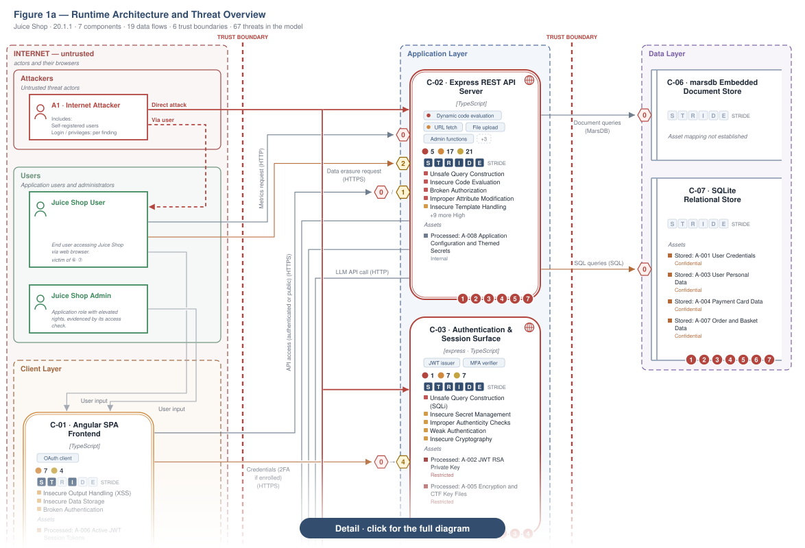

# appsec-advisor

[](CHANGELOG.md)
[](LICENSE)
[](https://docs.claude.com/en/docs/claude-code)
[](docs/security-assessment.md)
[](https://docs.oasis-open.org/sarif/sarif/v2.1.0/sarif-v2.1.0.html)
[](https://codecov.io/gh/appsec-foundry/appsec-advisor)

> ⚠️ **Beta.** `appsec-advisor` is under active development. Commands, schemas, and output may change without notice.

`appsec-advisor` is a Claude Code plugin that bundles application security tools for a repository. The tools read code and configuration, and each finding points to the code it is based on.

| Tool | What it does | Command |
|---|---|---|
| [AppSec Analyzer](#appsec-analyzer) | Assesses the whole application: architecture, security controls, findings, and what to fix first. | `/appsec-advisor:appsec-analyzer` |
| [Security Score](#security-score) | Quick 0–100 score from the scanners alone, without a model. | `/appsec-advisor:security-score` |
| [Threat Analyst](#threat-analyst) | Analyzes a planned feature or a code change for threats. | `/appsec-advisor:analyze-threats` |
| [Threat Model](#threat-model) | Writes and maintains a threat model from requirements and design documents. | `/appsec-advisor:create-threat-model` |
| [Requirements Audit](#requirements-audit) | Checks the repository against a security requirements catalog. | `/appsec-advisor:audit-security-requirements` |
| [Developer tools](#developer-tools) | Secure-coding baseline, security hints, and change reviews for Claude Code and CI. | `/appsec-advisor:install-baseline`, … |

[Quick start](#quick-start) · [AppSec Analyzer](#appsec-analyzer) · [Security Score](#security-score) · [Threat Analyst](#threat-analyst) · [Threat Model](#threat-model) · [Requirements Audit](#requirements-audit) · [Developer tools](#developer-tools) · [Enterprise rollout](#enterprise-rollout) · [Documentation](#documentation) · [How the plugin is built](#how-the-plugin-is-built) · [Contributing](#contributing)

---

## Security and data handling

> [!IMPORTANT]
> **Treat scanned repositories as untrusted input.** Repository content goes into the model context and may contain prompt injection. Untrusted mode is on by default; keep it on, and scan third-party or vendor code in a container or VM. See [Untrusted repositories](SECURITY.md#known-issues-untrusted-repositories).

An assessment sends selected source code, manifests, configuration, and any business context you supply to Anthropic. Secrets found in the code are masked. The assessment needs access to `api.anthropic.com` and cannot run air-gapped. Reports are rendered from validated data, and a run fails before publishing anything if an unmasked secret is found in its output.

## Quick start

You need [Claude Code](https://docs.claude.com/en/docs/claude-code), `git`, and Python 3.10+ with the `PyYAML` and `jsonschema` packages, for example installed with `python3 -m pip install PyYAML jsonschema`.

### 1. Install the plugin

```bash
claude plugin marketplace add appsec-foundry/appsec-advisor
claude plugin install appsec-advisor@appsec-foundry
```

If GitHub SSH access is not set up, run `export CLAUDE_CODE_PLUGIN_PREFER_HTTPS=1` first. Update later with `claude plugin update appsec-advisor@appsec-foundry` and restart Claude Code.

To use the development branch instead, clone it and pass the checkout to Claude Code:

```bash
git clone --branch dev https://github.com/appsec-foundry/appsec-advisor.git /path/to/appsec-advisor
cd /path/to/repository-to-assess
claude --plugin-dir /path/to/appsec-advisor
```

### 2. Run the AppSec Analyzer

Start Claude Code in the repository you want to assess and allow the commands the assessment needs:

```text
/appsec-advisor:check-permissions --update
```

This adds the missing rules, including `Bash(*)`, to the repository's `.claude/settings.local.json`. Restart Claude Code, then run:

```text
/appsec-advisor:appsec-analyzer
```

The results (`security-assessment.md` and `security-assessment.yaml`) go to a directory under your user data directory, not into the repository. `/appsec-advisor:status` shows where. Use `--output` to choose another directory.

An assessment usually takes tens of minutes; thorough runs can take over an hour. The plugin chooses the models itself, independent of your Claude Code session model, and stops at a cost limit: 10 USD for quick, 20 USD for standard, and 40 USD for thorough runs. See [model selection](docs/model-selection.md) and [depth and cost](docs/security-assessment.md#assessment-depth--cost-control).

### 3. Work with the results

```text
# Ask questions in plain language
what are the most critical findings?
what should I fix first?

# Fix findings, accept risks, or build a remediation plan
/appsec-advisor:triage-security-assessment

# Export as PDF, HTML, SARIF, Threat Dragon, or pentest tasks
/appsec-advisor:export-security-assessment
```

To reassess after code changes, run `/appsec-advisor:appsec-analyzer` again. Each run is a full assessment that continues the history of the previous one, and your review decisions are kept. `/appsec-advisor:help` lists all commands.

## AppSec Analyzer

Run the [AppSec Analyzer](https://github.com/appsec-foundry/appsec-analyzer) when you take over a repository or want to know where its security stands; no architecture document or existing threat model is needed. The report models components, data flows, and trust boundaries, shows which security controls exist or are missing, and lists findings ordered by risk, each linked to the code, together with abuse cases and remediation guidance.

The assessment sees only the repository and any business context you add, not runtime behavior or production-only controls. Have an AppSec engineer review the findings before you act on them or accept a risk.

Findings are mapped to the [OWASP Top 10:2025](https://owasp.org/Top10/2025/). For LLM and agent applications, the assessment also covers the [OWASP LLM](https://genai.owasp.org/llm-top-10/) and [Agentic Applications](https://genai.owasp.org/resource/owasp-top-10-for-agentic-applications-for-2026/) Top 10. Results can be exported as PDF, HTML, SARIF, Threat Dragon, and pentest tasks.

**Example:** [Standard assessment of OWASP Juice Shop](https://github.com/appsec-foundry/appsec-advisor-examples/blob/main/threat-modeler/security-assessment-juice-shop-standard-v0.6.0b5.md). The [examples repository](https://github.com/appsec-foundry/appsec-advisor-examples) also has its diagrams and exports.

The runtime architecture of Juice Shop with its data flows and attack paths; click the diagram to open it in full:

<a href="docs/images/figure1-example.svg">
<picture>
  <source media="(prefers-color-scheme: dark)" srcset="docs/images/figure1-example-crop-dark.svg">
  
</picture>
</a>

The [appsec-analyzer README](https://github.com/appsec-foundry/appsec-analyzer#reports-and-exports) shows the other report diagrams: the build pipeline with its supply-chain attacks, and the threat actors with the business harm they can cause.

The [AppSec Analyzer guide](docs/security-assessment.md) covers depth, result storage, repository context, exports, costs, and limits. The Analyzer describes the same assessment as the command-line tool in [`scan`](https://github.com/appsec-foundry/appsec-analyzer#scan-full-security-assessment) and its [security assessment guide](https://github.com/appsec-foundry/appsec-analyzer/blob/main/docs/security-assessment.md); the plugin command runs the pipeline in this repository unless you use the preview build.

### Abuse cases

Each run also checks abuse cases, things an attacker or user must not be able to do, such as reading another customer's orders. The built-in cases, the YAML format for your own, and how results appear in the report are described in the [appsec-analyzer README](https://github.com/appsec-foundry/appsec-analyzer#abuse-cases). In the plugin, repository cases go into `docs/security/abuse-cases/`, and `/appsec-advisor:abuse-cases` lists all cases and their results, as the Analyzer's [`abuse-cases`](https://github.com/appsec-foundry/appsec-analyzer#abuse-cases-list-the-defined-cases) command does. See also [organization profiles](docs/org-profiles.md#abuse-cases) for organization-wide cases.

### Several repositories

*Experimental.* To assess a system split across repositories as one, repeat `--repo` in the headless runner. The result is one report with a shared architecture model. See [non-interactive mode](docs/headless-mode.md#assess-several-repositories-as-one-system). To keep separate reports and still use the models of related repositories as context, see [cross-repository context](docs/security-assessment.md#cross-repo-context).

## Security Score

`/appsec-advisor:security-score` gives a score from 0 to 100 based on the deterministic scanners, without running the full assessment. It is a quick indicator, not a risk rating. The score is computed by the AppSec Analyzer; its rules, coverage, and limits are described in the Analyzer's [Security score](https://github.com/appsec-foundry/appsec-analyzer/blob/main/docs/security-score.md) guide.

To run it in CI, use the packaged plugin from `make plugin-package` (Python 3.10, Linux x86_64, committed Git checkout). Setup and the CI commands are in the [staging runbook](docs/internal/runbooks/composed-score-staging.md).

### Repository profile

`/appsec-advisor:repo-profile` shows what a scan would have to read: the size of the working tree, the language split, the build manifests and whether the repository is one service or a monorepo. It makes no model calls, reads no file contents and is not a security check. The workflow is the [repo-profile skill](https://github.com/appsec-foundry/appsec-skills/tree/main/skills/repo-profile) in appsec-skills, and the profile itself is computed by the AppSec Analyzer's [`repo-profile`](https://github.com/appsec-foundry/appsec-analyzer#repo-profile-size-languages-and-layout) command.

## Threat Analyst

*Experimental.* `/appsec-advisor:analyze-threats` looks at a planned feature or a code change and reports likely threats, recommended controls with their trade-offs, applicable requirements, and questions the team needs to answer. It is advisory and does not change the assessment. The threat analysis is part of the AppSec Analyzer.

| When | Command |
|---|---|
| Before coding | `/appsec-advisor:analyze-threats Let support staff export customer data as CSV.` |
| During implementation | `/appsec-advisor:analyze-threats --worktree --question "Can a tenant read another tenant's export?"` |
| Before merging | `/appsec-advisor:analyze-threats --base <target-branch> --head HEAD` |

See the [Threat Analyst guide](docs/threat-analyst.md). The Analyzer documents the same analysis as the command-line tool in [`analyze-threats`](https://github.com/appsec-foundry/appsec-analyzer#analyze-threats-answer-a-security-question) and its [Threat Analyst guide](https://github.com/appsec-foundry/appsec-analyzer/blob/main/docs/threat-analyst.md); the plugin command still uses its own copy.

## Threat Model

`/appsec-advisor:create-threat-model` writes a threat model the classic way, from requirements, design documents, and what the team tells it. Code is optional and nothing is scanned.

```text
/appsec-advisor:create-threat-model Create a threat model. Start with docs/requirements.md and docs/architecture.md.
/appsec-advisor:create-threat-model Update the model for the new CSV export.
/appsec-advisor:create-threat-model Review the current model without editing it.
```

It finds and reads the requirements, specifications, architecture documents, and ADRs of the project, such as `requirements.md` and `docs/architecture.md`. Where they leave gaps or contradict each other, it asks about your system, at most three questions per round. You can skip or stop the questions; unanswered points stay open in the model. The result is `threat-model.md`, linked from `SECURITY.md`. Details are in the [skill's README](https://github.com/appsec-foundry/appsec-skills/tree/main/skills/create-threat-model).

> Before 0.6, `create-threat-model` was the repository analysis, which is now `/appsec-advisor:appsec-analyzer`. The new command is only in the preview build under [how the plugin is built](#how-the-plugin-is-built).

## Requirements Audit

`/appsec-advisor:audit-security-requirements` checks the repository against a security requirements catalog. It is faster than a full assessment and suits pull-request gates and audit preparation.

```text
/appsec-advisor:audit-security-requirements
/appsec-advisor:audit-security-requirements --requirements https://appsec.int.example.com/appsec-requirements.yaml
```

Without a catalog of your own, start from `data/appsec-requirements-fallback.yaml` or the [requirements harvester](docs/harvester.md). See the [Requirements Audit reference](docs/security-requirements-audit-skill.md). The Analyzer offers the same audit as the command-line tool in [`audit-requirements`](https://github.com/appsec-foundry/appsec-analyzer#audit-requirements-requirements-audit) and its [requirements audit guide](https://github.com/appsec-foundry/appsec-analyzer/blob/main/docs/security-requirements-audit-skill.md); the plugin command still uses its own copy.

To check only a code change against the catalog, use [`/appsec-advisor:verify-requirements`](docs/dev-security-helper-usage.md#verify-requirements-skill) (*experimental*).

## Developer tools

| Tool | Use |
|---|---|
| [Secure-coding baseline](https://github.com/appsec-foundry/aiscb) | Add secure-coding rules to Claude Code with `install-baseline`; `update-baseline`, `verify-baseline`, and `remove-baseline` manage them. |
| [Security score](#security-score) | Quick 0–100 score from the scanners alone, without a model. |
| [Security Coach](docs/dev-security-helper-usage.md#security-coach-hook) (*experimental*) | Security hints while you write security-sensitive code. |
| [appsec-reviewer](docs/dev-security-helper-usage.md#appsec-reviewer-agent) (*experimental*) | Security review of a code change in Claude Code, an Agent SDK workflow, or CI with [appsec-reviewer-cli](docs/dev-security-helper-usage.md#appsec-reviewer-cli). |

See the [developer tools guide](docs/dev-security-helper-usage.md).

## Enterprise rollout

AppSec and platform teams can add their own requirements, defaults, skills, hooks, and MCP servers. The [packaging template](https://github.com/appsec-foundry/appsec-advisor-packaging-template) builds an internal plugin from a pinned upstream release, so you do not need to maintain a fork.

<picture>
  <source media="(prefers-color-scheme: dark)" srcset="docs/images/orgpackaging-dark.svg">
  
</picture>

See [Internal Plugin Packaging](docs/internal-plugin-packaging.md) and [Organization Profiles](docs/org-profiles.md).

## Documentation

| Goal | Start here |
|---|---|
| Run or configure the AppSec Analyzer | [AppSec Analyzer](docs/security-assessment.md) |
| Analyze a planned feature or code change | [Threat Analyst](docs/threat-analyst.md) |
| Configure models, cost, or logging | [Configuration](docs/configuration.md) and [Model Selection](docs/model-selection.md) |
| Configure requirements audits | [Requirements Audit](docs/security-requirements-audit-skill.md) |
| Run without interaction, for example in CI | [Non-interactive Mode](docs/headless-mode.md) |
| Product requirements | [requirements.md](requirements.md) |

If a run fails, `/appsec-advisor:report-error` checks a suspected plugin error locally and drafts a GitHub issue without logs, source code, or findings. You see the full draft and decide whether to publish it.

## How the plugin is built

`appsec-advisor` combines separately developed parts into one Claude Code plugin and adds the commands, hooks and display around them:

- the AppSec Analyzer engine from [appsec-analyzer](https://github.com/appsec-foundry/appsec-analyzer), which provides the assessment, the threat analysis and the security score and also runs on its own as a command-line tool;
- skills from [appsec-skills](https://github.com/appsec-foundry/appsec-skills) that call the engine, currently the security score and the repository profile;
- the [secure-coding baseline](https://github.com/appsec-foundry/aiscb), shipped as a copy in `data/baselines/`.

The marketplace release does not use the separate engine yet. It still runs the assessment pipeline in this repository, as does a `--plugin-dir` checkout, and neither needs a build step.

To build the preview that uses the separate engine, run:

```bash
make plugin-package
```

This takes the engine and skills at the commits listed in `data/plugin-package.json` and checks every downloaded file against its recorded checksum. The finished plugin only runs the copies bundled with it, never another version installed on the machine. So far the preview has five commands, `appsec-analyzer`, `security-score`, `repo-profile`, `abuse-cases` and `create-threat-model`; `analyze-threats` is not included yet. The [packaging guide](docs/internal-plugin-packaging.md#assemble-the-component-artifacts) covers updating the commits and installing the result.

## Related projects

- [appsec-advisor-tools](https://github.com/appsec-foundry/appsec-advisor-tools): launcher and CI templates for unattended assessments.
- [appsec-advisor-packaging-template](https://github.com/appsec-foundry/appsec-advisor-packaging-template): builds organization-specific plugin packages.
- [aiscb](https://github.com/appsec-foundry/aiscb): the secure-coding rules bundled with the plugin.

### Comparable tools

| Project | Focus | Difference |
|---|---|---|
| [tachi](https://github.com/davidmatousek/tachi) | Threat analysis of an architecture description | `appsec-advisor` derives the architecture from code and configuration. |
| [stride-gpt](https://github.com/mrwadams/stride-gpt) | STRIDE analysis from a description or codebase, several model providers | `appsec-advisor` runs in Claude Code and validates its output against schemas. |
| [OWASP pytm](https://github.com/OWASP/pytm) | Threat models written as Python code | `appsec-advisor` assesses an existing implementation. |
| [OWASP Threat Dragon](https://owasp.org/www-project-threat-dragon/) | Visual threat modeling | Assessments can be exported to Threat Dragon. |
| [OWASP ThreatAtlas](https://owasp.org/www-project-threatatlas/) | Collaborative threat-modeling workshops | Assessments can be imported as a starting point via the Threat Dragon export. |
| [OWASP Precogly](https://github.com/precogly/precogly) | Program-level threat modeling and compliance tracking | `appsec-advisor` assesses individual repositories. |
| [Claude Security](https://support.claude.com/en/articles/14661296-use-claude-security) | Scanning for exploitable vulnerabilities | `appsec-advisor` also finds architectural gaps that are not tied to a single line of code. |

## What's new in 0.6.0-beta.5

- **Abuse-case catalog.** Built-in business rules, such as "users must not see other users' data", alongside technical attack chains. You can add your own in one sentence each.
- **`/appsec-advisor:abuse-cases`** lists all abuse cases with their results.
- **Threat Analyst** checks a single abuse case against your code with `--abuse-case <ID>` and uses the existing assessment as context.
- **Several repositories, one report** with repeated `--repo` in headless mode.
- **Report improvements.** Critical findings are grouped by root cause, diagrams show trust boundaries more clearly, and secrets are masked in every output.

See the [changelog](CHANGELOG.md) for all changes.

## Contributing

Development happens on [`dev`](../../tree/dev). Branch from it and open your pull request against it; `main` holds tagged releases. See [CONTRIBUTING.md](CONTRIBUTING.md) for setup and the [repository layout](CONTRIBUTING.md#repository-layout). Read [AGENTS.md](AGENTS.md) before changing runtime behavior, schemas, prompts, or report output. Report vulnerabilities through [SECURITY.md](SECURITY.md).
