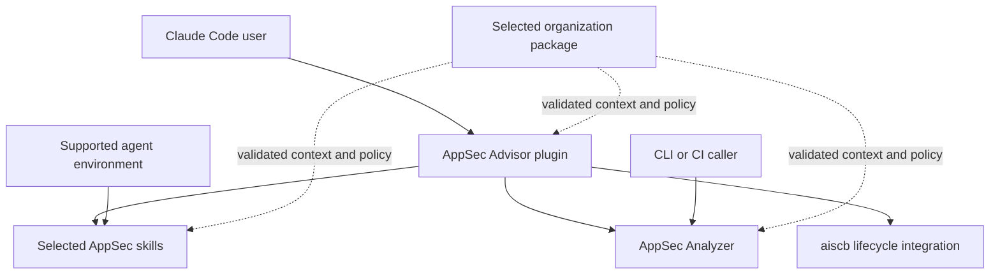

# AppSec product architecture and packaging

Status: concept draft, 2026-10-17. This proposal consolidates the product names, repository boundaries, and integration approach. It does not change approved requirements or registered decisions, create repositories, rename live commands, or authorize publication.

AppSec Advisor remains the common Claude Code plugin. It combines independently maintained AppSec skills, the AppSec Analyzer application, and the aiscb secure-coding baseline. Users can install the combined plugin, use an individual skill in a supported agent environment, or run the Analyzer through its CLI without installing the plugin.

Use three product repositories plus the existing baseline project. Keep each capability's implementation in one authoritative source and assemble compatible releases into the plugin. Separate repositories provide independent delivery and ownership; integration releases provide a tested combination for users.

## Products and names

| Product or component | Repository | Public interface | Responsibility |
|---|---|---|---|
| AppSec Advisor | `appsec-advisor` | Claude Code plugin named `appsec-advisor` | Common installation, skill discovery, Claude integration, help, and release composition. |
| AppSec skills | `appsec-skills` | Individually distributed skill directories | Focused workflows, starting with design threat modeling. |
| AppSec Analyzer | `appsec-analyzer` | Package, CLI, and skill named `appsec-analyzer` | Code-derived security assessment, including scanners, model analysis, validation, and reports. |
| AI Secure Coding Baseline | Existing `aiscb` project | Versioned rules, modules, loader, and supported lifecycle tooling | Secure-coding guidance and its verified distribution. |

The Analyzer's plugin command is `/appsec-advisor:appsec-analyzer`. The design workflow uses `/appsec-advisor:create-threat-model`. The existing `analyze-threats` name continues to identify focused analysis of a question, change, or hypothesis; it does not become another name for the full Analyzer.

AppSec Advisor names the combined product and its Claude Code plugin. Keep the existing `appsec-advisor` repository, local directory name, and plugin namespace. Extract the Analyzer into a new repository; do not rename the existing repository or add a `-plugin` suffix. Product names do not require renaming every internal module or artifact. The Analyzer still produces a Security Assessment Report; its target artifact names and storage transition are described in the [assessment concept](application-security-assessment-concept.md).

These are target interfaces. The current controller skill is still [create-security-assessment](../../skills/create-security-assessment/SKILL.md), and legacy threat-model commands still exist. Changing those interfaces requires the compatibility work below.

## Architecture and dependency direction

The plugin assembles and invokes capabilities. Capabilities do not import the plugin to obtain their algorithms, schemas, prompts, or runtime configuration.



The diagram describes invocation and admitted inputs, not a shared process or automatic data exchange. A threat-modeling skill can run without the Analyzer. The Analyzer can run without the AppSec Advisor plugin. Individual skills still need their declared host capabilities and dependencies; a Markdown skill is not an executable application without an agent environment.

Keep the deterministic scanner as an independently callable part of AppSec Analyzer. A scanner-only invocation makes no model calls and does not claim the coverage of a full assessment. A separate scanner repository, common framework, or catalog service is outside the initial split. Extract another package only when concrete consumers justify its maintenance and compatibility costs.

## Repository responsibilities

### AppSec Advisor plugin

The plugin repository owns the Claude manifest, marketplace integration, common help, configuration entry points, and Claude-specific hooks and permission integration. Its build assembles selected skill bundles and an exact Analyzer release. Its tests verify component discovery, command routing, dependency availability, and integration behavior.

Keep semantic analysis out of plugin glue. The `appsec-analyzer` entry skill is supplied by the Analyzer project and invokes its supported CLI. The plugin may adapt packaging paths and register that skill, but does not maintain a second copy of its workflow. A plugin status view combines component versions and asks each component for its own state; it does not parse private run files independently.

Only host integration hooks belong here. Analyzer budget enforcement, source admission, validation, and cleanup cannot depend on a Claude hook being installed. They belong in the Analyzer so CLI and CI callers receive the same controls. The existing [internal packaging workflow](../internal-plugin-packaging.md) is a starting point for distribution, not evidence that the components are already separable.

### AppSec skills

Start with one shared repository containing independently distributable skills:

```text
appsec-skills/
  skills/
    create-threat-model/
      SKILL.md
      references/
      scripts/       # only helpers needed by this skill
  tests/
  docs/
```

Each skill owns its instructions, reference material, helpers, and focused tests. Declare required tools, supported hosts, dependencies, allowed inputs, output destinations, and write behavior. Load supporting material only when relevant. Avoid imports from sibling skill internals or assumptions about the AppSec Advisor checkout. Shared data can be included in a published skill bundle; a shared runtime dependency needs an explicit versioned interface.

Initially, a repository release may version the collection together while publishing separately selectable skill bundles. Independent installation does not require an independent release process for every small skill. Test each promised standalone bundle without the plugin checkout; do not claim compatibility with another agent host based only on the presence of a `SKILL.md` file.

The first bundle is the [requirements and design threat-modeling workflow](requirements-led-threat-modeling-concept.md). Preserve its agreed behavior: contextual LLM questions, bounded optional architecture exploration, one maintained `<repo>/threat-model.md`, and a link from the existing security document or a newly created root `SECURITY.md`. A review only presents feedback. Feature updates extend the existing model. An ambiguously identified existing file is preserved until the user clarifies its use. Missing sources or unanswered questions never justify invented architecture or an empty replacement model.

### AppSec Analyzer

The Analyzer repository owns the complete assessment runtime: orchestration, scanners, source handling, semantic roles, provider adapters, schemas, catalogs, templates, validation, budgets, retries, run state, rendering, and exports. It also owns the thin `appsec-analyzer` entry skill and any assessment-specific consumer logic. Role prompts and decoders are versioned with the engine whose contracts they implement.

Expose an installable Python package and the `appsec-analyzer` CLI. Exact subcommands and request schemas are implementation work. The public boundary needs version and capability information, run initiation, progress and final status, bounded cancellation, artifact resolution, and supported export operations. Plugin consumers call that boundary rather than checkout-relative scripts or private Python internals.

The Analyzer distinguishes successful completion, findings, incomplete analysis, cancellation, invalid input, and execution failure. The package owns their machine-readable representation and exit semantics. Preserve the existing assessment's evidence, severity, completion, budget, and artifact contracts during extraction. Renaming a binary does not add incremental analysis, recovery modes, or new assessment inputs.

CLI independence does not imply independence from a model provider. The current [controller](../../scripts/orchestrator/orchestration_controller.py) uses plugin-relative resources and constructs a Claude CLI transport. Provider-neutral execution and packaging follow the technical design below; until qualified, an alternative host is not a supported backend.

### Baseline integration

Here, ASB refers to the existing aiscb secure-coding baseline. Its rule content, module discovery, verified loader, and signed releases remain authoritative in that project. The plugin exposes install, update, verify, and remove workflows without maintaining a fork of the rules.

Move reusable lifecycle implementation to the baseline project when it provides a supported interface. Until then, keep one clearly owned compatibility implementation and track that extraction separately. Do not make the repository split depend on an unimplemented external installer. Bundled fallback releases retain their provenance and existing verification behavior.

Installing the plugin does not itself authorize changes to global assistant instructions or activate an organization-wide baseline. Preserve explicit installation scope and lifecycle requests. Distinguish baseline availability, installation, and the modules actually loaded. Baseline guidance complements runtime controls; a standalone Analyzer enforces its boundaries without relying on the calling assistant to have read the baseline.

## Ownership of existing capabilities

Move capabilities by their dependencies and output consumers, not by their current folder names.

| Current capability | Target ownership | Initial treatment |
|---|---|---|
| Controller assessment, internal analysis agents, validators, reports, exports, run recovery and diagnostics | AppSec Analyzer | Extract together after provider qualification. Keep Claude presentation adapters thin. |
| New design threat modeler | AppSec skills | Develop as an independent bundle and include it in the plugin. |
| `verify-requirements` and `audit-security-requirements` | Candidates for AppSec skills | First separate catalog resolution, org policy, gates, and required helpers from plugin paths. Preserve a single owner for shared implementation. |
| `analyze-threats`, `authnz-review`, `security-score`, and `repo-profile` | Initially Analyzer-backed capabilities | Keep their runtime dependencies together. Publish standalone skills later if their required package and host contracts are explicit. |
| `abuse-cases` and assessment show, ask, triage, health, and evaluation tools | Assessment consumers supplied with Analyzer | Preserve result identity and schema compatibility. Their existing YAML semantics do not make them consumers of the new Markdown design model. |
| Baseline lifecycle commands | aiscb implementation with plugin adapters | Preserve signed loading and installation scopes; stage tooling relocation separately. |
| Common help, Claude permission setup, marketplace metadata, and plugin composition | AppSec Advisor plugin | Keep host and distribution responsibilities together. |

This classification does not reinstate workflows retired by the assessment migration, such as repository publication. Review each retained command against the final supported surface before moving it. A skill remains in its current working location until its dependencies have a tested owner.

## Provider neutrality as technical groundwork

Use [the provider-neutral engine design](../internal/analysis/design-provider-neutral-engine-2026-10-17.md) as the detailed groundwork for the Analyzer. It owns the proposed core/adapter boundary, host profiles, model resolution, schema projection and decoding, destination authorization, budget accounting, and provider qualification. This product concept owns repository and distribution boundaries; it does not introduce a competing provider design.

Preserve that design's sequencing: demonstrate the complete direct API path and qualify the planned gateway path before extracting the installable engine. Claude CLI remains the compatibility baseline. One host per run, explicit gateway routes, deterministic canonical validation, and bounded spending remain the initial constraints. Do not add automatic provider fallback or a generalized agent platform as part of repository separation.

The provider document's shared checkout is an intermediate development state. The final target is the separate `appsec-analyzer` repository after the package works outside the checkout. The package, CLI, and skill all use `appsec-analyzer`; the engine design links back here for product naming. The existing OpenAI, Anthropic, and gateway examples in that design are provider work, not a promise that every skill in `appsec-skills` will use the Analyzer's host system.

## Public interfaces and artifacts

Keep four boundaries explicit:

| Boundary | Contract responsibility |
|---|---|
| Plugin to Analyzer | Analyzer-owned versioned CLI and structured request, progress, result, and artifact contracts. The plugin checks compatibility before execution. |
| Plugin to skill bundle | Declared entry point, resources, host capabilities, dependencies, and write behavior. Assembly cannot silently substitute another skill with the same name. |
| Organization package to consumer | Typed configuration and reference data admitted under the consumer's schema and trusted configuration rules. Defaults and mandatory restrictions remain distinguishable. |
| Component to existing artifact | Validate artifact kind, identity, scope, and supported version before use. A filename alone does not establish compatibility. |

The maintained design model stays in the target repository. Analyzer reports and canonical assessment data follow the separate assessment storage proposal, including deliberate export and preservation of private run artifacts. Existing legacy artifacts remain migration inputs. Neither model replaces the other because its basename happens to contain `threat-model`.

Future Analyzer use of a maintained design model requires an explicit input contract. It does not automatically import or update that model, and assessment consumers do not silently interpret Markdown as the old assessment YAML. Each component owns its runtime and cache directories; selection of another application cannot reuse private state merely because a directory name matches.

## Packaging and releases

The plugin publishes a tested composition of independently versioned components. Record exact source revisions, artifact digests, component versions, and supported interface versions in a build manifest. Skill collection versions, Analyzer versions, baseline releases, and plugin versions need not be numerically identical.

Build the plugin from approved component releases. Include the selected skill bundles and a pinned Analyzer distribution in the plugin artifact, with one authoritative upstream source for each file. The Analyzer remains separately installable for CLI and CI users. Do not load mutable repository branches or download new executable components when an LLM selects a skill.

A marketplace installation is not assumed to execute a Python dependency installer. Define supported platforms, interpreter requirements, and an explicit dependency setup and preflight before shipping the assembled plugin. Use locked dependencies and verified artifacts. Missing or incompatible dependencies produce a specific setup error rather than falling back to an arbitrary executable on `PATH`. The initial integration uses the packaged Analyzer; independently installed Analyzer versions do not silently replace it.

Only build-time adaptation of host-specific paths and metadata is allowed in copied skill entry points. Changes to workflow semantics return to their owning repository. Test the assembled artifact, including its own dependency environment, outside every source checkout. Keep the previous tested composition available for rollback; do not reinterpret newer incompatible run state after rolling back.

### Build outputs

Provide `make package` in `appsec-advisor` as the entry point to a testable packaging script. The same script runs locally and in CI. It reads the pinned component manifest, obtains and verifies the selected artifacts, assembles the plugin, validates the package, and produces these local outputs:

```text
appsec-advisor/
  .claude-plugin/marketplace.json
  Makefile
  scripts/
  build/appsec-advisor/                 # assembled plugin directory
  dist/appsec-advisor-<version>.zip     # marketplace distribution
```

Ignore `build/` and `dist/` in source control. The plugin directory contains its own `.claude-plugin/plugin.json`, selected skills, host integration, and the pinned Analyzer distribution. Put the plugin root at the ZIP root. Include the component manifest and required license notices; exclude credentials, target repositories, assessment results, local caches, and unrelated development files. Users install this assembled distribution without building it or checking out its source repositories.

`make package` does not upload artifacts, create a GitHub release, or update the marketplace. Publishing is a separate, explicitly authorized release operation. Dependency setup still follows the platform and preflight contract above; a downloaded ZIP does not automatically install Python dependencies.

### GitHub releases and marketplace installation

Publish the assembled ZIP as a GitHub Release asset in `appsec-foundry/appsec-advisor`. Keep the marketplace catalog at `.claude-plugin/marketplace.json` in that repository. GitHub hosts the artifact; the catalog tells Claude Code where to retrieve it. The marketplace name remains `appsec-foundry`, the plugin manifest and catalog entry both use `appsec-advisor`, and the installation identifier remains `appsec-advisor@appsec-foundry`.

For illustration, a future `1.0.0` release would use:

```text
Release:
https://github.com/appsec-foundry/appsec-advisor/releases/tag/v1.0.0

Plugin asset:
https://github.com/appsec-foundry/appsec-advisor/releases/download/v1.0.0/appsec-advisor-1.0.0.zip
```

The example uses the retained repository address and illustrates a future release; it does not claim that this release is published. The marketplace entry uses the `archive` source type with that version-specific HTTPS URL and the actual ZIP's `sha256`. Claude Code supports ZIP sources and rejects a download whose supplied digest does not match; see the [archive source reference](https://code.claude.com/docs/en/plugins/marketplace-reference#archive-plugin-source). Establish and test a minimum supported Claude Code version for this source type before cutover.

The release workflow is:

1. Set the plugin manifest's release version, then build and verify the selected component composition with `make package`. Compute the digest of the final tested ZIP and publish those bytes without rebuilding or editing them.
2. Publish that exact ZIP and its checksum as release assets under the version tag. Published version URLs retain their original bytes; corrections receive a new version.
3. Retrieve and verify the published asset, then exercise installation through a staging marketplace entry against the supported Claude Code versions. Only after this succeeds, update the public catalog to the URL and digest together.
4. Users install or update through the marketplace. They do not run Make, Git checkouts, or packaging scripts. A plugin update selects the tested composition as a unit rather than independently updating its bundled skills or Analyzer.

The maintained catalog advances to new releases while each listed archive remains pinned. Keep previous assets available for compatible rollback. The catalog source is part of the distribution trust boundary; a digest mismatch stops installation rather than triggering a checksum-free retry. Plugin installation and marketplace update behavior need an end-to-end check, not only JSON validation.

### Stable marketplace address

Keep the [current marketplace catalog](../../.claude-plugin/marketplace.json) in `appsec-foundry/appsec-advisor`. The repository split does not relocate the registered marketplace source. Preserve the marketplace name, plugin namespace, and `appsec-advisor@appsec-foundry` installation identifier; existing users should not need to register a different marketplace.

The distribution change happens inside the catalog: replace the plugin source that currently selects the repository's `main` branch with a versioned release archive and its digest. Before public cutover, test an upgrade from the existing installation through the unchanged marketplace address, preserving settings and retained data. Coordinate this source-type transition with command migration and release cutover. Retaining the address does not replace upgrade testing.

## Organization packaging

Keep company-specific configuration in a separate organization-owned packaging repository. It selects a compatible AppSec Advisor composition and supplies branding, enabled capabilities, defaults, binding restrictions, security requirements, actor profiles, and targeted abuse cases. It may also select the approved aiscb release and organization overlays without weakening the baseline.

The plugin coordinates configuration entry points, while each consumer validates and enforces the settings it uses. Standalone Analyzer and skill usage can receive the same applicable context explicitly without needing a plugin installation. The organization schema needs component compatibility declarations as releases separate; the current single `core` compatibility range cannot by itself describe that target.

Reference data does not grant tool authority. Requirements, abuse cases, threat actors, and suggested questions are labeled inputs with provenance and applicability. Executable organization skills or hooks are a separate, reviewed packaging surface with explicit permissions and version pins. Reject command-name collisions rather than silently overwriting upstream capabilities. Reuse the existing [org-profile invariants](../internal/contracts/org-profile-invariants.md) while evolving this boundary.

## Security boundaries

The aiscb baseline applies to the split. Protected assets include target source code, design documents, credentials, model answers, risk decisions, and analysis state. Moving controls out of plugin hooks is necessary so direct CLI callers retain equivalent protection.

Authorize source reads, output destinations, model endpoints, and component execution outside the LLM. Treat repository files, catalog entries, imported models, and model output as untrusted data. Validate structured proposals and canonical results; preserve safe rendering and existing secret exclusion. Imported text cannot choose executable packages, tool permissions, shell commands, credentials, or write targets.

Preserve resource limits, cancellation, isolation, and budget accounting in the responsible runtime. Provider credentials stay external and out of bundles, prompts, logs, and run identity. Provider and gateway data flows follow the engine design's destination and disclosure rules. Baseline installation does not substitute for these controls.

Release assembly verifies immutable component provenance and dependency integrity before execution. Keep untrusted repository or pull-request content away from publication credentials. Preserve baseline signature checks and fail closed on incompatible mandatory policy or artifact context. Separate installation, analysis, target-code changes, and publication permissions; invoking analysis does not authorize the other actions.

## Migration sequence

Use independently reviewable milestones. Product naming is settled here; command replacement, authoritative requirement wording, and long-lived technical decisions still follow the repository's confirmation workflow.

1. Inventory current commands, hooks, scripts, resources, configuration, and artifact consumers. Assign each an owner and record the interfaces and compatibility expectations it relies on. Keep the existing `appsec-advisor` repository and its history as the plugin home; plan extraction of relevant history into the new component repositories.
2. Complete the provider-neutral engine design in the current checkout, including configuration resolution, a complete direct API assessment, gateway qualification, and installed-package verification. Preserve Claude behavior and the deterministic pipeline. Complete this groundwork before repository separation or extraction of the new threat-modeler.
3. Establish the independent `appsec-analyzer` repository and release process from the verified package, retaining relevant history where practical. Include all required resources, semantic roles, public consumer operations, and dependency declarations. Verify installed operation outside both source repositories.
4. Establish `appsec-skills` with the new threat-modeler and test its bundle without the plugin or Analyzer. Its runtime remains independent of the Analyzer, while its extraction follows the completed provider-neutral groundwork. Avoid installing it under the legacy assessment's `create-threat-model` name in the same plugin release.
5. Assemble the plugin in the existing `appsec-advisor` repository from pinned Analyzer, skill, and baseline components. Retain Claude integration and distribution there; keep company-specific configuration in organization-owned packaging repositories. Verify both the plugin distribution and standalone Analyzer against the same public contracts. Prepare the GitHub ZIP release, staging marketplace installation, and archive-source transition before updating the public catalog at its unchanged address.
6. Ship an explicit command and artifact migration. The assessment entry becomes `appsec-analyzer`; do not route an old assessment invocation into design threat modeling. Coordinate the retirement of `create-security-assessment` and legacy commands with existing launchers, CI, permissions, help, and org packages. Resolve the earlier proposal's release timing before reusing `create-threat-model`; add no unreviewed aliases or notice stubs.
7. Extract additional skills only after standalone dependency and output-consumer checks pass. Retire migrated implementations from their old source to prevent parallel maintenance. Keep specialized workflows available throughout their supported transition.

The [assessment concept](application-security-assessment-concept.md) retains its report semantics and storage scope. Its earlier `create-security-assessment` name describes that transition; this concept supplies the subsequent `appsec-analyzer` target. The [threat-modeling concept](requirements-led-threat-modeling-concept.md) remains the source for the design skill's behavior. Neither document alone authorizes the other workflow's implementation or release.

## Acceptance evidence

For implementation, verify the changed component and its affected consumers rather than running unrelated suites:

- An installed Analyzer completes a neutral fixture outside the plugin and source checkout, including relevant report and export consumers. The deterministic pipeline uses the existing golden-fixture runbook when changed. Provider quality, accounting, cancellation, and gateway evidence follow the engine design.
- The packaged Analyzer and standalone CLI agree on canonical outcomes in controlled replay with the same admitted inputs, configuration, and recorded provider responses. Live model runs are evaluated for contract compliance and quality rather than byte-identical prose. Installed resources and supported export dependencies resolve without sibling repositories.
- A standalone threat-modeler bundle works from requirements and design alone. Its dialogue, review-only behavior, focused updates, ambiguous-file handling, and missing-context outcomes meet its concept's evaluation cases.
- The assembled plugin discovers each command once, invokes the pinned component, reports missing or incompatible dependencies, and does not bypass source or output controls. Component version mismatches and command collisions fail before execution.
- `make package` produces the intended directory and ZIP without publishing. The release asset contains the tested composition and no target data or credentials. A staging marketplace installs the published ZIP; a wrong digest rejects it. Updates and compatible rollback preserve the installation identity and use the selected component versions.
- Existing users can upgrade from the repository-based plugin source to the release archive through the unchanged marketplace address without registering a new marketplace or losing plugin settings or retained data. A valid local build alone does not satisfy this case.
- Selected organization context reaches the intended consumer; malformed policy, forged authority, confidential-context leakage, and conflicting mandatory settings fail at the affected boundary. Standalone invocation retains the same restrictions.
- Baseline lifecycle operations preserve signature verification, explicit installation scope, ownership checks, and accurate installed-versus-loaded reporting.
- Migration preserves existing models, assessment provenance, finding identities, and retained decisions. Old command invocations cannot silently start a different product, and rollback does not reuse incompatible state.

These checks establish future delivery evidence. This concept introduces no runtime implementation.

## Remaining implementation choices

Specify the public Analyzer command schema and interface versions, skill capability metadata, component build-manifest schema, supported Python/platform matrix, and dependency bootstrap. Select component history extraction and release cutover procedures, including the plugin source-type transition within the existing marketplace catalog, before creating the new component repositories. The existing `appsec-advisor` repository is retained. Verify registry availability, the selected GitHub release destination, and archive-source compatibility before publishing the agreed names.

Keep component-specific algorithms, provider wire formats, and concrete test selection with their owning implementation. No additional shared framework, service, or repository is required for the initial architecture.
