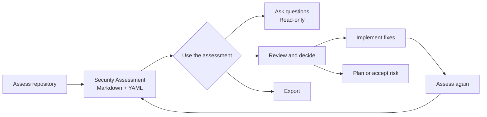
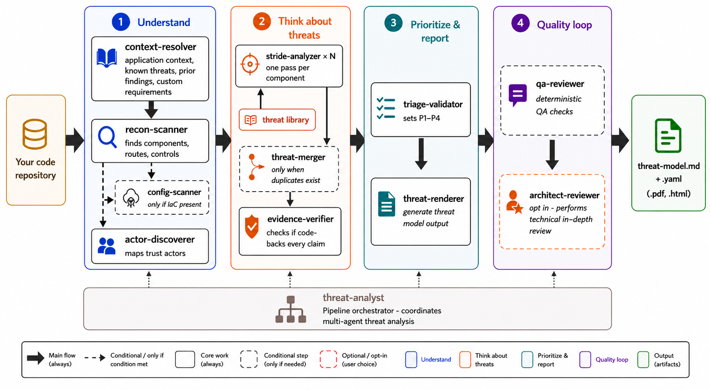

# Security assessment

`/appsec-advisor:appsec-analyzer` performs **repository-based security analysis with a focus on architecture**. It reconstructs components, data flows, and trust boundaries from code and configuration, assesses security controls, and identifies implementation weaknesses and design risks. Threat analysis examines potential attack paths and abuse cases within that architecture. Findings cite repository evidence and include remediation guidance.

The result is a Security Assessment of the implemented application. Threat modeling is planned as a separate skill.

→ [Back to README](../README.md)

## Contents

- [What you get](#what-you-get)
- [Where results are stored](#where-results-are-stored)
- [Using the assessment in architecture reviews](#using-the-assessment-in-architecture-reviews)
- [Assessment lifecycle](#assessment-lifecycle)
- [Example report](#example-report-owasp-juice-shop)
- [What it checks](#what-it-checks)
- [Trust boundaries](#trust-boundaries)
- [Usage examples](#usage-examples)
- [Assessment depth & cost control](#assessment-depth--cost-control)
- [Repo-local context](#repo-local-context)
- [Cross-repo context](#cross-repo-context)
- [Architecture](#architecture)
- [Workflow commands](#workflow-commands)

## What you get

An assessment generates an architecture and security report from repository evidence. The report covers components, data flows, trust boundaries, security controls and their gaps, systemic weaknesses, design risks, potential attack paths, and concrete findings with affected code and remediation guidance. Diagrams show the relationships between these elements. The Markdown and YAML outputs are rendered from the same validated data.

**Default outputs**

- `security-assessment.md`: report for engineers, architects, and security reviewers, titled `Security Assessment Report — <project>`.
- `security-assessment.yaml`: canonical structured model used by automation and exports, including requirements assessment and provenance, verified abuse-case outcomes, and bounded business-context provenance without the source prose.
- `security-assessment.figure*.svg`: the report's figures.

**Optional outputs**

| File | Enable with | Notes |
|---|---|---|
| `security-assessment.pdf` | `--pdf` | Requires `pandoc` and `weasyprint`. |
| `security-assessment.html` | `--html` | Requires `pandoc`. |
| `security-assessment.sarif.json` | `--sarif` | SARIF v2.1 for code-scanning integrations. |
| `pentest-tasks.yaml` | `--pentest-tasks` | Endpoint catalog and pentest plan. |
| `security-assessment.threatdragon.json` | `--threatdragon` | Alpha, opt-in, and lossy. Also imports into OWASP ThreatAtlas. |

Generate optional formats from an existing assessment without running the analysis again:

```text
# All stable formats
/appsec-advisor:export-security-assessment

# Selected formats
/appsec-advisor:export-security-assessment --formats sarif
/appsec-advisor:export-security-assessment --formats html
/appsec-advisor:export-security-assessment --formats pentest --pentest-target https://staging.example.com

# Alpha: Threat Dragon v2 JSON
/appsec-advisor:export-security-assessment --formats threatdragon
```

SARIF, pentest tasks, and Threat Dragon are generated from `security-assessment.yaml`. PDF and HTML are converted from `security-assessment.md`; rendered diagrams also require `mmdc` and Chrome or Chromium. Check dependencies with `/appsec-advisor:export-security-assessment --check-only`, or use `--no-mermaid` to export PDF or HTML without rendered diagrams. See [Threat Dragon export](threat-dragon-export.md) for that format's limits.

## Where results are stored

Results are stored outside the analyzed repository by default, in one directory per application:

| Platform | Directory |
|---|---|
| Linux and other Unix systems | `$XDG_DATA_HOME/appsec-advisor/assessments/<repo-name>-<hash8>`, or `~/.local/share/appsec-advisor/assessments/<repo-name>-<hash8>` when `XDG_DATA_HOME` is unset or relative |
| macOS | `~/Library/Application Support/appsec-advisor/assessments/<repo-name>-<hash8>` |
| Windows | `%LOCALAPPDATA%\appsec-advisor\assessments\<repo-name>-<hash8>` |

`<hash8>` derives from the normalized `origin` remote, or from the canonical repository root when there is no usable remote, so clones and worktrees of one remote share one directory. Several `--repo` selections share one `combined-<hash8>` directory, independent of their order. `--output <path>` writes to another directory instead. Without a resolvable data directory, for example on Windows without `LOCALAPPDATA`, the run stops and asks for `--output`.

The run creates the directory with mode `0700` at every level and its files readable only by you (`0600`). It refuses a level that is a symbolic link, belongs to another user, or is open to others. `/appsec-advisor:status` shows the resolved directory, and this command prints it:

```bash
python3 scripts/shared/assessment_location.py locate --repo <path-to-checkout>
```

`locate` prints the directory that the ask, show, export, triage and health skills read. `destination` prints where a new assessment is written. Run either from the plugin directory.

The external location keeps results out of commits and out of other users' reach. It does not protect them from other processes running as your user, from backups or synchronization of your home directory, or from a lost unencrypted device. Use disk encryption on machines that hold assessments.

Repository-owned inputs stay in the repository: `docs/security/business-context.md`, `docs/security/abuse-cases/`, `docs/known-threats.yaml`, and `.appsec/actors.yaml`. Triage decisions stay in `.appsec-triage/` of the checkout. Sharing a result always takes an explicit export to a location you choose.

### Assessments in `docs/security`

Earlier releases wrote `threat-model.md`, `threat-model.yaml` and their exports to `<repo>/docs/security`. The ask, show, export, triage and health skills still read such a set until it is imported.

An interactive run offers once to import a finished set into the application directory. Importing copies the report, model, figures, exports, changelog files and pentest tasks under the new names, and the next run continues its history. The files in the repository stay; remove them yourself when you no longer need them. A headless run that finds such a set stops unless it receives `--migrate-legacy`, which imports it, or `--ignore-legacy`, which starts a new history without it. An interrupted earlier run is reported as incomplete and not imported.

<a id="using-the-model-in-design-reviews"></a>

## Using the assessment in architecture reviews

Review the assessment with developers, architects, and security reviewers. Compare the reconstructed architecture, data flows, and trust boundaries with the intended design. Examine which security controls are evidenced, missing, broken, or uncertain, investigate findings and systemic weaknesses, and resolve assumptions that repository evidence cannot settle.

Supply business purpose, sensitive assets, and security assumptions through [repo-local context](#repo-local-context). Use [trust-boundary declarations](#trust-boundary-declarations--appsectrust-boundariesyaml) to clarify deployment, tenancy, or ownership that the source does not establish. Declarations provide context; they do not prove that a control works. The analysis cannot verify runtime behavior or production-only controls.

Use the review to decide which design changes and fixes are needed. After implementation changes, reassess the repository to check the revised design against the available code and configuration.

<a id="threat-model-lifecycle"></a>

## Assessment lifecycle

The analyzer automates repository analysis and report generation. The team validates findings, resolves open assumptions, and decides on design changes, remediation, or risk acceptance. Rerun the assessment as the implementation changes to keep its conclusions current.

The Management Summary verdict rates security concerns in the assessed scope: red indicates Critical concerns, yellow indicates High concerns, and green means neither was reported. It includes finding priorities and design risks without changing individual finding ratings. Green does not establish deployment safety or coverage of unexamined surfaces. When you explicitly declare no material business harm, the verdict shows the component scope of that declaration separately; technical findings and their severity remain available for benchmarking. Design-risk citations link directly to weaknesses and do not assert confirmed exploitation; the team retains the deployment decision.



<a id="create-or-update-the-model"></a>

### Run or update the assessment

Run `/appsec-advisor:appsec-analyzer` for the first assessment and again after code changes. Every run is a full assessment of the selected repository. A new run over a completed assessment replaces it and continues its changelog history. `--resume` continues an interrupted run without repeating its accepted steps. `--rebuild` starts over and resets the history.

`--incremental`, `--rerender`, `--dry-run`, `--base`, `--pr-mode`, `--restore-from`, `--clean-cache` and `--clean-all` are refused, and so is a free-text focus such as `focus on the payment service`. A refused run changes nothing.

<a id="ask-about-the-model"></a>

### Ask about the assessment

Ask a question directly in Claude Code:

```text
what are the most critical findings?
does the assessment cover SSRF?
what is the mitigation for F-003?
is the assessment still current?
```

These questions read `security-assessment.yaml`; they do not scan the repository again or change files. You can also write `/appsec-advisor:ask-security-assessment <question>`. Use `/appsec-advisor:show-security-assessment` when you want the standard overview.

### Review and decide

`/appsec-advisor:triage-security-assessment` supports finding review, fix and risk decisions, implementation of selected fixes, and remediation planning with owners and target dates.

Decisions are stored separately from the generated assessment and survive reassessment. The workflow changes source only after an explicit implementation choice.

### Export

`/appsec-advisor:export-security-assessment` creates exports from an existing assessment. Sharing a result is always an explicit export; no command commits it to the analyzed repository.

Figure 1 presents the Architecture and Threat Overview with attack paths and hexagonal authentication markers at component accesses. Equal methods share a number; `0` marks evidenced absence of separate authentication and `?` marks uncertainty. Marker colours describe method properties, not a security verdict. Dashed lines mark trust boundaries; the Trust Boundaries table lists them with their IDs. Matching E-labelled rows inside components name the peer and direction of connections whose lines are omitted. A model too large for one diagram also links a detail view that retains the data-flow and boundary catalogues. Existing models without authentication evidence need a new analysis to populate these markers; exporting does not infer missing controls.

Figure 2 connects actors, attack routes, underlying weaknesses and impact using the same numbers as Figure 1 and the Top Threats table. Each route names one example finding with its access prerequisite. Existing weakness links appear as W-IDs in parentheses; without a register link the card says so and never substitutes finding text. Impact shows the group's potential business harm. Consecutive routes of one actor share an actor card. The attack step, component and technical consequence remain in the linked findings and SVG tooltips.

## Example report: OWASP Juice Shop

The [OWASP Juice Shop example](https://github.com/appsec-foundry/appsec-advisor-examples/blob/main/threat-modeler/threat-model-juice-shop-thorough-v0.6.0b5.md) shows a thorough assessment with evidence links, abuse cases, and attack paths.


## What it checks

The analyzer maps routes, authentication flows, trust boundaries, sensitive sinks, security controls, deployment files, and supply-chain configuration. It assesses how these controls protect the application and where architectural assumptions or implementation weaknesses leave gaps.

| Area | What is inspected |
|---|---|
| **Security architecture** | Data flows, boundaries, compartmentalization, and security-relevant architecture patterns. |
| **Authentication and access control** | JWT, OAuth/OIDC, sessions, role checks, authorization middleware, and client-side guards. |
| **Input handling and injection** | Query construction, unsafe deserialization, request validation, and untrusted input reaching sensitive sinks. |
| **Cryptography and secrets** | Hardcoded secrets, weak algorithms, key handling, and sensitive configuration. |
| **Frontend security** | XSS-prone patterns, browser storage, exposed data, and security-relevant bundle content. |
| **Operations and configuration** | CORS, security headers, management endpoints, verbose errors, and stack traces. |
| **Supply chain** | Dependency and lockfile signals, GitHub Actions, container images, and build configuration. |
| **Coding-agent configuration** | Sandbox, approval, hook, and tool-trust settings a repository commits for Claude Code, Codex, Copilot, Gemini CLI, and Kiro, plus agent bypass flags in workflows and scripts. |
| **GenAI and LLM security** | Prompt injection, tool boundaries, vector-store access, model APIs, and OWASP LLM risks. |
| **Threat actors** | Insider, supply-chain, partner, and adjacent-tenant threats where applicable. |
| **Abuse cases** | Checks of what an attacker or user must not be able to do, such as reading other users' data or bypassing an approval. Built-in cases, your own cases, and at thorough depth cases derived for your application are each checked against the code. |

The threat-analysis stage uses STRIDE categories to examine these signals for potential attacks and control gaps. The assessment complements SAST, SCA, secret scanning, and IaC scanning. A hypothesis becomes a finding only when repository evidence supports it, and the resulting report still requires expert review.

## Trust boundaries

In this model, a trust boundary is the crossing where one component transfers data or control to another and relies on a security check. It is an enforcement point, not a zone. Connections governed by the same enforcement point are consolidated into one boundary.

### Assumptions and verdicts

Each boundary states the security condition it depends on. Findings determine the verdict:

| Verdict | Meaning |
|---|---|
| **Refuted** | A linked finding demonstrates a control gap at the crossing. |
| **Unconfirmed** | Relevant findings exist behind the crossing, but none examined the crossing itself. |
| *No finding contradicts it* | The report contains no evidence against the condition. |
| *Not examined* | The boundary protects no component in this model. |

A finding is linked only when its evidence applies to that crossing. Component adjacency alone does not create a link. `Unconfirmed` indicates incomplete coverage, not an effective control.

### Effect on finding priority

A refuted boundary reduces the number of enforced crossings between an attacker and the components behind it, which can move their findings up the ranking. If a finding is linked to a confirmed internet ingress, its effective severity may rise by one level, up to `High`. Evidence requirements and per-CWE severity caps still apply. Internal, outbound, inferred, or unresolved boundaries do not trigger this increase.

Declarations alone never change a rating. The next scan re-evaluates the path when a boundary finding is fixed.

### Where the catalog appears

The complete boundary catalog is in `security-assessment.yaml` and available through `ask-security-assessment`. The Markdown report shows a shorter table, but it never omits a boundary referenced by a finding. SARIF includes the linked boundary on each result. The architecture diagram is a summary, not the canonical boundary view.

## Usage examples

Run these commands in Claude Code:

```text
# Assess the current repository
/appsec-advisor:appsec-analyzer

# Deeper assessment
/appsec-advisor:appsec-analyzer --assessment-depth thorough

# Continue an interrupted run
/appsec-advisor:appsec-analyzer --resume

# Start over and reset the history
/appsec-advisor:appsec-analyzer --rebuild

# Stop a running assessment
/appsec-advisor:appsec-analyzer --stop
```

The assessment always covers the whole repository. A request to narrow it to a component or directory is refused rather than run in full.

### Large component inventories

Every run keeps every selected component in scope. The controller analyzes up to four components at the same time and records each accepted result, so `--resume` does not repeat it. Publication is blocked if a component still has no valid result after retry.

### Requirements catalog

Use `--requirements` to include an AppSec requirements catalog. See the [harvester guide](harvester.md) for creating one.

```text
/appsec-advisor:appsec-analyzer --requirements https://appsec.int.example.com/appsec-requirements.yaml
```

Once `requirements_yaml_url` is configured, later runs use the catalog without the flag.

### External repositories

Use `--repo` when the repository is outside the current working directory. Its results go to that repository's application directory unless `--output` names another one:

```text
/appsec-advisor:appsec-analyzer --repo ../another-api
/appsec-advisor:appsec-analyzer --repo ../another-api --output ./audits/another-api
```

For cross-repository analysis context, see [Cross-repo context](#cross-repo-context). The [non-interactive mode flag reference](headless-mode.md#flag-reference) lists the assessment flags.

## Assessment depth & cost control

Select the lowest assessment depth that provides sufficient coverage for the intended review. Each deeper mode retains the component coverage of the preceding modes and adds more.

| Component criterion | quick | standard | thorough |
|---|:---:|:---:|:---:|
| Frontend, authentication, or AI/LLM surface | ✓ | ✓ | ✓ |
| Internet-exposed or exposure unknown | ✓ | ✓ | ✓ |
| CI/CD and deployment pipeline | | ✓ | ✓ |
| Crown-jewel data store | | ✓ | ✓ |
| File upload or real-time channel | | ✓ | ✓ |
| Proven internal component | | | ✓ |

Thorough increases both component coverage and per-component analysis depth.

### What each depth does

| | quick | standard | thorough |
|---|---|---|---|
| Analysis per component | Lighter pass for internal components | Lighter pass for internal components | Full analysis everywhere |
| Abuse cases checked against the code | Only cases you request | Technical abuse cases and up to 3 business abuse cases | Technical abuse cases, up to 8 business abuse cases, and up to 3 derived for the application |
| Architect review of findings | No | No | Yes |
| Model for finding threats | Sonnet 5.5 | Sonnet 5.5 | Opus |
| Model for rating and merging findings | Sonnet 4.6 | Sonnet 5.5 | Opus |
| Model for checking abuse cases | Sonnet 4.6 | Sonnet 5.5 | Sonnet 5.5 |
| Model for repository discovery | Sonnet 5.5 | Sonnet 5.5 | Sonnet 5.5 |

No Claude Code session orchestrates the assessment. The controller calls each role's model directly with a fixed model version, independent of the session that started it, and the first lines of each run name the models it uses. See [Model routing](#model-routing).

### Measured cost by depth

The following OWASP Juice Shop runs were measured with the earlier session-orchestrated pipeline on a Sonnet 4.6 Claude Code session: quick and standard on 0.5.2-dev, thorough on 0.6.0-beta.4. They do not measure the current controller. Results vary with repository, cache state, and model routing.

| Mode | Best fit | Review depth | Measured API cost and time |
|---|---|---|---|
| **Quick** `--assessment-depth quick` | Early feedback and low-risk changes | Reduced analysis; no abuse-case validation or final model-based QA | $15.06 and 97 minutes ([sample](https://github.com/appsec-foundry/appsec-advisor-examples/blob/main/threat-modeler/threat-model-juice-shop-quick-v0.5.2.md)) |
| **Standard** *(default)* | Normal security reviews | Full analysis, abuse-case validation, and QA | $25.39 and 124 minutes |
| **Thorough** `--assessment-depth thorough` | High-risk services and major releases | Deeper component and architecture review | $32.14 and 99 minutes ([sample](https://github.com/appsec-foundry/appsec-advisor-examples/blob/main/threat-modeler/threat-model-juice-shop-thorough-v0.6.0b4.md)) |

The standard and thorough runs each included one STRIDE retry. Cost follows the number and complexity of analyzed components more closely than raw repository size.

### Additional controls

| Option | Effect |
|---|---|
| `--cheap-stride` / `--no-cheap-stride` | Use or disable the light pass for proven-internal components. It is on by default for quick and standard and off for thorough. All six STRIDE categories still run. |
| `--stride-cap N` | Limit Medium and Low findings per STRIDE category and component; Critical and High are never dropped. Off by default. |
| `--evidence-verifier-cap N` | Limit non-Critical findings sent through evidence verification. Critical findings are always selected first. |
| `--register-severity-floor LEVEL` | Set the lowest severity included in the report and exports. Default: `medium`, which reports the Low tally as `n/a` rather than `0`. |

Authentication, frontend, LLM, internet-exposed, file-upload, real-time, data-store, and core-backend components keep full STRIDE depth. Components with unknown reachability also keep full depth.

### Model routing

The session model does not affect the run. `--reasoning-model` chooses the analysis tier:

| Tier | STRIDE · triage · merge | Use |
|---|---|---|
| `sonnet-economy` | Sonnet 5.5* · Sonnet 5.5 · Sonnet 5.5 | Default for quick and standard. In quick mode triage and merging use Sonnet 4.6. |
| `sonnet` | Sonnet · Sonnet · Sonnet | Latest Sonnet for the reasoning core. |
| `opus-cheap` | Sonnet · Sonnet · Opus | Opus only for merging. |
| `opus` | Opus · Opus · Opus | Default for thorough. |

*The tier's STRIDE default is Sonnet 4.6. The controller moves it to Sonnet 5.5, because each STRIDE result must come back from one model call and Sonnet 4.6 exhausts its thinking there without returning one. An explicit STRIDE model is kept, and the run warns when it is Sonnet 4.6.*

`--model <id>` sets every role that is not set separately. `--stride-model`, `--triage-model` and `--merger-model` set one stage, and `--no-opus` turns every Opus selection into Sonnet. See [Model selection](model-selection.md) for routing precedence and benchmark details.

### Budget guardrails

| Flag | Effect |
|---|---|
| `--hard-budget <usd>` | Total model-cost limit of the run. The controller reserves money and time for required analysis and report completion, and replaces optional model work with its deterministic fallback when that work would consume the reserve. |
| `--soft-budget <usd>` | Deprecated. Alone, it sets the limit to 1.25 times its value; an explicit `--hard-budget` takes precedence. |
| `--max-duration <seconds>` | Cumulative deadline of the run, kept on `--resume`. Default: 14,400 seconds. |

Without a budget flag, `/appsec-advisor:appsec-analyzer` sets the limit from the depth: 10 USD for quick, 20 USD for standard, and 40 USD for thorough. A headless run requires `--soft-budget` or `--hard-budget`.

```bash
./scripts/run-headless.sh --max-duration 1800 --hard-budget 30
```

If the budget cannot cover required work, the run stops as incomplete and keeps a separate, explicitly incomplete snapshot instead of the report; see [non-interactive mode](headless-mode.md#cost-and-duration-limits). Under subscription billing the figures are price-table valuations of token counts rather than money billed.

## Repo-local context

These optional files provide context that cannot be derived from code. The plugin treats their contents as data, and they cannot suppress a finding supported by repository evidence.

<a id="business-context--docsbusiness-contextmd"></a>
### Business context: `docs/security/business-context.md`

The plugin reads `docs/business-context.md` only when `docs/security/business-context.md` is absent. If both exist, the file under `docs/security/` takes precedence. Saving dialog answers preserves effective legacy context in the new file and leaves the legacy file unchanged. The persistent file survives run cleanup.

Use this file for business facts that are not visible in code:

```markdown
## Business purpose
What the system does for the business or its users.

## Impact if compromised
Concrete harm from loss of confidentiality, integrity, or availability.

## Sensitive assets
Data, funds, credentials, decisions, or operations the system handles.

## Security obligations
Applicable policy, contractual, legal, or regulatory duties.

## Security assumptions
Conditions you assume rather than enforce in code.
```

Partial answers are fine. The Management Summary asks only questions tied to relevant findings and a decision their answer changes. Describe concrete disclosure, manipulation, or outage harm for each named asset; naming an asset alone does not answer its criticality. Answers already supplied for the affected component are omitted when the analysis can trace them to the context source. Partial or uncertain answers remain open. Named sensitive assets keep their components in standard scope and protect them from ceiling drops. They do not by themselves disable cheap STRIDE. Declared compromise impact and the sensitive assets an attack path actually reaches weight the impact rating of a finding the repository evidence already supports; they never create a finding, raise likelihood, or relax a severity cap. Within the same priority, Remediation Priorities and the completion summary's `Fix first` list put measures for findings that reach declared context first and name the declared asset they protect; declared context never moves a measure to another priority.

The report's run statistics name the file the context came from and how many findings it applied to, and each of those findings records which declared fields apply. A declared context that maps to no component is reported as a run issue.

Interactive runs first build a small application overview, then ask up to two optional questions before expensive scanning. The English dialog first asks you to confirm or correct the proposed use case, then uses your answer to ask for the worst plausible consequence for the business or its users. Free-text answers are preserved in their original language. The choices describe harm to people or business operations, not technical attack mechanisms. It omits topics explicitly answered by existing context; confirming the use case alone does not answer the worst-case question. Deployment and asset inventories are not standard questions. The answers inform the relevant components’ business purpose and compromise impact, the impact ratings and descriptions of supported findings, and mitigation ordering within the existing technical priorities. Answers apply before analysis begins and are saved in `docs/security/business-context.md` alongside existing repository context. Later analyses reuse them without asking answered questions again. Edit that file when the use case or relevant harm changes. Explicit `--context` imports remain run-only. The overview uses bounded local excerpts and does not run the full reconnaissance scanner. Its target is a 30–60 second delay before questions, although host and model latency can vary. Unknown or skipped answers remain uncertain rather than being inferred.

Supply reusable context in `docs/security/business-context.md`, or use `--context <url|path>` for a single run. `--skip-context` skips both the dialog and stored business context. Headless runs never ask questions and still accept `--context`. Supplied sources are validated before use; a rejected source stops the run. Remaining questions appear in the report; answers added to the persistent file take effect on the next assessment. The read-only ask skill does not save answers or update ratings.

The impact choices follow the confirmed use case, with the most plausible option recommended first for your confirmation. A training or demo application with synthetic data and no important business operations can have no material business harm; that option states its assumptions instead of treating the application label as proof. Confirmed no-harm context is saved and reported as applied, without adding a business-priority bonus or asking to raise impact merely because an answer exists. Unknown or skipped impact is not a no-harm declaration. Technical findings and independently declared sensitive assets or obligations remain relevant.

Changing persistent context does not re-rate an existing model automatically. Run a new assessment to apply it to every finding. Keep actor definitions, abuse cases, trust boundaries, threat ratings, and claimed controls out of this file; they have separate inputs or require repository evidence.

<a id="actor-layer--appsecactorsyaml"></a>
### Actor layer: `.appsec/actors.yaml`

Use this file to add, change, enable, or disable actors for the repository. It is checked against a schema before the scan starts. Organization actors are inherited by default; set `inherit_org: false` to leave them out. A repository cannot re-enable an actor disabled by the organization.

Malicious insiders (`ACT-D-04` repository or pipeline access, `ACT-D-05` production access) and attackers holding a user's device (`ACT-D-08`) are opt-in: the code cannot show that such a threat applies, so they are not assessed until `enable:` names them here or under `actors.enable` in the org profile. §11 of the report lists the ones a run did not assess.

```yaml
enable:
  - ACT-D-04
disable:
  - id: ACT-D-1
    reason: This repository has no direct customer accounts.
discovery:
  enabled: false
inherit_org: true
```

Actor choices made in conversation apply only to that run. Commit `.appsec/actors.yaml` when a choice must persist.

A legitimate role is shown as signed in (`internet-user` or `internet-priv-user`) only when its request path includes authentication. A path without an authenticating hop is shown as anonymous. An admin role requires a cited access check in code; a file header is not evidence.

The check cannot see external controls such as ingress SSO, an authenticating proxy, or VPN restrictions. Declare roles that depend on these controls under `legitimate_roles`. A declaration replaces a modeled role with the same `id` or adds a new role. It retains its name in Figure 1 and is never downgraded. The run log identifies withdrawn roles with `ROLE_ACCESS_WITHDRAWN`. Signed-in classes must state where login occurs:

```yaml
legitimate_roles:
  - id: ext-employee
    name: Employee
    access: internet-user
    description: Staff using the portal.
    authentication: SSO via oauth2-proxy at the ingress
```

Figures group actors linked to displayed findings by access category. Adding twenty roles does not create twenty diagram nodes. Identified Actors has one row for each attacker and legitimate role that Figure 1 draws, under the same name, and names your configured roles inside the attacker group that draws them. §2.1, the threat-actor legend and the abuse cases use the same names. A role whose group Figure 1 does not draw does not appear in the report. Grouping does not imply that the roles share every permission.

### Abuse cases: `docs/security/abuse-cases/`

An abuse case describes something a user must not be able to do in your application, such as reading another customer's orders or approving their own request. Scanners rarely catch these rules because they depend on what your business allows. You write the rule as one sentence, and the assessment finds the matching code and checks whether the rule holds.

#### Example

An expense tool lets employees submit reports and managers approve them. Nobody should approve their own report, except small amounts that policy allows:

```yaml
# docs/security/abuse-cases/expenses.yaml
schema_version: 2
abuse_cases:
  - id: REPO-AC-001
    kind: descriptive
    title: Employee approves their own expense report
    check: Check whether an employee can approve an expense report they submitted.
    exclusions:
      - Reports below the amount that policy lets employees self-approve.
    open_questions:
      - Which amount, if any, may be self-approved?
    finding: {severity: High, mitigation_title: Reject approval when the approver submitted the report}
    scope_qualifier: {path_patterns: ["*expense*", "*approv*"]}
```

What the next assessment does with this case:

- It reads files whose path matches a pattern, such as `ExpenseController.java` or `src/approvals/service.ts`, and looks for the operation that approves a report.
- The handler checks that the user has the approver role, but never compares the approver with the submitter: the case is confirmed. The report gets a High finding for that handler, and §9 quotes the cited line.
- The handler rejects approval when approver and submitter are the same person: the case is mitigated, and §9 cites that check.
- The rule lives somewhere the code does not show, such as an external policy service: the case is unresolved, and the first `open_questions` entry can become a question for your team.

#### Add your own case

1. Create a YAML file in `docs/security/abuse-cases/` of the repository, for example by copying the example above. One file can hold several cases.
2. Run `/appsec-advisor:abuse-cases` and check that your case is listed with origin `repository`. A file the assessment would reject is listed with the reason.
3. Optional: run `/appsec-advisor:analyze-threats --abuse-case REPO-AC-001` to check the case against the code without a full assessment. The result does not change the assessment.
4. Run `/appsec-advisor:appsec-analyzer`. Afterwards, `/appsec-advisor:abuse-cases REPO-AC-001` shows the result step by step with the cited code.

#### Fields

| Field | Required | Meaning |
|---|---|---|
| `id` | yes | `REPO-AC-` followed by at least three digits, unique in the repository. |
| `kind` | yes | Always `descriptive` for a case written as a sentence. |
| `title` | yes | Short name shown in the report and in `/appsec-advisor:abuse-cases`. |
| `check` | yes | The rule to check, in one or two sentences. Name who acts and on what, for example "a customer" and "another customer's invoice". |
| `scope_qualifier.path_patterns` | yes, unless `route_patterns` locate the code | File-name patterns that locate the code, matched ignoring case against each file and directory name. `*invoice*` matches `InvoiceService.java` and every file below `invoices/`. |
| `exclusions` | no | Behavior that looks like the abuse but is allowed, so it is not reported. |
| `open_questions` | no | Business facts the code cannot answer. If the case stays unresolved, the first one can become a question for your team. |
| `finding` | no | How a confirmed case is classified: `severity`, `cwe`, `stride`, and `mitigation_title`. Without it, the finding is Medium, CWE-840, Elevation of Privilege. |

[Business abuse cases](org-profiles.md#business-abuse-cases) describes further fields, such as `route_patterns` for locating code by URL path.

#### Results

| Result | Meaning |
|---|---|
| Confirmed | The code breaks the rule. The case becomes a finding, or is linked to an existing finding for the same weakness. |
| Unproven | The code shows no control, but the answer depends on a business fact. The case becomes a finding marked as unproven. |
| Mitigated | A control enforces the rule. §9 cites it. |
| Unresolved | The code does not settle the question. This is not a statement that the rule holds. |
| Not applicable | No file matches the patterns. Check the patterns, or name the case with `--only-abuse-case` to check it anyway. |
| Not checked | The run reached its limit for business abuse cases, or the check did not finish. |

#### Limits

Business abuse cases cost model time, so each run checks only a limited number of them. Your own cases share this limit with the seven built-in business rules: a standard run checks at most three, a thorough run at most eight, and a quick run only the cases you name. Cases with the most matching code and findings go first. To make sure a case is checked, name it: `/appsec-advisor:analyze-threats --abuse-case <ID>` checks it on its own, and `/appsec-advisor:appsec-analyzer --only-abuse-case <ID>` runs a new assessment that checks only the named cases and replaces the existing one. Thorough runs also add up to three cases derived for your application.

To apply cases to every repository of your organization, or to write technical attack chains with code patterns, see [Abuse cases in organization profiles](org-profiles.md#abuse-cases).

<a id="known-threats--docsknown-threatsyaml"></a>
### Known threats: `docs/known-threats.yaml`

Use this file for prior pentest findings, accepted risks, or issues that each assessment should revisit. Schema validation runs before analysis, and an invalid entry stops the assessment.

```yaml
threats:
  - id: PT-2025-001
    title: Stored XSS in product reviews
    stride: Tampering
    component: web-frontend
    severity: High
    status: open
    description: Review body rendered without sanitization.
    evidence: src/reviews/render.ts:42
```

| `status` | Behavior |
|---|---|
| `open` | Re-read the evidence and include the threat if it still holds. |
| `mitigated` | Verify that the mitigation exists. |
| `accepted` | Record the accepted risk without rechecking it. |
| `false-positive` | Skip the entry. |

Optional fields are `evidence`, `pentest_ref`, `accepted_risk`, and `mitigation_ref`.

<a id="trust-boundary-declarations--appsectrust-boundariesyaml"></a>
### Trust-boundary declarations: `.appsec/trust-boundaries.yaml`

Use this file when deployment, tenancy, or ownership is not clear from the source. A declaration can add a boundary or clarify one the scan found. It cannot remove a detected boundary, claim that a control works, or change a rating on its own.

```yaml
boundaries:
  - key: public-api
    name: Public API ingress
    from: external
    to: api
    kind: network
    assumption: Authenticated requests are authorized before protected operations.
    evidence:
      - file: deploy/ingress.yaml
        line: 18
```

`key` is the stable repository identity; the report assigns the public `tb-N` ID. Paths must be repository-relative. Invalid declaration files are rejected rather than partially applied. Unresolved or conflicting declarations remain visible as coverage gaps.

## Cross-repo context

A single-repository assessment reads only that repository's source. Add a called service's exported model to `docs/related-repos.yaml` when it should inform the local analysis:

```yaml
related:
  - name: payments-api
    threat_model: ../payments-api-assessment/security-assessment.yaml
    interface: POST /api/v1/payments
    expected_auth: JWT
    expected_validation: schema
```

`threat_model` accepts a local path or HTTPS URL. For private repositories, `auth_env` names the environment variable containing the fetch header. `interface` matches the upstream model's entry point. Optional expectations can trigger a local probe when the upstream model documents something different.

The imported model remains untrusted context. It may produce a hypothesis for local verification, but it cannot establish a finding, assign a CVSS score, or override target-repository evidence. Actor definitions are not imported from related repositories.

### Architect review

Thorough assessments enable architect review automatically; `--architect-review` enables it explicitly and `--no-architect-review` disables it. `--architect-model` selects its model. The reviewer checks findings before prioritization and independently proposes corrections to ratings and remediation steps.

The completion receipt distinguishes reviewed, incomplete and not-run coverage. Timeouts, missing evidence and findings outside the bounded review remain visible as gaps; they do not mean the findings were approved. The review does not edit CVSS, evidence, CWE mappings or general report prose.

## Architecture

Models make the security judgments; Python checks their structured output and builds the report. The report does not come from one free-form model response.



### How stages share state

The stages do not talk to each other. They hand over files.

The controller records every accepted step in the output directory: the run state in `.assessment-state.json` and the step results under `.assessment-work/`. Reconnaissance produces the repository summary. Architecture produces the components and data flows. The trust-boundary and control analyses produce their catalogs, and each STRIDE analysis its findings for one component. Merge, evidence verification, and triage build on those results before the report is composed.

Each result has a schema. A result that fails its schema stops the run; it is never passed on.

The models have no file, shell or network tools. The controller gives each call only the source excerpts and results its task needs, with secrets masked. The STRIDE analyses of different components run at the same time and do not see each other's findings. Their findings meet in the merge step.

After a single-repository run, the intermediate results remain in the output directory, so results can be audited and re-exported.

## Workflow commands

| Command | Purpose |
|---|---|
| `/appsec-advisor:ask-security-assessment <question>` | Answer from the structured model without rescanning or writing files. |
| `/appsec-advisor:show-security-assessment` | Show a fixed overview of freshness, findings, mitigations, and control posture. |
| `/appsec-advisor:appsec-analyzer` | Assess the repository again; a new run continues the history of a completed one. |
| `/appsec-advisor:triage-security-assessment` | Review findings, record decisions, implement selected fixes, or build a remediation plan. |
| `/appsec-advisor:export-security-assessment` | Export an existing model without another analysis. |
| `/appsec-advisor:security-assessment-health` | Check whether the model is fresh, stale, missing, or blocked. |
| `/appsec-advisor:security-score` | Score the repository 0-100 from the scanner layer alone, without the full security assessment. |
| `/appsec-advisor:clean-run-state` | Remove stale state after an interrupted run. |
| `/appsec-advisor:fix-run-issues` | Show manual plugin-fix guidance from a validated diagnosis of the previous run. |
| `/appsec-advisor:report-error` | Investigate a run error locally, review an anonymised issue draft, and optionally approve publication to the plugin repository; `--bundle-only` keeps the manual diagnostic-bundle workflow. |
| `/appsec-advisor:status` | Show plugin version, configuration, and last-run state. |
| `/appsec-advisor:check-permissions` | Check or update permissions for unattended runs. |

Outside Claude Code, configure a target repository with:

```sh
make setup-target [REPO=<path>] [SCOPE=local|project|user]
```

`REPO` defaults to the current directory. `SCOPE` selects local, project, or user settings.
