# Security Assessment Report - Juice Shop

_Analysis of security architecture and threats_

_Generated by appsec-advisor v0.6.0-beta.5 (analysis v5)_


---

> | | |
> |---|---|
> | **Project** | Juice Shop |
> | **Repository** | `https://github.com/juice-shop/juice-shop.git` |
> | **Homepage** | `https://github.com/juice-shop/juice-shop` |

---

## Changelog

_Append-only history of assessment runs. Most recent first._

| Version | Date | Mode | Depth | Reasoning | Baseline → Current | Δ Threats | Code | Note |
|--------|--------------------|--------|--------|--------------|------------------|----------------|--------|---------------|
| v1 | 2000-01-01 00:00 UTC | full | standard | sonnet-economy | _(initial)_ | 82 total | - | first full scan |

---

## Table of Contents

- [Management Summary](#management-summary)
- [Critical Findings by Root Cause](#critical-findings-by-root-cause)
1. [System Overview](#1-system-overview)
   - [Scope](#scope)
   - [Identified Actors](#identified-actors)
   - [Trust Boundaries](#trust-boundaries)
2. [Architecture Diagrams](#2-architecture-diagrams)
   - [2.1 System Context](#21-system-context)
   - [2.2 Container Architecture](#22-container-architecture)
   - [2.3 Components](#23-components)
3. [Attack Walkthroughs](#3-attack-walkthroughs)
   - [3.1 SQL injection in Search](#31-sql-injection-in-search)
   - [3.2 SQL injection in login email lookup](#32-sql-injection-in-login-email-lookup)
   - [3.3 Broken authorization in Data Export](#33-broken-authorization-in-data-export)
   - [3.4 Hardcoded JWT private signing key in source](#34-hardcoded-jwt-private-signing-key-in-source)
   - [3.5 Role accepted from user registration body in Juice Shop Express server](#35-role-accepted-from-user-registration-body-in-juice-shop-express-server)
4. [Assets](#4-assets)
5. [Attack Surface](#5-attack-surface)
   - [5.1 Unauthenticated Entry Points (69)](#51-unauthenticated-entry-points-69)
   - [5.2 Authenticated Entry Points (40)](#52-authenticated-entry-points-40)
6. [Security Architecture](#6-security-architecture)
   - [6.1 Security Control Overview](#61-security-control-overview)
   - [6.2 Identity and Authentication Controls](#62-identity-and-authentication-controls)
   - [6.3 Session and Token Controls](#63-session-and-token-controls)
   - [6.4 Authorization Controls](#64-authorization-controls)
   - [6.5 Query Construction and Data Access Controls](#65-query-construction-and-data-access-controls)
   - [6.6 Input Boundary Validation Controls](#66-input-boundary-validation-controls)
   - [6.7 Output Encoding and Rendering Controls](#67-output-encoding-and-rendering-controls)
   - [6.8 Browser and Cross-Origin Controls](#68-browser-and-cross-origin-controls)
   - [6.9 Cryptography Secrets and Data Protection](#69-cryptography-secrets-and-data-protection)
   - [6.10 File Parser and Outbound Request Controls](#610-file-parser-and-outbound-request-controls)
   - [6.11 Operations Runtime and Supply Chain Controls](#611-operations-runtime-and-supply-chain-controls)
   - [6.12 Real-time and Not Applicable Controls](#612-real-time-and-not-applicable-controls)
   - [6.13 Defense-in-Depth Summary](#613-defense-in-depth-summary)
7. [Weakness Register](#7-weakness-register)
8. [Findings Register](#8-findings-register)
9. [Abuse Cases](#9-abuse-cases)
10. [Mitigation Register](#10-mitigation-register)
11. [Out of Scope](#11-out-of-scope)
   - [Not Covered by This Method](#not-covered-by-this-method)
   - [Excluded from This Assessment](#excluded-from-this-assessment)
- [Appendix: Run Statistics](#appendix-run-statistics)
- [Appendix A - Attack Vector Taxonomy](#appendix-a-vektor-taxonomy)

---

## Management Summary

### Verdict

🔴 **Critical security concerns** - This web shop lets anonymous internet users log in as any customer or administrator and read or change other customers' data. It is acceptable only as an isolated training target and must never hold real customer or payment data.

**Risk distribution:** 🔴 Critical: 2 · 🟠 High: 17 · 🟡 Medium: 27 · 🟢 Low: n/a · **Total: 46**<br/>**Assessment evidence:** 38 of 43 finding(s) confirmed in code<br/>**Weakness classes:** 38 (31 implementation, 7 design) - see [§7 Weakness Register](#7-weakness-register)

<br/>

**Security concerns behind this assessment:**

<blockquote style="border-left: 3px solid #dc2626; padding: 16px 20px; margin: 0;">

- **Login bypass and database takeover** — SQL injection in login and product search lets unauthenticated visitors sign in as any user, including the administrator, and read database contents. *(🔴 [F-012](#f-012), 🔴 [F-006](#f-006) → [W-001](#w-001))*
- **Customers can read and change others' records** — Missing ownership checks (IDOR) let any signed-in customer view or modify other customers' orders, baskets and accounts. *(🔴 [F-008](#f-008), 🟠 [F-024](#f-024), 🟠 [F-038](#f-038) → [W-005](#w-005))*
- **New accounts can make themselves administrators** — Registration accepts a role chosen by the caller (mass assignment), so anyone can create an account with administrator rights. *(🟠 [F-043](#f-043) → [W-022](#w-022))*
- **Forged logins for any account** — The token signing key is committed to the source code, so anyone with repository access can mint valid logins for any user. *(🟠 [F-020](#f-020), 🟠 [F-018](#f-018) → [W-008](#w-008), [W-009](#w-009))*
- **Server takeover through code execution** — Profile handling runs attacker-supplied text as code on the server, exposing secrets, files and the database. *(🟠 [F-037](#f-037) → [W-002](#w-002))*

</blockquote>

<br/>

Until these gaps are closed, the shop should run only in an isolated environment with disposable data and no exposure to real customers.

**About this assessment:** An AI-assisted threat model derived from the implementation of Juice Shop. It reconstructs the implemented architecture (9 components and 3 external services, see [§2](#2-architecture-diagrams)) and identifies threats and control gaps in it.


**Method and limits:** Automated static analysis of code and configuration, not a pentest or a team threat-modeling session; Low and Informational findings not reported (threshold: medium) - see [§11 Out of Scope](#11-out-of-scope).

### Remediation Priorities

The root causes behind the findings, ranked by severity, each with the measures to do first. The lasting fix under a root cause removes it and every finding it causes. Every mitigation that fixes a Critical finding is listed. Details in the [§7 Weakness Register](#7-weakness-register) and the [§10 Mitigation Register](#10-mitigation-register).

<table style="table-layout:fixed;width:100%">
<colgroup><col width="34%" style="width:34%"><col width="46%" style="width:46%"><col width="12%" style="width:12%"><col width="8%" style="width:8%"></colgroup>
<thead><tr><th>Root cause → lasting fix</th><th>Do first</th><th>Resolves</th><th>Effort</th></tr></thead>
<tbody>
<tr><td rowspan="2" style="overflow-wrap:break-word">🔴 <a href="#w-001">W-001</a> - Database access relies on concatenated queries<br/><em>→ provide one parameterised repository or query-builder path and prohibit application-value interpolation in database queries</em></td><td style="overflow-wrap:break-word">● <a href="#m-008">M-008</a> - Use bind parameters in login query</td><td>🔴 <a href="#f-012">F-012</a></td><td>Low</td></tr>
<tr><td style="overflow-wrap:break-word">● <a href="#m-006">M-006</a> - Use parameterized / bound queries…</td><td>🔴 <a href="#f-006">F-006</a></td><td>Medium</td></tr>
<tr><td rowspan="3" style="overflow-wrap:break-word">🟠 <a href="#w-005">W-005</a> - Authorization is implemented route by route<br/><em>→ enforce authorization through a shared server-side policy layer and make ownership and tenant scope mandatory inputs to data access</em></td><td style="overflow-wrap:break-word">● <a href="#m-007">M-007</a> - Replace <code>req.body.UserId</code>/<code>userId</code>/<code>ownerId</code> with <code>req.user.id</code>…</td><td>🔴 <a href="#f-008">F-008</a></td><td>Medium</td></tr>
<tr><td style="overflow-wrap:break-word">◕ <a href="#m-003">M-003</a> - Check basket ownership before returning it</td><td>🟠 <a href="#f-003">F-003</a></td><td>Low</td></tr>
<tr><td style="overflow-wrap:break-word">◕ <a href="#m-004">M-004</a> - Restore authorization on product PUT route</td><td>🟠 <a href="#f-004">F-004</a></td><td>Low</td></tr>
<tr><td rowspan="1" style="overflow-wrap:break-word">🟠 <a href="#w-007">W-007</a> - Frontend rendering lacks enforced output encoding<br/><em>→ use framework-safe rendering by default and isolate any required raw HTML behind one reviewed sanitisation and Trusted Types policy</em></td><td style="overflow-wrap:break-word">◕ <a href="#m-001">M-001</a> - Remove sanitizer bypass for feedback comments</td><td>🟠 <a href="#f-001">F-001</a></td><td>Low</td></tr>
<tr><td rowspan="1" style="overflow-wrap:break-word">🟠 <a href="#w-008">W-008</a> - Secrets are committed to source instead of a managed store<br/><em>→ move every secret to a managed secret store or injected environment configuration, rotate the exposed values, and add secret-scanning to CI</em></td><td style="overflow-wrap:break-word">◕ <a href="#m-013">M-013</a> - Load JWT private key from secret store</td><td>🟠 <a href="#f-020">F-020</a></td><td>Medium</td></tr>
<tr><td rowspan="1" style="overflow-wrap:break-word">🟠 <a href="#w-002">W-002</a> - Application data crosses into executable code<br/><em>→ replace evaluation of application values with a data parser or a fixed set of operations whose arguments remain data</em></td><td style="overflow-wrap:break-word">◕ <a href="#m-028">M-028</a> - Remove eval of stored username in profile render</td><td>🟠 <a href="#f-037">F-037</a></td><td>Low</td></tr>
<tr><td rowspan="2" style="overflow-wrap:break-word">🟠 <a href="#w-003">W-003</a> - Input handling lacks enforced boundary validation<br/><em>→ enforce server-side schemas and domain-specific allowlists before input reaches parsing, persistence, or command construction</em></td><td style="overflow-wrap:break-word">◕ <a href="#m-016">M-016</a> - Constrain zip entries to the upload directory</td><td>🟠 <a href="#f-023">F-023</a></td><td>Low</td></tr>
<tr><td style="overflow-wrap:break-word">◕ <a href="#m-015">M-015</a> - Resolve the path, assert it stays within an allowed base directory…</td><td>🟠 <a href="#f-022">F-022</a></td><td>Medium</td></tr>
</tbody>
</table>

*21 more P1/P2 mitigations and 49 P3/P4 backlog items in the [§10 Mitigation Register](#10-mitigation-register). ● P1 · ◕ P2 · ◑ P3 · ○ P4*

### Open Questions for the Team

The code cannot answer these questions; the people who own the business and the deployment can. Each question states under it what its answer changes.

- _Which sensitive business records can the production database account used by Juice Shop Express server or Authentication & Session Surface access?_ ([W-001](#w-001): [F-006](#f-006), [F-012](#f-012))
  Personal or regulated data in reach raises both the breach impact and any notification duty; a narrowly scoped account limits the blast radius.
- _Which operations on other users' or tenants' data in Juice Shop Express server or Authentication & Session Surface are intended for support staff or administrators?_ ([W-005](#w-005): [F-003](#f-003), [F-004](#f-004), [F-024](#f-024) +3 more)
  Each access confirmed as intended narrows the finding to the remaining routes; if none are intended, every listed route is a live authorization gap.
- _Which parameter restrictions does infrastructure outside this repository enforce before requests reach Juice Shop Express server?_ ([W-003](#w-003): [F-023](#f-023))
  A confirmed upstream validator downgrades this to defence in depth; without one the listed parameters reach the parser unchecked.

### Security Posture & Top Threats

**Figure 1a - Runtime Architecture and Threat Overview**

At runtime, Juice Shop has 8 components in 3 layers and exchanges data with 4 external services. Figure 1a shows these data flows and where each of the 7 attack scenarios below begins. The complete boundary catalogue remains in [§1 Trust Boundaries](#trust-boundaries).

<picture><source media="(prefers-color-scheme: dark)" srcset="security-assessment.figure1-dark.svg"></picture>

**Build pipeline**, not drawn in this runtime view: GitHub Actions, GitLab CI. ⑧ A3 · Supply-Chain / Build Attacker → [Figure 1b](#figure-1b).

Role access and finding assignments are listed in [Identified Actors](#identified-actors).

**Actor grouping.** Regular self-registered users are grouped with anonymous internet attackers because registration is open. Each finding retains its login and privilege requirements.

<a id="figure-1b"></a>

**Figure 1b - Supply Chain and Build**

Juice Shop builds in GitHub Actions, GitLab CI. Figure 1b shows the inputs, build systems and release artifacts the repository evidences, with 8 findings attached to them. The highlighted path follows 🟡 [F-059](#f-059) as far as the repository evidences it. The control assessment is in [§6.11](#611-operations-runtime-and-supply-chain-controls).

<picture><source media="(prefers-color-scheme: dark)" srcset="security-assessment.figure1b-dark.svg"></picture>

**Figure 2 - Attack Routes and Impact**

Each numbered route names one example finding from the corresponding Top Threats group with its access prerequisite, the register weakness it is linked to, and the group's potential business harm, which depends on deployment and affected assets. W-IDs in parentheses link the example to an existing weakness. The attack step, affected component and technical consequence are listed in the findings register. Red arrows indicate attacks; dashed red arrows involve a victim; grey arrows lead to potential harm.

<picture><source media="(prefers-color-scheme: dark)" srcset="security-assessment.figure2-dark.svg"></picture>

**Threat actors.** The actors below drive the numbered attack paths in the figures above. The **Juice Shop User** is the *victim* of client-side attacks (XSS / CSRF), not an attacker. Figure 2 marks victim interaction on the applicable attack routes.

- **Juice Shop User** — legitimate end user; target of client-side attacks; target of ⑥ Output Encoding / Cross-Site Scripting, ⑦ CSRF / Permissive CORS.
- **Internet Attacker** — can self-register a regular account; drives ① Insecure Query Construction & Data Access, ② Hardcoded Secrets & Weak Cryptography, ③ Broken Authorization & Access Control, ④ Sensitive File & Secret Exposure, ⑤ Remote Code Execution (unsafe eval), ⑥ Output Encoding / Cross-Site Scripting.
- **Supply-Chain / Build Attacker** — compromises a dependency or build pipeline, or contributes malicious code to a public repo; drives ⑧ Build Pipeline & Dependency Integrity.
- **Internal Developer** — developer with source-repository access; drives ② Hardcoded Secrets & Weak Cryptography.

**8 structural threats**, grouped by weakness class - each row is one threat, not one finding. *Threat Description* states the general architectural weakness (STRIDE in brackets); *Findings* lists the concrete instances, each linked to [§8 Findings Register](#8-findings-register) with its component; *Risk & Impact* combines severity with business consequence.

| # | Threat Description | Findings (→ Component) | Risk & Impact | Fix |
|---|------------------------------------|------------------------------------------------|------------------------------------|--------|
| <a id="path-injection"></a>① | **Insecure Query Construction & Data Access** _(T·I)_<br/>Request-controlled text reaches SQL, NoSQL and XML parsers unescaped, letting callers alter queries, bypass login and read stored data. | <span style="white-space:nowrap">🔴&nbsp;[F-006](#f-006)</span> - SQL injection request data interpolated into a SQL string <span style="white-space:nowrap">→&nbsp;[C-01](#c-01)</span>&nbsp;Juice Shop Express server<br/><span style="white-space:nowrap">🔴&nbsp;[F-012](#f-012)</span> - SQL injection in login email lookup <span style="white-space:nowrap">→&nbsp;[C-09](#c-09)</span>&nbsp;Authentication & Session Surface<br/><span style="white-space:nowrap">🟠&nbsp;[F-027](#f-027)</span> - Input in executable NoSQL predicate <span style="white-space:nowrap">→&nbsp;[C-01](#c-01)</span>&nbsp;Juice Shop Express server<br/><span style="white-space:nowrap">🟠&nbsp;[F-028](#f-028)</span> - NoSQL where injection in product reviews lookup <span style="white-space:nowrap">→&nbsp;[C-01](#c-01)</span>&nbsp;Juice Shop Express server<br/><span style="white-space:nowrap">🟠&nbsp;[F-029](#f-029)</span> - NoSQL where injection in order tracking <span style="white-space:nowrap">→&nbsp;[C-01](#c-01)</span>&nbsp;Juice Shop Express server<br/><span style="white-space:nowrap">🟠&nbsp;[F-033](#f-033)</span> - XXE file content disclosure in upload errors <span style="white-space:nowrap">→&nbsp;[C-01](#c-01)</span>&nbsp;Juice Shop Express server<br/><span style="white-space:nowrap">🟠&nbsp;[F-030](#f-030)</span> - Input compiled as template source <span style="white-space:nowrap">→&nbsp;[C-01](#c-01)</span>&nbsp;Juice Shop Express server<br/><span style="white-space:nowrap">🟡&nbsp;[F-054](#f-054)</span> - NoSQL selector injection in review likes <span style="white-space:nowrap">→&nbsp;[C-01](#c-01)</span>&nbsp;Juice Shop Express server | 🔴 **Critical**<br/>Customer Data Exfiltration · Full Admin Takeover | <span style="white-space:nowrap">● [M-006](#m-006)</span><br/><span style="white-space:nowrap">● [M-008](#m-008)</span> |
| <a id="path-auth-bypass"></a>② | **Hardcoded Secrets & Weak Cryptography** _(S·E)_<br/>Weak or exposed credential handling lets attackers forge or guess login tokens and take over accounts without valid credentials. | <span style="white-space:nowrap">🟠&nbsp;[F-014](#f-014)</span> - Chat identity taken from unverified JWT <span style="white-space:nowrap">→&nbsp;[C-01](#c-01)</span>&nbsp;Juice Shop Express server<br/><span style="white-space:nowrap">🟠&nbsp;[F-018](#f-018)</span> - Insecure JWT Verification <span style="white-space:nowrap">→&nbsp;[C-09](#c-09)</span>&nbsp;Authentication & Session Surface<br/><span style="white-space:nowrap">🟠&nbsp;[F-019](#f-019)</span> - Password reset accepts a security-question answer <span style="white-space:nowrap">→&nbsp;[C-09](#c-09)</span>&nbsp;Authentication & Session Surface<br/><span style="white-space:nowrap">🟠&nbsp;[F-020](#f-020)</span> - Hardcoded JWT private signing key in source <span style="white-space:nowrap">→&nbsp;[C-09](#c-09)</span>&nbsp;Authentication & Session Surface<br/><span style="white-space:nowrap">🟠&nbsp;[F-031](#f-031)</span> - Non-cryptographic RNG for a <span style="white-space:nowrap">→&nbsp;[C-09](#c-09)</span>&nbsp;Authentication & Session Surface<br/><span style="white-space:nowrap">🟠&nbsp;[F-035](#f-035)</span> - Weak `MD5` password hashing in User setter <span style="white-space:nowrap">→&nbsp;[C-02](#c-02)</span>&nbsp;Sequelize application data access<br/><span style="white-space:nowrap">🟡&nbsp;[F-046](#f-046)</span> - Hardcoded cookie-parser signing secret <span style="white-space:nowrap">→&nbsp;[C-01](#c-01)</span>&nbsp;Juice Shop Express server<br/><span style="white-space:nowrap">🟡&nbsp;[F-048](#f-048)</span> - Hardcoded testing credentials in login component <span style="white-space:nowrap">→&nbsp;[C-05](#c-05)</span>&nbsp;Angular frontend<br/><span style="white-space:nowrap">🟡&nbsp;[F-076](#f-076)</span> - Hardcoded wallet mnemonic in source <span style="white-space:nowrap">→&nbsp;[C-04](#c-04)</span>&nbsp;Web3 / Wallet / NFT Surface | 🟠 **High**<br/>Full Admin Takeover · Customer Session Hijack | <span style="white-space:nowrap">◕ [M-009](#m-009)</span><br/><span style="white-space:nowrap">◕ [M-011](#m-011)</span> |
| <a id="path-privilege-escalation"></a>③ | **Broken Authorization & Access Control** _(E·I)_<br/>Missing object-level and role checks let ordinary or anonymous callers read, change or administer resources they do not own. | <span style="white-space:nowrap">🟠&nbsp;[F-003](#f-003)</span> - Systemic IDOR Missing Ownership Checks <span style="white-space:nowrap">→&nbsp;[C-01](#c-01)</span>&nbsp;Juice Shop Express server<br/><span style="white-space:nowrap">🟠&nbsp;[F-004](#f-004)</span> - Missing Authorization on Product Update <span style="white-space:nowrap">→&nbsp;[C-01](#c-01)</span>&nbsp;Juice Shop Express server<br/><span style="white-space:nowrap">🔴&nbsp;[F-008](#f-008)</span> - Broken authorization attacker-controlled owner ID in resource query… <span style="white-space:nowrap">→&nbsp;[C-01](#c-01)</span>&nbsp;Juice Shop Express server<br/><span style="white-space:nowrap">🟠&nbsp;[F-024](#f-024)</span> - IDOR resource lookup by URL parameter without ownership filter… <span style="white-space:nowrap">→&nbsp;[C-01](#c-01)</span>&nbsp;Juice Shop Express server<br/><span style="white-space:nowrap">🟠&nbsp;[F-038](#f-038)</span> - IDOR / broken object-level authorization PUT `/api/BasketItems/:id` <span style="white-space:nowrap">→&nbsp;[C-01](#c-01)</span>&nbsp;Juice Shop Express server<br/><span style="white-space:nowrap">🟠&nbsp;[F-039](#f-039)</span> - Sensitive Routes Registered Without Authentication Middleware <span style="white-space:nowrap">→&nbsp;[C-01](#c-01)</span>&nbsp;Juice Shop Express server<br/><span style="white-space:nowrap">🟠&nbsp;[F-043](#f-043)</span> - Role accepted from user registration body <span style="white-space:nowrap">→&nbsp;[C-01](#c-01)</span>&nbsp;Juice Shop Express server<br/><span style="white-space:nowrap">🟠&nbsp;[F-041](#f-041)</span> - Sensitive Routes Registered Without Authentication Middleware <span style="white-space:nowrap">→&nbsp;[C-01](#c-01)</span>&nbsp;Juice Shop Express server<br/><span style="white-space:nowrap">🟠&nbsp;[F-042](#f-042)</span> - Chatbot coupon tool lacks server-side discount limit <span style="white-space:nowrap">→&nbsp;[C-01](#c-01)</span>&nbsp;Juice Shop Express server<br/><span style="white-space:nowrap">🟡&nbsp;[F-045](#f-045)</span> - Password change allowed without current password <span style="white-space:nowrap">→&nbsp;[C-01](#c-01)</span>&nbsp;Juice Shop Express server<br/><span style="white-space:nowrap">🟡&nbsp;[F-091](#f-091)</span> - Any authenticated user lists all accounts <span style="white-space:nowrap">→&nbsp;[C-09](#c-09)</span>&nbsp;Authentication & Session Surface | 🔴 **Critical**<br/>Full Admin Takeover · Customer Data Exfiltration | <span style="white-space:nowrap">● [M-007](#m-007)</span><br/><span style="white-space:nowrap">◕ [M-003](#m-003)</span> |
| <a id="path-sensitive-data-exposure"></a>④ | **Sensitive File & Secret Exposure** _(I)_<br/>Unvalidated paths and URLs let callers read or write files outside intended locations and fetch internal resources. | <span style="white-space:nowrap">🟠&nbsp;[F-022](#f-022)</span> - Path traversal filesystem access from request input <span style="white-space:nowrap">→&nbsp;[C-01](#c-01)</span>&nbsp;Juice Shop Express server<br/><span style="white-space:nowrap">🟠&nbsp;[F-023](#f-023)</span> - Zip entry path traversal on complaint upload <span style="white-space:nowrap">→&nbsp;[C-01](#c-01)</span>&nbsp;Juice Shop Express server<br/><span style="white-space:nowrap">🟠&nbsp;[F-032](#f-032)</span> - Unauthenticated encryption key file download <span style="white-space:nowrap">→&nbsp;[C-01](#c-01)</span>&nbsp;Juice Shop Express server<br/><span style="white-space:nowrap">🟠&nbsp;[F-034](#f-034)</span> - Server-side request forgery in profile image URL fetch <span style="white-space:nowrap">→&nbsp;[C-01](#c-01)</span>&nbsp;Juice Shop Express server<br/><span style="white-space:nowrap">🟡&nbsp;[F-051](#f-051)</span> - Substring redirect allowlist check <span style="white-space:nowrap">→&nbsp;[C-09](#c-09)</span>&nbsp;Authentication & Session Surface<br/><span style="white-space:nowrap">🟡&nbsp;[F-052](#f-052)</span> - File type allowlist bypass through null byte handling <span style="white-space:nowrap">→&nbsp;[C-01](#c-01)</span>&nbsp;Juice Shop Express server<br/><span style="white-space:nowrap">🟡&nbsp;[F-067](#f-067)</span> - CAPTCHA answer returned to client <span style="white-space:nowrap">→&nbsp;[C-01](#c-01)</span>&nbsp;Juice Shop Express server<br/><span style="white-space:nowrap">🟡&nbsp;[F-068](#f-068)</span> - Unauthenticated memories listing with user data <span style="white-space:nowrap">→&nbsp;[C-01](#c-01)</span>&nbsp;Juice Shop Express server<br/><span style="white-space:nowrap">🟡&nbsp;[F-072](#f-072)</span> - Order PDFs with customer email in listed directory <span style="white-space:nowrap">→&nbsp;[C-01](#c-01)</span>&nbsp;Juice Shop Express server<br/><span style="white-space:nowrap">🟡&nbsp;[F-073](#f-073)</span> - Unauthenticated log directory browsing <span style="white-space:nowrap">→&nbsp;[C-01](#c-01)</span>&nbsp;Juice Shop Express server<br/><span style="white-space:nowrap">🟡&nbsp;[F-074](#f-074)</span> - Unauthenticated access log download <span style="white-space:nowrap">→&nbsp;[C-01](#c-01)</span>&nbsp;Juice Shop Express server<br/><span style="white-space:nowrap">🟡&nbsp;[F-075](#f-075)</span> - Plaintext payment card storage <span style="white-space:nowrap">→&nbsp;[C-02](#c-02)</span>&nbsp;Sequelize application data access<br/><span style="white-space:nowrap">🟡&nbsp;[F-077](#f-077)</span> - Private key submitted over configurable HTTP origin <span style="white-space:nowrap">→&nbsp;[C-05](#c-05)</span>&nbsp;Angular frontend<br/><span style="white-space:nowrap">🟡&nbsp;[F-080](#f-080)</span> - Stored notifications and flags sent to unauthenticated sockets <span style="white-space:nowrap">→&nbsp;[C-07](#c-07)</span>&nbsp;Real-time WebSocket Channel<br/><span style="white-space:nowrap">🟡&nbsp;[F-081](#f-081)</span> - Reset response returns full user object <span style="white-space:nowrap">→&nbsp;[C-09](#c-09)</span>&nbsp;Authentication & Session Surface | 🟠 **High**<br/>Customer Data Exfiltration | <span style="white-space:nowrap">◕ [M-015](#m-015)</span><br/><span style="white-space:nowrap">◕ [M-016](#m-016)</span> |
| <a id="path-remote-code-execution"></a>⑤ | **Remote Code Execution (unsafe eval)** _(E)_<br/>User-supplied text is evaluated as code on the server, giving attackers control over the application process. | <span style="white-space:nowrap">🟠&nbsp;[F-037](#f-037)</span> - Code injection through eval of profile username <span style="white-space:nowrap">→&nbsp;[C-01](#c-01)</span>&nbsp;Juice Shop Express server | 🟠 **High**<br/>Full Server Compromise | <span style="white-space:nowrap">◕ [M-028](#m-028)</span> |
| <a id="path-cross-site-scripting"></a>⑥ | **Output Encoding / Cross-Site Scripting** _(T·I)_<br/>Unsafe HTML rendering combined with script-readable token storage lets injected scripts steal a visitor's session. | <span style="white-space:nowrap">🟠&nbsp;[F-001](#f-001)</span> - XSS via Trusted HTML Sanitizer Bypass <span style="white-space:nowrap">→&nbsp;[C-05](#c-05)</span>&nbsp;Angular frontend<br/><span style="white-space:nowrap">🟠&nbsp;[F-002](#f-002)</span> - Session Token in Script-Readable Storage <span style="white-space:nowrap">→&nbsp;[C-05](#c-05)</span>&nbsp;Angular frontend<br/><span style="white-space:nowrap">🟠&nbsp;[F-110](#f-110)</span> - Session token stored in web-accessible client storage <span style="white-space:nowrap">→&nbsp;[C-05](#c-05)</span>&nbsp;Angular frontend<br/><span style="white-space:nowrap">🟡&nbsp;[F-005](#f-005)</span> - Angular Sanitizer Bypass Rendering Untrusted HTML <span style="white-space:nowrap">→&nbsp;[C-05](#c-05)</span>&nbsp;Angular frontend<br/><span style="white-space:nowrap">🟡&nbsp;[F-063](#f-063)</span> - Unsanitized `document.write` of data export response <span style="white-space:nowrap">→&nbsp;[C-05](#c-05)</span>&nbsp;Angular frontend<br/><span style="white-space:nowrap">🟡&nbsp;[F-064](#f-064)</span> - DOM XSS through sanitizer bypass on order ID <span style="white-space:nowrap">→&nbsp;[C-05](#c-05)</span>&nbsp;Angular frontend<br/><span style="white-space:nowrap">🟡&nbsp;[F-065](#f-065)</span> - Unsanitized login IP header stored when challenge flag on <span style="white-space:nowrap">→&nbsp;[C-09](#c-09)</span>&nbsp;Authentication & Session Surface | 🟠 **High**<br/>Customer Session Hijack | <span style="white-space:nowrap">◕ [M-001](#m-001)</span><br/><span style="white-space:nowrap">◕ [M-002](#m-002)</span> |
| <a id="path-cross-site-request-forgery"></a>⑦ | **CSRF / Permissive CORS** _(S·T)_<br/>a permissive CORS policy plus missing anti-CSRF tokens let any external page issue authenticated state-changing requests in the victim's session. | <span style="white-space:nowrap">🟡&nbsp;[F-047](#f-047)</span> - OAuth implicit flow without state, nonce or PKCE <span style="white-space:nowrap">→&nbsp;[C-05](#c-05)</span>&nbsp;Angular frontend | 🟡 **Medium**<br/>Customer Session Hijack | <span style="white-space:nowrap">◑ [M-035](#m-035)</span> |
| <a id="path-supply-chain"></a>⑧ | **Build Pipeline & Dependency Integrity** _(T·E)_<br/>a dependency, build input, pipeline step or published artifact can be replaced or altered, so attacker-controlled code reaches the shipped application.<br/>Path through the build: [Figure 1b](#figure-1b) · controls: [§6.11](#611-operations-runtime-and-supply-chain-controls) | <span style="white-space:nowrap">🟡&nbsp;[F-057](#f-057)</span> - Missing Container Image Signing <span style="white-space:nowrap">→&nbsp;[C-03](#c-03)</span>&nbsp;CI/CD Pipeline<br/><span style="white-space:nowrap">🟡&nbsp;[F-058](#f-058)</span> - Unverified remote script piped to shell in deploy workflow <span style="white-space:nowrap">→&nbsp;[C-03](#c-03)</span>&nbsp;CI/CD Pipeline<br/><span style="white-space:nowrap">🟡&nbsp;[F-059](#f-059)</span> - Untrusted npm Install/Postinstall Scripts Enabled <span style="white-space:nowrap">→&nbsp;[C-03](#c-03)</span>&nbsp;CI/CD Pipeline<br/><span style="white-space:nowrap">🟡&nbsp;[F-060](#f-060)</span> - Mutable main branch action reference with write token <span style="white-space:nowrap">→&nbsp;[C-03](#c-03)</span>&nbsp;CI/CD Pipeline<br/><span style="white-space:nowrap">🟡&nbsp;[F-061](#f-061)</span> - Release build uses non-locked dependency installation <span style="white-space:nowrap">→&nbsp;[C-03](#c-03)</span>&nbsp;CI/CD Pipeline<br/><span style="white-space:nowrap">🟡&nbsp;[F-062](#f-062)</span> - Unpinned Container Base Image <span style="white-space:nowrap">→&nbsp;[C-03](#c-03)</span>&nbsp;CI/CD Pipeline<br/><span style="white-space:nowrap">🟡&nbsp;[F-089](#f-089)</span> - Container Runs as Root <span style="white-space:nowrap">→&nbsp;[C-03](#c-03)</span>&nbsp;CI/CD Pipeline<br/><span style="white-space:nowrap">🟡&nbsp;[F-090](#f-090)</span> - Missing Workflow Permissions Block <span style="white-space:nowrap">→&nbsp;[C-03](#c-03)</span>&nbsp;CI/CD Pipeline | 🟡 **Medium**<br/>Full Server Compromise · Customer Data Exfiltration | <span style="white-space:nowrap">◑ [M-045](#m-045)</span><br/><span style="white-space:nowrap">◑ [M-046](#m-046)</span> |

_STRIDE: S spoofing · T tampering · R repudiation · I information disclosure · D denial of service · E elevation of privilege. Risk, findings, components, impact and Fix are derived deterministically; only the one-line weakness description is authored._

### AI / LLM Exposure

This system embeds an LLM/AI surface (an LLM/AI integration); the risks below are architectural - they follow from how untrusted input reaches the model's prompt, tools, and outputs. See **[§6 Security Architecture](#6-security-architecture)** for the per-control detail.


- **[LLM06](https://genai.owasp.org/llmrisk/llm06/) Excessive Agency** — The LLM is granted tool/function-calling authority without a secondary authorization boundary, so a manipulated model turn can invoke privileged actions on the user's behalf. _([C-01](#c-01) — Juice Shop Express server)_
  - ↳ 🟠 [F-042](#f-042) — Chatbot coupon tool lacks server-side discount limit _([ASI02](https://genai.owasp.org/resource/owasp-top-10-for-agentic-applications-for-2026/))_

- **[LLM01](https://genai.owasp.org/llmrisk/llm01/) Prompt Injection** — Untrusted user input reaches the LLM prompt/context without sufficient trust separation, letting an attacker override system instructions, redirect tool calls, or coerce unintended model behaviour. _([C-01](#c-01) — Juice Shop Express server)_
  - ↳ 🟡 [F-055](#f-055) — Client-supplied chat messages passed to model unvalidated _([ASI01](https://genai.owasp.org/resource/owasp-top-10-for-agentic-applications-for-2026/))_

- **[LLM10](https://genai.owasp.org/llmrisk/llm10/) Unbounded Consumption** — The LLM endpoint imposes no authentication, rate, or quota boundary, so any client can drive unbounded model invocations — uncontrolled provider cost and denial of service for legitimate users. _([C-01](#c-01) — Juice Shop Express server)_
  - ↳ 🟡 [F-083](#f-083) — Unbounded chat input with no rate limit on LLM endpoint

### Operational Strengths

Operational controls rated Adequate or Partial - grouped into broad clusters (full per-control breakdown in [§6](#6-security-architecture)). Clusters demoted to Weak by open Critical/High findings appear in [§6](#6-security-architecture) instead, not here.

| Strength | What's in Place | Effectiveness | Mitigates |
|----------------------|----------------------|----------------------|------------------------------------------------|
| **Container & Supply-Chain Hardening** | _Build-time and runtime hardening - minimal base image, non-root execution, dependency inventory._<br/>GitHub Actions pinned to commit SHAs<br/>Scheduled dynamic security scanning (ZAP baseline)<br/>CI secret handling and workflow token usage | ✅ Adequate | - |
| **Hardened HTTP Stack** | _Browser-facing HTTP hardening — security headers, cookie flags, cross-origin policy, and abuse-protection limits._<br/>Socket\.io CORS origin restriction<br/>Rate limiting | ⚠️ Partial — 1 medium/low-severity finding(s) within the cluster's remit remain open — see [§8](#8-findings-register) Findings Register for details. | 🟡 [F-047](#f-047) — OAuth implicit flow without state, nonce or PKCE (`login.c`… |
| **Observability & Audit** | _Runtime visibility - access logging, audit trails, and operational telemetry for post-incident review._<br/>Access logging and metrics exposure<br/>Database query logging and transaction/retry handling | ⚠️ Partial - Coverage incomplete - see [§7](#7-weakness-register) control assessment. | - |


**Bottom line:** These controls narrow specific attack surfaces but none eliminates a Critical finding on its own.

---

<a id="critical-attack-chain"></a>
<a id="critical-attack-tree"></a>
<a id="critical-findings-by-root-cause"></a>
## Critical Findings by Root Cause

3 of 3 Critical findings trace back to 2 root causes; fixing a root cause addresses every finding linked to it.

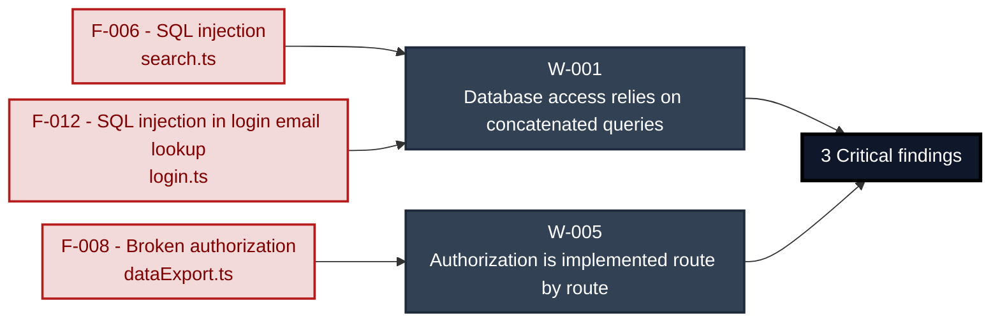

**Structural fixes** (full detail in [§7 Weakness Register](#7-weakness-register)):

- **[W-001](#w-001)** — Provide one parameterised repository or query-builder path and prohibit application-value interpolation in database queries _(closes [F-006](#f-006), [F-012](#f-012))_
- **[W-005](#w-005)** — Enforce authorization through a shared server-side policy layer and make ownership and tenant scope mandatory inputs to data access _(closes [F-008](#f-008))_

---

## 1. System Overview

Probably the most modern and sophisticated insecure web application

**Repository:** `https://github.com/juice-shop/juice-shop.git`
**Runtime:** Node\.js 22 - 26

### Scope

This threat model covers 9 components of juice-shop: 

- Juice Shop Express server
- Sequelize application data access
- CI/CD Pipeline
- Web3 / Wallet / NFT Surface
- Angular frontend
- MarsDB embedded store
- Real-time WebSocket Channel
- SQLite embedded store
- Authentication & Session Surface

**Not individually examined:** 124 source files in 3 components had no route, lead or security signal (Sequelize application data access 11, CI/CD Pipeline 4, Angular frontend 109).

**Not assessed:** 2 security-relevant code locations were read but could not be judged (Web3 / Wallet / NFT Surface 1, Authentication & Session Surface 1); `threat-model.yaml` records each with its reason under `meta.undecided_targets`.

**Not assigned to any component:** 134 program files belong to no component and were not analysed (`data/` 97, `lib/` 21, `frontend/` 5, `(repository root)` 4, `rsn/` 4, `models/` 1, `routes/` 1, `views/` 1).

**Out of scope:** third-party hosted dependencies, browser runtime, operating-system kernel, and the underlying network infrastructure.

**Basis:** An automated, AI-assisted threat model built from the repository's source code and configuration - static analysis only, no dynamic or penetration testing. It describes the system as built, not as designed.

---

<a id="identified-actors"></a>
### Identified Actors

Figure 1a draws **Internet Attacker** and **Internal Developer** as attackers and **Juice Shop User** and **Juice Shop Admin** as legitimate roles of Juice Shop. [Figure 1b](#figure-1b) draws **Supply-Chain / Build Attacker** and the build it attacks. Each row gives that actor's access and the findings attributed to it.

| Actor | Type | Access | Scenarios | Attributed findings |
|----------------------|---------------|----------------------|--------------|-------------------|
| A1 · Internet Attacker | Attacker | can self-register a regular account | ① ② ③ ④ ⑤ ⑥ ⑦ | 🔴 1 · 🟠 5 · 🟡 10 |
| A2 · Internal Developer | Attacker | developer with source-repository access | ② | - |
| A3 · Supply-Chain / Build Attacker | Attacker | compromises a dependency or build pipeline, or contributes malicious code to a public repo · [Figure 1b](#figure-1b) | ⑧ | 🟡 8 |
| Juice Shop User | Role (victim) | legitimate client | ⑥ ⑦ | - |
| Juice Shop Admin | Privileged role | Application role with elevated rights,<br/>evidenced by its access check. | - | - |

58 findings are not represented in the actor counts (2 Critical, 25 High, 31 Medium). These counts cover assigned findings only; absence from them does not establish inaccessibility.

---

### Trust Boundaries

Each row names a crossing and the condition it relies on. A modelled crossing does not prove that its control works.

| ID | Crossing | Required condition | Findings / open question |
|-----|----------------------|----------------------|------------------------------------------------|
| <a id="tb-1"></a>tb-1 | external → Real-time WebSocket Channel | Every Socket\.IO event payload is treated as untrusted input and validated before it influences server state.<br>Control: Socket\.IO CORS origin option | Gap evidenced: _Authentication_<br>🟡 [F-049](#f-049) |
| <a id="tb-2"></a>tb-2 | external → Juice Shop Express server | Every state-changing or user-specific API route is registered behind `security.isAuthorized()` before its handler runs.<br>Control: `security.isAuthorized()` route middleware | 44 related findings; relevance to this crossing remains unverified. |
| <a id="tb-3"></a>tb-3 | external → CI/CD Pipeline | Workflows triggered by external pushes and pull requests run without access to release or publishing secrets.<br>Control: GitHub Actions `pull_request` trigger | 8 related findings; relevance to this crossing remains unverified. |
| <a id="tb-4"></a>tb-4 | external → Web3 / Wallet / NFT Surface<br>Crossing: inferred | Every `/rest/web3` request is treated as attacker-controlled and authorized server-side regardless of the Angular client.<br>Control: not identified | Gap evidenced: _Validation_<br>🟡 [F-085](#f-085) |
| <a id="tb-5"></a>tb-5 | external → Authentication &amp; Session Surface<br>Crossing: inferred | Every authenticated auth/session route is registered behind `security.isAuthorized()` so a valid `RS256`-signed JWT is required.<br>Control: `isAuthorized` `expressJwt` middleware | Gap evidenced: _Validation_<br>🔴 [F-012](#f-012) |
| <a id="tb-6"></a>tb-6 | Sequelize application data access → SQLite embedded store<br>Crossing: inferred | Every query reaches SQLite through Sequelize parameter binding, never concatenated raw SQL.<br>Control: Sequelize parameter binding | No linked finding establishes a gap; control effectiveness is not established. |
| <a id="tb-7"></a>tb-7 | external → Authentication &amp; Session Surface<br>Crossing: inferred | Every state-changing API route is rejected unless the request carries a valid server-verified session token for the acting user.<br>Control: not identified | 10 related findings; relevance to this crossing remains unverified. |
| <a id="tb-8"></a>tb-8 | Juice Shop Express server → MarsDB embedded store | Request-derived values never become MarsDB query operators or selectors.<br>Control: not identified | Gap evidenced: _Query construction_<br>🟡 [F-054](#f-054) |
| <a id="tb-9"></a>tb-9 | Angular frontend → external | The OAuth access token is returned only to a redirect URI registered for the client ID, and the token is sent only to Google endpoints.<br>Control: Google OAuth redirect URI registration | Gap evidenced: _Egress content_<br>🟡 [F-079](#f-079) |
| <a id="tb-10"></a>tb-10 | Juice Shop Express server → external | Only content that is safe to disclose to the LLM provider is placed in prompts, and model output is treated as untrusted.<br>Control: not identified | Gap evidenced: _Egress destination_<br>🟠 [F-034](#f-034) |
| <a id="tb-11"></a>tb-11 | Web3 / Wallet / NFT Surface → external | Contract events received from the Alchemy RPC are treated as untrusted input before they drive challenge state.<br>Control: not identified | No linked finding establishes a gap; control effectiveness is not established. |

Crossing types, source evidence and provenance are retained in `security-assessment.yaml`.

---

## 2. Architecture Diagrams

### 2.1 System Context

Who uses and attacks Juice Shop, and which external systems it exchanges data with. Solid arrows name the data a flow carries; dashed red arrows are attack routes. Actors carry the names Figure 1 uses (C4 Level 1).

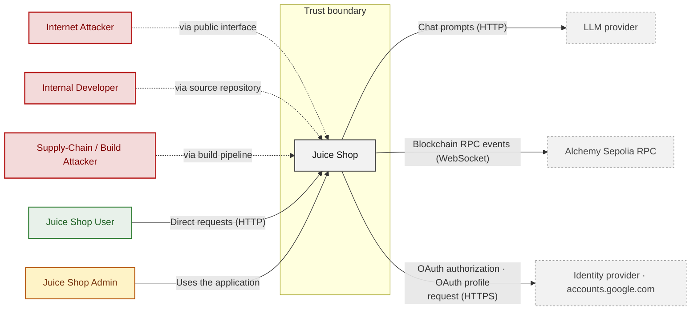

**Key takeaway:** Juice Shop serves Juice Shop User and Juice Shop Admin and depends on LLM provider, Alchemy Sepolia RPC and Identity provider · accounts.google.com; Internet Attacker, Internal Developer and Supply-Chain / Build Attacker attack it.

### 2.2 Container Architecture

How the system decomposes into deployable units. Each box is a separate runtime process or service container; arrows show synchronous request paths between them. Components with ≥3 Critical findings carry a red border, ≥2 High amber (C4 Level 2).

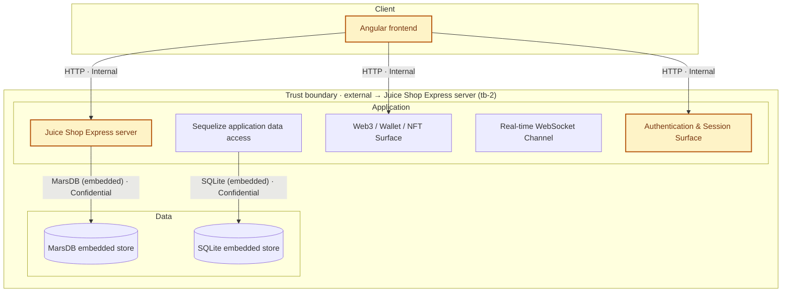

*Trust boundaries not drawn above: Juice Shop Express server → MarsDB embedded store (tb-8), Sequelize application data access → SQLite embedded store (tb-6), external → CI/CD Pipeline (tb-3), Angular frontend → external (tb-9), +2 more - every boundary is listed in [§1 Trust Boundaries](#trust-boundaries).*

**Key takeaway:** The system decomposes into 1 client, 5 application and 2 data unit(s); Juice Shop Express server carries the most Critical findings (2) and bounds the worst-case blast radius. The build plane (CI/CD Pipeline) is shown in [Figure 1b](#figure-1b).

### 2.3 Components

How each component is reached, what it handles, how many threats hit it, and how effective the controls evidenced on it are. The component table below holds source paths and linked threats per `C-NN`; per-finding evidence is in [§8 Findings Register](#8-findings-register).

<!-- detail-table -->
| Component | Inbound flows | Data handled | Threats | Controls: worst effectiveness per domain |
|----------------------|----------------------|------------|----------------------|----------------------|
| [C-01](#c-01) · Juice Shop Express server | 2 unauthenticated<br/>1 authentication unknown<br/>2 authenticated (bearer, cookie) | Confidential | 45 (🔴 2 · 🟠 21 · 🟡 22) | – |
| [C-02](#c-02) · Sequelize application data access | none modeled | Confidential | 3 (🟠 1 · 🟡 2) | 🟠 Weak: Secrets / crypto<br/>🟡 Partial: Logging |
| [C-03](#c-03) · CI/CD Pipeline | none modeled | – | 8 (🟡 8) | 🟠 Weak: Supply chain (3) |
| [C-04](#c-04) · Web3 / Wallet / NFT Surface | 1 unauthenticated | Internal | 2 (🟡 2) | – |
| [C-05](#c-05) · Angular frontend | none modeled | Confidential | 12 (🟠 4 · 🟡 8) | – |
| [C-06](#c-06) · MarsDB embedded store | 1 unauthenticated | Confidential | none | 🔴 Missing: AuthZ |
| [C-07](#c-07) · Real-time WebSocket Channel | none modeled | – | 3 (🟡 3) | – |
| [C-08](#c-08) · SQLite embedded store | 1 unauthenticated | Confidential | none | 🟠 Weak: Secrets / crypto<br/>🟡 Partial: Logging |
| [C-09](#c-09) · Authentication &amp; Session Surface | 1 unauthenticated<br/>1 authentication unknown<br/>1 authenticated (bearer) | Internal | 11 (🔴 1 · 🟠 5 · 🟡 5) | 🔴 Unsafe: AuthN (3)<br/>🟠 Weak: Input / query, Secrets / crypto<br/>🟡 Partial: Session, AuthZ |
| System-wide: evidence not tied to one<br/>component | – | – | – | 🔴 Missing: AuthN (4), AuthZ (4), Input /<br/>query (4), Secrets / crypto (2), Supply<br/>chain (3)<br/>🟠 Weak: Session (2), Transport<br/>🟡 Partial: Logging |

*🔴 **Unsafe**: relied upon but defeated or trivially bypassable - fix it · 🔴 **Missing**: never built - add it · 🟠 **Weak**: present, with exploitable gaps · 🟡 **Partial**: covers some surfaces, meaningful gaps remain · 🟢 **Adequate**: present and sound. A control counts for the component whose paths hold its implementation evidence; a domain without an evidenced control is not listed; (n) counts the controls behind a rating. Threat counts use the Figure 1 attribution; [§6](#6-security-architecture) holds the full assessment.*

**Key takeaway:** 2 components have at least one control rated Unsafe or Missing (C-06, C-09); 4 components have no component-specific control (C-01, C-04, C-05, C-07); 21 controls apply system-wide.

| ID | Name | Type | Key Paths | Linked Threats |
|----|----------------------|-----------|----------------------------------------|------------------------------------------------|
| <a id="c-01"></a><a id="component-1f61b207923dbaf5"></a><span style="white-space:nowrap">C-01</span> | Juice Shop Express server | application | `lib/startup/registerWebsocketEvents.ts`<br/>`routes/address.ts`<br/>`routes/appConfiguration.ts`<br/>`routes/appVersion.ts`<br/>`routes/b2bOrder.ts` | 🔴 [F-006](#f-006) — SQL injection request data interpolated into a SQL string<br/>🔴 [F-008](#f-008) — Broken authorization attacker-controlled owner ID in resource query…<br/>🟠 [F-003](#f-003) — Systemic IDOR Missing Ownership Checks<br/>🟠 [F-004](#f-004) — Missing Authorization on Product Update<br/>🟠 [F-014](#f-014) — Chat identity taken from unverified JWT<br/>🟠 [F-021](#f-021) — Wallet top-up accepts unvalidated balance amount<br/>🟠 [F-022](#f-022) — Path traversal filesystem access from request input<br/>🟠 [F-023](#f-023) — Zip entry path traversal on complaint upload<br/>🟠 [F-024](#f-024) — IDOR resource lookup by URL parameter without ownership filter…<br/>🟠 [F-027](#f-027) — Input in executable NoSQL predicate<br/>🟠 [F-028](#f-028) — NoSQL where injection in product reviews lookup<br/>🟠 [F-029](#f-029) — NoSQL where injection in order tracking<br/>🟠 [F-030](#f-030) — Input compiled as template source<br/>🟠 [F-032](#f-032) — Unauthenticated encryption key file download<br/>🟠 [F-033](#f-033) — XXE file content disclosure in upload errors<br/>🟠 [F-034](#f-034) — Server-side request forgery in profile image URL fetch<br/>🟠 [F-036](#f-036) — Blocking busy-wait sleep reachable from queries<br/>🟠 [F-037](#f-037) — Code injection through eval of profile username<br/>🟠 [F-038](#f-038) — IDOR / broken object-level authorization PUT `/api/BasketItems/:id`<br/>🟠 [F-039](#f-039) — Sensitive Routes Registered Without Authentication Middleware<br/>🟠 [F-041](#f-041) — Sensitive Routes Registered Without Authentication Middleware<br/>🟠 [F-042](#f-042) — Chatbot coupon tool lacks server-side discount limit<br/>🟠 [F-043](#f-043) — Role accepted from user registration body<br/>🟡 [F-044](#f-044) — Unauthenticated review creation with spoofable author<br/>🟡 [F-045](#f-045) — Password change allowed without current password<br/>🟡 [F-046](#f-046) — Hardcoded cookie-parser signing secret<br/>🟡 [F-052](#f-052) — File type allowlist bypass through null byte handling<br/>🟡 [F-053](#f-053) — Client-supplied coupon data grants expired discounts<br/>🟡 [F-054](#f-054) — NoSQL selector injection in review likes<br/>🟡 [F-055](#f-055) — Client-supplied chat messages passed to model unvalidated<br/>🟡 [F-066](#f-066) — Template layout path read via request body in data erasure<br/>🟡 [F-067](#f-067) — CAPTCHA answer returned to client<br/>🟡 [F-068](#f-068) — Unauthenticated memories listing with user data<br/>🟡 [F-069](#f-069) — CAPTCHA answer returned to the client<br/>🟡 [F-070](#f-070) — User enumeration via security question lookup<br/>🟡 [F-071](#f-071) — Unauthenticated Prometheus metrics endpoint<br/>🟡 [F-072](#f-072) — Order PDFs with customer email in listed directory<br/>🟡 [F-073](#f-073) — Unauthenticated log directory browsing<br/>🟡 [F-074](#f-074) — Unauthenticated access log download<br/>🟡 [F-082](#f-082) — Unbounded remote download for profile image<br/>🟡 [F-083](#f-083) — Unbounded chat input with no rate limit on LLM endpoint<br/>🟡 [F-084](#f-084) — Unbounded disk upload ahead of authentication<br/>🟡 [F-087](#f-087) — Fail-open image CAPTCHA verification<br/>🟡 [F-088](#f-088) — Deluxe membership granted without payment |
| <a id="c-02"></a><a id="component-290ae722e9565831"></a><span style="white-space:nowrap">C-02</span> | Sequelize application data access | application | `models/address.ts`<br/>`models/basket.ts`<br/>`models/basketitem.ts`<br/>`models/captcha.ts`<br/>`models/card.ts` | 🟠 [F-035](#f-035) — Weak MD5 password hashing in User setter<br/>🟡 [F-056](#f-056) — Unsanitized product description setter<br/>🟡 [F-075](#f-075) — Plaintext payment card storage |
| <a id="c-03"></a><a id="component-31ebe1b93ddf60d5"></a><span style="white-space:nowrap">C-03</span> | CI/CD Pipeline | application | `.dockerignore`<br/>`.github/workflows/ci.yml`<br/>`.github/workflows/codeql-analysis.yml`<br/>`.github/workflows/frontend-bundle-analysis.yml`<br/>`.github/workflows/image_actions.yml` | 🟡 [F-057](#f-057) — Missing Container Image Signing<br/>🟡 [F-058](#f-058) — Unverified remote script piped to shell in deploy workflow<br/>🟡 [F-059](#f-059) — Untrusted npm Install/Postinstall Scripts Enabled<br/>🟡 [F-060](#f-060) — Mutable main branch action reference with write token<br/>🟡 [F-061](#f-061) — Release build uses non-locked dependency installation<br/>🟡 [F-062](#f-062) — Unpinned Container Base Image<br/>🟡 [F-089](#f-089) — Container Runs as Root<br/>🟡 [F-090](#f-090) — Missing Workflow Permissions Block |
| <a id="c-04"></a><a id="component-6ffadbc3868c2a3b"></a><span style="white-space:nowrap">C-04</span> | Web3 / Wallet / NFT Surface | application | `routes/checkKeys.ts`<br/>`routes/nftMint.ts`<br/>`routes/redirect.ts`<br/>`routes/web3Wallet.ts` | 🟡 [F-076](#f-076) — Hardcoded wallet mnemonic in source<br/>🟡 [F-085](#f-085) — Unbounded unvalidated wallet set on open endpoint |
| <a id="c-05"></a><a id="component-6ffaf23414c56207"></a><span style="white-space:nowrap">C-05</span> | Angular frontend | client | `frontend/src/app/Models/backup.model.ts`<br/>`frontend/src/app/Models/challenge.model.ts`<br/>`frontend/src/app/Models/deliveryMethod.model.ts`<br/>`frontend/src/app/Models/hint.model.ts`<br/>`frontend/src/app/Models/product.model.ts` | 🟠 [F-001](#f-001) — XSS via Trusted HTML Sanitizer Bypass<br/>🟠 [F-002](#f-002) — Session Token in Script-Readable Storage<br/>🟠 [F-016](#f-016) — Predictable password derived from OAuth email<br/>🟠 [F-110](#f-110) — Session token stored in web-accessible client storage<br/>🟡 [F-005](#f-005) — Angular Sanitizer Bypass Rendering Untrusted HTML<br/>🟡 [F-047](#f-047) — OAuth implicit flow without state, nonce or PKCE<br/>🟡 [F-048](#f-048) — Hardcoded testing credentials in login component<br/>🟡 [F-063](#f-063) — Unsanitized document.write of data export response<br/>🟡 [F-064](#f-064) — DOM XSS through sanitizer bypass on order ID<br/>🟡 [F-077](#f-077) — Private key submitted over configurable HTTP origin<br/>🟡 [F-078](#f-078) — Passwords sent as GET query parameters<br/>🟡 [F-079](#f-079) — OAuth access token in userinfo query string |
| <a id="c-06"></a><a id="component-790db1fed70651aa"></a><span style="white-space:nowrap">C-06</span> | MarsDB embedded store | data | `data/mongodb.ts` | - |
| <a id="c-07"></a><a id="component-8c3a32ee53769307"></a><span style="white-space:nowrap">C-07</span> | Real-time WebSocket Channel | application | `lib/challengeUtils.ts`<br/>`lib/startup/registerWebsocketEvents.ts` | 🟡 [F-049](#f-049) — Unauthenticated WebSocket Channel<br/>🟡 [F-080](#f-080) — Stored notifications and flags sent to unauthenticated sockets<br/>🟡 [F-086](#f-086) — Unhandled exception from non-string event payloads |
| <a id="c-08"></a><a id="component-b213d5ab01236933"></a><span style="white-space:nowrap">C-08</span> | SQLite embedded store | data | `models/index.ts` | - |
| <a id="c-09"></a><a id="component-dff0840e0f4855be"></a><span style="white-space:nowrap">C-09</span> | Authentication & Session Surface | application | `lib/insecurity.ts`<br/>`lib/startup/registerWebsocketEvents.ts`<br/>`routes/2fa.ts`<br/>`routes/authenticatedUsers.ts`<br/>`routes/login.ts` | 🔴 [F-012](#f-012) — SQL injection in login email lookup<br/>🟠 [F-018](#f-018) — Insecure JWT Verification<br/>🟠 [F-019](#f-019) — Password reset accepts a security-question answer<br/>🟠 [F-020](#f-020) — Hardcoded JWT private signing key in source<br/>🟠 [F-031](#f-031) — Non-cryptographic RNG for a<br/>🟡 [F-050](#f-050) — Unthrottled security-answer password reset<br/>🟡 [F-051](#f-051) — Substring redirect allowlist check<br/>🟡 [F-065](#f-065) — Unsanitized login IP header stored when challenge flag on<br/>🟡 [F-081](#f-081) — Reset response returns full user object<br/>🟡 [F-091](#f-091) — Any authenticated user lists all accounts |

> **Legend:** `-->` synchronous request/response (REST, HTTPS, gRPC) · **red border** ≥ 3 Critical threats on the component · **amber border** ≥ 2 High threats

---

## 3. Attack Walkthroughs

This section walks through how the highest-risk findings are exploited - one short walkthrough per Critical, each with attack steps, a focused sequence diagram, and the primary mitigation. Which root cause each Critical traces back to is in [Critical Findings by Root Cause](#critical-findings-by-root-cause); full per-finding context (severity rationale, assets, detection signals) is in the [§8 Findings Register](#8-findings-register).

### 3.1 SQL injection in Search

**Source:** 🔴 [F-006](#f-006) — `routes/search.ts:23`

Severity **Critical** ([CWE-89](https://cwe.mitre.org/data/definitions/89.html)). STRIDE: Tampering. See [§8 F-006](#f-006) for the full register row.

**Attack Steps**

1. Find the request parameter that reaches the raw query at `routes/search.ts:23`.
2. Interpolating request-controlled text into a SQL statement lets an attacker alter the query - exfiltrating or modifying arbitrary rows, bypassing authentication, or escalating to full database control.

**Sequence Diagram**

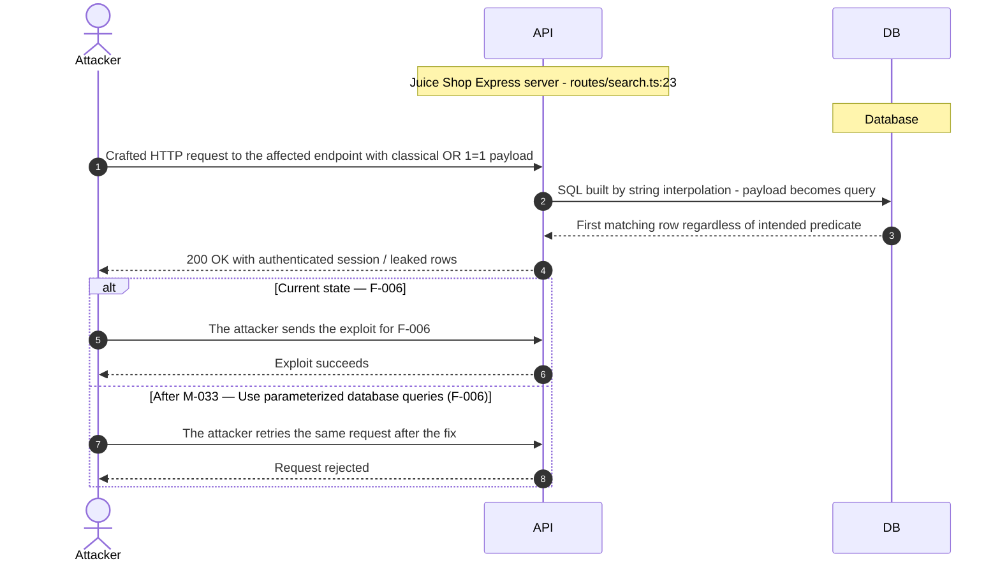

**Key takeaway:** Until ◑ [M-033](#m-033) (Require current password for password changes) lands, 🔴 [F-006](#f-006) is exploitable at `routes/search.ts:23` (Critical-severity, [CWE-89](https://cwe.mitre.org/data/definitions/89.html)).

**Defense in Depth**

- Primary mitigation: ◑ [M-033](#m-033) (Use parameterized database queries (🔴 [F-006](#f-006)))

### 3.2 SQL injection in login email lookup

**Source:** 🔴 [F-012](#f-012) — `routes/login.ts:34`

Severity **Critical** ([CWE-89](https://cwe.mitre.org/data/definitions/89.html)). STRIDE: Tampering. See [§8 F-012](#f-012) for the full register row.

**Attack Steps**

1. POST `/rest/user/login` with email set to an injection payload that comments out the password clause.
2. The raw query returns the target user row and the server issues a valid JWT for that account.

**Sequence Diagram**

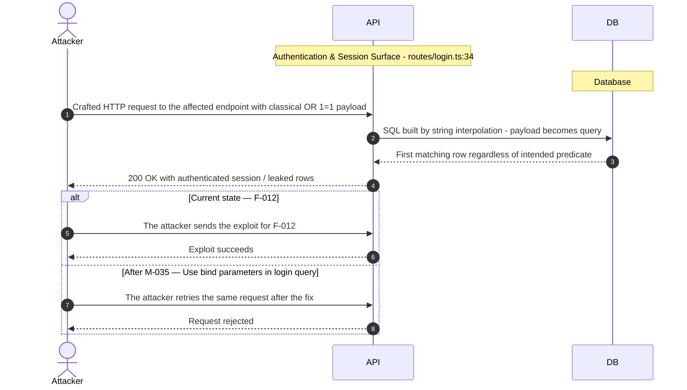

**Key takeaway:** Until ◑ [M-035](#m-035) (Switch to authorization code flow with PKCE and state) lands, 🔴 [F-012](#f-012) is exploitable at `routes/login.ts:34` (Critical-severity, [CWE-89](https://cwe.mitre.org/data/definitions/89.html)).

**Defense in Depth**

- Primary mitigation: ◑ [M-035](#m-035) (Use bind parameters in login query)

### 3.3 Broken authorization in Data Export

**Source:** 🔴 [F-008](#f-008) — `routes/dataExport.ts:26`

Severity **Critical** ([CWE-639](https://cwe.mitre.org/data/definitions/639.html)). STRIDE: Tampering. See [§8 F-008](#f-008) for the full register row.

**Attack Steps**

1. An attacker crafts a request that reaches the code at `routes/dataExport.ts:26`.
2. A signed-in attacker puts another user's ID into the owner field of the request (`req.body.UserId` and the like); the query trusts it instead of the session identity, so the attacker reads or changes every other user's records - horizontal privilege escalation across all accounts.

**Sequence Diagram**

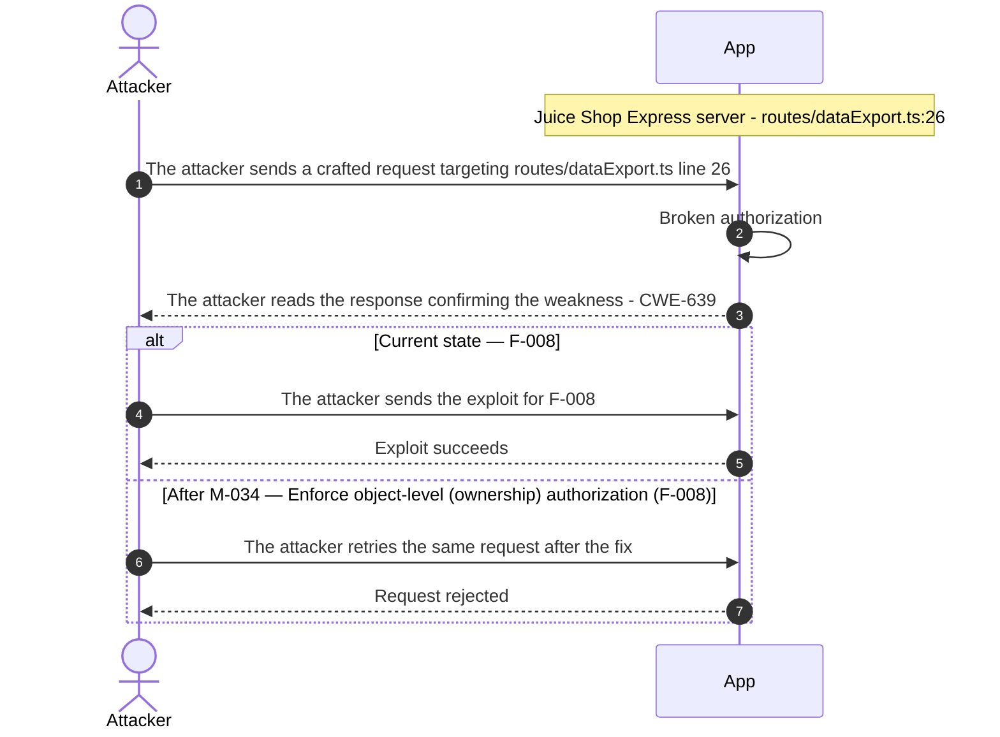

**Key takeaway:** Until ◑ [M-034](#m-034) (Load cookie secret from environment) lands, 🔴 [F-008](#f-008) is exploitable at `routes/dataExport.ts:26` (Critical-severity, [CWE-639](https://cwe.mitre.org/data/definitions/639.html)).

**Defense in Depth**

- Primary mitigation: ◑ [M-034](#m-034) (Enforce object-level (ownership) authorization (🔴 [F-008](#f-008)))
- Defence in depth: ◕ [M-002](#m-002) (Manual review: verify Broken authorization attacker-controlled owner ID in resource query…)

### 3.4 Hardcoded JWT private signing key in source

**Source:** 🟠 [F-020](#f-020) — `lib/insecurity.ts:21`

Severity **High** ([CWE-798](https://cwe.mitre.org/data/definitions/798.html)). STRIDE: Spoofing. See [§8 F-020](#f-020) for the full register row.

**Attack Steps**

1. An attacker crafts a request that reaches the code at `lib/insecurity.ts:21`.
2. The `RS256` private key is embedded in `lib/insecurity.ts`.
3. Anyone with the source can sign a token with an arbitrary role claim, which `isAuthorized` and the role checks accept, and can also compute deluxe tokens derived from the same key.

**Sequence Diagram**

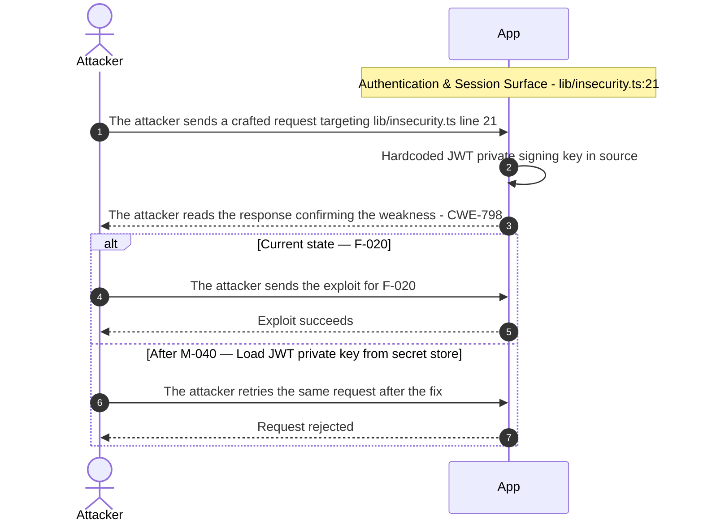

**Key takeaway:** Until ◑ [M-040](#m-040) (Reject null bytes before validating the file name) lands, 🟠 [F-020](#f-020) is exploitable at `lib/insecurity.ts:21` (High-severity, [CWE-798](https://cwe.mitre.org/data/definitions/798.html)).

**Defense in Depth**

- Primary mitigation: ◑ [M-040](#m-040) (Load JWT private key from secret store)

### 3.5 Role accepted from user registration body in Juice Shop Express server

**Source:** 🟠 [F-043](#f-043) — `routes/verify.ts:53`

Severity **High** ([CWE-915](https://cwe.mitre.org/data/definitions/915.html)). STRIDE: Elevation of Privilege. See [§8 F-043](#f-043) for the full register row.

**Attack Steps**

1. An attacker crafts a request that reaches the code at `routes/verify.ts:53`.
2. An unauthenticated caller POSTs `/api/Users` with role set to admin.
3. The middleware chain only inspects `req.body.role` and calls next, passing the body to the generated create endpoint, which may store the role.

**Sequence Diagram**

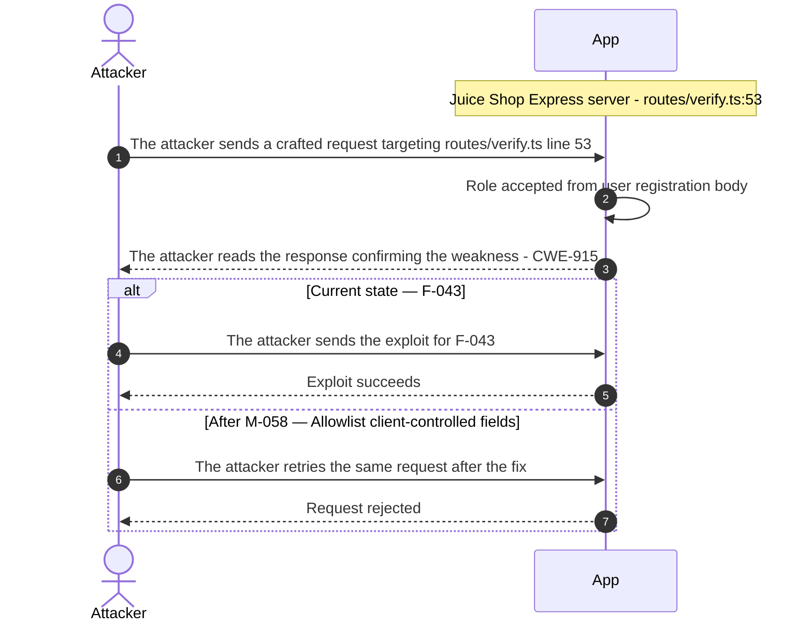

**Key takeaway:** Until ◑ [M-058](#m-058) (Return uniform response for security question lookup) lands, 🟠 [F-043](#f-043) is exploitable at `routes/verify.ts:53` (High-severity, [CWE-915](https://cwe.mitre.org/data/definitions/915.html)).

**Defense in Depth**

- Primary mitigation: ◑ [M-058](#m-058) (Allowlist client-controlled fields)
- Defence in depth: ◕ [M-010](#m-010) (Manual review: verify Role accepted from user registration body)

<!-- generated:walkthrough_renderer -->

---

## 4. Assets

Information assets and the classification level that drives the Confidentiality / Integrity / Availability targets used in [§8 Findings Register](#8-findings-register) risk scoring.

| Asset | Classification | Description | Linked Threats |
|----------------------|--------------|------------------------------------|------------------------------------------------|
| Alchemy API key | Restricted | Credential read from `ALCHEMY_API_KEY` for the blockchain RPC endpoint. | 🟠 [F-001](#f-001) — XSS via Trusted HTML Sanitizer Bypass<br/>🟡 [F-005](#f-005) — Angular Sanitizer Bypass Rendering Untrusted HTML<br/>🔴 [F-006](#f-006) — SQL injection request data interpolated into a SQL string<br/>🔴 [F-012](#f-012) — SQL injection in login email lookup<br/>🟠 [F-035](#f-035) — Weak MD5 password hashing in User setter<br/>🟡 [F-050](#f-050) — Unthrottled security-answer password reset<br/>🟡 [F-063](#f-063) — Unsanitized document.write of data export response<br/>🟡 [F-064](#f-064) — DOM XSS through sanitizer bypass on order ID<br/>🟡 [F-065](#f-065) — Unsanitized login IP header stored when challenge flag on |
| LLM provider API key | Restricted | Credential read from `LLM_API_KEY` for the chatbot provider. | 🟠 [F-001](#f-001) — XSS via Trusted HTML Sanitizer Bypass<br/>🟡 [F-005](#f-005) — Angular Sanitizer Bypass Rendering Untrusted HTML<br/>🔴 [F-006](#f-006) — SQL injection request data interpolated into a SQL string<br/>🔴 [F-012](#f-012) — SQL injection in login email lookup<br/>🟠 [F-035](#f-035) — Weak MD5 password hashing in User setter<br/>🟡 [F-050](#f-050) — Unthrottled security-answer password reset<br/>🟡 [F-063](#f-063) — Unsanitized document.write of data export response<br/>🟡 [F-064](#f-064) — DOM XSS through sanitizer bypass on order ID<br/>🟡 [F-065](#f-065) — Unsanitized login IP header stored when challenge flag on |
| Application relational data | Confidential | Sequelize-managed SQLite data (users, baskets, cards, addresses, etc.). | 🟠 [F-003](#f-003) — Systemic IDOR Missing Ownership Checks<br/>🟠 [F-004](#f-004) — Missing Authorization on Product Update<br/>🔴 [F-006](#f-006) — SQL injection request data interpolated into a SQL string<br/>🔴 [F-008](#f-008) — Broken authorization attacker-controlled owner ID in resource query…<br/>🔴 [F-012](#f-012) — SQL injection in login email lookup<br/>🟠 [F-024](#f-024) — IDOR resource lookup by URL parameter without ownership filter…<br/>🟠 [F-038](#f-038) — IDOR / broken object-level authorization PUT `/api/BasketItems/:id`<br/>🟠 [F-039](#f-039) — Sensitive Routes Registered Without Authentication Middleware<br/>🟠 [F-041](#f-041) — Sensitive Routes Registered Without Authentication Middleware<br/>🟠 [F-043](#f-043) — Role accepted from user registration body<br/>🟡 [F-091](#f-091) — Any authenticated user lists all accounts |
| Reviews and orders collections | Confidential | MarsDB collections for product reviews and orders. | - |

---

## 5. Attack Surface

Network-reachable entry points classified by authentication requirement. Each row links to the threat(s) referenced in its **Notes** column. The **Risk** column reflects the highest-severity linked finding. Entry points with no linked finding are still listed when they sit on a sensitive surface (authentication, registration, management) or look like a missing-auth/authz suspect - marked **⚑ Review** in Notes.

### 5.1 Unauthenticated Entry Points (69)

| Method | Route | Risk | Notes |
|------|----------------------------------------|----------|------------------------------------|
| POST | `/rest/user/data-export` | 🔴 Critical | 🔴 [F-008](#f-008) — Broken authorization attacker-controlled owner ID in resource query…<br/>🟡 [F-063](#f-063) — Unsanitized document.write of data export response<br/>🟡 [F-087](#f-087) — Fail-open image CAPTCHA verification |
| POST | `/rest/user/login` | 🔴 Critical | 🔴 [F-012](#f-012) — SQL injection in login email lookup<br/>Public by design |
| GET | `/rest/products/search` | 🔴 Critical | 🔴 [F-006](#f-006) — SQL injection request data interpolated into a SQL string |
| POST | `/api/Users` | 🟠 High | 🟠 [F-043](#f-043) — Role accepted from user registration body |
| POST | `/file-upload` | 🟠 High | 🟠 [F-023](#f-023) — Zip entry path traversal on complaint upload<br/>🟠 [F-033](#f-033) — XXE file content disclosure in upload errors<br/>🟠 [F-039](#f-039) — Sensitive Routes Registered Without Authentication Middleware |
| POST | `/rest/2fa/verify` | 🟠 High | 🟠 [F-043](#f-043) — Role accepted from user registration body<br/>Public by design |
| POST | `/rest/chat` | 🟠 High | 🟠 [F-014](#f-014) — Chat identity taken from unverified JWT<br/>🟠 [F-042](#f-042) — Chatbot coupon tool lacks server-side discount limit<br/>🟡 [F-083](#f-083) — Unbounded chat input with no rate limit on LLM endpoint |
| POST | `/rest/user/reset-password` | 🟠 High | 🟠 [F-019](#f-019) — Password reset accepts a security-question answer<br/>🟡 [F-050](#f-050) — Unthrottled security-answer password reset<br/>🟡 [F-081](#f-081) — Reset response returns full user object<br/>Public by design |
| PUT | `/rest/wallet/balance` | 🟠 High | 🟠 [F-021](#f-021) — Wallet top-up accepts unvalidated balance amount |
| ALL | `/encryptionkeys/:file` | 🟠 High | 🟠 [F-032](#f-032) — Unauthenticated encryption key file download |
| GET | `/rest/track-order/:id` | 🟠 High | 🟠 [F-029](#f-029) — NoSQL where injection in order tracking |
| GET | `/rest/wallet/balance` | 🟠 High | 🟠 [F-021](#f-021) — Wallet top-up accepts unvalidated balance amount |
| GET | `/metrics` | 🟡 Medium | 🟡 [F-071](#f-071) — Unauthenticated Prometheus metrics endpoint<br/>Management surface |
| POST | `/rest/deluxe-membership` | 🟡 Medium | 🟡 [F-088](#f-088) — Deluxe membership granted without payment |
| POST | `/rest/memories` | 🟡 Medium | 🟡 [F-068](#f-068) — Unauthenticated memories listing with user data<br/>🟡 [F-084](#f-084) — Unbounded disk upload ahead of authentication |
| POST | `/​rest/​web3/​walletExploitAddress` | 🟡 Medium | 🟡 [F-085](#f-085) — Unbounded unvalidated wallet set on open endpoint |
| GET | `/rest/captcha` | 🟡 Medium | 🟡 [F-069](#f-069) — CAPTCHA answer returned to the client<br/>Public by design |
| GET | `/rest/deluxe-membership` | 🟡 Medium | 🟡 [F-088](#f-088) — Deluxe membership granted without payment |
| GET | `/rest/image-captcha` | 🟡 Medium | 🟡 [F-067](#f-067) — CAPTCHA answer returned to client<br/>🟡 [F-087](#f-087) — Fail-open image CAPTCHA verification |
| GET | `/rest/memories` | 🟡 Medium | 🟡 [F-068](#f-068) — Unauthenticated memories listing with user data<br/>🟡 [F-084](#f-084) — Unbounded disk upload ahead of authentication |
| GET | `/rest/saveLoginIp` | 🟡 Medium | 🟡 [F-065](#f-065) — Unsanitized login IP header stored when challenge flag on |
| GET | `/rest/user/change-password` | 🟡 Medium | 🟡 [F-045](#f-045) — Password change allowed without current password<br/>🟡 [F-078](#f-078) — Passwords sent as GET query parameters |
| GET | `/rest/user/security-question` | 🟡 Medium | 🟡 [F-070](#f-070) — User enumeration via security question lookup |
| ALL | `/support/logs/:file` | 🟡 Medium | 🟡 [F-073](#f-073) — Unauthenticated log directory browsing<br/>🟡 [F-074](#f-074) — Unauthenticated access log download |
| POST | `/api/Addresss` | - | _⚑ Review: no auth guard detected_ |
| PUT | `/api/Addresss/:id` | - | _⚑ Review: no auth guard detected_ |
| DELETE | `/api/Addresss/:id` | - | _⚑ Review: no auth guard detected_ |
| POST | `/api/Cards` | - | _⚑ Review: no auth guard detected_ |
| DELETE | `/api/Cards/:id` | - | _⚑ Review: no auth guard detected_ |
| POST | `/api/Feedbacks` | - | _⚑ Review: no auth guard detected_ |
| GET | `/​rest/​admin/​application-​configuration` | - | Management surface<br/>_⚑ Review: no auth guard detected_ |
| GET | `/​rest/​admin/​application-​version` | - | Management surface<br/>_⚑ Review: no auth guard detected_ |
| PUT | `/​rest/​continue-​code-​findIt/​apply/​:​continueCode` | - | _⚑ Review: no auth guard detected_ |
| PUT | `/​rest/​continue-​code-​fixIt/​apply/​:​continueCode` | - | _⚑ Review: no auth guard detected_ |
| PUT | `/​rest/​continue-​code/​apply/​:​continueCode` | - | _⚑ Review: no auth guard detected_ |
| PUT | `/rest/products/:id/reviews` | - | _⚑ Review: no auth guard detected_ |
| POST | `/rest/web3/submitKey` | - | _⚑ Review: no auth guard detected_ |
| POST | `/rest/web3/walletNFTVerify` | - | _⚑ Review: no auth guard detected_ |
| POST | `/snippets/fixes` | - | _⚑ Review: no auth guard detected_ |
| POST | `/snippets/verdict` | - | _⚑ Review: no auth guard detected_ |

_29 further entry point(s) in this category carry no linked finding and no elevated review signal, and are not listed individually (69 total). The complete route inventory is available in `.route-inventory.json` and, when exported, `pentest-tasks.yaml`._

### 5.2 Authenticated Entry Points (40)

| Method | Route | Risk | Notes |
|------|---------------------------------------|--------|------------------------------------|
| PUT | `/api/BasketItems/:id` | 🟠 High | 🟠 [F-024](#f-024) — IDOR resource lookup by URL parameter without ownership filter…<br/>🟠 [F-038](#f-038) — IDOR / broken object-level authorization PUT `/api/BasketItems/:id`<br/>Authorization not confirmed (review) |
| DELETE | `/api/Products/:id` | 🟠 High | 🟠 [F-004](#f-004) — Missing Authorization on Product Update<br/>Authorization not confirmed (review) |
| PUT | `/api/Products/:id` | 🟠 High | 🟠 [F-004](#f-004) — Missing Authorization on Product Update<br/>Authorization not confirmed (review) |
| GET | `/rest/basket/:id` | 🟠 High | 🟠 [F-003](#f-003) — Systemic IDOR Missing Ownership Checks |
| POST | `/rest/basket/:id/checkout` | 🟠 High | 🟠 [F-003](#f-003) — Systemic IDOR Missing Ownership Checks<br/>Authorization not confirmed (review) |
| PUT | `/​rest/​basket/​:​id/​coupon/​:​coupon` | 🟠 High | 🟠 [F-003](#f-003) — Systemic IDOR Missing Ownership Checks<br/>Authorization not confirmed (review) |
| POST | `/api/BasketItems` | 🟠 High | 🟠 [F-024](#f-024) — IDOR resource lookup by URL parameter without ownership filter…<br/>🟠 [F-038](#f-038) — IDOR / broken object-level authorization PUT `/api/BasketItems/:id`<br/>Authorization not confirmed (review) |
| POST | `/api/Products` | 🟠 High | 🟠 [F-004](#f-004) — Missing Authorization on Product Update<br/>Authorization not confirmed (review) |
| GET | `/api/Users` | 🟠 High | 🟠 [F-043](#f-043) — Role accepted from user registration body |
| GET | `/profile` | 🟠 High | 🟠 [F-034](#f-034) — Server-side request forgery in profile image URL fetch<br/>🟠 [F-037](#f-037) — Code injection through eval of profile username<br/>🟡 [F-082](#f-082) — Unbounded remote download for profile image |
| POST | `/profile` | 🟠 High | 🟠 [F-034](#f-034) — Server-side request forgery in profile image URL fetch<br/>🟠 [F-037](#f-037) — Code injection through eval of profile username<br/>🟡 [F-082](#f-082) — Unbounded remote download for profile image<br/>Authorization not confirmed (review) |
| POST | `/profile/image/file` | 🟠 High | 🟠 [F-034](#f-034) — Server-side request forgery in profile image URL fetch<br/>🟡 [F-082](#f-082) — Unbounded remote download for profile image<br/>Authorization not confirmed (review) |
| POST | `/profile/image/url` | 🟠 High | 🟠 [F-034](#f-034) — Server-side request forgery in profile image URL fetch<br/>🟡 [F-082](#f-082) — Unbounded remote download for profile image<br/>Authorization not confirmed (review) |
| GET | `/​rest/​user/​authentication-​details` | 🟡 Medium | 🟡 [F-091](#f-091) — Any authenticated user lists all accounts |
| PUT | `/api/Cards/:id` | - | Authorization not confirmed (review)<br/>_⚑ Review: no authz guard detected_ |
| PUT | `/api/Feedbacks/:id` | - | Authorization not confirmed (review)<br/>_⚑ Review: no authz guard detected_ |
| DELETE | `/api/Quantitys/:id` | - | Authorization not confirmed (review)<br/>_⚑ Review: no authz guard detected_ |
| PUT | `/api/Recycles/:id` | - | Authorization not confirmed (review)<br/>_⚑ Review: no authz guard detected_ |
| DELETE | `/api/Recycles/:id` | - | Authorization not confirmed (review)<br/>_⚑ Review: no authz guard detected_ |
| POST | `/rest/2fa/disable` | - | Public by design<br/>_⚑ Review: auth/token endpoint_ |
| POST | `/rest/2fa/setup` | - | Public by design<br/>_⚑ Review: auth/token endpoint_ |
| GET | `/rest/2fa/status` | - | Public by design<br/>_⚑ Review: auth/token endpoint_ |
| PUT | `/​rest/​order-​history/​:​id/​delivery-​status` | - | Authorization not confirmed (review)<br/>_⚑ Review: no authz guard detected_ |

_17 further entry point(s) in this category carry no linked finding and no elevated review signal, and are not listed individually (40 total). The complete route inventory is available in `.route-inventory.json` and, when exported, `pentest-tasks.yaml`._

---

## 6. Security Architecture

This chapter is organized by security-control category. Findings are listed only where the affected control is described.

_Cataloged controls: 38 total - 3 adequate, 12 partial, 14 weak, 2 unsafe, 7 missing._

**How to read the verdicts.** Every control category (and every sub-control below it) carries exactly one status. The two red verdicts do **not** mean the same thing - this is the distinction that decides what you have to do about a finding:

| Status | Meaning | What it asks of you |
|----------|------------------------------------|------------------------|
| 🟢 Adequate | Control is present and sound | Nothing - keep it |
| 🟡 Partial | Present, but with meaningful gaps | Close the gap |
| 🟠 Weak | Present, but has exploitable gaps | Strengthen it |
| 🔴 Unsafe | **Present and relied upon, but defeated /<br/>trivially bypassable** | **Fix the existing control** |
| 🔴 Missing | **Control was never built** | **Add the control** |
| - | Not applicable to this codebase | - |

So "🔴 Unsafe" on a control category does *not* mean the control is absent - it means the control exists but does not hold (e.g. an `MD5` password hash, a raw-SQL query path, a hardcoded signing key). "🔴 Missing" is reserved for controls that were never built (e.g. no `Content-Security-Policy` header).

### 6.1 Security Control Overview

<!-- §6.1 MECHANICAL-FROZEN — DO NOT EDIT (overview table is pregenerator-owned) -->

| Control category | Verdict | Main reason |
|----------------------|---------|------------------------------------|
| [6.2 Identity and Authentication Controls](#62-identity-and-authentication-controls) | 🔴 Unsafe | 9 findings; catalogued controls are present<br/>but defeated (e.g. Wallet ownership<br/>verification for NFT mint challenge, OAuth<br/>implicit flow login). |
| [6.3 Session and Token Controls](#63-session-and-token-controls) | 🟠 Weak | 2 findings; catalogued controls are weak<br/>(e.g. Cookie signing and request body<br/>parsing, Client-side token storage). |
| [6.4 Authorization Controls](#64-authorization-controls) | 🔴 Missing | 10 findings; required controls not in place<br/>(e.g. Route-level authorization middleware,<br/>Chatbot tool-level authorization and coupon<br/>policy). |
| [6.5 Query Construction and Data Access Controls](#65-query-construction-and-data-access-controls) | 🔴 Unsafe | 6 findings; catalogued controls are present<br/>but defeated (e.g. Embedded MarsDB data<br/>store access control, Login query<br/>construction). |
| [6.6 Input Boundary Validation Controls](#66-input-boundary-validation-controls) | 🔴 Missing | 6 findings; required controls not in place<br/>(e.g. Chatbot tool input validation and<br/>query construction, Validation of wallet<br/>address input). |
| [6.7 Output Encoding and Rendering Controls](#67-output-encoding-and-rendering-controls) | 🟠 Weak | 6 findings; catalogued controls are weak<br/>(e.g. Redirect allowlist). |
| [6.8 Browser and Cross-Origin Controls](#68-browser-and-cross-origin-controls) | 🟠 Weak | 1 finding; catalogued controls are weak<br/>(e.g. Socket\.io CORS origin restriction). |
| [6.9 Cryptography Secrets and Data Protection](#69-cryptography-secrets-and-data-protection) | 🔴 Missing | 6 findings; required controls not in place<br/>(e.g. Embedded SQLite datastore protection,<br/>Blockchain RPC API key handling). |
| [6.10 File Parser and Outbound Request Controls](#610-file-parser-and-outbound-request-controls) | 🔴 Missing | 14 findings; required controls not in place<br/>(e.g. Profile image URL fetch (SSRF<br/>protection), Upload handling (size, mime<br/>type, filename sanitization)). |
| [6.11 Operations Runtime and Supply Chain Controls](#611-operations-runtime-and-supply-chain-controls) | 🔴 Missing | 8 findings; required controls not in place<br/>(e.g. Rate limiting, Access logging and<br/>metrics exposure). |
| [6.12 Real-time and Not Applicable Controls](#612-real-time-and-not-applicable-controls) | - | No controls or findings in this category. |

<!-- §6.1 MECHANICAL-FROZEN END -->

### 6.2 Identity and Authentication Controls

<a id="ctrl-identity-and-authentication-controls"></a>


**Systemic weaknesses:** [W-009](#w-009), [W-010](#w-010), [W-011](#w-011), [W-012](#w-012)
**Verdict:** 🔴 Unsafe - SQL injection in login, role injection at registration, and a guessable security-answer reset defeat identity controls that exist.

<!-- The line below is mechanically derived from the controls table — LLM must not re-author it. -->
**Controls covered:**

- [6.2.1 OAuth implicit flow login](#oauth-implicit-flow-login)
- [6.2.2 Password reset](#password-reset)
- [6.2.3 Multi-factor authentication step](#multi-factor-authentication-step)
- [6.2.4 User Registration](#user-registration)

**Implemented controls:** Wallet ownership verification for NFT mint challenge, OAuth implicit flow login, Credential handling in client, Password reset, Multi-factor authentication step.

**Assessment:** Identity rests on a raw-SQL password login, a client-side Google implicit flow that ends in the same local login, an optional TOTP step and a security-question reset. Each is defeated or weakened: SQL injection bypasses the credential check, the OAuth password is derived from the email, and reset needs only a guessable answer. Each successful flow above terminates in the server issuing a session token; the signing, validation, storage and lifecycle of that token are described in [§6.3 Session and Token Controls](#63-session-and-token-controls).

<!-- §6.2 AUTH-MECHANISMS-FROZEN — deterministic inventory, pregenerator-owned. DO NOT EDIT. -->
**Authentication mechanisms (at a glance).** Every authentication mechanism detected on the application, its effective status, where it is assessed, and its linked findings. Controls are catalogued by domain, so JWT/session handling is assessed under [§6.3 Session and Token Controls](#63-session-and-token-controls) and password hashing under [§6.9 Cryptography Secrets and Data Protection](#69-cryptography-secrets-and-data-protection).

| Mechanism | Status | Assessed in | Findings |
|----------------------|---------|-----------|------------------------------------------------|
| User registration | 🔴 Unsafe | [§6.2](#62-identity-and-authentication-controls) | [W-005](#w-005) — Authorization is implemented route by route<br/>[W-022](#w-022) — Privileged attributes lack an enforced write allowlist<br/>🟡 [F-080](#f-080) — Stored notifications and flags sent — `registerWebsocketEvents.ts:30`<br/>🟡 [F-086](#f-086) — Unhandled exception from non-string event — `registerWebsocketEvents.ts:41` |
| Password login | 🔴 Unsafe | [§6.2](#62-identity-and-authentication-controls) | - |
| Password reset / change | 🟠 Weak | [§6.2](#62-identity-and-authentication-controls) | 🟠 [F-019](#f-019) — Password reset accepts a security-question answer — `routes/resetPassword.ts:10`<br/>[W-012](#w-012) — Password change allowed without current password (`changePassword.ts:39`)<br/>[W-011](#w-011) — Unthrottled security-answer password reset (`resetPassword.ts:41`) |
| Password storage (hashing) | 🟠 Weak | [§6.9](#69-cryptography-secrets-and-data-protection) | [W-036](#w-036) — Security-sensitive data uses weak cryptographic primitives |
| JWT / bearer-token session | 🟡 Partial | [§6.3](#63-session-and-token-controls) | [W-009](#w-009) — Authentication relies on hand-rolled token verification<br/>[W-008](#w-008) — Secrets are committed to source instead of a managed store |
| Session-token storage | 🟠 Weak | [§6.3](#63-session-and-token-controls) | 🟠 [F-110](#f-110) — Session token stored in web-accessible client storage — `basket.service.ts:64` |
| Multi-factor authentication (TOTP / 2FA) | 🟡 Partial | [§6.2](#62-identity-and-authentication-controls) | - |
| OAuth / OIDC federated login | 🟠 Weak | [§6.2](#62-identity-and-authentication-controls) | 🟠 [F-016](#f-016) — Predictable password derived from OAuth email — `oauth.component.ts:30`<br/>[W-021](#w-021) — OAuth sign-in requests are not bound to the user's browser session<br/>[W-033](#w-033) — OAuth access token in userinfo query string (`user.service.ts:68`) |

<!-- §6.2 AUTH-MECHANISMS-FROZEN END -->

**Findings in this category without a control:**

- 🟡 [F-044](#f-044) — Unauthenticated review creation with spoofable author
- 🟡 [F-049](#f-049) — Unauthenticated WebSocket Channel
- 🟡 [F-071](#f-071) — Unauthenticated Prometheus metrics endpoint

<a id="wallet-ownership-verification-for-nft-mint-challenge"></a>
**Wallet ownership verification for NFT mint challenge.**


**Status:** 🟠 Weak - the server trusts a client-supplied wallet address with no proof of key control.

`walletNFTVerify` checks the `walletAddress` from the request body against an in-memory set of minter addresses filled from on-chain events. A matching entry is consumed on use.

The diagram shows the intended wallet claim path for the NFT mint challenge:
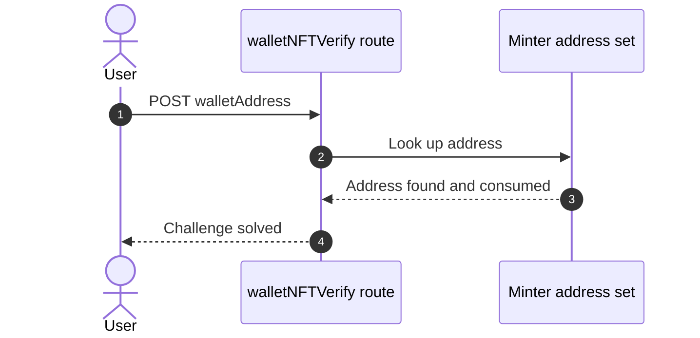

**Security assessment**

<!-- Model assessment (facts the narrative must not contradict): walletNFTVerify trusts a client-supplied walletAddress from the request body and checks it against an in-memory set of minters populated from on-chain events. No signature or proof of key control is required, so any caller who knows a minter address can claim it. Entries are consumed on use, which limits replay of the same address. -->
The check proves knowledge of an address, not control of its key:

- The address comes from the request body and no signature is required, so anyone who knows a minter address can claim it.
- Consuming entries on use limits replay of one address but not first-come claiming.
- The related open wallet endpoint also accepts arbitrary addresses (🟡 [F-085](#f-085)).


**Relevant findings**

- None linked to this control; see the other findings of this category.

<a id="oauth-implicit-flow-login"></a>
#### 6.2.1 OAuth implicit flow login

**Status:** 🟠 Weak - the implicit flow has no state, nonce or PKCE, and the token travels in a query string.

The Angular `login.component.ts` starts Google login with `response_type=token`. `oauth.component.ts` reads the access token from the redirect, fetches the profile, and finishes through the local login endpoint.

The diagram shows how the frontend OAuth adapter enters local login:
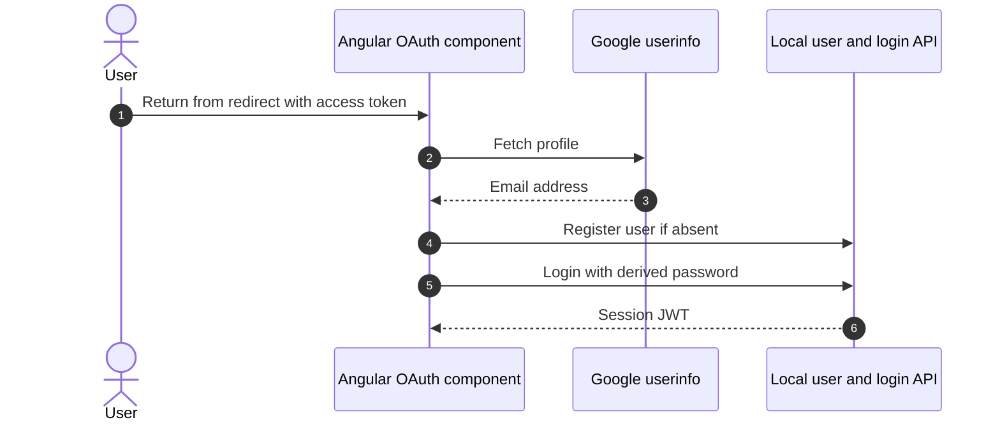

**Security assessment**

<!-- Model assessment (facts the narrative must not contradict): Google login uses response_type=token (implicit flow) with no state or nonce parameter and no PKCE. The access token is passed in a URL query string to the userinfo endpoint. A redirect URI allow-list from server configuration (lines 80-87) is a partial mitigation. -->
This is an identity hint converted into a local password login, with three weaknesses:

- The local password is derived from the email, so anyone who knows the email can log in as that user (🟠 [F-016](#f-016)).
- The flow carries no state, nonce or PKCE parameter (🟡 [F-047](#f-047)).
- The access token is sent in the userinfo query string, where it can reach logs and history (🟡 [F-079](#f-079)).
- A server-configured redirect allow-list is a partial mitigation.


**Relevant findings**

- None linked to this control; see the other findings of this category.

<a id="credential-handling-in-client"></a>
**Credential handling in client.**


**Status:** 🟠 Weak - test credentials ship in client source and password changes travel in URLs.

`login.component.ts` handles the login form and `user.service.ts` calls the password-change and userinfo endpoints. Login validation only requires a non-empty password.

**Security assessment**

<!-- Model assessment (facts the narrative must not contradict): The client source contains hardcoded testing credentials. Password change sends the current and new passwords as GET query parameters, so they can appear in logs and history. Login validation only requires a non-empty password. -->
Credential handling in the Angular client leaks secrets in two ways:

- Hardcoded testing credentials are public properties of the login component (🟡 [F-048](#f-048)).
- Current and new passwords are sent as GET query parameters, so they can appear in logs and browser history (🟡 [F-078](#f-078)).

**Relevant findings**

- None linked to this control; see the other findings of this category.

<a id="websocket-connection-authentication"></a>
**WebSocket connection authentication.**


**Status:** 🔴 Missing - any client can connect and receive stored notifications.

This control is not evidenced in the repository.

**Security assessment**

<!-- Model assessment (facts the narrative must not contradict): The connection handler accepts any client without a token, session or handshake check, and immediately emits stored challenge notifications to it. No io.use middleware is visible in the inspected file. -->
The Socket\.IO connection handler performs no token, session or handshake check:

- Unauthenticated clients can open a channel (🟡 [F-049](#f-049)).
- On connect, the server emits stored challenge notifications, including flags, to the new socket (🟡 [F-080](#f-080)).
- No `io.use` middleware is visible in the inspected file.

**Relevant findings**

- None linked to this control; see the other findings of this category.

<a id="password-reset"></a>
#### 6.2.2 Password reset

**Status:** 🟠 Weak - reset depends on a guessable security answer with no effective throttle.

`routes/resetPassword.ts` accepts an email, a security-question answer and a new password. The answer is compared as a keyed HMAC and the endpoint requires no session.

The diagram shows the intended reset path:
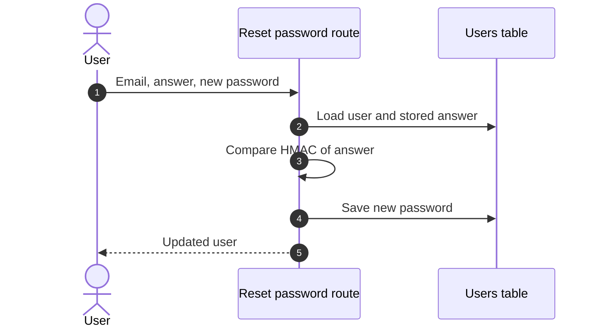

**Security assessment**

<!-- Model assessment (facts the narrative must not contradict): Reset relies only on a knowledge-based security answer, compared as a keyed HMAC. The endpoint is unauthenticated. No rate limiting or lockout was observed in the inspected files, so answers can be guessed repeatedly. -->
The reset path trusts a single knowledge factor:

- A security-question answer authorizes the reset (🟠 [F-019](#f-019)).
- No throttle or lockout protects guessing, and the rate limit on this route can be bypassed through a spoofable header (🟡 [F-050](#f-050)).
- The response returns the full user object (🟡 [F-081](#f-081)).
- Question lookup leaks which emails have an answer stored (🟡 [F-070](#f-070)).


**Relevant findings**

- None linked to this control; see the other findings of this category.

<a id="multi-factor-authentication-step"></a>
#### 6.2.3 Multi-factor authentication step

**Status:** 🟡 Partial - TOTP is requested when a secret is set, but the verification step was not assessed and the first step can be bypassed.

After the password check, login issues a temporary token that requires a TOTP code when the user has a `totpSecret`. The 2FA endpoints sit behind a rate limiter.

**Security assessment**

<!-- Model assessment (facts the narrative must not contradict): Login issues a temporary token requiring a TOTP second factor when a totpSecret is set. routes/2fa.ts was not inspected, so TOTP verification was not assessed. The SQL injection in the first step can bypass the credential check. -->
The possession factor is only as strong as the step before it:

- SQL injection in the first step can bypass the credential check and the path into TOTP (🔴 [F-012](#f-012)).
- `routes/2fa.ts` was not inspected, so code verification itself is unassessed.
- TOTP is opt-in per user.

**Relevant findings**

- None linked to this control; see the other findings of this category.

<a id="user-registration"></a>
#### 6.2.4 User Registration

**Status:** 🔴 Unsafe - the role field is accepted from the registration body, giving privilege escalation at sign-up.

<!-- Model implementation note (facts for the intro): Present at POST /api/Users -->
Registration is served at `POST /api/Users` through the generated `finale-rest` resource. `routes/verify.ts` runs before it on the request.

The diagram shows the intended sign-up path:
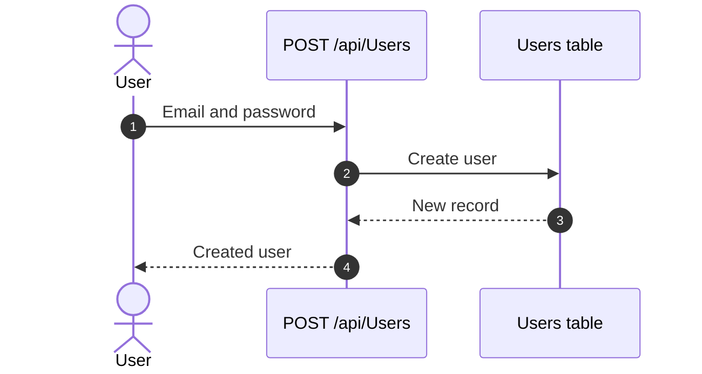

**Security assessment**

Registration lets the caller shape the account:

- The role value from the body is not rejected, so a new user can choose an elevated role (🟠 [F-043](#f-043)).
- The route is registered without authentication middleware (🟠 [F-039](#f-039), 🟠 [F-041](#f-041)).
- 🟡 [F-080](#f-080) — Stored notifications and flags sent to unauthenticated sockets and 🟡 [F-086](#f-086) — Unhandled exception from non-string event payloads are routed here by the catalog but concern the `Socket.IO` channel; see [§6.12](#612-real-time-and-not-applicable-controls).


**Relevant findings**

- 🟠 [F-039](#f-039) — Sensitive Routes Registered Without Authentication Middleware
- 🟠 [F-041](#f-041) — Sensitive Routes Registered Without Authentication Middleware
- 🟠 [F-043](#f-043) — Role accepted from user registration body
- 🟡 [F-080](#f-080) — Stored notifications and flags sent to unauthenticated sockets
- 🟡 [F-086](#f-086) — Unhandled exception from non-string event payloads

### 6.3 Session and Token Controls

<a id="ctrl-session-and-token-controls"></a>

**Verdict:** 🟠 Weak - the signing key is public and tokens sit in script-readable storage.

<!-- The line below is mechanically derived from the controls table — LLM must not re-author it. -->
**Controls covered:**

- [6.3.1 Cookie signing and request body parsing](#cookie-signing-and-request-body-parsing)
- [6.3.2 Client-side token storage](#client-side-token-storage)
- [6.3.3 Session Token Issuance](#session-token-issuance)

**Implemented controls:** Cookie signing and request body parsing, Client-side token storage, Session Token Issuance (JWT Based).

**Assessment:** This application uses a single locally-signed JWT for every authenticated session, regardless of the login flow in [§6.2](#62-identity-and-authentication-controls) that established it. The sub-sections below trace cookie signing, browser storage and token issuance. The `RS256` choice and the 6h expiry are sound, but the private key is committed, tokens are stored where scripts can read them, and there is no revocation.

**Findings in this category without a control:**

- 🟠 [F-002](#f-002) — Session Token in Script-Readable Storage
- 🟠 [F-110](#f-110) — Session token stored in web-accessible client storage

<a id="cookie-signing-and-request-body-parsing"></a>
#### 6.3.1 Cookie signing and request body parsing

**Status:** 🟠 Weak - the cookie signing secret is a hardcoded static string.

`cookie-parser` signs cookies with a fixed secret in `server.ts`. Profile routes look up the cookie token in an in-memory token map, and request bodies of any content type are parsed as text then JSON.

**Security assessment**

<!-- Model assessment (facts the narrative must not contradict): cookie-parser uses a hardcoded static secret 'kekse' in source. Profile routes authenticate via an in-memory token map lookup using the cookie token. Request bodies of any content type are parsed as text and JSON.parse is applied without a try/catch, which can raise errors. -->
Cookie handling depends on a secret anyone with the source knows:

- The cookie-parser secret is hardcoded, so signed cookies can be forged (🟡 [F-046](#f-046)).
- `JSON.parse` runs on parsed bodies without a try/catch, which can raise unhandled errors.
- The token map is in-memory only.

**Relevant findings**

- None linked to this control; see the other findings of this category.

<a id="client-side-token-storage"></a>
#### 6.3.2 Client-side token storage

**Status:** 🟠 Weak - the JWT is readable by any script that runs in the page.

The Angular client writes the JWT to `localStorage` and to a cookie set from JavaScript, with an 8 hour cookie expiry. A failed login clears the stored token.

**Security assessment**

<!-- Model assessment (facts the narrative must not contradict): The JWT is stored in localStorage and in a script-set cookie. The cookie is set from JavaScript, so it cannot be HttpOnly. Any XSS can read the token. The cookie expiry is 8 hours. Failed login clears the stored token. -->
Storage choices expose the token to cross-site scripting:

- The token sits in `localStorage` and a non-HttpOnly cookie, so any XSS reads it (🟠 [F-002](#f-002), 🟠 [F-110](#f-110)).
- A script-set cookie cannot carry the HttpOnly flag.
- XSS sinks exist in the frontend, e.g. 🟠 [F-001](#f-001) — XSS via Trusted HTML Sanitizer Bypass and 🟡 [F-064](#f-064) — DOM XSS through sanitizer bypass on order ID.

**Relevant findings**

- None linked to this control; see the other findings of this category.

<a id="session-token-issuance"></a><a id="session-token-issuance-jwt-based"></a>
#### 6.3.3 Session Token Issuance

**Status:** 🟡 Partial - `RS256` and a 6h expiry are in place, but the signing key is public and tokens cannot be revoked.

<!-- Model implementation note (facts for the intro): lib/insecurity.ts:20-21,52-56,70-91,186-197 -->
`lib/insecurity.ts` signs a JWT on login with an RSA key and a 6h expiry. The `express-jwt` middleware verifies tokens against the public key, and issued tokens are tracked in an in-memory map.

The diagram shows issuance and the validation that follows:
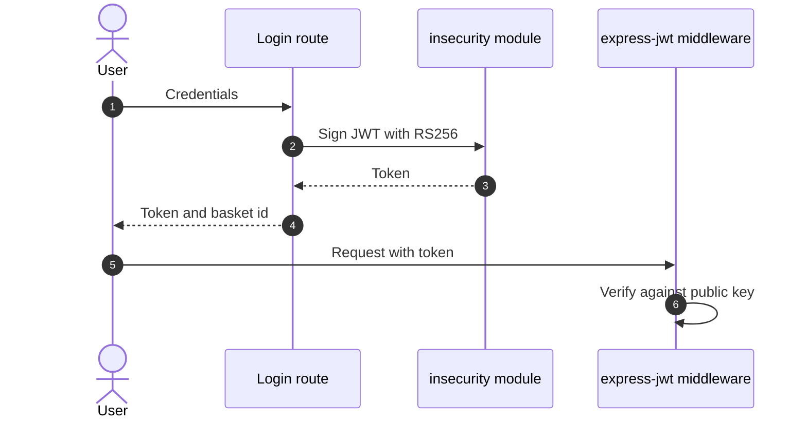

**Security assessment**

<!-- Model assessment (facts the narrative must not contradict): Tokens are RS256-signed with a 6h expiry, and the express-jwt middleware verifies them against the public key. However, the private key is embedded in source, so anyone with the source can forge tokens. Tokens are also kept in an in-memory map with no revocation or logout invalidation. The unverified jws.decode in the role checks is gated by verify(). -->
Algorithm choice is sound but key custody and lifecycle are not:

- The private signing key is a source literal, so anyone with the repository can mint tokens (🟠 [F-020](#f-020)).
- Some verification paths accept tokens too loosely (🟠 [F-018](#f-018)), and the chat route trusts an unverified token (🟠 [F-014](#f-014)).
- A non-cryptographic RNG feeds a secret value (🟠 [F-031](#f-031)).
- Tokens have no logout invalidation or revocation.


**Relevant findings**

- None linked to this control; see the other findings of this category.

### 6.4 Authorization Controls

<a id="ctrl-authorization-controls"></a>


**Systemic weaknesses:** [W-005](#w-005), [W-019](#w-019), [W-020](#w-020), [W-021](#w-021), [W-022](#w-022), [W-038](#w-038)
**Verdict:** 🔴 Missing - object-level and route-level authorization are absent on many routes.

<!-- The line below is mechanically derived from the controls table — LLM must not re-author it. -->
**Controls covered:**

- [6.4.1 Route-level authorization middleware](#route-level-authorization-middleware)
- [6.4.2 Chatbot tool-level authorization and coupon policy](#chatbot-tool-level-authorization-and-coupon-policy)
- [6.4.3 Authentication on web3 listener endpoints](#authentication-on-web3-listener-endpoints)
- [6.4.4 Request authentication attachment and client route gating](#request-authentication-attachment-and-client-route-gating)
- [6.4.5 Role checks](#role-checks)

**Implemented controls:** Route-level authorization middleware, Chatbot tool-level authorization and coupon policy, Request authentication attachment and client route gating, Role checks.

**Assessment:** Authorization relies on per-route `isAuthorized`, `denyAll` and `isAccounting` middleware plus role claims in the JWT. Coverage is inconsistent, object ownership is rarely checked, and the chatbot enforces coupon limits only through its prompt. Client route guards are not an enforcement point.

**Findings in this category without a control:**

- 🟠 [F-003](#f-003) — Systemic IDOR Missing Ownership Checks
- 🟠 [F-004](#f-004) — Missing Authorization on Product Update
- 🔴 [F-008](#f-008) — Broken authorization attacker-controlled owner ID in resource query…
- 🟠 [F-024](#f-024) — IDOR resource lookup by URL parameter without ownership filter…
- 🟠 [F-038](#f-038) — IDOR / broken object-level authorization PUT `/api/BasketItems/:id`
- 🟠 [F-039](#f-039) — Sensitive Routes Registered Without Authentication Middleware
- 🟠 [F-041](#f-041) — Sensitive Routes Registered Without Authentication Middleware
- 🟠 [F-042](#f-042) — Chatbot coupon tool lacks server-side discount limit
- 🟠 [F-043](#f-043) — Role accepted from user registration body
- 🟡 [F-091](#f-091) — Any authenticated user lists all accounts

<a id="route-level-authorization-middleware"></a>
#### 6.4.1 Route-level authorization middleware

**Status:** 🟡 Partial - middleware covers many routes but leaves several sensitive ones open.

`isAuthorized`, `denyAll` and `isAccounting` guard baskets, complaints, privacy requests, B2B, 2FA and several generated API resources.

**Security assessment**

<!-- Model assessment (facts the narrative must not contradict): isAuthorized/denyAll/isAccounting are applied to baskets, complaints, privacy requests, B2B, 2FA and several generated API resources. Coverage is inconsistent: PUT /api/Products/:id authorization is commented out, /api/Deliverys, /rest/order-history, /rest/deluxe-membership, /rest/memories, /rest/chat and /rest/products/:id/reviews PUT show no authorization middleware in the inspected slices. The /api/Quantitys/:id IpFilter uses a placeholder address. -->
Coverage gaps appear on routes that matter:

- Product update authorization is commented out (🟠 [F-004](#f-004)).
- Sensitive routes are registered without authentication middleware (🟠 [F-039](#f-039), 🟠 [F-041](#f-041)).
- The memories listing is open and returns user data (🟡 [F-068](#f-068)).
- Any signed-in user can list all accounts (🟡 [F-091](#f-091)).
- The `/api/Quantitys/:id` IP filter uses a placeholder address.

**Relevant findings**

- None linked to this control; see the other findings of this category.

<a id="chatbot-tool-level-authorization-and-coupon-policy"></a>
#### 6.4.2 Chatbot tool-level authorization and coupon policy

**Status:** 🟠 Weak - coupon limits live only in the system prompt, not in tool code.

`routes/chat.ts` lets the model call tools such as `generateCoupon`, `getOrderById`, `searchProducts` and `getProductReviews`. `getOrderById` checks authentication and ownership.

**Security assessment**

<!-- Model assessment (facts the narrative must not contradict): The coupon limit (max 10%) and eligibility conditions exist only in the system prompt. The generateCoupon tool accepts any number with no server-side cap, order validation or authentication, so model-directed action authorization depends on prompt compliance. getOrderById does check authentication and ownership (compared by vowel-masked email). The model-chosen searchProducts and getProductReviews tools have no per-user scoping. The /rest/chat route has no auth middleware, and the flow evidence says the token is decoded without signature verification. The system prompt also embeds a confidential discount instruction. -->
Model-directed actions depend on prompt compliance:

- `generateCoupon` accepts any number with no server-side cap, order check or authentication (🟠 [F-042](#f-042)).
- The chat route has no auth middleware and decodes the token without verifying it (🟠 [F-014](#f-014)).
- Search and review tools have no per-user scoping.
- The system prompt embeds a confidential discount instruction.
- Client messages reach the model unvalidated (🟡 [F-055](#f-055)).

**Relevant findings**

- None linked to this control; see the other findings of this category.

<a id="authentication-on-web3-listener-endpoints"></a>
#### 6.4.3 Authentication on web3 listener endpoints

**Status:** 🔴 Missing - web3 listener handlers perform no caller authentication.

This control is not evidenced in the repository.

**Security assessment**

<!-- Model assessment (facts the narrative must not contradict): The handlers in the cited slices perform no authentication or authorization checks. Any caller can trigger creation of the shared WebSocket listeners. Handler-chain middleware outside these slices was not inspected beyond the flow metadata, which records no credential check. -->
The web3 handlers carry no credential check:

- Any caller can trigger creation of the shared WebSocket listeners.
- Middleware outside the cited slices was not inspected, but the flow metadata records no credential check.
- The related open wallet endpoint is described in 🟡 [F-085](#f-085) — Unbounded unvalidated wallet set on open endpoint.

**Relevant findings**

- None linked to this control; see the other findings of this category.

<a id="request-authentication-attachment-and-client-route-gating"></a>
#### 6.4.4 Request authentication attachment and client route gating

**Status:** 🟡 Partial - the client forwards IDs and tokens, and the server must carry authorization.

Angular services call basket, address and card endpoints with client-supplied IDs. An interceptor attaches the token and route guards gate pages in the browser.

**Security assessment**

<!-- Model assessment (facts the narrative must not contradict): Services call object-ID endpoints such as basket, address and card with client-supplied IDs. Authorization is left to the server. The interceptor and guards (request.interceptor.ts, app.guard.ts) were not inspected, so this rating covers only the services read. Client-side checks are not an enforcement boundary. -->
Authorization is left to the server, which does not do it consistently:

- Client-chosen IDs reach object endpoints without ownership checks (🟠 [F-003](#f-003), 🟠 [F-024](#f-024), 🟠 [F-038](#f-038) — IDOR / broken object-level authorization PUT /api/BasketItems/:id (IDOR / broken object-level authorization PUT `/api/BasketItems/:id`)).
- Broken authorization is reported on further object routes (🔴 [F-008](#f-008)).
- `request.interceptor.ts` and `app.guard.ts` were not inspected, so this rating covers only the services read.
- Client checks are not an enforcement boundary.

**Relevant findings**

- None linked to this control; see the other findings of this category.

<a id="role-checks"></a>
#### 6.4.5 Role checks

**Status:** 🟡 Partial - role claims are checked after signature verification, but the key is forgeable.

Role checks for accounting, deluxe and customer first verify the token signature, then read the role claim. The deluxe token is an HMAC keyed with the private key.

**Security assessment**

<!-- Model assessment (facts the narrative must not contradict): Role checks for accounting, deluxe and customer verify the token signature and then check the role claim. The deluxe token is an HMAC keyed with the private key. The forgeable-key issue limits their strength. -->
The role logic is sound, the key custody is not:

- A committed private key lets anyone sign a token carrying any role (🟠 [F-020](#f-020)).
- The deluxe HMAC shares that key.
- Registration also accepts the role from the request body (🟠 [F-043](#f-043)).
- The account listing has no role check (🟡 [F-091](#f-091)).

**Relevant findings**

- None linked to this control; see the other findings of this category.

### 6.5 Query Construction and Data Access Controls

<a id="ctrl-query-construction-and-data-access-controls"></a>


**Systemic weaknesses:** [W-001](#w-001), [W-004](#w-004)
**Verdict:** 🔴 Unsafe - raw SQL string building in login and search, and string-built NoSQL predicates in review and order routes.

<!-- The line below is mechanically derived from the controls table — LLM must not re-author it. -->
**Controls covered:**

- [6.5.1 Embedded MarsDB data store access control](#embedded-marsdb-data-store-access-control)
- [6.5.2 Login query construction](#login-query-construction)

**Implemented controls:** Login query construction.

**Assessment:** Sequelize backs most data access, but the login and search routes build raw SQL by interpolation and the MarsDB review and order routes build `$where` predicates from request values. The embedded stores add no access control of their own, so each route must sanitize input itself, and several do not.

**Findings in this category without a control:**

- 🔴 [F-006](#f-006) — SQL injection request data interpolated into a SQL string
- 🔴 [F-012](#f-012) — SQL injection in login email lookup
- 🟠 [F-027](#f-027) — Input in executable NoSQL predicate
- 🟠 [F-028](#f-028) — NoSQL where injection in product reviews lookup
- 🟠 [F-029](#f-029) — NoSQL where injection in order tracking
- 🟡 [F-054](#f-054) — NoSQL selector injection in review likes

<a id="embedded-marsdb-data-store-access-control"></a>
#### 6.5.1 Embedded MarsDB data store access control

**Status:** 🔴 Missing - the in-process store has no authentication, schema or access limits.

This control is not evidenced in the repository.

**Security assessment**

<!-- Model assessment (facts the narrative must not contradict): The reviews ('posts') and orders collections are created in-process with no authentication, schema validation, or access restriction at the data layer. The embedded engine has no login of its own, so the store depends entirely on callers for authorization and input sanitisation. Only this file was inspected; caller-side controls were not assessed here. -->
The MarsDB collections depend entirely on callers:

- Review and order predicates are built from request input (🟠 [F-027](#f-027), 🟠 [F-028](#f-028), 🟠 [F-029](#f-029)).
- Review like selectors take unvalidated request ids (🟡 [F-054](#f-054)).
- Only the store file was inspected, so caller-side controls are not assessed here.

**Relevant findings**

- None linked to this control; see the other findings of this category.

<a id="login-query-construction"></a>
#### 6.5.2 Login query construction

**Status:** 🔴 Unsafe - the email is interpolated into raw SQL, which allows authentication bypass.

`routes/login.ts` hashes the submitted password, then passes a hand-built SQL string to `sequelize.query()`. The email is placed in the string as given.

The diagram shows the intended login lookup:
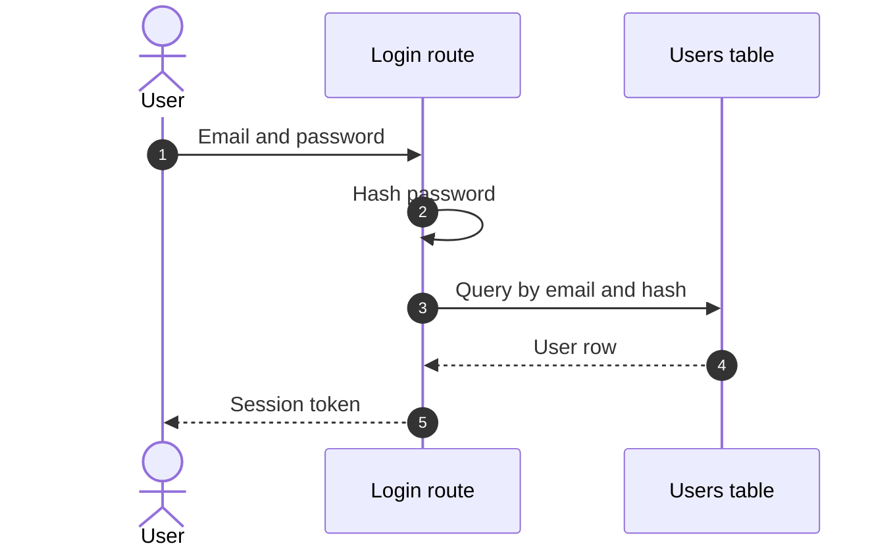

**Security assessment**

<!-- Model assessment (facts the narrative must not contradict): The login query is built by string interpolation of req.body.email into raw SQL. This allows SQL injection and authentication bypass. The password is hashed before interpolation, but the email is not escaped or parameterized. -->
The query structure is controlled by the caller:

- The unescaped email changes the WHERE clause and returns a user row, such as the admin, without a password (🔴 [F-012](#f-012)).
- The product search route repeats the pattern (🔴 [F-006](#f-006)).
- Hashing the password first does not protect the email term.


**Relevant findings**

- None linked to this control; see the other findings of this category.

### 6.6 Input Boundary Validation Controls

<a id="ctrl-input-boundary-validation-controls"></a>

**Verdict:** 🔴 Missing - there is no shared validation layer, and wallet, upload and chat inputs are accepted unchecked.

<!-- The line below is mechanically derived from the controls table — LLM must not re-author it. -->
**Controls covered:**

- [6.6.1 Validation Approach](#validation-approach)
- [6.6.2 Chatbot tool input validation and query construction](#chatbot-tool-input-validation-and-query-construction)
- [6.6.3 Validation of wallet address input](#validation-of-wallet-address-input)
- [6.6.4 Guest basket input validation](#guest-basket-input-validation)
- [6.6.5 WebSocket message payload validation](#websocket-message-payload-validation)

**Implemented controls:** Chatbot tool input validation and query construction, Guest basket input validation, WebSocket message payload validation.

**Assessment:** Validation exists in pockets: Zod schemas on chatbot tools, item checks on the guest basket, and ad hoc checks in socket handlers. Wallet top-up, wallet address, upload and chat length have none, so unbounded values reach memory, disk and the model.

**Findings in this category without a control:**

- 🟠 [F-021](#f-021) — Wallet top-up accepts unvalidated balance amount
- 🟠 [F-036](#f-036) — Blocking busy-wait sleep reachable from queries
- 🟡 [F-082](#f-082) — Unbounded remote download for profile image
- 🟡 [F-083](#f-083) — Unbounded chat input with no rate limit on LLM endpoint
- 🟡 [F-084](#f-084) — Unbounded disk upload ahead of authentication
- 🟡 [F-085](#f-085) — Unbounded unvalidated wallet set on open endpoint

<a id="validation-approach"></a>
#### 6.6.1 Validation Approach

**Status:** 🟠 Weak - validation is per-handler with no common schema layer.

Each handler validates on its own terms: Zod on chatbot tools, try/catch plus item checks on the guest basket, and `Array.isArray` guards in socket handlers.

**Security assessment**

Unvalidated values reach sensitive operations:

- Wallet top-up uses the body balance directly (🟠 [F-021](#f-021)).
- A review route runs a blocking busy-wait (🟠 [F-036](#f-036)).
- Remote downloads and chat input are unbounded (🟡 [F-082](#f-082), 🟡 [F-083](#f-083)).
- Uploads are accepted ahead of authentication (🟡 [F-084](#f-084)).
- The wallet set grows without limit (🟡 [F-085](#f-085)).

**Relevant findings**

- None linked to this control; see the other findings of this category.

<a id="chatbot-tool-input-validation-and-query-construction"></a>
#### 6.6.2 Chatbot tool input validation and query construction

**Status:** 🟠 Weak - Zod types the tool arguments, but query building still has gaps.

The chatbot tools in `routes/chat.ts` declare Zod schemas for arguments. `searchProducts` uses a parameterized `Op.like` and `getProductReviews` coerces the id with `Number()`.

**Security assessment**

<!-- Model assessment (facts the narrative must not contradict): Zod schemas give type checks. getProductReviews coerces the id with Number() before building a $where string, which limits injection to numeric values (NaN is still concatenated). searchProducts uses Sequelize Op.like with a parameterized value, but wildcard characters in the query are not escaped. -->
Type checks do not cover everything:

- `getProductReviews` still concatenates the number into a `$where` string, and `NaN` passes through.
- Wildcard characters in the search term are not escaped.
- Free-text chat messages reach the model unvalidated (🟡 [F-055](#f-055)).

**Relevant findings**

- None linked to this control; see the other findings of this category.

<a id="validation-of-wallet-address-input"></a>
#### 6.6.3 Validation of wallet address input

**Status:** 🔴 Missing - the wallet address is accepted with no type, format or size check.

This control is not evidenced in the repository.

**Security assessment**

<!-- Model assessment (facts the narrative must not contradict): req.body.walletAddress is added to an unbounded in-memory Set without any type, format or size validation. Unauthenticated callers can grow the set without limit, which is a memory-exhaustion risk, and can pre-register arbitrary addresses. -->
The wallet address path is open to abuse:

- `req.body.walletAddress` goes into an in-memory Set with no validation, so unauthenticated callers can grow it without limit (🟡 [F-085](#f-085)).
- The same callers can pre-register arbitrary addresses.

**Relevant findings**

- None linked to this control; see the other findings of this category.

<a id="guest-basket-input-validation"></a>
#### 6.6.4 Guest basket input validation

**Status:** 🟢 Adequate - stored guest basket data is parsed safely and each item is checked.

The guest basket reads data from `sessionStorage`, parses it inside try/catch, and keeps only items with an integer ProductId and positive quantity.

**Security assessment**

<!-- Model assessment (facts the narrative must not contradict): Guest basket data from sessionStorage is parsed in try/catch and each item is validated (integer ProductId, positive quantity). Invalid items are dropped. This is local state only and the server must still validate. -->
The check holds for local state:

- Invalid items are dropped rather than sent on.
- It is client-side only, so the server must still validate basket contents.
- No finding is routed to this control.

**Relevant findings**

- None linked to this control; see the other findings of this category.

<a id="websocket-message-payload-validation"></a>
#### 6.6.5 WebSocket message payload validation

**Status:** 🟠 Weak - socket handlers take untyped data with ad hoc checks.

`registerWebsocketEvents.ts` registers handlers that receive `any` data. Some use optional chaining or `Array.isArray`, and the effects are limited to challenge state.

**Security assessment**

<!-- Model assessment (facts the narrative must not contradict): Handlers take untyped data (any) with no schema validation. Any client can remove notifications by sending a matching flag, and can trigger challenge-solving logic. Some handlers use optional chaining or Array.isArray checks, but these are ad hoc. The event effects are limited to application challenge state. -->
Payload handling is unstructured:

- A non-string event value reaches `str.includes` and raises an unhandled exception (🟡 [F-086](#f-086)).
- Any client can remove notifications by sending a matching flag, and the stored notifications carry flags (🟡 [F-080](#f-080)).
- No schema validation is applied.

**Relevant findings**

- None linked to this control; see the other findings of this category.

### 6.7 Output Encoding and Rendering Controls


**Systemic weaknesses:** [W-007](#w-007), [W-023](#w-023)
**Verdict:** 🟠 Weak - the only cataloged control is a redirect allowlist with a substring check, and several rendering sinks bypass Angular escaping.

<!-- The line below is mechanically derived from the controls table — LLM must not re-author it. -->
**Controls covered:**

- [6.7.1 Redirect allowlist](#redirect-allowlist)

**Implemented controls:** Redirect allowlist.

**Assessment:** Angular escapes templates by default, but several components bypass it with trusted-HTML calls or raw writes: 🟠 [F-001](#f-001), 🟡 [F-005](#f-005), 🟡 [F-063](#f-063) (Unsanitized `document.write` of data export response) and 🟡 [F-064](#f-064). Server-side setters store unsanitized values for later rendering (🟡 [F-056](#f-056), 🟡 [F-065](#f-065)). The one cataloged control, the redirect allowlist, matches by substring.

**Findings in this category without a control:**

- 🟠 [F-001](#f-001) — XSS via Trusted HTML Sanitizer Bypass
- 🟡 [F-005](#f-005) — Angular Sanitizer Bypass Rendering Untrusted HTML
- 🟡 [F-056](#f-056) — Unsanitized product description setter
- 🟡 [F-063](#f-063) — Unsanitized document.write of data export response
- 🟡 [F-064](#f-064) — DOM XSS through sanitizer bypass on order ID
- 🟡 [F-065](#f-065) — Unsanitized login IP header stored when challenge flag on

<a id="redirect-allowlist"></a>
#### 6.7.1 Redirect allowlist

**Status:** 🟠 Weak - the allowlist matches substrings, so an attacker URL containing an allowed URL passes.

`lib/insecurity.ts` decides whether a redirect target is allowed by testing each allowed URL against the candidate with `url.includes`.

**Security assessment**

<!-- Model assessment (facts the narrative must not contradict): The allowlist check uses substring matching with url.includes, so an attacker URL containing an allowed URL passes. -->
The check is a substring test:

- A hostile URL that embeds an allowed URL is accepted (🟡 [F-051](#f-051)).
- The redirect handler that consumes the result was not read.

**Relevant findings**

- None linked to this control; see the other findings of this category.

### 6.8 Browser and Cross-Origin Controls

**Verdict:** 🟠 Weak - the only evidenced browser policy is a hard-coded Socket\.IO CORS origin.

<!-- The line below is mechanically derived from the controls table — LLM must not re-author it. -->
**Controls covered:**

- [6.8.1 Socket.io CORS origin restriction](#socketio-cors-origin-restriction)

**Implemented controls:** Socket\.io CORS origin restriction.

**Assessment:** The cataloged browser control is the `Socket.IO` CORS origin setting. No other header or CORS evidence was cataloged, so this chapter is thin. The single origin limits browser access, but CORS does not authenticate clients.

**Findings in this category without a control:**

- 🟡 [F-047](#f-047) — OAuth implicit flow without state, nonce or PKCE

<a id="socketio-cors-origin-restriction"></a>
#### 6.8.1 Socket\.io CORS origin restriction

**Status:** 🟡 Partial - a single origin is pinned, but it is hard-coded and does not stop non-browser clients.

The `Socket.IO` server restricts CORS to one origin, `http://localhost:4200`, set in source.

**Security assessment**

<!-- Model assessment (facts the narrative must not contradict): Socket.io server restricts CORS to a single hard-coded origin (http://localhost:4200). This limits browser cross-origin access but is hard-coded, not environment-configurable, and CORS does not authenticate clients or block non-browser clients. -->
The restriction is narrow:

- The origin is hard-coded, not environment-configurable.
- Non-browser clients ignore CORS, so the unauthenticated channel stays open (🟡 [F-049](#f-049)).
- The OAuth flow lacks state and nonce (🟡 [F-047](#f-047)).

**Relevant findings**

- None linked to this control; see the other findings of this category.

### 6.9 Cryptography Secrets and Data Protection


**Systemic weaknesses:** [W-036](#w-036)
**Verdict:** 🔴 Missing - the signing key, cookie secret and wallet mnemonic are in source, and data at rest and in transit lack protection.

<!-- The line below is mechanically derived from the controls table — LLM must not re-author it. -->
**Controls covered:**

- [6.9.1 Embedded SQLite datastore protection](#embedded-sqlite-datastore-protection)
- [6.9.2 Blockchain RPC API key handling](#blockchain-rpc-api-key-handling)
- [6.9.3 Transport protection of API calls](#transport-protection-of-api-calls)
- [6.9.4 Database storage encryption and access authentication](#database-storage-encryption-and-access-authentication)
- [6.9.5 Password Hashing and Credential Storage](#password-hashing-and-credential-storage)

**Implemented controls:** Embedded SQLite datastore protection, Blockchain RPC API key handling, Transport protection of API calls, Password hashing.

**Assessment:** Secrets and data protection fail in several places: the JWT private key and cookie secret are source literals (🟠 [F-020](#f-020), 🟡 [F-046](#f-046)), a wallet mnemonic is hardcoded (🟡 [F-076](#f-076)), a non-cryptographic RNG feeds a token (🟠 [F-031](#f-031)), and order PDFs with customer email sit in a listed directory (🟡 [F-072](#f-072)). SQLite is unencrypted, and passwords use unsalted `MD5`.

**Findings in this category without a control:**

- 🟠 [F-020](#f-020) — Hardcoded JWT private signing key in source
- 🟠 [F-031](#f-031) — Non-cryptographic RNG for a
- 🟡 [F-046](#f-046) — Hardcoded cookie-parser signing secret
- 🟡 [F-048](#f-048) — Hardcoded testing credentials in login component
- 🟡 [F-072](#f-072) — Order PDFs with customer email in listed directory
- 🟡 [F-076](#f-076) — Hardcoded wallet mnemonic in source

<a id="embedded-sqlite-datastore-protection"></a>
#### 6.9.1 Embedded SQLite datastore protection

**Status:** 🟠 Weak - the database is a plain file with ignored placeholder credentials.

Sequelize opens the file-based SQLite database at `data/juiceshop.sqlite` with placeholder `username` and `password` values that SQLite ignores.

**Security assessment**

<!-- Model assessment (facts the narrative must not contradict): Sequelize opens a file-based SQLite database at data/juiceshop.sqlite with placeholder credentials ('username'/'password') that SQLite ignores. No database-level authentication or encryption at rest is configured in this code. Protection depends on process and filesystem access controls, which were not inspected. -->
Protection depends on the host rather than the code:

- No database authentication or at-rest encryption is configured here.
- Payment card numbers are stored as plain integers (🟡 [F-075](#f-075)).
- File system permissions were not inspected.

**Relevant findings**

- None linked to this control; see the other findings of this category.

<a id="blockchain-rpc-api-key-handling"></a>
#### 6.9.2 Blockchain RPC API key handling

**Status:** 🟡 Partial - the key comes from the environment, but sits in the URL path.

The web3 code reads the Alchemy key from an environment variable and connects over `wss`.

**Security assessment**

<!-- Model assessment (facts the narrative must not contradict): The Alchemy API key is read from the environment rather than hardcoded, and the connection uses wss. However, the key is embedded in the URL path and falls back to an empty string when unset. Provider errors are logged with error.message, which could expose the URL. -->
The key handling has small gaps:

- The key is embedded in the URL path.
- It falls back to an empty string when unset.
- Provider errors are logged with `error.message`, which could expose the URL.
- A wallet mnemonic is separately hardcoded (🟡 [F-076](#f-076)).

**Relevant findings**

- None linked to this control; see the other findings of this category.

<a id="transport-protection-of-api-calls"></a>
#### 6.9.3 Transport protection of API calls

**Status:** 🟠 Weak - API calls go to a configurable HTTP origin and TLS is left to deployment.

Angular services build API URLs from `environment.hostServer`, which is `http://localhost:3000` in the default environment file.

**Security assessment**

<!-- Model assessment (facts the narrative must not contradict): API calls use environment.hostServer, and the architecture flows list the protocol as HTTP. Sensitive data crosses this path: credentials, TOTP tokens, passwords, and a private key via submitKey. Enforcement of TLS is deployment-dependent and was not inspected. -->
Sensitive data crosses this path:

- A private key is posted to the configurable origin (🟡 [F-077](#f-077)).
- Passwords go out as GET query parameters (🟡 [F-078](#f-078)).
- The OAuth token goes out in a query string (🟡 [F-079](#f-079)).
- TLS enforcement is deployment-dependent and was not inspected.

**Relevant findings**

- None linked to this control; see the other findings of this category.

<a id="database-storage-encryption-and-access-authentication"></a>
#### 6.9.4 Database storage encryption and access authentication

**Status:** 🔴 Missing - no database authentication or at-rest encryption exists.

This control is not evidenced in the repository.

**Security assessment**

<!-- Model assessment (facts the narrative must not contradict): The SQLite database is a plain file at data/juiceshop.sqlite. The Sequelize constructor uses placeholder credentials ('database', 'username', 'password'), which SQLite ignores, so there is no database-level authentication. The configuration shows no at-rest encryption. Protection depends on file system permissions and application-layer controls, which were not inspected here. -->
The database is unprotected below the application:

- The Sequelize constructor uses placeholder credentials that SQLite ignores.
- No at-rest encryption appears in the configuration.
- Plaintext card numbers follow from this (🟡 [F-075](#f-075)).
- File permissions and application-layer controls were not inspected.

**Relevant findings**

- None linked to this control; see the other findings of this category.

<a id="password-hashing"></a><a id="password-hashing-and-credential-storage"></a>
#### 6.9.5 Password Hashing and Credential Storage

**Status:** 🟠 Weak - passwords use unsalted `MD5`, and the answer HMAC key is hardcoded.

The `User` model setter hashes passwords with `security.hash` from `lib/insecurity.ts`. The security-answer HMAC uses a key hardcoded in the same module.

**Security assessment**

<!-- Model assessment (facts the narrative must not contradict): Passwords are hashed with unsalted MD5, which is fast and vulnerable to rainbow-table and brute-force attacks. The security-answer HMAC uses a hardcoded key at line 42. -->
The hashing is fast and unsalted:

- Unsalted `MD5` has no work factor, so a database dump yields passwords through rainbow tables or brute force (🟠 [F-035](#f-035) — Weak MD5 password hashing in User setter (Weak `MD5` password hashing in User setter)).
- The HMAC key for security answers is a source literal.
- A non-cryptographic RNG feeds a secret value (🟠 [F-031](#f-031)).

**Relevant findings**

- None linked to this control; see the other findings of this category.

### 6.10 File Parser and Outbound Request Controls

<a id="ctrl-file-parser-and-outbound-request-controls"></a>


**Systemic weaknesses:** [W-002](#w-002), [W-003](#w-003), [W-035](#w-035)
**Verdict:** 🔴 Missing - outbound fetches, archive extraction and XML parsing have no hardening, and management surfaces are public.

<!-- The line below is mechanically derived from the controls table — LLM must not re-author it. -->
**Controls covered:**

- [6.10.1 Profile image URL fetch](#profile-image-url-fetch)
- [6.10.2 Upload handling](#upload-handling)

**Implemented controls:** Upload handling (size, mime type, filename sanitization).

**Assessment:** This category has the most findings. The server fetches user-supplied URLs (🟠 [F-034](#f-034)), extracts zip entries by unsanitized path (🟠 [F-023](#f-023)), parses XML with entity loading (🟠 [F-033](#f-033)), evaluates user text (🟠 [F-037](#f-037), 🟠 [F-030](#f-030)) and serves key, log and PDF files publicly (🟠 [F-032](#f-032), 🟡 [F-073](#f-073), 🟡 [F-074](#f-074)). Upload handling is the one partial control.

**Findings in this category without a control:**

- 🟠 [F-022](#f-022) — Path traversal filesystem access from request input
- 🟠 [F-023](#f-023) — Zip entry path traversal on complaint upload
- 🟠 [F-030](#f-030) — Input compiled as template source
- 🟠 [F-032](#f-032) — Unauthenticated encryption key file download
- 🟠 [F-033](#f-033) — XXE file content disclosure in upload errors
- 🟠 [F-034](#f-034) — Server-side request forgery in profile image URL fetch
- 🟠 [F-037](#f-037) — Code injection through eval of profile username
- 🟡 [F-051](#f-051) — Substring redirect allowlist check
- 🟡 [F-067](#f-067) — CAPTCHA answer returned to client
- 🟡 [F-068](#f-068) — Unauthenticated memories listing with user data
- 🟡 [F-073](#f-073) — Unauthenticated log directory browsing
- 🟡 [F-074](#f-074) — Unauthenticated access log download
- 🟡 [F-080](#f-080) — Stored notifications and flags sent to unauthenticated sockets
- 🟡 [F-081](#f-081) — Reset response returns full user object

<a id="profile-image-url-fetch"></a><a id="profile-image-url-fetch-ssrf-protection"></a>
#### 6.10.1 Profile image URL fetch

**Status:** 🔴 Missing - the server fetches any requester-supplied URL.

This control is not evidenced in the repository.

**Security assessment**

<!-- Model assessment (facts the narrative must not contradict): The server fetches a requester-supplied URL with no scheme, host or private-range allowlist and no size limit. The response is written to disk under a user-id-based name with an extension that is allowlisted or defaults to jpg. Only a logged-in cookie session is required. On fetch failure the raw URL is stored as the profile image. No SSRF mitigation was found. -->
The profile image fetch has no SSRF defence:

- No scheme, host or private-range allowlist applies, and any logged-in session can reach internal addresses (🟠 [F-034](#f-034)).
- The download has no size limit (🟡 [F-082](#f-082)).
- On failure the raw URL is stored as the profile image.

**Relevant findings**

- None linked to this control; see the other findings of this category.

<a id="upload-handling"></a><a id="upload-handling-size-mime-type-filename-sanitization"></a>
#### 6.10.2 Upload handling

**Status:** 🟡 Partial - a mime allowlist and filename sanitizing exist, but sizes and types are weakly checked.

The memory upload applies a mime allowlist, `sanitizeFilename` and a timestamp suffix. The memory-storage multer is capped at 200 KB, and `/file-upload` adds its own size and type checks.

**Security assessment**

<!-- Model assessment (facts the narrative must not contradict): The memory upload applies a mime allowlist (client-declared type), sanitizeFilename and a timestamp suffix. The memory-upload multer is configured without a fileSize limit, while the memory-storage multer is limited to 200 KB. /file-upload adds size and type checks. Mime types are taken from the client header, not content. -->
Upload controls are uneven:

- Zip entry paths are not constrained to the upload folder (🟠 [F-023](#f-023)).
- The memory-upload multer has no `fileSize` limit and runs ahead of authentication (🟡 [F-084](#f-084)).
- Mime types come from the client header, not content.
- XML parsing can disclose file content in errors (🟠 [F-033](#f-033)).
- The file type allowlist can be bypassed (🟡 [F-052](#f-052)).

**Relevant findings**

- None linked to this control; see the other findings of this category.

### 6.11 Operations Runtime and Supply Chain Controls

**Build path.** [Figure 1b](#figure-1b) shows the inputs, build systems and release artifacts that Juice Shop evidences.

Highlighted path of 🟡 [F-059](#f-059): npm registry → GitHub Actions → docker.io/bkimminich/juice-shop. The path stops where the evidence ends.

**Attack entries:**

- **Manipulated dependency**
  - 🟡 [F-059](#f-059) — Untrusted npm Install/Postinstall Scripts Enabled
  - 🟡 [F-061](#f-061) — Release build uses non-locked dependency installation
- **Manipulated CI input**
  - 🟡 [F-058](#f-058) — Unverified remote script piped to shell in deploy workflow
  - 🟡 [F-060](#f-060) — Mutable main branch action reference with write token
  - 🟡 [F-062](#f-062) — Unpinned Container Base Image
- **Replaced release artifact**
  - 🟡 [F-057](#f-057) — Missing Container Image Signing

**Not attributable to a build step:**

- 🟡 [F-089](#f-089) — Container Runs as Root


**Systemic weaknesses:** [W-037](#w-037)
**Verdict:** 🔴 Missing - rate limiting covers few routes, the release pipeline is not locked down, and operational endpoints are public.

<!-- The line below is mechanically derived from the controls table — LLM must not re-author it. -->
**Controls covered:**

- [6.11.1 Rate limiting](#rate-limiting)
- [6.11.2 Access logging and metrics exposure](#access-logging-and-metrics-exposure)
- [6.11.3 Database query logging and transaction/retry handling](#database-query-logging-and-transactionretry-handling)
- [6.11.4 GitHub Actions pinned to commit SHAs](#github-actions-pinned-to-commit-shas)
- [6.11.5 Release pipeline dependency installation and build integrity](#release-pipeline-dependency-installation-and-build-integrity)
- [6.11.6 CI secret handling and workflow token usage](#ci-secret-handling-and-workflow-token-usage)
- [6.11.7 Scheduled dynamic security scanning](#scheduled-dynamic-security-scanning)
- [6.11.8 Build pipeline and dependency controls](#build-pipeline-and-dependency-controls)

**Implemented controls:** Rate limiting, Access logging and metrics exposure, Database query logging and transaction/retry handling, GitHub Actions pinned to commit SHAs, Release pipeline dependency installation and build integrity.

**Assessment:** Runtime and pipeline controls are patchy. Rate limits cover only reset and 2FA, logs and metrics are exposed (🟡 [F-071](#f-071), 🟡 [F-073](#f-073), 🟡 [F-074](#f-074)), and the container runs as root (🟡 [F-089](#f-089)). In CI, actions are SHA-pinned and a weekly ZAP scan runs, but images are unsigned (🟡 [F-057](#f-057)), a remote script is piped to shell (🟡 [F-058](#f-058)) and workflow permissions are unset (🟡 [F-090](#f-090)).

**Findings in this category without a control:**

- 🟡 [F-057](#f-057) — Missing Container Image Signing
- 🟡 [F-058](#f-058) — Unverified remote script piped to shell in deploy workflow
- 🟡 [F-061](#f-061) — Release build uses non-locked dependency installation
- 🟡 [F-089](#f-089) — Container Runs as Root
- 🟡 [F-090](#f-090) — Missing Workflow Permissions Block

<a id="rate-limiting"></a>
#### 6.11.1 Rate limiting

**Status:** 🟠 Weak - limiters cover only reset and 2FA, and the reset limiter is spoofable.

`express-rate-limit` is applied to reset-password and the 2FA endpoints at 100 requests per 5 minutes. The reset key generator reads `X-Forwarded-For`.

**Security assessment**

<!-- Model assessment (facts the narrative must not contradict): Rate limits apply only to reset-password and the 2FA endpoints. The reset-password key generator trusts the X-Forwarded-For header (spoofable, so the limit can be bypassed). The limit is 100 per 5 minutes, and validate:false is set on the 2FA limiters. The login, chat (LLM cost) and upload endpoints show no limiter. -->
Most expensive or sensitive routes have no limiter:

- The spoofable header lets an attacker rotate the key and bypass the reset limit (🟡 [F-050](#f-050)).
- Login, chat and upload show no limiter, leaving LLM cost and disk use open (🟡 [F-083](#f-083), 🟡 [F-084](#f-084)).
- The 2FA limiters set `validate:false`.

**Relevant findings**

- None linked to this control; see the other findings of this category.

<a id="access-logging-and-metrics-exposure"></a>
#### 6.11.2 Access logging and metrics exposure

**Status:** 🟡 Partial - logs are written and rotated, but they and metrics are publicly readable.

`morgan` writes rotating access logs with two days of retention. `/support/logs` serves the directory and `/metrics` serves Prometheus output.

**Security assessment**

<!-- Model assessment (facts the narrative must not contradict): Rotating access logs (2 days retention) are written via morgan. However, /support/logs directory browsing with file serving and the unauthenticated /metrics endpoint expose operational data without authentication in the inspected code. Retention is short. -->
The logs exist but the exposure defeats them:

- Directory browsing of logs is unauthenticated (🟡 [F-073](#f-073)).
- Access log files download without authentication (🟡 [F-074](#f-074)).
- The metrics endpoint has no credential check (🟡 [F-071](#f-071)).
- Two-day retention is short.

**Relevant findings**

- None linked to this control; see the other findings of this category.

<a id="database-query-logging-and-transactionretry-handling"></a>
#### 6.11.3 Database query logging and transaction/retry handling

**Status:** 🟡 Partial - transactions and retries protect writes, but there is no data-access audit trail.

`models/index.ts` runs transactions in IMMEDIATE mode and retries `SQLITE_BUSY` errors up to 5 times.

**Security assessment**

<!-- Model assessment (facts the narrative must not contradict): Transactions use IMMEDIATE mode, and SQLITE_BUSY errors are retried up to 5 times, which supports write integrity under contention. Sequelize query logging is disabled (logging: false), so this layer gives no data-access audit trail. Only models/index.ts was inspected, so model-level validation and setters were not assessed. -->
Write integrity is covered, auditing is not:

- Sequelize query logging is off (`logging: false`), so there is no data-access audit trail.
- Only the index file was inspected, so model-level validation and setters are not assessed here.
- No finding is routed to this control.

**Relevant findings**

- None linked to this control; see the other findings of this category.

<a id="github-actions-pinned-to-commit-shas"></a>
#### 6.11.4 GitHub Actions pinned to commit SHAs

**Status:** 🟢 Adequate - third-party actions in the inspected workflows are pinned to full commit SHAs.

<!-- Model implementation note (facts for the intro): .github/workflows/ci.yml, release.yml, zap_scan.yml uses: lines -->
`ci.yml`, `release.yml` and `zap_scan.yml` reference third-party actions by commit SHA with version comments.

**Security assessment**

<!-- Model assessment (facts the narrative must not contradict): Third-party actions in the inspected workflows (ci, release, zap_scan) are pinned to full commit SHAs with version comments, limiting tag-hijack supply-chain risk. One action (dawidd6/action-get-tag) is flagged as archived in a TODO but is still pinned and used in the release path. Other workflows were not inspected. -->
Pinning holds in the inspected files, with exceptions:

- The `dawidd6/action-get-tag` action is flagged archived in a TODO but still used in the release path.
- Other workflows still use a mutable main branch reference with a write token (🟡 [F-060](#f-060)).
- Workflows not inspected may differ.

**Relevant findings**

- None linked to this control; see the other findings of this category.

<a id="release-pipeline-dependency-installation-and-build-integrity"></a>
#### 6.11.5 Release pipeline dependency installation and build integrity

**Status:** 🟡 Partial - the lint job ignores scripts, but release installs are not locked.

<!-- Model implementation note (facts for the intro): release.yml package job; ci.yml lint job -->
The `release.yml` package job installs global CLI tools and project dependencies; the `ci.yml` lint job installs with `--ignore-scripts`. A CycloneDX SBOM tool is part of the build.

**Security assessment**

<!-- Model assessment (facts the narrative must not contradict): Release jobs install global CLI tools (grunt-cli unpinned, typescript and cyclonedx with semver ranges) and use npm install rather than npm ci, so release artifacts are not built from locked dependency versions. The lint job uses —ignore-scripts, which is a good practice, but test and release installs run lifecycle scripts. A CycloneDX SBOM tool is part of the build. -->
Release artifacts are not built from locked versions:

- `grunt-cli` is unpinned and `typescript` and CycloneDX use semver ranges.
- `npm install` replaces `npm ci`, so versions resolve at build time (🟡 [F-061](#f-061)).
- Test and release installs run lifecycle scripts (🟡 [F-059](#f-059)).

**Relevant findings**

- None linked to this control; see the other findings of this category.

<a id="ci-secret-handling-and-workflow-token-usage"></a>
#### 6.11.6 CI secret handling and workflow token usage

**Status:** 🟡 Partial - secrets come from GitHub secrets, but token scope and provenance are unset.

<!-- Model implementation note (facts for the intro): release.yml docker, create-release and notify-slack jobs -->
In `release.yml`, the docker, create-release and notify-slack jobs read registry and Slack credentials from GitHub secrets. Releases trigger on version tags and are created as drafts.

**Security assessment**

<!-- Model assessment (facts the narrative must not contradict): Registry and Slack credentials come from GitHub secrets, and the release is triggered only by version tags. No explicit top-level `permissions:` block was seen in the inspected files, so GITHUB_TOKEN scope depends on repository defaults. Releases are created as drafts, which adds a manual publication gate. Docker publishing has no visible provenance or signing step. -->
Credential sourcing is correct, scoping is not:

- No top-level `permissions:` block was seen, so `GITHUB_TOKEN` scope follows repository defaults (🟡 [F-090](#f-090)).
- Docker publishing has no visible signing or provenance step (🟡 [F-057](#f-057)).
- Draft releases add a manual publication gate.

**Relevant findings**

- None linked to this control; see the other findings of this category.

<a id="scheduled-dynamic-security-scanning"></a><a id="scheduled-dynamic-security-scanning-zap-baseline"></a>
#### 6.11.7 Scheduled dynamic security scanning

**Status:** 🟢 Adequate - a weekly ZAP baseline scan gives ongoing dynamic coverage.

`zap_scan.yml` runs a weekly ZAP baseline scan against the preview instance using a rules file.

**Security assessment**

<!-- Model assessment (facts the narrative must not contradict): Weekly ZAP baseline scan against the preview instance with a rules file, giving ongoing DAST coverage. It targets a preview deployment only. -->
The scan is useful with limits:

- It targets a preview deployment only.
- A baseline scan is passive, so it does not substitute for the code-level fixes above.
- No finding is routed to this control.

**Relevant findings**

- None linked to this control; see the other findings of this category.

<a id="build-pipeline-and-dependency-controls"></a>
#### 6.11.8 Build pipeline and dependency controls

**Status:** 🔴 Missing - gaps in Lockfile hygiene, CI install integrity, Action pinning, Base image pinning, Install scripts

<!-- Model implementation note (facts for the intro): In place: Automated SCA scanning, Action pinning, Static analysis (SAST) -->
CI runs SCA scanning from `.gitlab-ci.yml` and CodeQL static analysis, and workflow actions are mostly pinned. Install integrity and image pinning are where the pipeline loses determinism.

- **Automated SCA scanning** — 🟢 Adequate. Automated SCA scanning present: `.gitlab-ci.yml:2`.
- **Automated dependency updates** — Not evidenced in the repository; it may run outside it (GitHub App, default setup, organization policy, agent).
- **Lockfile hygiene** — 🔴 Missing. Lockfile hygiene not detected in the repository (.gitignore:10, .npmrc:1).
- **CI install integrity** — 🔴 Missing. CI installs dependencies by resolving versions at install time: `.github/workflows/ci.yml:36`, `.github/workflows/ci.yml:38`, `.github/workflows/ci.yml:51`.
- **Action pinning** — 🟡 Partial. Some CI action or image references use a mutable tag or branch: `.github/workflows/ci.yml:188`, `.github/workflows/codeql-analysis.yml:23`, `.github/workflows/codeql-analysis.yml:34`. → 🟡 [F-060](#f-060) — Mutable main branch action reference with write token
- **Base image pinning** — 🔴 Missing. Base images use no tag or a mutable tag: `Dockerfile:1`, `Dockerfile:22`, `test/smoke/Dockerfile:1`. → 🟡 [F-062](#f-062) — Unpinned Container Base Image
- **Install scripts** — 🟠 Weak. A build step executes code fetched from an external URL: `.github/workflows/ci.yml:358`. → 🟡 [F-059](#f-059) — Untrusted npm Install/Postinstall Scripts Enabled
- **Static analysis (SAST)** — 🟢 Adequate. Static analysis runs in CI: `.github/workflows/codeql-analysis.yml:36`, `.gitlab-ci.yml:2`.

**Security assessment**

Gaps: Lockfile hygiene (Missing), CI install integrity (Missing), Action pinning (Partial), Base image pinning (Missing), Install scripts (Weak). Not evidenced in the repository: Automated dependency updates.

**Relevant findings**

- 🟡 [F-060](#f-060) — Mutable main branch action reference with write token
- 🟡 [F-062](#f-062) — Unpinned Container Base Image
- 🟡 [F-059](#f-059) — Untrusted npm Install/Postinstall Scripts Enabled

### 6.12 Real-time and Not Applicable Controls

**Verdict:** 🟠 Weak - the `Socket.IO` channel has no connection authentication or payload validation, and the LLM integration relies on prompt rules.

<!-- The line below is mechanically derived from the controls table — LLM must not re-author it. -->
**Controls covered:**

- [6.12.1 Real-Time Channel Security](#real-time-channel-security)
- [6.12.2 LLM Integration Security](#llm-integration-security)

**Implemented controls:** Socket\.io CORS origin restriction, Zod schemas on chatbot tool arguments, and an ownership check in the order lookup tool.

**Assessment:** Recon found a `Socket.IO` channel and an LLM chatbot, so neither is out of scope. The channel accepts any client and emits stored notifications, and the chatbot enforces its coupon policy only through the prompt. Other domains were not detected in this assessment.

<a id="real-time-channel-security"></a>
#### 6.12.1 Real-Time Channel Security

**Status:** 🔴 Missing - no connection authentication or message schema is evidenced.

`registerWebsocketEvents.ts` attaches `Socket.IO` handlers for challenge notifications. The server restricts CORS to one origin and emits cached notifications on connect.

**Security assessment**

The channel has no gate in front of it. Findings are listed in the matching [§6.2](#62-identity-and-authentication-controls) and [§6.6](#66-input-boundary-validation-controls) controls:

- Any client can connect and receive notifications (🟡 [F-049](#f-049)).
- Notifications sent on connect include flags (🟡 [F-080](#f-080)).
- Untyped payloads can raise unhandled exceptions (🟡 [F-086](#f-086)).

**Relevant findings**

- None.

<a id="llm-integration-security"></a>
#### 6.12.2 LLM Integration Security

**Status:** 🟠 Weak - tool access and discount limits rely on prompt compliance.

`routes/chat.ts` passes client messages to an LLM that can call tools for coupons, orders, products and reviews. Tool arguments are typed with Zod and order lookup checks ownership.

**Security assessment**

The model decides which actions run, and server code under-checks them:

- The coupon tool has no server-side cap (🟠 [F-042](#f-042)).
- Chat identity is read from an unverified token (🟠 [F-014](#f-014)).
- Messages reach the model unvalidated (🟡 [F-055](#f-055)).
- Input is unbounded and unlimited, so cost is open to abuse (🟡 [F-083](#f-083)).

**Relevant findings**

- None.

### 6.13 Defense-in-Depth Summary

<!-- §6.13 FORMAT — NEVER a table, at most 120 words, no file:line. Two short bullet lists: **What holds** (the individual positive controls that exist, strongest first, e.g. distroless runtime image, RS256 algorithm choice) and **Repair first** (the control-boundary repairs that would restore layered defense, each with its mitigation link [M-NNN](#m-nnn)). Do NOT emit a Markdown table — `| header |` lines under §6.13 are a contract violation. Do NOT make speculative perimeter-absence claims (`No WAF`, `No firewall`, `No DAM`) — only positive evidence from the recon scan. -->

**What holds**

- `RS256` signing with a 6h expiry and public-key verification.
- GitHub Actions pinned to commit SHAs and a weekly ZAP baseline scan.
- Zod typing on chatbot tools and ownership checks on order lookup.
- Rate limits on reset and 2FA, and Angular template escaping by default.

**Repair first**

- Move the signing key and cookie secret out of source.
- Parameterize login, search and review queries.
- Add server-side ownership and role checks on object routes.
- Authenticate the `Socket.IO` channel and the open management endpoints.

---

<a id="weakness-register"></a>
## 7. Weakness Register

Systemic control gaps behind the findings, ordered by severity (W-001 = most severe). Each weakness names the missing, home-grown, or misused control, the findings that evidence it, the components it spans, and its remediation. A weakness may also rest on observed unsafe practice or an absent architectural control with no confirmed exploit - only confirmed findings carry a CVSS score.

- 🔴 **Critical** · [W-001](#w-001) - Database access relies on concatenated queries · confirmed · 2 findings · 2 components
- 🟠 **High** · [W-002](#w-002) - Application data crosses into executable code · confirmed · 1 finding · 1 component
- 🟠 **High** · [W-003](#w-003) - Input handling lacks enforced boundary validation · confirmed · 2 findings · 1 component
- 🟠 **High** · [W-004](#w-004) - Document-database queries take their structure from application values · confirmed · 3 findings · 1 component
- 🟠 **High** · [W-005](#w-005) - Authorization is implemented route by route · confirmed · 9 findings · 2 components
- 🟠 **High** · [W-006](#w-006) - Browser scripts retain reusable session credentials · observed-practice · 1 finding · 1 component
- 🟠 **High** · [W-007](#w-007) - Frontend rendering lacks enforced output encoding · design-risk · 5 findings · 2 components
- 🟠 **High** · [W-008](#w-008) - Secrets are committed to source instead of a managed store · design-risk · 4 findings · 4 components
- 🟡 **Medium** · [W-009](#w-009) - Authentication relies on hand-rolled token verification · confirmed · 3 findings · 3 components
- 🟡 **Medium** · [W-010](#w-010) - Endpoints are reachable without enforced authentication · confirmed · 2 findings · 2 components
- 🟡 **Medium** · [W-011](#w-011) - Unthrottled security-answer password reset (`resetPassword.ts:41`) · observed-practice · 1 finding · 1 component
- 🟡 **Medium** · [W-012](#w-012) - Password change allowed without current password (`changePassword.ts:39`) · observed-practice · 1 finding · 1 component
- 🟡 **Medium** · [W-013](#w-013) - Blocking busy-wait sleep reachable from queries (`showProductReviews.ts:23`) · observed-practice · 1 finding · 1 component
- 🟡 **Medium** · [W-014](#w-014) - Unbounded remote download for profile image (`profileImageUrlUpload.ts:30`) · observed-practice · 1 finding · 1 component
- 🟡 **Medium** · [W-015](#w-015) - Unbounded chat input with no rate limit on LLM endpoint (`chat.ts:191`) · observed-practice · 1 finding · 1 component
- 🟡 **Medium** · [W-016](#w-016) - Unbounded unvalidated wallet set on open endpoint (`web3Wallet.ts:16`) · observed-practice · 1 finding · 1 component
- 🟡 **Medium** · [W-017](#w-017) - Application data builds operating-system commands · observed-practice · 0 findings · 1 component
- 🟡 **Medium** · [W-018](#w-018) - Application data crosses into template source · observed-practice · 1 finding · 1 component
- 🟡 **Medium** · [W-019](#w-019) - Client-side role guard trusts unverified JWT claims (`app.guard.ts:54`) · observed-practice · 0 findings · 1 component
- 🟡 **Medium** · [W-020](#w-020) - Client-side role guards trust unverified JWT (`app.guard.ts:54`) · observed-practice · 0 findings · 1 component
- 🟡 **Medium** · [W-021](#w-021) - OAuth sign-in requests are not bound to the user's browser session · observed-practice · 1 finding · 1 component
- 🟡 **Medium** · [W-022](#w-022) - Privileged attributes lack an enforced write allowlist · observed-practice · 1 finding · 1 component
- 🟡 **Medium** · [W-023](#w-023) - Unsanitized product description setter (`product.ts:45`) · observed-practice · 1 finding · 1 component
- 🟡 **Medium** · [W-024](#w-024) - Unauthenticated memories listing with user data (`memory.ts:24`) · observed-practice · 1 finding · 1 component
- 🟡 **Medium** · [W-025](#w-025) - Reset response returns full user object (`resetPassword.ts:46`) · observed-practice · 1 finding · 1 component
- 🟡 **Medium** · [W-026](#w-026) - Confidential discount rule embedded in system prompt (`chat.ts:105`) · observed-practice · 0 findings · 1 component
- 🟡 **Medium** · [W-027](#w-027) - Raw LLM provider errors streamed to chat client (`chat.ts:255`) · observed-practice · 0 findings · 1 component
- 🟡 **Medium** · [W-028](#w-028) - Internal error details returned to callers (`nftMint.ts:33`) · observed-practice · 0 findings · 1 component
- 🟡 **Medium** · [W-029](#w-029) - Plaintext payment card storage (`card.ts:38`) · observed-practice · 1 finding · 1 component
- 🟡 **Medium** · [W-030](#w-030) - Unencrypted SQLite database file at rest (`index.ts:41`) · observed-practice · 0 findings · 1 component
- 🟡 **Medium** · [W-031](#w-031) - Order PDFs with customer email in listed directory (`order.ts:45`) · observed-practice · 1 finding · 1 component
- 🟡 **Medium** · [W-032](#w-032) - Passwords sent as GET query parameters (`user.service.ts:54`) · observed-practice · 1 finding · 1 component
- 🟡 **Medium** · [W-033](#w-033) - OAuth access token in userinfo query string (`user.service.ts:68`) · observed-practice · 1 finding · 1 component
- 🟡 **Medium** · [W-034](#w-034) - Passwords sent in GET query string (`user.service.ts:54`) · observed-practice · 0 findings · 1 component
- 🟡 **Medium** · [W-035](#w-035) - Substring redirect allowlist check (`insecurity.ts:136`) · observed-practice · 1 finding · 1 component
- 🟡 **Medium** · [W-036](#w-036) - Security-sensitive data uses weak cryptographic primitives · observed-practice · 2 findings · 2 components
- 🟡 **Medium** · [W-037](#w-037) - Build pipeline trusts mutable third-party references · design-risk · 2 findings · 1 component
- 🟢 **Low** · [W-038](#w-038) - Cookie-authenticated changes lack request authenticity checks · observed-practice · 1 finding · 2 components

<a id="w-001"></a>
### W-001 — Database access relies on concatenated queries

🔴 **Critical** · design weakness · confirmed · 2 findings

Database queries are assembled from application values instead of passing those values through an enforced parameterised data-access path. This leaves every call site responsible for preserving query structure.

**Architectural anti-pattern - Raw SQL string interpolation.** Login and search build SQL by concatenating request text instead of using bound parameters, so each route must be fixed individually and the pattern recurs.

**Confirmed findings:**

- 🔴 [F-006](#f-006) — SQL injection request data interpolated into a SQL string
- 🔴 [F-012](#f-012) — SQL injection in login email lookup

**Practice sites:**

- `routes/login.ts:34`
- `routes/search.ts:23`

**Architecture evidence:** Parameterized Queries, ORM / Repository Layer, Source evidence (`routes/vulnCodeSnippet.ts:46`)

**Affected components:** [C-01](#c-01), [C-09](#c-09)

**Remediation:**

- **Structural** — provide one parameterised repository or query-builder path and prohibit application-value interpolation in database queries
- **Tactical** — ● [M-006](#m-006), ● [M-008](#m-008)

<a id="w-002"></a>
### W-002 — Application data crosses into executable code

🟠 **High** · implementation weakness · confirmed · 1 finding

An interpreter evaluates application values as code. The affected path mixes data processing with executable program construction instead of constraining callers to predefined operations.

**Confirmed findings:**

- 🟠 [F-037](#f-037) — Code injection through eval of profile username

**Affected components:** [C-01](#c-01)

**Remediation:**

- **Structural** — replace evaluation of application values with a data parser or a fixed set of operations whose arguments remain data
- **Tactical** — ◕ [M-028](#m-028)

<a id="w-003"></a>
### W-003 — Input handling lacks enforced boundary validation

🟠 **High** · design weakness · confirmed · 2 findings

Request handlers do not validate input against one enforced server-side schema or allowlist at the boundary - validation is either absent on the vulnerable parameters or limited to rejecting selected bad patterns (a blacklist). New encodings and unanticipated input forms can therefore reach downstream parsers or interpreters.

**Confirmed findings:**

- 🟠 [F-023](#f-023) — Zip entry path traversal on complaint upload

**Practice sites:**

- 🟠 [F-022](#f-022) — Path traversal filesystem access from request input

**Architecture evidence:** Schema Validation, Allowlist Validation, Source evidence (`server.ts:204`), Source evidence (`server.ts:246`), Source evidence (`server.ts:411`), Source evidence (`server.ts:412`) (+4 more)

**Affected components:** [C-01](#c-01)

**Remediation:**

- **Structural** — enforce server-side schemas and domain-specific allowlists before input reaches parsing, persistence, or command construction
- **Tactical** — ◕ [M-016](#m-016), ◕ [M-015](#m-015)

<a id="w-004"></a>
### W-004 — Document-database queries take their structure from application values

🟠 **High** · implementation weakness · confirmed · 3 findings

Document-store queries take operators or JavaScript predicates from application values instead of fixed query structures with typed values. Callers can change what a query selects, for example through injected operators or evaluated expressions.

**Confirmed findings:**

- 🟠 [F-029](#f-029) — NoSQL where injection in order tracking

**Practice sites:**

- 🟠 [F-027](#f-027) — Input in executable NoSQL predicate
- 🟠 [F-028](#f-028) — NoSQL where injection in product reviews lookup
- `routes/chat.ts:149`

**Affected components:** [C-01](#c-01)

**Remediation:**

- **Structural** — build document queries from fixed operator structures, coerce request values to the expected scalar types, and disable server-side JavaScript evaluation in the database
- **Tactical** — ◕ [M-020](#m-020), ◕ [M-018](#m-018), ◕ [M-019](#m-019)

<a id="w-005"></a>
### W-005 — Authorization is implemented route by route

🟠 **High** · design weakness · confirmed · 9 findings

Authorization depends on per-handler checks instead of a policy boundary that consistently enforces role, ownership, and tenant scope. New routes can bypass protection by omitting a local check.

**Architectural anti-pattern - Missing server-side authorization layer.** Ownership and role checks are implemented route by route, with no central enforcement, so many routes omit them and a single fix will not close the gap.

**Confirmed findings:**

- 🟠 [F-003](#f-003) — Systemic IDOR Missing Ownership Checks
- 🟠 [F-004](#f-004) — Missing Authorization on Product Update
- 🟠 [F-024](#f-024) — IDOR resource lookup by URL parameter without ownership filter…
- 🟠 [F-039](#f-039) — Sensitive Routes Registered Without Authentication Middleware
- 🟠 [F-042](#f-042) — Chatbot coupon tool lacks server-side discount limit
- 🟡 [F-091](#f-091) — Any authenticated user lists all accounts

**Practice sites:**

- 🔴 [F-008](#f-008) — Broken authorization attacker-controlled owner ID in resource query…
- 🟠 [F-038](#f-038) — IDOR / broken object-level authorization PUT `/api/BasketItems/:id`
- 🟠 [F-041](#f-041) — Sensitive Routes Registered Without Authentication Middleware
- `routes/orderHistory.ts:17`

**Architecture evidence:** Centralised AuthZ Policy, Role / Scope Enforcement, Ownership Check, Source evidence (`server.ts:371`), Source evidence (`server.ts:389`), Source evidence (`server.ts:390`) (+66 more)

**Affected components:** [C-01](#c-01), [C-09](#c-09)

**Remediation:**

- **Structural** — enforce authorization through a shared server-side policy layer and make ownership and tenant scope mandatory inputs to data access
- **Tactical** — ◕ [M-003](#m-003), ◕ [M-004](#m-004), ◕ [M-017](#m-017), ◕ [M-030](#m-030), ◑ [M-079](#m-079), ● [M-007](#m-007), ◕ [M-029](#m-029)

<a id="w-006"></a>
### W-006 — Browser scripts retain reusable session credentials

🟠 **High** · implementation weakness · observed-practice · 1 finding

Browser code retains reusable authentication credentials in script-readable storage. Script execution in the same origin can obtain the credentials and reuse the authenticated session.

**Architectural anti-pattern - SPA without BFF.** The Angular frontend keeps the session token in script-readable storage and no backend-for-frontend holds it server-side, so any script injection yields a reusable token.

**Practice sites:**

- 🟠 [F-002](#f-002) — Session Token in Script-Readable Storage

**Affected components:** [C-05](#c-05)

**Remediation:**

- **Structural** — move reusable credentials behind a server-managed session boundary and keep browser-visible state free of reusable authentication secrets
- **Tactical** — ◕ [M-002](#m-002)

<a id="w-007"></a>
### W-007 — Frontend rendering lacks enforced output encoding

🟠 **High** · design weakness · design-risk · 5 findings

Browser rendering paths write HTML or DOM content directly without one enforced contextual-encoding or sanitisation boundary. Safety depends on each individual component using the right API.

**Practice sites:**

- 🟠 [F-001](#f-001) — XSS via Trusted HTML Sanitizer Bypass
- 🟡 [F-005](#f-005) — Angular Sanitizer Bypass Rendering Untrusted HTML
- 🟡 [F-063](#f-063) — Unsanitized document.write of data export response
- 🟡 [F-064](#f-064) — DOM XSS through sanitizer bypass on order ID
- 🟡 [F-065](#f-065) — Unsanitized login IP header stored when challenge flag on
- `frontend/src/app/about/about.component.ts:119`
- `frontend/src/app/administration/administration.component.ts:73`
- `frontend/src/app/administration/administration.component.ts:91`
- `frontend/src/app/data-export/data-export.component.ts:57`
- `frontend/src/app/last-login-ip/last-login-ip.component.ts:39`

**Architecture evidence:** Template Autoescape, Output Encoding, Content Security Policy, Source evidence (`frontend/src/app/about/about.component.ts:119`), Source evidence (`frontend/src/app/last-login-ip/last-login-ip.component.ts:39`), Source evidence (`frontend/src/app/administration/administration.component.ts:73`) (+5 more)

**Affected components:** [C-05](#c-05), [C-09](#c-09)

**Remediation:**

- **Structural** — use framework-safe rendering by default and isolate any required raw HTML behind one reviewed sanitisation and Trusted Types policy
- **Tactical** — ◕ [M-001](#m-001), ◑ [M-005](#m-005), ◑ [M-051](#m-051), ◑ [M-052](#m-052), ◑ [M-053](#m-053)

<a id="w-008"></a>
### W-008 — Secrets are committed to source instead of a managed store

🟠 **High** · design weakness · design-risk · 4 findings

Cryptographic keys, credentials, and other high-entropy secrets are embedded as literals in source or config rather than resolved at runtime from a managed secret store, so anyone with repository read access obtains reusable signing material and credentials.

**Architectural anti-pattern - Secrets hardcoded in source.** Signing keys and other secrets are committed to the repository rather than a managed store, so repository access alone enables forged logins.

**Practice sites:**

- 🟠 [F-020](#f-020) — Hardcoded JWT private signing key in source
- 🟡 [F-046](#f-046) — Hardcoded cookie-parser signing secret
- 🟡 [F-048](#f-048) — Hardcoded testing credentials in login component
- 🟡 [F-076](#f-076) — Hardcoded wallet mnemonic in source

**Architecture evidence:** Managed Secret Store, Runtime Secret Injection, Source evidence (`routes/checkKeys.ts:10`), Source evidence (`lib/insecurity.ts:21`)

**Affected components:** [C-01](#c-01), [C-04](#c-04), [C-05](#c-05), [C-09](#c-09)

**Remediation:**

- **Structural** — move every secret to a managed secret store or injected environment configuration, rotate the exposed values, and add secret-scanning to CI
- **Tactical** — ◕ [M-013](#m-013), ◑ [M-034](#m-034), ◑ [M-036](#m-036), ◑ [M-064](#m-064)

<a id="w-009"></a>
### W-009 — Authentication relies on hand-rolled token verification

🟡 **Medium** · implementation weakness · confirmed · 3 findings

Token validation is implemented in application code rather than behind one vetted and consistently configured authentication path. Algorithm, issuer, audience, and key-handling checks can diverge between callers.

**Confirmed findings:**

- 🟡 [F-057](#f-057) — Missing Container Image Signing

**Practice sites:**

- 🟠 [F-014](#f-014) — Chat identity taken from unverified JWT
- 🟠 [F-018](#f-018) — Insecure JWT Verification

**Affected components:** [C-01](#c-01), [C-03](#c-03), [C-09](#c-09)

**Remediation:**

- **Structural** — centralise token validation on a vetted library with pinned algorithms, issuer and audience checks, and managed signing keys
- **Tactical** — ◑ [M-045](#m-045), ◕ [M-009](#m-009), ◕ [M-011](#m-011)

<a id="w-010"></a>
### W-010 — Endpoints are reachable without enforced authentication

🟡 **Medium** · design weakness · confirmed · 2 findings

Sensitive API routes and real-time channels are exposed without an enforced authentication check at the endpoint boundary. Access control depends on each handler (or the caller) remembering to require a session, so an unauthenticated client can reach privileged operations directly.

**Confirmed findings:**

- 🟡 [F-049](#f-049) — Unauthenticated WebSocket Channel
- 🟡 [F-071](#f-071) — Unauthenticated Prometheus metrics endpoint

**Architecture evidence:** Route Authentication Middleware, Server-Side Session Enforcement, Source evidence (`server.ts:309`), Source evidence (`server.ts:312`), Source evidence (`server.ts:402`), Source evidence (`server.ts:404`) (+4 more)

**Affected components:** [C-01](#c-01), [C-07](#c-07)

**Remediation:**

- **Structural** — enforce authentication centrally at the routing and channel boundary so every exposed endpoint requires a verified session unless explicitly marked public
- **Tactical** — ◑ [M-037](#m-037), ◑ [M-059](#m-059)

<a id="w-011"></a>
### W-011 — Unthrottled security-answer password reset (resetPassword.ts:41)

🟡 **Medium** · implementation weakness · observed-practice · 1 finding

**Practice sites:**

- 🟡 [F-050](#f-050) — Unthrottled security-answer password reset

**Affected components:** [C-09](#c-09)

**Remediation:**

- **Tactical** — ◑ [M-038](#m-038)

<a id="w-012"></a>
### W-012 — Password change allowed without current password (changePassword.ts:39)

🟡 **Medium** · implementation weakness · observed-practice · 1 finding

**Practice sites:**

- 🟡 [F-045](#f-045) — Password change allowed without current password

**Affected components:** [C-01](#c-01)

**Remediation:**

- **Tactical** — ◑ [M-033](#m-033)

<a id="w-013"></a>
### W-013 — Blocking busy-wait sleep reachable from queries (showProductReviews.ts:23)

🟡 **Medium** · implementation weakness · observed-practice · 1 finding

**Practice sites:**

- 🟠 [F-036](#f-036) — Blocking busy-wait sleep reachable from queries

**Affected components:** [C-01](#c-01)

**Remediation:**

- **Tactical** — ◕ [M-027](#m-027)

<a id="w-014"></a>
### W-014 — Unbounded remote download for profile image (profileImageUrlUpload.ts:30)

🟡 **Medium** · implementation weakness · observed-practice · 1 finding

**Practice sites:**

- 🟡 [F-082](#f-082) — Unbounded remote download for profile image

**Affected components:** [C-01](#c-01)

**Remediation:**

- **Tactical** — ◑ [M-070](#m-070)

<a id="w-015"></a>
### W-015 — Unbounded chat input with no rate limit on LLM endpoint (chat.ts:191)

🟡 **Medium** · implementation weakness · observed-practice · 1 finding

**Practice sites:**

- 🟡 [F-083](#f-083) — Unbounded chat input with no rate limit on LLM endpoint

**Affected components:** [C-01](#c-01)

**Remediation:**

- **Tactical** — ◑ [M-071](#m-071)

<a id="w-016"></a>
### W-016 — Unbounded unvalidated wallet set on open endpoint (web3Wallet.ts:16)

🟡 **Medium** · implementation weakness · observed-practice · 1 finding

**Practice sites:**

- 🟡 [F-085](#f-085) — Unbounded unvalidated wallet set on open endpoint

**Affected components:** [C-04](#c-04)

**Remediation:**

- **Tactical** — ◑ [M-073](#m-073)

<a id="w-017"></a>
### W-017 — Application data builds operating-system commands

🟡 **Medium** · implementation weakness · observed-practice

A command line is assembled from application values and handed to a shell. Shell syntax in those values runs as further commands with the privileges of the service.

**Practice sites:**

- `.github/workflows/update-news-www.yml:19`

**Affected components:** [C-03](#c-03)

**Remediation:**

- **Structural** — call a fixed executable with an argument list and no shell, and accept only allowlisted argument values from callers

<a id="w-018"></a>
### W-018 — Application data crosses into template source

🟡 **Medium** · implementation weakness · observed-practice · 1 finding

Template construction treats application values as template source. Rendering can therefore interpret data as template instructions.

**Practice sites:**

- 🟠 [F-030](#f-030) — Input compiled as template source

**Affected components:** [C-01](#c-01)

**Remediation:**

- **Structural** — compile fixed templates and pass application values only through their data-binding interface
- **Tactical** — ◕ [M-021](#m-021)

<a id="w-019"></a>
### W-019 — Client-side role guard trusts unverified JWT claims (app.guard.ts:54)

🟡 **Medium** · implementation weakness · observed-practice

**Practice sites:**

- `frontend/src/app/app.guard.ts:54`

**Affected components:** [C-05](#c-05)

<a id="w-020"></a>
### W-020 — Client-side role guards trust unverified JWT (app.guard.ts:54)

🟡 **Medium** · implementation weakness · observed-practice

**Practice sites:**

- `frontend/src/app/app.guard.ts:54`

**Affected components:** [C-05](#c-05)

<a id="w-021"></a>
### W-021 — OAuth sign-in requests are not bound to the user's browser session

🟡 **Medium** · implementation weakness · observed-practice · 1 finding

The client starts OAuth or OpenID Connect sign-in without a per-request state value that its callback verifies. A forged authorization response can then complete sign-in in the victim's browser with the attacker's grant.

**Practice sites:**

- 🟡 [F-047](#f-047) — OAuth implicit flow without state, nonce or PKCE

**Affected components:** [C-05](#c-05)

**Remediation:**

- **Structural** — start every sign-in through a maintained OAuth/OIDC client that generates and verifies state (and PKCE) for each authorization request
- **Tactical** — ◑ [M-035](#m-035)

<a id="w-022"></a>
### W-022 — Privileged attributes lack an enforced write allowlist

🟡 **Medium** · implementation weakness · observed-practice · 1 finding

Model binding accepts caller-selected attributes across a privileged write boundary. The affected binding path does not separate fields callers may change from fields reserved for server-side policy.

**Practice sites:**

- 🟠 [F-043](#f-043) — Role accepted from user registration body

**Affected components:** [C-01](#c-01)

**Remediation:**

- **Structural** — define operation-specific write schemas and assign privileged attributes exclusively through server-side policy
- **Tactical** — ◕ [M-031](#m-031)

<a id="w-023"></a>
### W-023 — Unsanitized product description setter (product.ts:45)

🟡 **Medium** · implementation weakness · observed-practice · 1 finding

**Practice sites:**

- 🟡 [F-056](#f-056) — Unsanitized product description setter

**Affected components:** [C-02](#c-02)

**Remediation:**

- **Tactical** — ◑ [M-044](#m-044)

<a id="w-024"></a>
### W-024 — Unauthenticated memories listing with user data (memory.ts:24)

🟡 **Medium** · implementation weakness · observed-practice · 1 finding

**Practice sites:**

- 🟡 [F-068](#f-068) — Unauthenticated memories listing with user data

**Affected components:** [C-01](#c-01)

**Remediation:**

- **Tactical** — ◑ [M-056](#m-056)

<a id="w-025"></a>
### W-025 — Reset response returns full user object (resetPassword.ts:46)

🟡 **Medium** · implementation weakness · observed-practice · 1 finding

**Practice sites:**

- 🟡 [F-081](#f-081) — Reset response returns full user object

**Affected components:** [C-09](#c-09)

**Remediation:**

- **Tactical** — ◑ [M-069](#m-069)

<a id="w-026"></a>
### W-026 — Confidential discount rule embedded in system prompt (chat.ts:105)

🟡 **Medium** · implementation weakness · observed-practice

**Practice sites:**

- `routes/chat.ts:105`

**Affected components:** [C-01](#c-01)

<a id="w-027"></a>
### W-027 — Raw LLM provider errors streamed to chat client (chat.ts:255)

🟡 **Medium** · implementation weakness · observed-practice

**Practice sites:**

- `routes/chat.ts:255`

**Affected components:** [C-01](#c-01)

<a id="w-028"></a>
### W-028 — Internal error details returned to callers (nftMint.ts:33)

🟡 **Medium** · implementation weakness · observed-practice

**Practice sites:**

- `routes/nftMint.ts:33`

**Affected components:** [C-04](#c-04)

<a id="w-029"></a>
### W-029 — Plaintext payment card storage (card.ts:38)

🟡 **Medium** · implementation weakness · observed-practice · 1 finding

**Practice sites:**

- 🟡 [F-075](#f-075) — Plaintext payment card storage

**Affected components:** [C-02](#c-02)

**Remediation:**

- **Tactical** — ◑ [M-063](#m-063)

<a id="w-030"></a>
### W-030 — Unencrypted SQLite database file at rest (index.ts:41)

🟡 **Medium** · implementation weakness · observed-practice

**Practice sites:**

- `models/index.ts:41`

**Affected components:** [C-08](#c-08)

<a id="w-031"></a>
### W-031 — Order PDFs with customer email in listed directory (order.ts:45)

🟡 **Medium** · implementation weakness · observed-practice · 1 finding

**Practice sites:**

- 🟡 [F-072](#f-072) — Order PDFs with customer email in listed directory

**Affected components:** [C-01](#c-01)

**Remediation:**

- **Tactical** — ◑ [M-060](#m-060)

<a id="w-032"></a>
### W-032 — Passwords sent as GET query parameters (user.service.ts:54)

🟡 **Medium** · implementation weakness · observed-practice · 1 finding

**Practice sites:**

- 🟡 [F-078](#f-078) — Passwords sent as GET query parameters

**Affected components:** [C-05](#c-05)

**Remediation:**

- **Tactical** — ◑ [M-066](#m-066)

<a id="w-033"></a>
### W-033 — OAuth access token in userinfo query string (user.service.ts:68)

🟡 **Medium** · implementation weakness · observed-practice · 1 finding

**Practice sites:**

- 🟡 [F-079](#f-079) — OAuth access token in userinfo query string

**Affected components:** [C-05](#c-05)

**Remediation:**

- **Tactical** — ◑ [M-067](#m-067)

<a id="w-034"></a>
### W-034 — Passwords sent in GET query string (user.service.ts:54)

🟡 **Medium** · implementation weakness · observed-practice

**Practice sites:**

- `frontend/src/app/Services/user.service.ts:54`

**Affected components:** [C-05](#c-05)

<a id="w-035"></a>
### W-035 — Substring redirect allowlist check (insecurity.ts:136)

🟡 **Medium** · implementation weakness · observed-practice · 1 finding

**Practice sites:**

- 🟡 [F-051](#f-051) — Substring redirect allowlist check

**Affected components:** [C-09](#c-09)

**Remediation:**

- **Tactical** — ◑ [M-039](#m-039)

<a id="w-036"></a>
### W-036 — Security-sensitive data uses weak cryptographic primitives

🟡 **Medium** · implementation weakness · observed-practice · 2 findings

Password, token, or integrity protection uses a weak hash, predictable random source, or insufficient work factor. The application may use a standard library, but the selected primitive does not provide the required security property.

**Practice sites:**

- 🟠 [F-031](#f-031) — Non-cryptographic RNG for a
- 🟠 [F-035](#f-035) — Weak MD5 password hashing in User setter

**Affected components:** [C-02](#c-02), [C-09](#c-09)

**Remediation:**

- **Structural** — standardise on a password KDF, a CSPRNG for secrets, and modern authenticated cryptographic primitives with centrally reviewed parameters
- **Tactical** — ◕ [M-022](#m-022), ◕ [M-026](#m-026)

<a id="w-037"></a>
### W-037 — Build pipeline trusts mutable third-party references

🟡 **Medium** · design weakness · design-risk · 2 findings

CI/CD workflows resolve third-party actions and other build dependencies to mutable tags or branches instead of immutable commit digests, so a retagged or compromised upstream runs inside the pipeline with its token and secret scope.

**Practice sites:**

- 🟡 [F-060](#f-060) — Mutable main branch action reference with write token
- 🟡 [F-061](#f-061) — Release build uses non-locked dependency installation

**Architecture evidence:** Commit-SHA Action Pinning, Dependency Provenance Verification, Source evidence (`.github/workflows/image_actions.yml:33`), Source evidence (`.github/workflows/image_actions.yml:42`), Source evidence (`.github/workflows/ci.yml:188`)

**Affected components:** [C-03](#c-03)

**Remediation:**

- **Structural** — pin every third-party action and build dependency to an immutable commit SHA (or a vetted internal mirror) and enforce SHA-pinning in CI
- **Tactical** — ◑ [M-048](#m-048), ◑ [M-049](#m-049)

<a id="w-038"></a>
### W-038 — Cookie-authenticated changes lack request authenticity checks

🟢 **Low** · implementation weakness · observed-practice · 1 finding

A state-changing operation accepts ambient browser credentials without an enforced check that the authenticated user initiated the request. The affected mutation path lacks a request-authenticity boundary.

**Practice sites:**

- 🟡 [F-047](#f-047) — OAuth implicit flow without state, nonce or PKCE
- `routes/updateUserProfile.ts:38`

**Affected components:** [C-01](#c-01), [C-05](#c-05)

**Remediation:**

- **Structural** — enforce framework CSRF protection or validated origin and anti-CSRF tokens on every mutation that accepts ambient browser credentials
- **Tactical** — ◑ [M-035](#m-035)

---

## 8. Findings Register

Findings are grouped by severity (Critical → High → Medium → Low); within a tier they are ordered by attack vektor (Repo-Read → Internet-Anon → Internet-User → Victim-Required). Every finding card shows **Severity · Component · Location**, **Issue**, **Fix**, and **Classification** (with external CWE / OWASP links). **Evidence**, **Root cause**, violated requirements, the weakness, and the trust boundary gap appear when they apply.

**Risk Distribution:** 🔴 Critical: 3 · 🟠 High: 30 · 🟡 Medium: 49 · 🟢 Low: n/a · **Total findings: 82**
*This register counts every finding card below. The Management Summary's risk distribution (Total: 46) counts folded insecure-practice sites under their weakness and adds each design risk once.*
**STRIDE Coverage:** Spoofing: 13 · Tampering: 28 · Repudiation: 0 · Information Disclosure: 22 · Denial of Service: 6 · Elevation of Privilege: 13

The root causes and the fixes to do first are summarized in **Remediation Priorities** in the Management Summary; evidence-backed weaknesses are documented in the [Weakness Register](#weakness-register).

**Findings index:**<br/>🔴 [F-006](#f-006) — SQL injection request data interpolated into a SQL string<br/>🔴 [F-008](#f-008) — Broken authorization attacker-controlled owner ID in resource query…<br/>🔴 [F-012](#f-012) — SQL injection in login email lookup<br/>🟠 [F-001](#f-001) — XSS via Trusted HTML Sanitizer Bypass<br/>🟠 [F-002](#f-002) — Session Token in Script-Readable Storage<br/>🟠 [F-003](#f-003) — Systemic IDOR Missing Ownership Checks<br/>🟠 [F-004](#f-004) — Missing Authorization on Product Update<br/>🟠 [F-014](#f-014) — Chat identity taken from unverified JWT<br/>🟠 [F-016](#f-016) — Predictable password derived from OAuth email<br/>🟠 [F-018](#f-018) — Insecure JWT Verification<br/>🟠 [F-019](#f-019) — Password reset accepts a security-question answer<br/>🟠 [F-020](#f-020) — Hardcoded JWT private signing key in source<br/>🟠 [F-021](#f-021) — Wallet top-up accepts unvalidated balance amount<br/>🟠 [F-022](#f-022) — Path traversal filesystem access from request input<br/>🟠 [F-023](#f-023) — Zip entry path traversal on complaint upload<br/>🟠 [F-024](#f-024) — IDOR resource lookup by URL parameter without ownership filter…<br/>🟠 [F-027](#f-027) — Input in executable NoSQL predicate<br/>🟠 [F-028](#f-028) — NoSQL where injection in product reviews lookup<br/>🟠 [F-029](#f-029) — NoSQL where injection in order tracking<br/>🟠 [F-030](#f-030) — Input compiled as template source<br/>🟠 [F-031](#f-031) — Non-cryptographic RNG for a<br/>🟠 [F-032](#f-032) — Unauthenticated encryption key file download<br/>🟠 [F-033](#f-033) — XXE file content disclosure in upload errors<br/>🟠 [F-034](#f-034) — Server-side request forgery in profile image URL fetch<br/>🟠 [F-035](#f-035) — Weak MD5 password hashing in User setter<br/>🟠 [F-036](#f-036) — Blocking busy-wait sleep reachable from queries<br/>🟠 [F-037](#f-037) — Code injection through eval of profile username<br/>🟠 [F-038](#f-038) — IDOR / broken object-level authorization PUT `/api/BasketItems/:id`<br/>🟠 [F-039](#f-039) — Sensitive Routes Registered Without Authentication Middleware<br/>🟠 [F-041](#f-041) — Sensitive Routes Registered Without Authentication Middleware<br/>🟠 [F-042](#f-042) — Chatbot coupon tool lacks server-side discount limit<br/>🟠 [F-043](#f-043) — Role accepted from user registration body<br/>🟠 [F-110](#f-110) — Session token stored in web-accessible client storage<br/>🟡 [F-005](#f-005) — Angular Sanitizer Bypass Rendering Untrusted HTML<br/>🟡 [F-044](#f-044) — Unauthenticated review creation with spoofable author<br/>🟡 [F-045](#f-045) — Password change allowed without current password<br/>🟡 [F-046](#f-046) — Hardcoded cookie-parser signing secret<br/>🟡 [F-047](#f-047) — OAuth implicit flow without state, nonce or PKCE<br/>🟡 [F-048](#f-048) — Hardcoded testing credentials in login component<br/>🟡 [F-049](#f-049) — Unauthenticated WebSocket Channel<br/>🟡 [F-050](#f-050) — Unthrottled security-answer password reset<br/>🟡 [F-051](#f-051) — Substring redirect allowlist check<br/>🟡 [F-052](#f-052) — File type allowlist bypass through null byte handling<br/>🟡 [F-053](#f-053) — Client-supplied coupon data grants expired discounts<br/>🟡 [F-054](#f-054) — NoSQL selector injection in review likes<br/>🟡 [F-055](#f-055) — Client-supplied chat messages passed to model unvalidated<br/>🟡 [F-056](#f-056) — Unsanitized product description setter<br/>🟡 [F-057](#f-057) — Missing Container Image Signing<br/>🟡 [F-058](#f-058) — Unverified remote script piped to shell in deploy workflow<br/>🟡 [F-059](#f-059) — Untrusted npm Install/Postinstall Scripts Enabled<br/>🟡 [F-060](#f-060) — Mutable main branch action reference with write token<br/>🟡 [F-061](#f-061) — Release build uses non-locked dependency installation<br/>🟡 [F-062](#f-062) — Unpinned Container Base Image<br/>🟡 [F-063](#f-063) — Unsanitized document.write of data export response<br/>🟡 [F-064](#f-064) — DOM XSS through sanitizer bypass on order ID<br/>🟡 [F-065](#f-065) — Unsanitized login IP header stored when challenge flag on<br/>🟡 [F-066](#f-066) — Template layout path read via request body in data erasure<br/>🟡 [F-067](#f-067) — CAPTCHA answer returned to client<br/>🟡 [F-068](#f-068) — Unauthenticated memories listing with user data<br/>🟡 [F-069](#f-069) — CAPTCHA answer returned to the client<br/>🟡 [F-070](#f-070) — User enumeration via security question lookup<br/>🟡 [F-071](#f-071) — Unauthenticated Prometheus metrics endpoint<br/>🟡 [F-072](#f-072) — Order PDFs with customer email in listed directory<br/>🟡 [F-073](#f-073) — Unauthenticated log directory browsing<br/>🟡 [F-074](#f-074) — Unauthenticated access log download<br/>🟡 [F-075](#f-075) — Plaintext payment card storage<br/>🟡 [F-076](#f-076) — Hardcoded wallet mnemonic in source<br/>🟡 [F-077](#f-077) — Private key submitted over configurable HTTP origin<br/>🟡 [F-078](#f-078) — Passwords sent as GET query parameters<br/>🟡 [F-079](#f-079) — OAuth access token in userinfo query string<br/>🟡 [F-080](#f-080) — Stored notifications and flags sent to unauthenticated sockets<br/>🟡 [F-081](#f-081) — Reset response returns full user object<br/>🟡 [F-082](#f-082) — Unbounded remote download for profile image<br/>🟡 [F-083](#f-083) — Unbounded chat input with no rate limit on LLM endpoint<br/>🟡 [F-084](#f-084) — Unbounded disk upload ahead of authentication<br/>🟡 [F-085](#f-085) — Unbounded unvalidated wallet set on open endpoint<br/>🟡 [F-086](#f-086) — Unhandled exception from non-string event payloads<br/>🟡 [F-087](#f-087) — Fail-open image CAPTCHA verification<br/>🟡 [F-088](#f-088) — Deluxe membership granted without payment<br/>🟡 [F-089](#f-089) — Container Runs as Root<br/>🟡 [F-090](#f-090) — Missing Workflow Permissions Block<br/>🟡 [F-091](#f-091) — Any authenticated user lists all accounts

<a id="th-01"></a><a id="th-06"></a><a id="th-02"></a><a id="th-03"></a><a id="th-04"></a><a id="th-05"></a><a id="th-07"></a><a id="th-08"></a><a id="th-09"></a><a id="th-10"></a><a id="th-11"></a><a id="th-12"></a><a id="th-14"></a><a id="th-15"></a><a id="th-17"></a><a id="th-18"></a>

### 🔴 Critical (3)

<a id="t-006"></a><a id="f-006"></a>
#### F-006 · SQL injection request data interpolated into a SQL string

**Severity:** 🔴 Critical  ·  **Component:** [C-01](#c-01) - Juice Shop Express server  ·  **Location:** `routes/search.ts:23`

**Weakness:** [W-001](#w-001) - Database access relies on concatenated queries

**Issue:** Interpolating request-controlled text into a SQL statement lets an attacker alter the query - exfiltrating or modifying arbitrary rows, bypassing authentication, or escalating to full database control.

**Evidence:** ✓ verified - SQL is assembled via string concatenation/interpolation of untrusted input.

**Fix:** Switch all SQL execution to parameterised queries or ORM-bound parameters → ● [M-006](#m-006) — Use parameterized / bound queries…

**Classification:** Injection · STRIDE: Tampering · [CWE-89](https://cwe.mitre.org/data/definitions/89.html) · [OWASP A05:2025](https://owasp.org/Top10/2025/A05_2025-Injection/) · walkthrough [Walkthrough §3.1](#31-sql-injection-in-search)

<a id="t-008"></a><a id="f-008"></a>
#### F-008 · Broken authorization attacker-controlled owner ID in resource query…

**Severity:** 🔴 Critical  ·  **Component:** [C-01](#c-01) - Juice Shop Express server  ·  **Location:** Multiple locations (4)

**Weakness:** [W-005](#w-005) - Authorization is implemented route by route

**Instances (4):** `routes/dataExport.ts`: 26; `routes/order.ts`: 148, 150, 157

**Issue:** A signed-in attacker puts another user's ID into the owner field of the request (`req.body.UserId` and the like); the query trusts it instead of the session identity, so the attacker reads or changes every other user's records - horizontal privilege escalation across all accounts.

**Evidence:** ◌ ambiguous - An object-identity parameter is trusted from the request without server-side ownership check.

**Fix:** Tie every object lookup to the requesting user's identity and reject cross-tenant references → ● [M-007](#m-007) — Replace req.body.UserId/userId/ownerId with req.user.id…

**Classification:** Broken Access Control · STRIDE: Tampering · [CWE-639](https://cwe.mitre.org/data/definitions/639.html) · [OWASP A01:2025](https://owasp.org/Top10/2025/A01_2025-Broken_Access_Control/) · walkthrough [Walkthrough §3.3](#33-broken-authorization-in-data-export)

<a id="t-012"></a><a id="f-012"></a>
#### F-012 · SQL injection in login email lookup

**Severity:** 🔴 Critical  ·  **Component:** [C-09](#c-09) - Authentication & Session Surface  ·  **Location:** `routes/login.ts:34`

**Weakness:** [W-001](#w-001) - Database access relies on concatenated queries

**Trust boundary gap:** [tb-5](#tb-5) - external → Authentication &amp; Session Surface · Validation: The finding's evidence line is the interface this boundary cites; CWE-89 breaks its validation condition.

**Issue:** An unauthenticated attacker posts an email such as admin@host'-- to `/rest/user/login`. The email is interpolated into raw SQL, so the password predicate is commented out and the query returns the admin row, yielding a signed session token for any account.

Authentication bypass and login as any user including admin; potential extraction of the user table via UNION.

**Evidence:** ✓ verified - `req.body.email` is concatenated into a SQL string passed to `sequelize.query` without escaping or bind parameters.

**Fix:** Switch all SQL execution to parameterised queries or ORM-bound parameters → ● [M-008](#m-008) — Use bind parameters in login query

**Classification:** Injection · STRIDE: Tampering · [CWE-89](https://cwe.mitre.org/data/definitions/89.html) · [OWASP A05:2025](https://owasp.org/Top10/2025/A05_2025-Injection/) · walkthrough [Walkthrough §3.2](#32-sql-injection-in-login-email-lookup)

### 🟠 High (30)

<a id="t-001"></a><a id="f-001"></a>
#### F-001 · XSS via Trusted HTML Sanitizer Bypass

**Severity:** 🟠 High  ·  **Component:** [C-05](#c-05) - Angular frontend  ·  **Location:** Multiple locations (5)

**Weakness:** [W-007](#w-007) - Frontend rendering lacks enforced output encoding

**Instances (5):** `frontend/src/app/about/about.component.ts`: 119; `frontend/src/app/administration/administration.component.ts`: 73, 91; `frontend/src/app/last-login-ip/last-login-ip.component.ts`: 39; `frontend/src/app/search-result/search-result.component.ts`: 143

**Issue:** An attacker submits feedback through the unauthenticated feedback API with a script-bearing comment. The About page wraps the comment in markup, marks it trusted HTML and renders it with `innerHTML` for every visitor, so the script runs and can read the JWT in `localStorage`.

Script execution in every visitor's session allows token theft and account takeover; server-side sanitization of stored feedback was not shown.

**Evidence:** ✓ verified - Feedback comment is concatenated into HTML and passed to the sanitizer bypass, then bound to `innerHTML` in the template.

**Fix:** Output-encode untrusted strings at every sink and remove all `bypassSecurityTrustHtml` calls → ◕ [M-001](#m-001) — Remove sanitizer bypass for feedback comments

**Classification:** Cross-Site Scripting (XSS) · STRIDE: Tampering · [CWE-79](https://cwe.mitre.org/data/definitions/79.html) · [OWASP A05:2025](https://owasp.org/Top10/2025/A05_2025-Injection/)

<a id="t-002"></a><a id="f-002"></a>
#### F-002 · Session Token in Script-Readable Storage

**Severity:** 🟠 High  ·  **Component:** [C-05](#c-05) - Angular frontend  ·  **Location:** Multiple locations (6)

**Weakness:** [W-006](#w-006) - Browser scripts retain reusable session credentials

**Instances (6):** `frontend/src/app/Services/request.interceptor.ts`: 16, 13; `frontend/src/app/login/login.component.ts`: 101; `frontend/src/app/oauth/oauth.component.ts`: 51; `frontend/src/app/payment/payment.component.ts`: 232; `frontend/src/app/two-factor-auth-enter/two-factor-auth-enter.component.ts`: 53

**Issue:** After login the JWT is written to `localStorage` and a JavaScript-set cookie, so it cannot be HttpOnly. Any XSS in the origin, such as the last-login-ip sink, reads the token and exfiltrates it. A single script injection yields a reusable bearer token valid for the full session.

**Evidence:** ✓ verified - Lines 101 and 104 store the token in `localStorage` and a non-HttpOnly cookie.

**Fix:** ◕ [M-002](#m-002) — Issue session tokens in HttpOnly SameSite cookies

**Classification:** Insecure Client-Side Storage · STRIDE: Information Disclosure · [CWE-922](https://cwe.mitre.org/data/definitions/922.html) · [OWASP A04:2025](https://owasp.org/Top10/2025/A04_2025-Cryptographic_Failures/)

<a id="t-003"></a><a id="f-003"></a>
#### F-003 · Systemic IDOR Missing Ownership Checks

**Severity:** 🟠 High  ·  **Component:** [C-01](#c-01) - Juice Shop Express server  ·  **Location:** Multiple locations (8)

**Weakness:** [W-005](#w-005) - Authorization is implemented route by route

**Instances (8):** `server.ts`: 450, 603, 604, 605; `routes/basket.ts`: 19; `routes/coupon.ts`: 18; `routes/order.ts`: 35; `routes/updateProductReviews.ts`: 18

**Issue:** `retrieveBasket` finds the basket by `req.params.id` with no comparison against the authenticated user's basket id. Any logged-in user can read another's basket. Other customers' basket contents are exposed.

**Evidence:** ✓ verified - An object-identity parameter is trusted from the request without server-side ownership check.

**Fix:** Tie every object lookup to the requesting user's identity and reject cross-tenant references → ◕ [M-003](#m-003) — Check basket ownership before returning it

**Classification:** Broken Access Control · STRIDE: Elevation of Privilege · [CWE-639](https://cwe.mitre.org/data/definitions/639.html) · [OWASP A01:2025](https://owasp.org/Top10/2025/A01_2025-Broken_Access_Control/)

<a id="t-004"></a><a id="f-004"></a>
#### F-004 · Missing Authorization on Product Update

**Severity:** 🟠 High  ·  **Component:** [C-01](#c-01) - Juice Shop Express server  ·  **Location:** Multiple locations (3)

**Weakness:** [W-005](#w-005) - Authorization is implemented route by route

**Instances (3):** `server.ts`: 370, 503, 369

**Issue:** The `isAuthorized` middleware for PUT `/api/Products/:id` is commented out, while finale exposes the Product update endpoint. An anonymous caller can modify products. Catalog content and prices can be altered without login.

**Evidence:** ✓ verified - Route-level authorization middleware is missing on a mutating endpoint.

**Fix:** ◕ [M-004](#m-004) — Restore authorization on product PUT route

**Classification:** Broken Access Control · STRIDE: Elevation of Privilege · [CWE-862](https://cwe.mitre.org/data/definitions/862.html) · [OWASP A01:2025](https://owasp.org/Top10/2025/A01_2025-Broken_Access_Control/)

<a id="t-014"></a><a id="f-014"></a>
#### F-014 · Chat identity taken from unverified JWT

**Severity:** 🟠 High  ·  **Component:** [C-01](#c-01) - Juice Shop Express server  ·  **Location:** `routes/chat.ts:45`

**Weakness:** [W-009](#w-009) - Authentication relies on hand-rolled token verification

**Issue:** `getUserId` decodes the bearer token with `security.decode` and trusts `data.id`. The `getOrderById` tool then looks up that user's email and returns their orders, so a forged token naming another user id exposes that user's orders.

The route has no auth middleware. Another customer's order data can be read through the chatbot.

**Evidence:** ◌ ambiguous

**Fix:** Pin the signature algorithm explicitly and reject `alg:none` and unknown algorithms → ◕ [M-009](#m-009) — Verify JWT signature in chat identity lookup

**Classification:** Broken Authentication · STRIDE: Spoofing · [CWE-347](https://cwe.mitre.org/data/definitions/347.html) · [OWASP A07:2025](https://owasp.org/Top10/2025/A07_2025-Authentication_Failures/)

<a id="t-016"></a><a id="f-016"></a>
#### F-016 · Predictable password derived from OAuth email

**Severity:** 🟠 High  ·  **Component:** [C-05](#c-05) - Angular frontend  ·  **Location:** `frontend/src/app/oauth/oauth.component.ts:30`

**Issue:** The OAuth component registers and logs in the local account with password `btoa(reverse(email))`. An attacker who knows a victim's Google-linked email computes the password and logs in via the normal login endpoint, taking over the account.

Full takeover of any account created or used through OAuth login, exposing orders, addresses, wallet and payment data.

**Evidence:** ✓ verified - Line 30 derives the password from the email; line 46 reuses it for login, and line 31 registers it as the account credential.

**Fix:** ◕ [M-010](#m-010) — Remove email-derived password from OAuth login

**Classification:** OAuth / OIDC Misconfiguration · STRIDE: Spoofing · [CWE-1391](https://cwe.mitre.org/data/definitions/1391.html) · [OWASP A07:2025](https://owasp.org/Top10/2025/A07_2025-Authentication_Failures/)

<a id="t-018"></a><a id="f-018"></a>
#### F-018 · Insecure JWT Verification

**Severity:** 🟠 High  ·  **Component:** [C-09](#c-09) - Authentication & Session Surface  ·  **Location:** Multiple locations (2)

**Weakness:** [W-009](#w-009) - Authentication relies on hand-rolled token verification

**Instances (2):** `lib/insecurity.ts`: 53, 189

**Issue:** Without an algorithm allowlist the token middleware that guards every authenticated route accepts tokens an attacker signs with a weaker or unintended algorithm, so a forged token passes as any user on every protected route.

**Evidence:** ✓ verified

**Fix:** Pin the signature algorithm explicitly and reject `alg:none` and unknown algorithms → ◕ [M-011](#m-011) — Add `algorithms: ['RS256']` (or matching) to the `expressJwt()` options object.

**Classification:** Broken Authentication · STRIDE: Spoofing · [CWE-347](https://cwe.mitre.org/data/definitions/347.html) · [OWASP A07:2025](https://owasp.org/Top10/2025/A07_2025-Authentication_Failures/)

<a id="t-019"></a><a id="f-019"></a>
#### F-019 · Password reset accepts a security-question answer

**Severity:** 🟠 High  ·  **Component:** [C-09](#c-09) - Authentication & Session Surface  ·  **Location:** `routes/resetPassword.ts:10`

**Issue:** An attacker who can research or guess the answer can satisfy the recovery check and take over the account without the original credential.

**Evidence:** ✓ verified - The password-reset path accepts an attacker-influenced binding without out-of-band verification.

**Fix:** ◕ [M-012](#m-012) — Replace security-question recovery with a CSPRNG reset token delivered through…

**Classification:** Broken Authentication · STRIDE: Spoofing · [CWE-640](https://cwe.mitre.org/data/definitions/640.html) · [OWASP A07:2025](https://owasp.org/Top10/2025/A07_2025-Authentication_Failures/)

<a id="t-020"></a><a id="f-020"></a>
#### F-020 · Hardcoded JWT private signing key in source

**Severity:** 🟠 High  ·  **Component:** [C-09](#c-09) - Authentication & Session Surface  ·  **Location:** `lib/insecurity.ts:21`

**Weakness:** [W-008](#w-008) - Secrets are committed to source instead of a managed store

**Issue:** The `RS256` private key is embedded in `lib/insecurity.ts`. Anyone with the source can sign a token with an arbitrary role claim, which `isAuthorized` and the role checks accept, and can also compute deluxe tokens derived from the same key.

Forged admin or accounting tokens give full account takeover and privileged access.

**Evidence:** ✓ verified - `privateKey` is a literal in the module and is used by authorize at line 54 and `deluxeToken` at line 150.

**Fix:** Move the credential out of source control into a secret store and rotate it → ◕ [M-013](#m-013) — Load JWT private key from secret store

**Classification:** Cryptographic Failures · STRIDE: Spoofing · [CWE-798](https://cwe.mitre.org/data/definitions/798.html) · [OWASP A04:2025](https://owasp.org/Top10/2025/A04_2025-Cryptographic_Failures/) · walkthrough [Walkthrough §3.4](#34-hardcoded-jwt-private-signing-key-in-source)

<a id="t-021"></a><a id="f-021"></a>
#### F-021 · Wallet top-up accepts unvalidated balance amount

**Severity:** 🟠 High  ·  **Component:** [C-01](#c-01) - Juice Shop Express server  ·  **Location:** `routes/wallet.ts:27`

**Issue:** An authenticated user sends PUT `/rest/wallet/balance` with their own saved card id and an arbitrary balance value. The server only checks card ownership, then increments the wallet by the client-supplied number with no payment charge, type, range or sign validation, so the attacker mints wallet credit for free.

Attackers can credit wallets with arbitrary funds without payment, causing direct financial loss to the shop.

**Evidence:** ✓ verified - `WalletModel.increment` uses `req.body.balance` directly after only a card-ownership check.

**Fix:** ◕ [M-014](#m-014) — Validate wallet top-up amount server-side

**Classification:** Broken Access Control · STRIDE: Tampering · [CWE-20](https://cwe.mitre.org/data/definitions/20.html) · [OWASP A01:2025](https://owasp.org/Top10/2025/A01_2025-Broken_Access_Control/)

<a id="t-022"></a><a id="f-022"></a>
#### F-022 · Path traversal filesystem access from request input

**Severity:** 🟠 High  ·  **Component:** [C-01](#c-01) - Juice Shop Express server  ·  **Location:** `routes/dataErasure.ts:104`

**Weakness:** [W-003](#w-003) - Input handling lacks enforced boundary validation

**Issue:** A request-controlled path with `../` can read arbitrary files (`/etc/passwd`, source, secrets) or write outside the intended root.

**Evidence:** ◌ ambiguous - User-supplied path components are joined without traversal-safe canonicalisation.

**Fix:** Resolve and normalise every constructed path and reject anything that escapes the intended base directory → ◕ [M-015](#m-015) — Resolve the path, assert it stays within an allowed base directory…

**Classification:** Insecure File Handling · STRIDE: Tampering · [CWE-22](https://cwe.mitre.org/data/definitions/22.html) · [OWASP A06:2025](https://owasp.org/Top10/2025/A06_2025-Insecure_Design/)

<a id="t-023"></a><a id="f-023"></a>
#### F-023 · Zip entry path traversal on complaint upload

**Severity:** 🟠 High  ·  **Component:** [C-01](#c-01) - Juice Shop Express server  ·  **Location:** `routes/fileUpload.ts:34`

**Weakness:** [W-003](#w-003) - Input handling lacks enforced boundary validation

**Issue:** An unauthenticated attacker uploads a zip whose entry names contain ../ sequences to `/file-upload`. The containment check only tests that the resolved path contains the working directory, so files are written anywhere under the app root, overwriting served content such as `ftp/legal.md`.

Arbitrary file overwrite within the application directory, enabling content tampering and possible code replacement.

**Evidence:** ✓ verified - `createWriteStream` uses the unsanitized entry path; the `includes(cwd)` check does not constrain to uploads/complaints.

**Fix:** Resolve and normalise every constructed path and reject anything that escapes the intended base directory → ◕ [M-016](#m-016) — Constrain zip entries to the upload directory

**Classification:** Insecure File Handling · STRIDE: Tampering · [CWE-22](https://cwe.mitre.org/data/definitions/22.html) · [OWASP A06:2025](https://owasp.org/Top10/2025/A06_2025-Insecure_Design/)

<a id="t-024"></a><a id="f-024"></a>
#### F-024 · IDOR resource lookup by URL parameter without ownership filter…

**Severity:** 🟠 High  ·  **Component:** [C-01](#c-01) - Juice Shop Express server  ·  **Location:** `routes/basketItems.ts:68`

**Weakness:** [W-005](#w-005) - Authorization is implemented route by route

**Issue:** Any authenticated user can substitute another user's resource ID in the URL and read or modify the target record because the query filter has no ownership clause. Admin-only routes are excluded via the counter-pattern allowlist.

**Evidence:** ✓ verified - An object-identity parameter is trusted from the request without server-side ownership check.

**Fix:** Tie every object lookup to the requesting user's identity and reject cross-tenant references → ◕ [M-017](#m-017) — Add an owner column to the WHERE clause (UserId: req.user.id) or wrap the route…

**Classification:** Broken Access Control · STRIDE: Tampering · [CWE-639](https://cwe.mitre.org/data/definitions/639.html) · [OWASP A01:2025](https://owasp.org/Top10/2025/A01_2025-Broken_Access_Control/)

<a id="t-027"></a><a id="f-027"></a>
#### F-027 · Input in executable NoSQL predicate

**Severity:** 🟠 High  ·  **Component:** [C-01](#c-01) - Juice Shop Express server  ·  **Location:** `routes/showProductReviews.ts:36`

**Weakness:** [W-004](#w-004) - Document-database queries take their structure from application values

**Issue:** Request input read reaches an executable expression. Observed path conditions: const id = !`utils.isChallengeEnabled(challenges.noSqlCommandChallenge)` ? The unsafe path is observed; attacker control, access prerequisites, and active configuration require verification.

**Evidence:** ✓ verified

**Fix:** Replace string concatenation in query operators with parameter binding → ◕ [M-018](#m-018) — Use typed query predicates instead of \$where

**Classification:** Injection · STRIDE: Tampering · [CWE-943](https://cwe.mitre.org/data/definitions/943.html) · [OWASP A05:2025](https://owasp.org/Top10/2025/A05_2025-Injection/)

<a id="t-028"></a><a id="f-028"></a>
#### F-028 · NoSQL where injection in product reviews lookup

**Severity:** 🟠 High  ·  **Component:** [C-01](#c-01) - Juice Shop Express server  ·  **Location:** `routes/showProductReviews.ts:36`

**Weakness:** [W-004](#w-004) - Document-database queries take their structure from application values

**Issue:** An unauthenticated caller sends a crafted :id to GET `/rest/products/:id/reviews`. The value is concatenated into a \$where string, allowing arbitrary JavaScript predicates to return all reviews or run sleep. Attackers can read all reviews and liked-by emails and block the server.

**Evidence:** ◌ ambiguous - Line 36 builds the predicate with string concatenation of id; line 31 truncates but does not escape in the enabled branch.

**Fix:** Replace string concatenation in query operators with parameter binding → ◕ [M-019](#m-019) — Query reviews with numeric equality filter

**Classification:** Injection · STRIDE: Tampering · [CWE-943](https://cwe.mitre.org/data/definitions/943.html) · [OWASP A05:2025](https://owasp.org/Top10/2025/A05_2025-Injection/)

<a id="t-029"></a><a id="f-029"></a>
#### F-029 · NoSQL where injection in order tracking

**Severity:** 🟠 High  ·  **Component:** [C-01](#c-01) - Juice Shop Express server  ·  **Location:** `routes/trackOrder.ts:18`

**Weakness:** [W-004](#w-004) - Document-database queries take their structure from application values

**Issue:** An unauthenticated caller supplies a crafted :id to GET `/rest/track-order/:id`. It is placed inside a JavaScript \$where string for MarsDB, so the attacker can alter the predicate and return other customers' orders. Order records of other users, including addresses and totals, can be read.

**Evidence:** ✓ verified - Line 18 interpolates id into a \$where expression; line 15 only sanitizes in one configuration, so the challenge-enabled branch passes it through trunc.

**Fix:** Replace string concatenation in query operators with parameter binding → ◕ [M-020](#m-020) — Query orders by field equality not where strings

**Classification:** Injection · STRIDE: Tampering · [CWE-943](https://cwe.mitre.org/data/definitions/943.html) · [OWASP A05:2025](https://owasp.org/Top10/2025/A05_2025-Injection/)

<a id="t-030"></a><a id="f-030"></a>
#### F-030 · Input compiled as template source

**Severity:** 🟠 High  ·  **Component:** [C-01](#c-01) - Juice Shop Express server  ·  **Location:** `routes/userProfile.ts:87`

**Weakness:** [W-018](#w-018) - Application data crosses into template source

**Issue:** Persisted record read reaches an executable expression. Observed path conditions: if (username) {. The unsafe path is observed; attacker control, access prerequisites, and active configuration require verification.

**Evidence:** ✓ verified

**Fix:** ◕ [M-021](#m-021) — Keep input as data; remove dynamic code or template-source compilation

**Classification:** Injection · STRIDE: Tampering · [CWE-1336](https://cwe.mitre.org/data/definitions/1336.html) · [OWASP A05:2025](https://owasp.org/Top10/2025/A05_2025-Injection/)

<a id="t-031"></a><a id="f-031"></a>
#### F-031 · Non-cryptographic RNG for a

**Severity:** 🟠 High  ·  **Component:** [C-09](#c-09) - Authentication & Session Surface  ·  **Location:** `lib/insecurity.ts:53`

**Weakness:** [W-036](#w-036) - Security-sensitive data uses weak cryptographic primitives

**Issue:** A predictable token/secret lets an attacker guess or brute-force session identifiers, reset links, or OTPs.

**Evidence:** ◌ ambiguous

**Fix:** Switch to a cryptographically secure RNG (`crypto.randomBytes` / OS `/dev/urandom`) → ◕ [M-022](#m-022) — Use crypto.randomBytes / crypto.randomUUID / webcrypto getRandomValues for any…

**Classification:** Cryptographic Failures · STRIDE: Tampering · [CWE-330](https://cwe.mitre.org/data/definitions/330.html) · [OWASP A04:2025](https://owasp.org/Top10/2025/A04_2025-Cryptographic_Failures/)

<a id="t-032"></a><a id="f-032"></a>
#### F-032 · Unauthenticated encryption key file download

**Severity:** 🟠 High  ·  **Component:** [C-01](#c-01) - Juice Shop Express server  ·  **Location:** `routes/keyServer.ts:14`

**Issue:** Anyone requests `/encryptionkeys` and `/encryptionkeys/:file`, which list and serve key material via `sendFile` with no authentication. Only forward slashes are rejected. Disclosure of key material used for signing or premium content.

**Evidence:** ✓ verified - `sendFile` serves any file in encryptionkeys with no auth check on the route.

**Fix:** ◕ [M-023](#m-023) — Remove public key directory serving

**Classification:** Unauthenticated Management Plane · STRIDE: Information Disclosure · [CWE-552](https://cwe.mitre.org/data/definitions/552.html) · [OWASP A01:2025](https://owasp.org/Top10/2025/A01_2025-Broken_Access_Control/)

<a id="t-033"></a><a id="f-033"></a>
#### F-033 · XXE file content disclosure in upload errors

**Severity:** 🟠 High  ·  **Component:** [C-01](#c-01) - Juice Shop Express server  ·  **Location:** `routes/fileUpload.ts:79`

**Issue:** An attacker uploads an XML file with an external entity such as `file:///etc/passwd`. The parser (entity substitution and DTD load enabled) expands it and the result is embedded in the error response message. Reads arbitrary server files readable by the process.

**Evidence:** ✓ verified - Parsed XML string, built with NOENT/DTDLOAD in `lib/xml.ts`, is returned in the thrown error text.

**Fix:** Disable external entity resolution on every XML parser and reject DOCTYPE declarations → ◕ [M-024](#m-024) — Disable external entities in XML parsing

**Classification:** Insecure File Handling · STRIDE: Information Disclosure · [CWE-611](https://cwe.mitre.org/data/definitions/611.html) · [OWASP A06:2025](https://owasp.org/Top10/2025/A06_2025-Insecure_Design/)

<a id="t-034"></a><a id="f-034"></a>
#### F-034 · Server-side request forgery in profile image URL fetch

**Severity:** 🟠 High  ·  **Component:** [C-01](#c-01) - Juice Shop Express server  ·  **Location:** `routes/profileImageUrlUpload.ts:24`

**Trust boundary gap:** [tb-10](#tb-10) - Juice Shop Express server → external · Egress destination: The finding's evidence line is the interface this boundary cites; CWE-918 breaks its egress-destination condition.

**Issue:** A logged-in user posts `imageUrl` and the server fetches it with no scheme, host or private-range restriction. The attacker targets internal services or cloud metadata and the response is saved under a public uploads path, readable afterwards.

**Evidence:** ✓ verified - An outbound request is issued to a URL derived from untrusted input without an allow-list.

**Fix:** Validate the URL scheme + host against an explicit allow-list before issuing outbound requests → ◕ [M-025](#m-025) — Allowlist and resolve-check profile image URLs

**Classification:** Server-Side Request Forgery · STRIDE: Information Disclosure · [CWE-918](https://cwe.mitre.org/data/definitions/918.html) · [OWASP A01:2025](https://owasp.org/Top10/2025/A01_2025-Broken_Access_Control/)

<a id="t-035"></a><a id="f-035"></a>
#### F-035 · Weak MD5 password hashing in User setter

**Severity:** 🟠 High  ·  **Component:** [C-02](#c-02) - Sequelize application data access  ·  **Location:** Multiple locations (2)

**Weakness:** [W-036](#w-036) - Security-sensitive data uses weak cryptographic primitives

**Instances (2):** `models/user.ts`: 76; `lib/insecurity.ts`: 41

**Issue:** The User password setter hashes passwords with the unsalted, fast `MD5` digest from lib/insecurity. An attacker who obtains the SQLite file or a dump of the Users table can crack passwords quickly with rainbow tables or GPU brute force and take over accounts.

Offline recovery of user passwords after any read access to the database, leading to account takeover and credential reuse.

**Evidence:** ✓ verified - The setter calls `security.hash`, which `lib/insecurity.ts:41` implements as unsalted `MD5`.

**Fix:** Replace the broken hash with a salted password-hashing function (bcrypt/Argon2id) → ◕ [M-026](#m-026) — Replace MD5 with argon2id or bcrypt in password setter

**Classification:** Cryptographic Failures · STRIDE: Information Disclosure · [CWE-916](https://cwe.mitre.org/data/definitions/916.html) · [OWASP A04:2025](https://owasp.org/Top10/2025/A04_2025-Cryptographic_Failures/)

<a id="t-036"></a><a id="f-036"></a>
#### F-036 · Blocking busy-wait sleep reachable from queries

**Severity:** 🟠 High  ·  **Component:** [C-01](#c-01) - Juice Shop Express server  ·  **Location:** `routes/showProductReviews.ts:23`

**Weakness:** [W-013](#w-013) - Blocking busy-wait sleep reachable from queries (`showProductReviews.ts:23`)

**Issue:** A caller sends repeated requests whose :id injects `sleep(2000)` into the \$where predicate. The global sleep spins the single Node thread for 2 seconds per record, so a few requests stall the whole server. Unauthenticated callers can make the shop unavailable to all users.

**Evidence:** ◌ ambiguous - Line 23 loops synchronously until the deadline; the per-call cap does not bound calls per record or per request.

**Fix:** Bound the request rate and the per-request resource budget on this endpoint → ◕ [M-027](#m-027) — Remove global sleep and evaluate no where strings

**Classification:** Denial of Service · STRIDE: Denial of Service · [CWE-400](https://cwe.mitre.org/data/definitions/400.html) · [OWASP A06:2025](https://owasp.org/Top10/2025/A06_2025-Insecure_Design/)

<a id="t-037"></a><a id="f-037"></a>
#### F-037 · Code injection through eval of profile username

**Severity:** 🟠 High  ·  **Component:** [C-01](#c-01) - Juice Shop Express server  ·  **Location:** `routes/userProfile.ts:61`

**Weakness:** [W-002](#w-002) - Application data crosses into executable code

**Issue:** An authenticated user sets username to #{...} via POST `/profile` and then loads GET `/profile`. The server strips the delimiters and passes the content to eval, executing attacker JavaScript in the Node process. Server-side code execution allows reading secrets, files and the database.

**Evidence:** ✓ verified - Line 61 calls eval on a substring of the stored username; the username is also substituted into the pug template compiled at line 87.

**Fix:** Replace runtime code generation (eval/Function/template render) with a data-only execution path → ◕ [M-028](#m-028) — Remove eval of stored username in profile render

**Classification:** Code Execution via Unsafe Deserialization or Eval · STRIDE: Elevation of Privilege · [CWE-95](https://cwe.mitre.org/data/definitions/95.html) · [OWASP A08:2025](https://owasp.org/Top10/2025/A08_2025-Software_or_Data_Integrity_Failures/)

<a id="t-038"></a><a id="f-038"></a>
#### F-038 · IDOR / broken object-level authorization PUT /api/BasketItems/:id

**Severity:** 🟠 High  ·  **Component:** [C-01](#c-01) - Juice Shop Express server  ·  **Location:** `server.ts:426`

**Weakness:** [W-005](#w-005) - Authorization is implemented route by route

**Issue:** The `PUT /api/BasketItems/:id` handler (`server.ts:426`) loads a resource by a request-supplied id and enforces authentication but no ownership predicate in the handler body, so any authenticated user can access another user's object.

**Evidence:** ◌ ambiguous - An object-identity parameter is trusted from the request without server-side ownership check.

**Fix:** Tie every object lookup to the requesting user's identity and reject cross-tenant references → _not yet mapped ([§10](#10-mitigation-register))_

**Classification:** Broken Access Control · STRIDE: Elevation of Privilege · [CWE-639](https://cwe.mitre.org/data/definitions/639.html) · [OWASP A01:2025](https://owasp.org/Top10/2025/A01_2025-Broken_Access_Control/)

<a id="t-039"></a><a id="f-039"></a>
#### F-039 · Sensitive Routes Registered Without Authentication Middleware

**Severity:** 🟠 High  ·  **Component:** [C-01](#c-01) - Juice Shop Express server  ·  **Location:** Multiple locations (6)

**Weakness:** [W-005](#w-005) - Authorization is implemented route by route

**Instances (6):** `server.ts`: 309, 606, 607, 645, 676, 729

**Issue:** The state-changing / management route `POST /file-upload` (`server.ts:309`) has no authentication or authorization check in its handler body, so it is reachable by an unauthenticated caller.

**Evidence:** ✓ verified - Route-level authorization middleware is missing on a mutating endpoint.

**Fix:** _no mitigation mapped - see [§10](#10-mitigation-register)_

**Classification:** Broken Access Control · STRIDE: Elevation of Privilege · [CWE-862](https://cwe.mitre.org/data/definitions/862.html) · [OWASP A01:2025](https://owasp.org/Top10/2025/A01_2025-Broken_Access_Control/)

<a id="t-041"></a><a id="f-041"></a>
#### F-041 · Sensitive Routes Registered Without Authentication Middleware

**Severity:** 🟠 High  ·  **Component:** [C-01](#c-01) - Juice Shop Express server  ·  **Location:** Multiple locations (10)

**Weakness:** [W-005](#w-005) - Authorization is implemented route by route

**Instances (10):** `server.ts`: 598, 641, 667, 612, 613, 614, 638, 644 … (+2 more)

**Issue:** The route registration carries no authentication marker, so an anonymous attacker may call this state-changing operation on a sensitive resource directly, unless a downstream check the scanner cannot see stops it.

**Evidence:** ◌ ambiguous - Route-level authorization middleware is missing on a mutating endpoint.

**Fix:** ◕ [M-029](#m-029) — Add an explicit auth middleware…

**Classification:** Broken Access Control · STRIDE: Elevation of Privilege · [CWE-862](https://cwe.mitre.org/data/definitions/862.html) · [OWASP A01:2025](https://owasp.org/Top10/2025/A01_2025-Broken_Access_Control/)

<a id="t-042"></a><a id="f-042"></a>
#### F-042 · Chatbot coupon tool lacks server-side discount limit

**Severity:** 🟠 High  ·  **Component:** [C-01](#c-01) - Juice Shop Express server  ·  **Location:** `routes/chat.ts:184`

**Weakness:** [W-005](#w-005) - Authorization is implemented route by route

**Issue:** LLM06/ASI02: the 10% cap and eligibility rules exist only in the system prompt. An unauthenticated caller of `/rest/chat` uses prompt injection so the model calls `generateCoupon` with discount 99, and the server issues the code without checks.

Attackers mint arbitrary discount coupons, causing direct financial loss to the shop.

**Evidence:** ✓ verified - An authorization decision is made against the wrong identity attribute.

**Fix:** ◕ [M-030](#m-030) — Enforce coupon cap and eligibility in server code

**Classification:** Broken Access Control · STRIDE: Elevation of Privilege · [CWE-863](https://cwe.mitre.org/data/definitions/863.html) · [OWASP A01:2025](https://owasp.org/Top10/2025/A01_2025-Broken_Access_Control/)

<a id="t-043"></a><a id="f-043"></a>
#### F-043 · Role accepted from user registration body

**Severity:** 🟠 High  ·  **Component:** [C-01](#c-01) - Juice Shop Express server  ·  **Location:** `routes/verify.ts:53`

**Weakness:** [W-022](#w-022) - Privileged attributes lack an enforced write allowlist

**Issue:** An unauthenticated caller POSTs `/api/Users` with role set to admin. The middleware chain only inspects `req.body.role` and calls next, passing the body to the generated create endpoint, which may store the role. A new account with an admin role could access administrative functions.

**Evidence:** ◌ ambiguous - Line 53 shows role is read from the registration body and not rejected; the request then proceeds to finale at `server.ts` line 481.

**Fix:** ◕ [M-031](#m-031) — Strip role from registration body server-side

**Classification:** Broken Access Control · STRIDE: Elevation of Privilege · [CWE-915](https://cwe.mitre.org/data/definitions/915.html) · [OWASP A01:2025](https://owasp.org/Top10/2025/A01_2025-Broken_Access_Control/) · walkthrough [Walkthrough §3.5](#35-role-accepted-from-user-registration-body-in-juice-shop-express-server)

<a id="t-110"></a><a id="f-110"></a>
#### F-110 · Session token stored in web-accessible client storage

**Severity:** 🟠 High  ·  **Component:** [C-05](#c-05) - Angular frontend  ·  **Location:** `frontend/src/app/Services/basket.service.ts:64`

**Issue:** Token exfiltrated from local/session storage via the Step 1 payload.

**Evidence:** ✓ verified

**Fix:** ◕ [M-080](#m-080) — Store session tokens in HttpOnly cookies

**Classification:** Insecure Client-Side Storage · STRIDE: Information Disclosure · [CWE-922](https://cwe.mitre.org/data/definitions/922.html) · [OWASP A04:2025](https://owasp.org/Top10/2025/A04_2025-Cryptographic_Failures/)

### 🟡 Medium (49)

<a id="t-005"></a><a id="f-005"></a>
#### F-005 · Angular Sanitizer Bypass Rendering Untrusted HTML

**Severity:** 🟡 Medium  ·  **Component:** [C-05](#c-05) - Angular frontend  ·  **Location:** Multiple locations (4)

**Weakness:** [W-007](#w-007) - Frontend rendering lacks enforced output encoding

**Instances (4):** `frontend/src/app/data-export/data-export.component.ts`: 57; `frontend/src/app/score-board/score-board.component.ts`: 82; `frontend/src/app/search-result/search-result.component.html`: 11; `frontend/src/app/search-result/search-result.component.ts`: 110

**Issue:** The search heading binds `searchValue` (a SafeHtml) to `innerHTML`. If it derives from the URL search query, an attacker sends a crafted link and script runs in the victim session. Reflected DOM XSS could expose the JWT in `localStorage` and perform actions as the victim.

**Evidence:** ◌ ambiguous - The template binds a SafeHtml field to `innerHTML`; the field's assignment from the query parameter was not in the slice read, so reachability is unproven.

**Fix:** Output-encode untrusted strings at every sink and remove all `bypassSecurityTrustHtml` calls → ◑ [M-005](#m-005) — Render search term as text instead of trusted HTML

**Classification:** Cross-Site Scripting (XSS) · STRIDE: Tampering · [CWE-79](https://cwe.mitre.org/data/definitions/79.html) · [OWASP A05:2025](https://owasp.org/Top10/2025/A05_2025-Injection/)

<a id="t-044"></a><a id="f-044"></a>
#### F-044 · Unauthenticated review creation with spoofable author

**Severity:** 🟡 Medium  ·  **Component:** [C-01](#c-01) - Juice Shop Express server  ·  **Location:** `routes/createProductReviews.ts:26`

**Issue:** An unauthenticated caller sends PUT `/rest/products/:id/reviews` with an arbitrary author value. The route is registered without `isAuthorized` (`server.ts:633`). The caller can post reviews as any user, including admin.

**Evidence:** ✓ verified

**Fix:** ◑ [M-032](#m-032) — Derive review author from authenticated token

**Classification:** Broken Authentication · STRIDE: Spoofing · [CWE-290](https://cwe.mitre.org/data/definitions/290.html) · [OWASP A07:2025](https://owasp.org/Top10/2025/A07_2025-Authentication_Failures/)

<a id="t-045"></a><a id="f-045"></a>
#### F-045 · Password change allowed without current password

**Severity:** 🟡 Medium  ·  **Component:** [C-01](#c-01) - Juice Shop Express server  ·  **Location:** `routes/changePassword.ts:39`

**Weakness:** [W-012](#w-012) - Password change allowed without current password (`changePassword.ts:39`)

**Issue:** The current password is verified only when supplied. A caller holding a session token omits it and sets a new password; the new password also travels in the query string. A hijacked or CSRF-driven session leads to permanent account takeover.

**Evidence:** ✓ verified

**Fix:** ◑ [M-033](#m-033) — Require current password for password changes

**Classification:** Broken Authentication · STRIDE: Spoofing · [CWE-620](https://cwe.mitre.org/data/definitions/620.html) · [OWASP A07:2025](https://owasp.org/Top10/2025/A07_2025-Authentication_Failures/)

<a id="t-046"></a><a id="f-046"></a>
#### F-046 · Hardcoded cookie-parser signing secret

**Severity:** 🟡 Medium  ·  **Component:** [C-01](#c-01) - Juice Shop Express server  ·  **Location:** `server.ts:289`

**Weakness:** [W-008](#w-008) - Secrets are committed to source instead of a managed store

**Issue:** cookie-parser is configured with a static secret in source. Anyone with the source can forge signed cookies. Signed cookies cannot be trusted; the consumer of signed cookies was not shown.

**Evidence:** ✓ verified

**Fix:** Move the credential out of source control into a secret store and rotate it → ◑ [M-034](#m-034) — Load cookie secret from environment

**Classification:** Cryptographic Failures · STRIDE: Spoofing · [CWE-798](https://cwe.mitre.org/data/definitions/798.html) · [OWASP A04:2025](https://owasp.org/Top10/2025/A04_2025-Cryptographic_Failures/)

<a id="t-047"></a><a id="f-047"></a>
#### F-047 · OAuth implicit flow without state, nonce or PKCE

**Severity:** 🟡 Medium  ·  **Component:** [C-05](#c-05) - Angular frontend  ·  **Location:** `frontend/src/app/login/login.component.ts:148`

**Weakness:** [W-021](#w-021) - OAuth sign-in requests are not bound to the user's browser session

**Issue:** Google login uses `response_type=token` with no state or nonce and no PKCE. An attacker can inject a token or authorization response into a victim's browser (login CSRF), and the access token is exposed in the URL fragment and later sent to userinfo as a query parameter.

A victim can be signed in with an attacker-chosen identity, or a leaked access token can be replayed.

**Evidence:** ✓ verified - The authorization URL is built with `response_type=token` and contains no state, nonce or `code_challenge` parameter.

**Fix:** Enforce a same-origin or signed CSRF token on every state-changing endpoint → ◑ [M-035](#m-035) — Switch to authorization code flow with PKCE and state

**Classification:** Cross-Site Request Forgery (CSRF) · STRIDE: Spoofing · [CWE-352](https://cwe.mitre.org/data/definitions/352.html) · [OWASP A01:2025](https://owasp.org/Top10/2025/A01_2025-Broken_Access_Control/)

<a id="t-048"></a><a id="f-048"></a>
#### F-048 · Hardcoded testing credentials in login component

**Severity:** 🟡 Medium  ·  **Component:** [C-05](#c-05) - Angular frontend  ·  **Location:** `frontend/src/app/login/login.component.ts:62`

**Weakness:** [W-008](#w-008) - Secrets are committed to source instead of a managed store

**Issue:** The login component ships a valid testing username and password in the client bundle. Anyone reading the bundle can log in as that account if it exists on the server. Unauthenticated users can obtain an authenticated session for the testing account.

**Evidence:** ✓ verified - Lines 61-62 define `testingUsername` and `testingPassword` as literal public properties.

**Fix:** Move the credential out of source control into a secret store and rotate it → ◑ [M-036](#m-036) — Remove hardcoded test credentials from client code

**Classification:** Cryptographic Failures · STRIDE: Spoofing · [CWE-798](https://cwe.mitre.org/data/definitions/798.html) · [OWASP A04:2025](https://owasp.org/Top10/2025/A04_2025-Cryptographic_Failures/)

<a id="t-049"></a><a id="f-049"></a>
#### F-049 · Unauthenticated WebSocket Channel

**Severity:** 🟡 Medium  ·  **Component:** [C-07](#c-07) - Real-time WebSocket Channel  ·  **Location:** Multiple locations (2)

**Weakness:** [W-010](#w-010) - Endpoints are reachable without enforced authentication

**Trust boundary gap:** [tb-1](#tb-1) 🌐 External - external → Real-time WebSocket Channel · Authentication: The finding's evidence line is the interface this boundary cites; CWE-306 breaks its authentication condition.<br>_⬆ Confirmed internet ingress at tb-1 raised this finding: a higher rating._

**Instances (2):** `lib/startup/registerWebsocketEvents.ts`: 23, 36

**Issue:** An attacker, from a browser or a non-browser Socket\.IO client that CORS does not restrict, connects to the server without any credential. The connection handler accepts it and lets it emit the verify* and notification events.

Anonymous clients can drive the server's challenge state and read its notifications.

**Evidence:** ✓ verified - `io.on('connection')` performs no auth check, and no `io.use` middleware is present in the file.

**Fix:** ◑ [M-037](#m-037) — Add Socket\.IO authentication middleware via `io.use`

**Classification:** Unauthenticated Management Plane · STRIDE: Spoofing · [CWE-306](https://cwe.mitre.org/data/definitions/306.html) · [OWASP A01:2025](https://owasp.org/Top10/2025/A01_2025-Broken_Access_Control/)

<a id="t-050"></a><a id="f-050"></a>
#### F-050 · Unthrottled security-answer password reset

**Severity:** 🟡 Medium  ·  **Component:** [C-09](#c-09) - Authentication & Session Surface  ·  **Location:** `routes/resetPassword.ts:41`

**Weakness:** [W-011](#w-011) - Unthrottled security-answer password reset (`resetPassword.ts:41`)

**Issue:** POST `/rest/user/reset-password` is unauthenticated and registered without rate limiting. An attacker guesses the knowledge-based security answer for a target email repeatedly and, on a match, sets a new password and takes over the account. Account takeover of users with guessable security answers.

**Evidence:** ✓ verified - Reset depends solely on `hmac(answer)` equality; the route registration at `server.ts:598` has no rate limiter, though global middleware outside the read range was not checked.

**Fix:** Apply rate limiting and lock-out thresholds on authentication endpoints → ◑ [M-038](#m-038) — Rate limit and token-gate password reset

**Classification:** Broken Authentication · STRIDE: Spoofing · [CWE-307](https://cwe.mitre.org/data/definitions/307.html) · [OWASP A07:2025](https://owasp.org/Top10/2025/A07_2025-Authentication_Failures/)

<a id="t-051"></a><a id="f-051"></a>
#### F-051 · Substring redirect allowlist check

**Severity:** 🟡 Medium  ·  **Component:** [C-09](#c-09) - Authentication & Session Surface  ·  **Location:** `lib/insecurity.ts:136`

**Weakness:** [W-035](#w-035) - Substring redirect allowlist check (`insecurity.ts:136`)

**Issue:** `isRedirectAllowed` uses `url.includes`, so an attacker URL that merely contains an allowlisted address passes. Used with the redirect endpoint it enables phishing from a trusted origin. Users redirected to attacker sites via a trusted-looking link.

**Evidence:** ✓ verified - allowed is computed with `url.includes(allowedUrl)`; the redirect handler consuming it was not read.

**Fix:** ◑ [M-039](#m-039) — Use exact URL match in redirect allowlist

**Classification:** Open Redirect · STRIDE: Spoofing · [CWE-601](https://cwe.mitre.org/data/definitions/601.html) · [OWASP A01:2025](https://owasp.org/Top10/2025/A01_2025-Broken_Access_Control/)

<a id="t-052"></a><a id="f-052"></a>
#### F-052 · File type allowlist bypass through null byte handling

**Severity:** 🟡 Medium  ·  **Component:** [C-01](#c-01) - Juice Shop Express server  ·  **Location:** `routes/fileServer.ts:28`

**Issue:** The server checks that the file name ends in .md or .pdf (`fileServer.ts:27`) and only afterwards truncates at a null byte (line 28). A request such as `file.bak`%`2500.md` passes the allowlist. The behaviour of `cutOffPoisonNullByte` is not shown in the slices read.

**Evidence:** ✓ verified

**Fix:** ◑ [M-040](#m-040) — Reject null bytes before validating the file name

**Classification:** Insecure File Handling · STRIDE: Tampering · [CWE-158](https://cwe.mitre.org/data/definitions/158.html) · [OWASP A06:2025](https://owasp.org/Top10/2025/A06_2025-Insecure_Design/)

<a id="t-053"></a><a id="f-053"></a>
#### F-053 · Client-supplied coupon data grants expired discounts

**Severity:** 🟡 Medium  ·  **Component:** [C-01](#c-01) - Juice Shop Express server  ·  **Location:** `routes/order.ts:201`

**Issue:** Checkout trusts `req.body.couponData`, a base64 string of campaign code and date. The campaign table is in source, so an attacker submits e.g. WMNSDY2019 with its `validOn` timestamp and receives a 75 percent discount without any server-issued coupon.

**Evidence:** ✓ verified

**Fix:** ◑ [M-041](#m-041) — Validate coupons server-side against issued state

**Classification:** Broken Access Control · STRIDE: Tampering · [CWE-840](https://cwe.mitre.org/data/definitions/840.html) · [OWASP A01:2025](https://owasp.org/Top10/2025/A01_2025-Broken_Access_Control/)

<a id="t-054"></a><a id="f-054"></a>
#### F-054 · NoSQL selector injection in review likes

**Severity:** 🟡 Medium  ·  **Component:** [C-01](#c-01) - Juice Shop Express server  ·  **Location:** `routes/likeProductReviews.ts:35`

**Trust boundary gap:** [tb-8](#tb-8) - Juice Shop Express server → MarsDB embedded store · Query construction: Request-derived id is interpreted as a MarsDB selector at the reviews collection update.

**Issue:** An authenticated attacker posts a JSON body with id as an operator object such as `{"$ne":-1}`. It is used directly as the MarsDB selector, so the update increments likes on and rewrites `likedBy` for all reviews. Mass modification of review data and bypass of the per-user like check.

**Evidence:** ✓ verified - `req.body.id` flows unvalidated into `findOne` and update selectors.

**Fix:** Replace string concatenation in query operators with parameter binding → ◑ [M-042](#m-042) — Validate review id as a string before querying

**Classification:** Injection · STRIDE: Tampering · [CWE-943](https://cwe.mitre.org/data/definitions/943.html) · [OWASP A05:2025](https://owasp.org/Top10/2025/A05_2025-Injection/)

<a id="t-055"></a><a id="f-055"></a>
#### F-055 · Client-supplied chat messages passed to model unvalidated

**Severity:** 🟡 Medium  ·  **Component:** [C-01](#c-01) - Juice Shop Express server  ·  **Location:** `routes/chat.ts:191`

**Issue:** LLM01/ASI01: `req.body.messages` is passed straight to `streamText`. A caller can send system, assistant or tool-role messages and fabricated history to override the rules and trigger tools. Prompt-based restrictions are bypassed and tool calls can be steered by the caller.

**Evidence:** ✓ verified

**Fix:** ◑ [M-043](#m-043) — Validate chat messages schema and allow user role only

**Classification:** Injection · STRIDE: Tampering · [CWE-1427](https://cwe.mitre.org/data/definitions/1427.html) · [OWASP A05:2025](https://owasp.org/Top10/2025/A05_2025-Injection/)

<a id="t-056"></a><a id="f-056"></a>
#### F-056 · Unsanitized product description setter

**Severity:** 🟡 Medium  ·  **Component:** [C-02](#c-02) - Sequelize application data access  ·  **Location:** `models/product.ts:45`

**Weakness:** [W-023](#w-023) - Unsanitized product description setter (`product.ts:45`)

**Issue:** When the `restfulXssChallenge` flag is enabled, the Product description setter stores input without any sanitization, so an attacker able to write a product description can persist HTML or script that is later rendered to other users. Stored markup injection into product pages, which could lead to script execution in customer browsers.

**Evidence:** ◌ ambiguous - The `sanitizeSecure` call is only in the else branch; with the flag on, the raw description is stored. Write-route reachability and render sink were not read.

**Fix:** ◑ [M-044](#m-044) — Always sanitize product description in model setter

**Classification:** Cross-Site Scripting (XSS) · STRIDE: Tampering · [CWE-116](https://cwe.mitre.org/data/definitions/116.html) · [OWASP A05:2025](https://owasp.org/Top10/2025/A05_2025-Injection/)

<a id="t-057"></a><a id="f-057"></a>
#### F-057 · Missing Container Image Signing

**Severity:** 🟡 Medium  ·  **Component:** [C-03](#c-03) - CI/CD Pipeline  ·  **Location:** `.github/workflows/ci.yml:1`

**Weakness:** [W-009](#w-009) - Authentication relies on hand-rolled token verification

**Issue:** Missing Container Image Signing: Unsigned container images cannot be verified for provenance - any registry intermediary could substitute them.

**Evidence:** ✓ verified

**Fix:** Pin the signature algorithm explicitly and reject `alg:none` and unknown algorithms → ◑ [M-045](#m-045) — Add cosign signing step to release workflow; or use actions/attest-build-proven…

**Classification:** Broken Authentication · STRIDE: Tampering · [CWE-347](https://cwe.mitre.org/data/definitions/347.html) · [OWASP A07:2025](https://owasp.org/Top10/2025/A07_2025-Authentication_Failures/)

<a id="t-058"></a><a id="f-058"></a>
#### F-058 · Unverified remote script piped to shell in deploy workflow

**Severity:** 🟡 Medium  ·  **Component:** [C-03](#c-03) - CI/CD Pipeline  ·  **Location:** `.github/workflows/ci.yml:358`

**Issue:** The heroku job downloads `install.sh` from a remote host and pipes it to sh on the runner that deploys to production; a compromised or MITM'd download runs arbitrary code in the deploy job.

**Evidence:** ✓ verified

**Fix:** ◑ [M-046](#m-046) — Remove curl-pipe-shell Heroku CLI install

**Classification:** Supply-Chain Integrity · STRIDE: Tampering · [CWE-494](https://cwe.mitre.org/data/definitions/494.html) · [OWASP A03:2025](https://owasp.org/Top10/2025/A03_2025-Software_Supply_Chain_Failures/)

<a id="t-059"></a><a id="f-059"></a>
#### F-059 · Untrusted npm Install/Postinstall Scripts Enabled

**Severity:** 🟡 Medium  ·  **Component:** [C-03](#c-03) - CI/CD Pipeline  ·  **Location:** Multiple locations (2)

**Instances (2):** `Dockerfile`: 4; `package.json`: 56

**Issue:** Dependency Install Scripts Run at Build Time: Without `--ignore-scripts`, any compromised dependency publisher can execute postinstall code at build time.

**Evidence:** ✓ verified

**Fix:** ◑ [M-047](#m-047) — Use `npm ci --ignore-scripts` and audit required postinstalls separately

**Classification:** Supply-Chain Integrity · STRIDE: Tampering · [CWE-506](https://cwe.mitre.org/data/definitions/506.html) · [OWASP A03:2025](https://owasp.org/Top10/2025/A03_2025-Software_Supply_Chain_Failures/)

<a id="t-060"></a><a id="f-060"></a>
#### F-060 · Mutable main branch action reference with write token

**Severity:** 🟡 Medium  ·  **Component:** [C-03](#c-03) - CI/CD Pipeline  ·  **Location:** Multiple locations (3)

**Weakness:** [W-037](#w-037) - Build pipeline trusts mutable third-party references

**Instances (3):** `.github/workflows/image_actions.yml`: 33; `.github/workflows/ci.yml`: 188; `.github/workflows/codeql-analysis.yml`: 23

**Issue:** `image_actions.yml` runs calibreapp/image-actions pinned to the mutable main branch and passes `GITHUB_TOKEN`. If that upstream branch is compromised, malicious code runs in CI on push to master/develop with a token able to open pull requests.

Compromised upstream action executes with repository token.

**Evidence:** ✓ verified

**Fix:** ◑ [M-048](#m-048) — Pin image-actions and related actions to commit SHAs

**Classification:** Supply-Chain Integrity · STRIDE: Tampering · [CWE-829](https://cwe.mitre.org/data/definitions/829.html) · [OWASP A03:2025](https://owasp.org/Top10/2025/A03_2025-Software_Supply_Chain_Failures/)

<a id="t-061"></a><a id="f-061"></a>
#### F-061 · Release build uses non-locked dependency installation

**Severity:** 🟡 Medium  ·  **Component:** [C-03](#c-03) - CI/CD Pipeline  ·  **Location:** `.github/workflows/release.yml:55`

**Weakness:** [W-037](#w-037) - Build pipeline trusts mutable third-party references

**Issue:** `release.yml` runs npm install `--production` and installs grunt-cli globally unpinned, with lifecycle scripts enabled (`package.json` postinstall). Dependency versions can drift or a poisoned fresh release be pulled into packaged release artifacts.

**Evidence:** ◌ ambiguous

**Fix:** ◑ [M-049](#m-049) — Use npm ci with lockfile in release builds

**Classification:** Supply-Chain Integrity · STRIDE: Tampering · [CWE-829](https://cwe.mitre.org/data/definitions/829.html) · [OWASP A03:2025](https://owasp.org/Top10/2025/A03_2025-Software_Supply_Chain_Failures/)

<a id="t-062"></a><a id="f-062"></a>
#### F-062 · Unpinned Container Base Image

**Severity:** 🟡 Medium  ·  **Component:** [C-03](#c-03) - CI/CD Pipeline  ·  **Location:** Multiple locations (2)

**Instances (2):** `Dockerfile`: 1; `test/smoke/Dockerfile`: 1

**Issue:** Unpinned Container Base Image: Tag-only base images (FROM node:24) can be silently substituted by a malicious publisher. Digest-pinning (@sha256:…) ensures the exact image bytes are used on every build.

**Evidence:** ✓ verified

**Fix:** Replace the unmaintained dependency with a maintained equivalent or fork it under ownership → ◑ [M-050](#m-050) — Pin base image to @sha256:<digest>

**Classification:** Supply-Chain Integrity · STRIDE: Tampering · [CWE-1104](https://cwe.mitre.org/data/definitions/1104.html) · [OWASP A03:2025](https://owasp.org/Top10/2025/A03_2025-Software_Supply_Chain_Failures/)

<a id="t-063"></a><a id="f-063"></a>
#### F-063 · Unsanitized document.write of data export response

**Severity:** 🟡 Medium  ·  **Component:** [C-05](#c-05) - Angular frontend  ·  **Location:** `frontend/src/app/data-export/data-export.component.ts:71`

**Weakness:** [W-007](#w-007) - Frontend rendering lacks enforced output encoding

**Issue:** The data export handler writes the server-supplied `userData` string directly into a new browser window with `document.write`. If an attacker has stored markup in any exported field (for example reviews or feedback), it executes as script in the app origin when the victim exports their data, exposing the JWT in `localStorage`.

Script execution in the shop origin can read the `localStorage` JWT and act as the victim.

**Evidence:** ◌ ambiguous - `document.write(this.userData)` renders the unescaped server response as HTML in a new window; attacker-controlled content reaching that field was not shown in this slice.

**Fix:** Output-encode untrusted strings at every sink and remove all `bypassSecurityTrustHtml` calls → ◑ [M-051](#m-051) — Render export data as text, not via document.write

**Classification:** Cross-Site Scripting (XSS) · STRIDE: Tampering · [CWE-79](https://cwe.mitre.org/data/definitions/79.html) · [OWASP A05:2025](https://owasp.org/Top10/2025/A05_2025-Injection/)

<a id="t-064"></a><a id="f-064"></a>
#### F-064 · DOM XSS through sanitizer bypass on order ID

**Severity:** 🟡 Medium  ·  **Component:** [C-05](#c-05) - Angular frontend  ·  **Location:** `frontend/src/app/track-result/track-result.component.ts:48`

**Weakness:** [W-007](#w-007) - Frontend rendering lacks enforced output encoding

**Issue:** The track-result page wraps the `orderId` returned by the order-tracking API in HTML, marks it trusted, and binds it to `innerHtml`. An attacker who gets markup into that value, or into the id query parameter if the server echoes it, runs script in the victim's session.

Script execution in the shop origin allows token theft and actions as the victim. The server side of the order ID was not read, so exploitability is unconfirmed.

**Evidence:** ◌ ambiguous - Line 48 builds trusted HTML from `results.data[0].orderId` and the template binds it to `innerHtml` at line 9, bypassing Angular's sanitizer.

**Fix:** Output-encode untrusted strings at every sink and remove all `bypassSecurityTrustHtml` calls → ◑ [M-052](#m-052) — Remove sanitizer bypass and bind order ID as text

**Classification:** Cross-Site Scripting (XSS) · STRIDE: Tampering · [CWE-79](https://cwe.mitre.org/data/definitions/79.html) · [OWASP A05:2025](https://owasp.org/Top10/2025/A05_2025-Injection/)

<a id="t-065"></a><a id="f-065"></a>
#### F-065 · Unsanitized login IP header stored when challenge flag on

**Severity:** 🟡 Medium  ·  **Component:** [C-09](#c-09) - Authentication & Session Surface  ·  **Location:** `routes/saveLoginIp.ts:32`

**Weakness:** [W-007](#w-007) - Frontend rendering lacks enforced output encoding

**Issue:** An authenticated user sends a crafted True-Client-IP header to `/rest/saveLoginIp`. When the challenge is enabled the value skips sanitization and is persisted as `lastLoginIp`, which can later be rendered in the browser as script.

Stored XSS against whoever views the last-login-IP page, enabling session theft.

**Evidence:** ◌ ambiguous - The header value is stored unsanitized when `isChallengeEnabled` is true (line 22-23); the rendering sink was not read.

**Fix:** Output-encode untrusted strings at every sink and remove all `bypassSecurityTrustHtml` calls → ◑ [M-053](#m-053) — Always sanitize stored login IP value

**Classification:** Cross-Site Scripting (XSS) · STRIDE: Tampering · [CWE-79](https://cwe.mitre.org/data/definitions/79.html) · [OWASP A05:2025](https://owasp.org/Top10/2025/A05_2025-Injection/)

<a id="t-066"></a><a id="f-066"></a>
#### F-066 · Template layout path read via request body in data erasure

**Severity:** 🟡 Medium  ·  **Component:** [C-01](#c-01) - Juice Shop Express server  ·  **Location:** `routes/dataErasure.ts:107`

**Issue:** An authenticated user posts to `/dataerasure` with a layout path. The value is resolved and checked against a denylist of substrings (ftp, `ctf.key`, encryptionkeys) (`dataErasure.ts:104-105`). A denylist is not a containment check.

**Evidence:** ◌ ambiguous

**Fix:** ◑ [M-054](#m-054) — Ignore request-supplied layout and render options

**Classification:** Insecure File Handling · STRIDE: Information Disclosure · [CWE-73](https://cwe.mitre.org/data/definitions/73.html) · [OWASP A06:2025](https://owasp.org/Top10/2025/A06_2025-Insecure_Design/)

<a id="t-067"></a><a id="f-067"></a>
#### F-067 · CAPTCHA answer returned to client

**Severity:** 🟡 Medium  ·  **Component:** [C-01](#c-01) - Juice Shop Express server  ·  **Location:** `routes/imageCaptcha.ts:31`

**Issue:** The image CAPTCHA endpoint serializes the full record, including the plaintext answer, in the JSON response, so a script reads the answer and defeats the CAPTCHA. CAPTCHA provides no protection against automation.

**Evidence:** ✓ verified - `res.json(imageCaptcha)` includes the answer field.

**Fix:** Restrict the response to the minimum fields needed and never echo secrets → ◑ [M-055](#m-055) — Omit answer from CAPTCHA response

**Classification:** Error Information Disclosure · STRIDE: Information Disclosure · [CWE-200](https://cwe.mitre.org/data/definitions/200.html) · [OWASP A02:2025](https://owasp.org/Top10/2025/A02_2025-Security_Misconfiguration/)

<a id="t-068"></a><a id="f-068"></a>
#### F-068 · Unauthenticated memories listing with user data

**Severity:** 🟡 Medium  ·  **Component:** [C-01](#c-01) - Juice Shop Express server  ·  **Location:** `routes/memory.ts:24`

**Weakness:** [W-024](#w-024) - Unauthenticated memories listing with user data (`memory.ts:24`)

**Issue:** GET `/rest/memories` has no auth and returns each memory joined with its full UserModel record, which can expose emails and other user attributes. User personal data disclosure to anonymous callers.

**Evidence:** ◌ ambiguous - `findAll` includes UserModel without attribute restriction; route registered without auth. Exposed columns depend on the model, not read.

**Fix:** Restrict the response to the minimum fields needed and never echo secrets → ◑ [M-056](#m-056) — Limit joined user attributes in memories

**Classification:** Error Information Disclosure · STRIDE: Information Disclosure · [CWE-200](https://cwe.mitre.org/data/definitions/200.html) · [OWASP A02:2025](https://owasp.org/Top10/2025/A02_2025-Security_Misconfiguration/)

<a id="t-069"></a><a id="f-069"></a>
#### F-069 · CAPTCHA answer returned to the client

**Severity:** 🟡 Medium  ·  **Component:** [C-01](#c-01) - Juice Shop Express server  ·  **Location:** `routes/captcha.ts:31`

**Issue:** The captcha handler returns the whole captcha object including answer, so any client can read the answer and bypass the CAPTCHA protecting feedback. Automated abuse of the feedback endpoint is not prevented.

**Evidence:** ✓ verified

**Fix:** ◑ [M-057](#m-057) — Omit CAPTCHA answer from the response

**Classification:** Error Information Disclosure · STRIDE: Information Disclosure · [CWE-201](https://cwe.mitre.org/data/definitions/201.html) · [OWASP A02:2025](https://owasp.org/Top10/2025/A02_2025-Security_Misconfiguration/)

<a id="t-070"></a><a id="f-070"></a>
#### F-070 · User enumeration via security question lookup

**Severity:** 🟡 Medium  ·  **Component:** [C-01](#c-01) - Juice Shop Express server  ·  **Location:** `routes/securityQuestion.ts:21`

**Issue:** An unauthenticated caller queries GET `/rest/user/security-question?email=` for candidate addresses. A returned question reveals the account exists and gives reset hints, while an empty object means none. Attackers can confirm registered emails and target password reset guessing.

**Evidence:** ✓ verified - Lines 21-25 return different bodies depending on whether the email has a stored answer.

**Fix:** ◑ [M-058](#m-058) — Return uniform response for security question lookup

**Classification:** Error Information Disclosure · STRIDE: Information Disclosure · [CWE-204](https://cwe.mitre.org/data/definitions/204.html) · [OWASP A02:2025](https://owasp.org/Top10/2025/A02_2025-Security_Misconfiguration/)

<a id="t-071"></a><a id="f-071"></a>
#### F-071 · Unauthenticated Prometheus metrics endpoint

**Severity:** 🟡 Medium  ·  **Component:** [C-01](#c-01) - Juice Shop Express server  ·  **Location:** `routes/metrics.ts:92`

**Weakness:** [W-010](#w-010) - Endpoints are reachable without enforced authentication

**Issue:** GET `/metrics` returns all registered metrics, including user counts, wallet totals and order counts, without authentication. Business and operational data exposed for reconnaissance.

**Evidence:** ✓ verified - `serveMetrics` writes `register.metrics()` with no credential check.

**Fix:** ◑ [M-059](#m-059) — Restrict metrics endpoint access

**Classification:** Unauthenticated Management Plane · STRIDE: Information Disclosure · [CWE-306](https://cwe.mitre.org/data/definitions/306.html) · [OWASP A01:2025](https://owasp.org/Top10/2025/A01_2025-Broken_Access_Control/)

<a id="t-072"></a><a id="f-072"></a>
#### F-072 · Order PDFs with customer email in listed directory

**Severity:** 🟡 Medium  ·  **Component:** [C-01](#c-01) - Juice Shop Express server  ·  **Location:** `routes/order.ts:45`

**Weakness:** [W-031](#w-031) - Order PDFs with customer email in listed directory (`order.ts:45`)

**Issue:** `placeOrder` writes order PDFs containing the customer email to ftp/, which `server.ts` exposes with unauthenticated directory listing. Any visitor can list and download other customers' order confirmations.

**Evidence:** ◌ ambiguous

**Fix:** ◑ [M-060](#m-060) — Store order PDFs outside the public ftp directory

**Classification:** Error Information Disclosure · STRIDE: Information Disclosure · [CWE-538](https://cwe.mitre.org/data/definitions/538.html) · [OWASP A02:2025](https://owasp.org/Top10/2025/A02_2025-Security_Misconfiguration/)

<a id="t-073"></a><a id="f-073"></a>
#### F-073 · Unauthenticated log directory browsing

**Severity:** 🟡 Medium  ·  **Component:** [C-01](#c-01) - Juice Shop Express server  ·  **Location:** `server.ts:281`

**Issue:** `/support/logs` is registered with `serveIndex` and file serving, with no authentication middleware. Anyone can list and read access logs, which contain request URLs, IPs and possibly tokens in query strings.

**Evidence:** ✓ verified

**Fix:** ◑ [M-061](#m-061) — Remove or authenticate the log directory route

**Classification:** Unauthenticated Management Plane · STRIDE: Information Disclosure · [CWE-548](https://cwe.mitre.org/data/definitions/548.html) · [OWASP A01:2025](https://owasp.org/Top10/2025/A01_2025-Broken_Access_Control/)

<a id="t-074"></a><a id="f-074"></a>
#### F-074 · Unauthenticated access log download

**Severity:** 🟡 Medium  ·  **Component:** [C-01](#c-01) - Juice Shop Express server  ·  **Location:** `routes/logfileServer.ts:14`

**Issue:** Anyone browses `/support/logs` and downloads access logs via `sendFile`, exposing request URLs, IPs and tokens in query strings. Operational and user activity data disclosure.

**Evidence:** ✓ verified - No auth before `sendFile` of logs/ files.

**Fix:** ◑ [M-062](#m-062) — Require admin auth for log access

**Classification:** Unauthenticated Management Plane · STRIDE: Information Disclosure · [CWE-552](https://cwe.mitre.org/data/definitions/552.html) · [OWASP A01:2025](https://owasp.org/Top10/2025/A01_2025-Broken_Access_Control/)

<a id="t-075"></a><a id="f-075"></a>
#### F-075 · Plaintext payment card storage

**Severity:** 🟡 Medium  ·  **Component:** [C-02](#c-02) - Sequelize application data access  ·  **Location:** `models/card.ts:38`

**Weakness:** [W-029](#w-029) - Plaintext payment card storage (`card.ts:38`)

**Issue:** The Card model stores the full card number as a plain integer column in the unencrypted SQLite file. An attacker with file or database read access obtains all stored card numbers. Disclosure of full card numbers and expiry data from any database read or file exposure.

**Evidence:** ✓ verified - `cardNum` is a plain INTEGER with no setter or encryption, and `models/index.ts` configures no encryption at rest.

**Fix:** Encrypt the data in transit and at rest with vetted primitives → ◑ [M-063](#m-063) — Encrypt or tokenize card numbers in Card model

**Classification:** Cryptographic Failures · STRIDE: Information Disclosure · [CWE-311](https://cwe.mitre.org/data/definitions/311.html) · [OWASP A04:2025](https://owasp.org/Top10/2025/A04_2025-Cryptographic_Failures/)

<a id="t-076"></a><a id="f-076"></a>
#### F-076 · Hardcoded wallet mnemonic in source

**Severity:** 🟡 Medium  ·  **Component:** [C-04](#c-04) - Web3 / Wallet / NFT Surface  ·  **Location:** `routes/checkKeys.ts:10`

**Weakness:** [W-008](#w-008) - Secrets are committed to source instead of a managed store

**Issue:** Anyone with read access to the repository or build artifact obtains the BIP-39 mnemonic and derives the wallet private key, which is also the value the endpoint accepts as the secret. The key controls the associated Ethereum account.

Compromise of the wallet key material and any assets or privileges tied to that account.

**Evidence:** ✓ verified - A literal mnemonic is assigned and used with `HDNodeWallet.fromPhrase` to derive the private key.

**Fix:** Move the credential out of source control into a secret store and rotate it → ◑ [M-064](#m-064) — Move wallet mnemonic to secret store

**Classification:** Cryptographic Failures · STRIDE: Information Disclosure · [CWE-798](https://cwe.mitre.org/data/definitions/798.html) · [OWASP A04:2025](https://owasp.org/Top10/2025/A04_2025-Cryptographic_Failures/)

<a id="t-077"></a><a id="f-077"></a>
#### F-077 · Private key submitted over configurable HTTP origin

**Severity:** 🟡 Medium  ·  **Component:** [C-05](#c-05) - Angular frontend  ·  **Location:** `frontend/src/app/Services/keys.service.ts:45`

**Issue:** `submitKey` posts a user's private key to the API at `environment.hostServer`, which is plain HTTP in the shipped development environment. A network attacker on the path can read the key in transit. Disclosure of wallet private keys allows theft of the user's on-chain assets.

**Evidence:** ◌ ambiguous - Line 45 posts the `privateKey` to a URL built from `environment.hostServer`, which is `http://localhost:3000` in `environment.ts`.

**Fix:** Force TLS on every transport channel and reject downgrades → ◑ [M-065](#m-065) — Enforce HTTPS and avoid sending private keys

**Classification:** Cryptographic Failures · STRIDE: Information Disclosure · [CWE-319](https://cwe.mitre.org/data/definitions/319.html) · [OWASP A04:2025](https://owasp.org/Top10/2025/A04_2025-Cryptographic_Failures/)

<a id="t-078"></a><a id="f-078"></a>
#### F-078 · Passwords sent as GET query parameters

**Severity:** 🟡 Medium  ·  **Component:** [C-05](#c-05) - Angular frontend  ·  **Location:** `frontend/src/app/Services/user.service.ts:54`

**Weakness:** [W-032](#w-032) - Passwords sent as GET query parameters (`user.service.ts:54`)

**Issue:** `changePassword` places the current, new and repeat passwords in the URL query string of a GET request. They end up in browser history, proxy and server access logs, and `Referer` headers, where an attacker with log or history access can recover them.

Account passwords are exposed in logs and browser history, enabling account takeover for anyone with access to them.

**Evidence:** ✓ verified - Line 54 concatenates `passwords.current`, `passwords.new` and `passwords.repeat` into a GET URL.

**Fix:** ◑ [M-066](#m-066) — Send password change as POST body

**Classification:** Cryptographic Failures · STRIDE: Information Disclosure · [CWE-598](https://cwe.mitre.org/data/definitions/598.html) · [OWASP A04:2025](https://owasp.org/Top10/2025/A04_2025-Cryptographic_Failures/)

<a id="t-079"></a><a id="f-079"></a>
#### F-079 · OAuth access token in userinfo query string

**Severity:** 🟡 Medium  ·  **Component:** [C-05](#c-05) - Angular frontend  ·  **Location:** `frontend/src/app/Services/user.service.ts:68`

**Weakness:** [W-033](#w-033) - OAuth access token in userinfo query string (`user.service.ts:68`)

**Trust boundary gap:** [tb-9](#tb-9) - Angular frontend → external · Egress content: The access token crosses the Google boundary inside a URL query string, which leaks it.

**Issue:** `oauthLogin` appends the Google access token to the userinfo URL as the `access_token` query parameter, so the token can leak through browser history, proxies and logs. The implicit flow `response_type=token` also exposes it in the URL fragment.

A leaked token lets an attacker call Google APIs as the user and impersonate them in the shop's OAuth login.

**Evidence:** ✓ verified - Line 68 concatenates `accessToken` into the query string of the googleapis userinfo URL.

**Fix:** ◑ [M-067](#m-067) — Send OAuth token in Authorization header

**Classification:** Cryptographic Failures · STRIDE: Information Disclosure · [CWE-598](https://cwe.mitre.org/data/definitions/598.html) · [OWASP A04:2025](https://owasp.org/Top10/2025/A04_2025-Cryptographic_Failures/)

<a id="t-080"></a><a id="f-080"></a>
#### F-080 · Stored notifications and flags sent to unauthenticated sockets

**Severity:** 🟡 Medium  ·  **Component:** [C-07](#c-07) - Real-time WebSocket Channel  ·  **Location:** `lib/startup/registerWebsocketEvents.ts:30`

**Issue:** An attacker connects to the socket without credentials. The server replays every stored notification, including the CTF flag field, to the new socket. CTF flags and challenge solve state leak to unauthenticated and unrelated clients.

**Evidence:** ✓ verified - The connection handler emits each cached notification to the new socket. The notification built in `challengeUtils` includes flag: `utils.ctfFlag(challenge.name)`.

**Fix:** Restrict the response to the minimum fields needed and never echo secrets → ◑ [M-068](#m-068) — Restrict notification replay to authenticated owners

**Classification:** Error Information Disclosure · STRIDE: Information Disclosure · [CWE-200](https://cwe.mitre.org/data/definitions/200.html) · [OWASP A02:2025](https://owasp.org/Top10/2025/A02_2025-Security_Misconfiguration/)

<a id="t-081"></a><a id="f-081"></a>
#### F-081 · Reset response returns full user object

**Severity:** 🟡 Medium  ·  **Component:** [C-09](#c-09) - Authentication & Session Surface  ·  **Location:** `routes/resetPassword.ts:46`

**Weakness:** [W-025](#w-025) - Reset response returns full user object (`resetPassword.ts:46`)

**Issue:** After a successful reset the handler sends the updated user model as JSON, which can include the password hash and `totpSecret` fields to the unauthenticated caller. Leaks credential material and the TOTP secret, weakening 2FA.

**Evidence:** ◌ ambiguous - `res.json({ user: updatedUser })` serializes the model without field exclusion; model serialization was not read.

**Fix:** Restrict the response to the minimum fields needed and never echo secrets → ◑ [M-069](#m-069) — Return only non-sensitive reset fields

**Classification:** Error Information Disclosure · STRIDE: Information Disclosure · [CWE-200](https://cwe.mitre.org/data/definitions/200.html) · [OWASP A02:2025](https://owasp.org/Top10/2025/A02_2025-Security_Misconfiguration/)

<a id="t-082"></a><a id="f-082"></a>
#### F-082 · Unbounded remote download for profile image

**Severity:** 🟡 Medium  ·  **Component:** [C-01](#c-01) - Juice Shop Express server  ·  **Location:** `routes/profileImageUrlUpload.ts:30`

**Weakness:** [W-014](#w-014) - Unbounded remote download for profile image (`profileImageUrlUpload.ts:30`)

**Issue:** The fetched response is piped to disk with no size cap or timeout. An authenticated user points `imageUrl` at a huge or endless stream and fills the server disk or ties up the handler.

**Evidence:** ✓ verified

**Fix:** Bound the request rate and the per-request resource budget on this endpoint → ◑ [M-070](#m-070) — Cap size and time of image downloads

**Classification:** Denial of Service · STRIDE: Denial of Service · [CWE-400](https://cwe.mitre.org/data/definitions/400.html) · [OWASP A06:2025](https://owasp.org/Top10/2025/A06_2025-Insecure_Design/)

<a id="t-083"></a><a id="f-083"></a>
#### F-083 · Unbounded chat input with no rate limit on LLM endpoint

**Severity:** 🟡 Medium  ·  **Component:** [C-01](#c-01) - Juice Shop Express server  ·  **Location:** `routes/chat.ts:191`

**Weakness:** [W-015](#w-015) - Unbounded chat input with no rate limit on LLM endpoint (`chat.ts:191`)

**Issue:** LLM10: `/rest/chat` is unauthenticated, accepts an unbounded messages array, and has no rate limiter. Attackers send large histories repeatedly to consume provider tokens and server resources. LLM cost inflation and degraded availability.

**Evidence:** ◌ ambiguous

**Fix:** Bound the request rate and the per-request resource budget on this endpoint → ◑ [M-071](#m-071) — Bound chat input and add per-caller rate limit

**Classification:** Denial of Service · STRIDE: Denial of Service · [CWE-770](https://cwe.mitre.org/data/definitions/770.html) · [OWASP A06:2025](https://owasp.org/Top10/2025/A06_2025-Insecure_Design/)

<a id="t-084"></a><a id="f-084"></a>
#### F-084 · Unbounded disk upload ahead of authentication

**Severity:** 🟡 Medium  ·  **Component:** [C-01](#c-01) - Juice Shop Express server  ·  **Location:** Multiple locations (2)

**Instances (2):** `server.ts`: 698, 312

**Issue:** POST `/rest/memories` runs the `uploadToDisk` multer first, with no `fileSize` limit. The mime check uses the client-declared type. An unauthenticated attacker can send large files repeatedly and exhaust disk space.

**Evidence:** ✓ verified

**Fix:** Bound the request rate and the per-request resource budget on this endpoint → ◑ [M-072](#m-072) — Authenticate before upload and cap file size

**Classification:** Denial of Service · STRIDE: Denial of Service · [CWE-770](https://cwe.mitre.org/data/definitions/770.html) · [OWASP A06:2025](https://owasp.org/Top10/2025/A06_2025-Insecure_Design/)

<a id="t-085"></a><a id="f-085"></a>
#### F-085 · Unbounded unvalidated wallet set on open endpoint

**Severity:** 🟡 Medium  ·  **Component:** [C-04](#c-04) - Web3 / Wallet / NFT Surface  ·  **Location:** `routes/web3Wallet.ts:16`

**Weakness:** [W-016](#w-016) - Unbounded unvalidated wallet set on open endpoint (`web3Wallet.ts:16`)

**Trust boundary gap:** [tb-4](#tb-4) - external → Web3 / Wallet / NFT Surface · Validation: `walletExploitAddress` body is used without validation at the internet-facing web3 route.

**Issue:** An unauthenticated attacker repeatedly POSTs distinct `walletAddress` values (or large strings) to `/rest/web3/walletExploitAddress`. Each is added to a process-wide Set that is never bounded or pruned, growing memory until the server degrades.

Memory exhaustion of the shared Node process affecting the whole application.

**Evidence:** ✓ verified - `req.body.walletAddress` is added to `walletsConnected` with no type, format, size or count limit; no auth or rate limit is visible in the read route registration.

**Fix:** Bound the request rate and the per-request resource budget on this endpoint → ◑ [M-073](#m-073) — Validate addresses and cap the wallet set

**Classification:** Denial of Service · STRIDE: Denial of Service · [CWE-770](https://cwe.mitre.org/data/definitions/770.html) · [OWASP A06:2025](https://owasp.org/Top10/2025/A06_2025-Insecure_Design/)

<a id="t-086"></a><a id="f-086"></a>
#### F-086 · Unhandled exception from non-string event payloads

**Severity:** 🟡 Medium  ·  **Component:** [C-07](#c-07) - Real-time WebSocket Channel  ·  **Location:** `lib/startup/registerWebsocketEvents.ts:41`

**Issue:** An attacker emits `verifyLocalXssChallenge` with a numeric or object payload. `utils.contains` calls `str.includes` on a non-string, which throws a TypeError inside the socket listener. A single anonymous message could crash the server if the exception is not caught elsewhere.

**Evidence:** ◌ ambiguous - The handler passes untyped data to `utils.contains`, which calls `str.includes` on any truthy value.

**Fix:** ◑ [M-074](#m-074) — Validate payload types in socket event handlers

**Classification:** Denial of Service · STRIDE: Denial of Service · [CWE-248](https://cwe.mitre.org/data/definitions/248.html) · [OWASP A06:2025](https://owasp.org/Top10/2025/A06_2025-Insecure_Design/)

<a id="t-087"></a><a id="f-087"></a>
#### F-087 · Fail-open image CAPTCHA verification

**Severity:** 🟡 Medium  ·  **Component:** [C-01](#c-01) - Juice Shop Express server  ·  **Location:** `routes/imageCaptcha.ts:52`

**Issue:** `verifyImageCaptcha` calls `next()` whenever no CAPTCHA exists in the last five minutes for the user, so an attacker simply never requests one and submits the data export directly, skipping the CAPTCHA. The anti-automation control on data export is trivially bypassed.

**Evidence:** ✓ verified - The condition !captchas[0] || answer match passes when no captcha record exists.

**Fix:** ◑ [M-075](#m-075) — Fail closed when no CAPTCHA exists

**Classification:** Broken Access Control · STRIDE: Elevation of Privilege · [CWE-636](https://cwe.mitre.org/data/definitions/636.html) · [OWASP A01:2025](https://owasp.org/Top10/2025/A01_2025-Broken_Access_Control/)

<a id="t-088"></a><a id="f-088"></a>
#### F-088 · Deluxe membership granted without payment

**Severity:** 🟡 Medium  ·  **Component:** [C-01](#c-01) - Juice Shop Express server  ·  **Location:** `routes/deluxe.ts:43`

**Issue:** An authenticated customer posts to `/rest/deluxe-membership` with a `paymentMode` that is neither 'wallet' nor 'card'. Neither payment branch runs, but the role is still updated to deluxe (`deluxe.ts:43`). The user obtains a paid role for free, and a fresh token with that role is issued (line 48).

**Evidence:** ✓ verified

**Fix:** ◑ [M-076](#m-076) — Require successful payment before role upgrade

**Classification:** Broken Access Control · STRIDE: Elevation of Privilege · [CWE-840](https://cwe.mitre.org/data/definitions/840.html) · [OWASP A01:2025](https://owasp.org/Top10/2025/A01_2025-Broken_Access_Control/)

<a id="t-089"></a><a id="f-089"></a>
#### F-089 · Container Runs as Root

**Severity:** 🟡 Medium  ·  **Component:** [C-03](#c-03) - CI/CD Pipeline  ·  **Location:** `test/smoke/Dockerfile:1`

**Issue:** Container Runs as Root: Containers running as root expand container-escape blast radius.

**Evidence:** ✓ verified

**Fix:** ◑ [M-077](#m-077) — Add USER <non-root-uid>

**Classification:** Supply-Chain Integrity · STRIDE: Elevation of Privilege · [CWE-250](https://cwe.mitre.org/data/definitions/250.html) · [OWASP A03:2025](https://owasp.org/Top10/2025/A03_2025-Software_Supply_Chain_Failures/)

<a id="t-090"></a><a id="f-090"></a>
#### F-090 · Missing Workflow Permissions Block

**Severity:** 🟡 Medium  ·  **Component:** [C-03](#c-03) - CI/CD Pipeline  ·  **Location:** Multiple locations (13)

**Instances (13):** `.github/workflows/ci.yml`: 25; `.github/workflows/frontend-bundle-analysis.yml`: 13; `.github/workflows/image_actions.yml`: 21; `.github/workflows/lint-fixer.yml`: 6; `.github/workflows/rebase.yml`: 8; `.github/workflows/release.yml`: 10; `.github/workflows/stale.yml`: 7; `.github/workflows/update-challenges-ebook.yml`: 11 … (+5 more)

**Issue:** Missing Workflow Permissions Block: Without an explicit permissions block at workflow or job level, the job inherits the repository default (commonly write-all) for `GITHUB_TOKEN` - any compromised step can push code, create releases, or approve PRs.

**Evidence:** ✓ verified

**Fix:** ◑ [M-078](#m-078) — Add `permissions: { contents: read }` at workflow root; elevate per-job only wh…

**Classification:** Supply-Chain Integrity · STRIDE: Elevation of Privilege · [CWE-732](https://cwe.mitre.org/data/definitions/732.html) · [OWASP A03:2025](https://owasp.org/Top10/2025/A03_2025-Software_Supply_Chain_Failures/)

<a id="t-091"></a><a id="f-091"></a>
#### F-091 · Any authenticated user lists all accounts

**Severity:** 🟡 Medium  ·  **Component:** [C-09](#c-09) - Authentication & Session Surface  ·  **Location:** `routes/authenticatedUsers.ts:12`

**Weakness:** [W-005](#w-005) - Authorization is implemented route by route

**Issue:** GET `/rest/user/authentication-details` requires only a valid JWT, then returns every user including email, role, last login time and other fields. A low-privilege customer enumerates admins and accounting users for targeting.

User enumeration and exposure of roles and PII to every authenticated user.

**Evidence:** ✓ verified - `UserModel.findAll` is returned to any caller passing `isAuthorized` with no role check.

**Fix:** ◑ [M-079](#m-079) — Restrict user listing to admin role

**Classification:** Broken Access Control · STRIDE: Elevation of Privilege · [CWE-862](https://cwe.mitre.org/data/definitions/862.html) · [OWASP A01:2025](https://owasp.org/Top10/2025/A01_2025-Broken_Access_Control/)

---

## 9. Abuse Cases

_Abuse cases connect findings into attack scenarios. The verdict records whether repository evidence confirms the path. Combined risk is the highest policy-rated risk of the linked findings in the [§8 Findings Register](#8-findings-register); verification adds no severity. Within each verification group, higher-risk cases appear first. Equal risks use the strongest finding's assessed reach, impact and likelihood. Case IDs remain stable and do not indicate priority._

**Confirmed attack paths**

| # | Scenario | Actor | Combined Risk | Verdict |
|--------|------------------------------------|-----------------|-------------|--------------|
| [AC-T-005](#ac-t-005) | Authentication Bypass via Exposed Secret<br/>Material | Internet Attacker | 🔴 Critical | ⚠ Fully viable |
| [AC-B-001](#ac-b-001) | User reads or changes data of another user<br/>or tenant | attacker | 🟠 High | ⚠ Fully viable |
| [AC-T-007](#ac-t-007) | Privileged Action via Prompt Injection into<br/>a Tool-Calling Model | Internet Attacker | 🟠 High | ⚠ Fully viable |
| [AC-B-003](#ac-b-003) | User takes over another account | attacker | 🟡 Medium | ⚠ Fully viable |

**Unresolved scenarios**

| # | Scenario | Actor | Combined Risk | Verdict |
|--------|------------------------------------|-----------------|----------------------|--------------|
| [AC-T-002](#ac-t-002) | Bulk Data Exfiltration via Broken Object<br/>Authorization | Internet Attacker | 🟠 High | ? Inconclusive |
| [AC-T-004](#ac-t-004) | Privilege Escalation via Mass-Assignment on<br/>Registration | Internet Attacker | 🟠 High | ? Inconclusive |
| [AC-T-001](#ac-t-001) | Account Takeover via XSS + Token Hijacking | Internet Attacker | 🟠 High | ? Inconclusive |
| [AC-B-004](#ac-b-004) | User bypasses a required approval | attacker | not rated (no linked finding) | ? Inconclusive |

**Checked without finding**

| Case | Result | Reason |
|----------------------|----------------|------------------------------------|
| <a id="ac-t-006"></a>AC-T-006 - Remote Code Execution via<br/>Server-Side Injection | ✗ Does not apply | The new `Function()` body is a fixed string<br/>('return `import(specifier)`') and<br/>`dynamicImport` is only called with literals<br/>('libxml2-wasm',<br/>'libxml2-wasm/lib/nodejs.mjs'). The<br/>`vm.runInContext` script is also a constant.<br/>The attacker-controlled `d (`lib/xml.ts:12`) |

_Verdict: ⚠ Fully viable - no effective control blocks this chain · ◐ Partially blocked - at least one step has a compensating control but the chain is not fully closed · ✓ Mitigated - chain is broken at a verified step · ? Inconclusive - could not be verified end-to-end. Step: ✗ Refuted - the matched pairing does not hold on the code._

_Blocking mitigations: implementing any single mitigation listed under a case severs the chain at the named step, so the end-to-end abuse can no longer complete._

---

<a id="ac-t-005"></a>
### AC-T-005 — Authentication Bypass via Exposed Secret Material

> **Source:** technical abuse case · **Actor:** Internet Attacker - unauthenticated external attacker · **Combined Risk:** 🔴 Critical · **Verdict:** ⚠ Fully viable

**Goal:** Forge trusted tokens / credentials and impersonate any user.

**Prerequisite:** Signing material or other secrets are reachable (committed to a public repo, served by an unauthenticated route, or in an exposed directory).

**Attack chain**

| Step | Finding | Outcome |
|--------|------------------------------------------------|----------------------|
| 1 | 🟠 [F-020](#f-020) — Hardcoded JWT private signing key in source | A private key, signing secret, or credential<br/>file is committed to the source repository<br/>or served without authentication. |
| 2 | 🟠 [F-018](#f-018) — Insecure JWT Verification | The exposed key/secret is the same one the<br/>server trusts, so a token signed with it (or<br/>the leaked credential) is accepted as<br/>authentic. |

**Scenario impact**

Exposed signing material collapses the entire authentication boundary: any attacker who reads the key can mint a valid token for any identity or role, with no credential ever required.

**Blocking mitigations**

- ◑ [M-040](#m-040) — Load JWT private key from secret store (**P2**): remediating 🟠 [F-020](#f-020) — Hardcoded JWT private signing key in source breaks the chain at **Step 1**, removing the link the rest of the chain depends on.
- ◑ [M-038](#m-038) — Enforce JWT signature and algorithm verification (🟠 [F-018](#f-018)) (**P2**): remediating 🟠 [F-018](#f-018) — Insecure JWT Verification breaks the chain at **Step 2**, removing the link the rest of the chain depends on.

---

<a id="ac-b-001"></a>
### AC-B-001 — User reads or changes data of another user or tenant

> **Source:** business abuse case · **Actor:** attacker · **Combined Risk:** 🟠 High · **Verdict:** ⚠ Fully viable

**Goal:** 

**Attack chain**

| Step | Finding | Outcome |
|--------|------------------------------------------------|----------------------|
| 1 | 🟠 [F-003](#f-003) — Systemic IDOR Missing Ownership Checks | Check whether a user can read or change data<br/>that belongs to another user or tenant,<br/>through the primary operation or through an<br/>export, download, share link, search, or<br/>report. |

**Blocking mitigations**

- ◕ [M-030](#m-030) — Check basket ownership before returning it (**P2**): remediating 🟠 [F-003](#f-003) — Systemic IDOR Missing Ownership Checks breaks the chain at **Step 1**, removing the link the rest of the chain depends on.

---

<a id="ac-t-007"></a>
### AC-T-007 — Privileged Action via Prompt Injection into a Tool-Calling Model

> **Source:** technical abuse case · **Actor:** Internet Attacker - unauthenticated external attacker · **Combined Risk:** 🟠 High · **Verdict:** ⚠ Fully viable

**Goal:** Make the model invoke a privileged tool or return data the attacker is not entitled to, using the application's own authority.

**Prerequisite:** Attacker can place text into a conversation, document, or record that the application later sends to a language model.

**Attack chain**

| Step | Finding | Outcome |
|--------|------------------------------------------------|----------------------|
| 1 | 🟡 [F-055](#f-055) — Client-supplied chat messages passed to model unvalidated | The handler builds the prompt by<br/>interpolating request or stored text into<br/>the same string as the system instructions,<br/>so attacker text is read as instruction. |
| 2 | 🟠 [F-042](#f-042) — Chatbot coupon tool lacks server-side discount limit | Tools exposed to the model run with the<br/>application's authority; a manipulated model<br/>turn therefore performs actions the caller<br/>could not. |

**Scenario impact**

Text an attacker can place anywhere the application later feeds to the model becomes instruction, and the tools behind that model run with the application's authority rather than the caller's - so a comment or a stored record reaches actions the attacker was never entitled to.

**Blocking mitigations**

- ◑ [M-070](#m-070) — Validate chat messages schema and allow user role only (**P3**): remediating 🟡 [F-055](#f-055) — Client-supplied chat messages passed to model unvalidated breaks the chain at **Step 1**, removing the link the rest of the chain depends on.
- ◑ [M-057](#m-057) — Enforce correct server-side authorization (**P2**): remediating 🟠 [F-042](#f-042) — Chatbot coupon tool lacks server-side discount limit breaks the chain at **Step 2**, removing the link the rest of the chain depends on.

---

<a id="ac-b-003"></a>
### AC-B-003 — User takes over another account

> **Source:** business abuse case · **Actor:** attacker · **Combined Risk:** 🟡 Medium · **Verdict:** ⚠ Fully viable

**Goal:** 

**Attack chain**

| Step | Finding | Outcome |
|--------|------------------------------------------------|----------------------|
| 1 | 🟡 [F-050](#f-050) — Unthrottled security-answer password reset | Check whether anyone other than the verified<br/>owner can change an account's credentials or<br/>recovery data, such as email, phone number,<br/>or reset tokens. |

**Blocking mitigations**

- ◑ [M-065](#m-065) — Rate limit and token-gate password reset (**P3**): remediating 🟡 [F-050](#f-050) — Unthrottled security-answer password reset breaks the chain at **Step 1**, removing the link the rest of the chain depends on.

---

<a id="ac-t-002"></a>
### AC-T-002 — Bulk Data Exfiltration via Broken Object Authorization

> **Source:** technical abuse case · **Actor:** Internet Attacker - authenticated low-privilege user · **Combined Risk:** 🟠 High · **Verdict:** ? Inconclusive

**Goal:** Enumerate and exfiltrate other users' records, then escalate own permissions via unguarded mass assignment.

**Prerequisite:** Attacker holds a valid, non-privileged user account.

**Attack chain**

| Step | Finding | Outcome |
|--------|------------------------------------------------|----------------------|
| 1 | 🟠 [F-003](#f-003) — Systemic IDOR Missing Ownership Checks | Attacker enumerates and retrieves records<br/>for arbitrary object IDs; no ownership<br/>comparison is performed. |
| 2 | 🟠 [F-043](#f-043) — Role accepted from user registration body | Update endpoint persists an unfiltered `role`<br/>(or equivalent) field supplied in the<br/>request body. |

**Scenario impact**

The ownership gap exposes every record, and the mass-assignment gap lets the same low-privilege actor self-elevate - together they turn a single compromised account into full tenant data access and role escalation.

**Blocking mitigations**

- ◕ [M-030](#m-030) — Check basket ownership before returning it (**P2**): remediating 🟠 [F-003](#f-003) — Systemic IDOR Missing Ownership Checks breaks the chain at **Step 1**, removing the link the rest of the chain depends on.
- ◕ [M-010](#m-010) — Manual review: verify Role accepted from user registration body (**P3**): remediating 🟠 [F-043](#f-043) — Role accepted from user registration body breaks the chain at **Step 2**, removing the link the rest of the chain depends on.
- ◑ [M-058](#m-058) — Allowlist client-controlled fields (**P2**): remediating 🟠 [F-043](#f-043) — Role accepted from user registration body breaks the chain at **Step 2**, removing the link the rest of the chain depends on.

---

<a id="ac-t-004"></a>
### AC-T-004 — Privilege Escalation via Mass-Assignment on Registration

> **Source:** technical abuse case · **Actor:** Internet Attacker - unauthenticated external attacker · **Combined Risk:** 🟠 High · **Verdict:** ? Inconclusive

**Goal:** Obtain an administrator account without any existing privilege.

**Prerequisite:** Self-registration is open (one unauthenticated POST).

**Attack chain**

| Step | Finding | Outcome |
|--------|------------------------------------------------|----------------------|
| 1 | 🟠 [F-043](#f-043) — Role accepted from user registration body | The account-creation handler persists the<br/>request body wholesale, so a client-supplied<br/>`role` (or `isAdmin`) field is written verbatim. |

**Scenario impact**

A single unauthenticated request mints an admin account when the registration handler trusts a client-supplied role field - the most direct full-compromise path in role-based apps with open sign-up.

**Blocking mitigations**

- ◕ [M-010](#m-010) — Manual review: verify Role accepted from user registration body (**P3**): remediating 🟠 [F-043](#f-043) — Role accepted from user registration body breaks the chain at **Step 1**, removing the link the rest of the chain depends on.
- ◑ [M-058](#m-058) — Allowlist client-controlled fields (**P2**): remediating 🟠 [F-043](#f-043) — Role accepted from user registration body breaks the chain at **Step 1**, removing the link the rest of the chain depends on.

---

<a id="ac-t-001"></a>
### AC-T-001 — Account Takeover via XSS + Token Hijacking

> **Source:** technical abuse case · **Actor:** Internet Attacker - unauthenticated external attacker · **Combined Risk:** 🟠 High · **Verdict:** ? Inconclusive

**Goal:** Obtain persistent authenticated access as an arbitrary user without valid credentials.

**Prerequisite:** Attacker can get markup rendered in a victim's session, through stored content (e.g. feedback, comments, profile fields) or a crafted link.

**Attack chain**

| Step | Finding | Outcome |
|--------|------------------------------------------------|----------------------|
| 1 | 🟠 [F-001](#f-001) — XSS via Trusted HTML Sanitizer Bypass | Attacker JavaScript executes in the victim's<br/>browser session. |
| 2 | 🟠 [F-110](#f-110) — Session token stored in web-accessible client storage | Token exfiltrated from local/session storage<br/>via the Step 1 payload. |
| 3 | _no matching finding_ | Exfiltrated token accepted for a new<br/>session; absence of token binding / PKCE<br/>removes the last server-side revocation<br/>opportunity. |

**Scenario impact**

Individually the XSS sink and the web-readable token storage rate below Critical, but chained they form a repeatable credential-theft path: a single stored payload causes indefinite session compromise for every user who views the affected page.

**Blocking mitigations**

- ◕ [M-028](#m-028) — Remove sanitizer bypass for feedback comments (**P2**): remediating 🟠 [F-001](#f-001) — XSS via Trusted HTML Sanitizer Bypass breaks the chain at **Step 1**, removing the link the rest of the chain depends on.
- [M-102](#m-102) — Store session tokens in HttpOnly cookies (**P2**): remediating 🟠 [F-110](#f-110) — Session token stored in web-accessible client storage breaks the chain at **Step 2**, removing the link the rest of the chain depends on.

---

<a id="ac-b-004"></a>
### AC-B-004 — User bypasses a required approval

> **Source:** business abuse case · **Actor:** attacker · **Combined Risk:** not rated (no linked finding) · **Verdict:** ? Inconclusive

**Goal:** 

**Attack chain**

| Step | Finding | Outcome |
|--------|---------------------|----------------------|
| 1 | _no matching finding_ | Check whether a user can approve their own<br/>request where an independent approval is<br/>required, or change content after approval<br/>and keep the earlier approval. |

---

### Technical abuse cases — evaluated, not applicable

_These common abuse-case scenarios from the standard library were checked against this codebase and did not apply. They are listed so the assessment's abuse-case coverage is explicit, not silent._

| Scenario | Source | Why not applicable |
|------------------------------------|---------|----------------------|
| Privilege Escalation to Admin via JWT<br/>Algorithm Confusion | mandatory | no finding matched the required chain<br/>step(s) for this scenario |

---

### Business-case coverage

- 4 business abuse case(s) were not performed: exceeds the limit of 3 business abuse cases at standard depth.

---

## 10. Mitigation Register

Each mitigation block lists the findings it **Addresses**, the CWEs it **Prevents**, and the **Priority** (P1 = before deployment, P2 = current sprint, P3 = next quarter, P4 = backlog). **Why**, **How**, and **Verification** appear when written; every P1 or P2 mitigation that changes code gives **How** and **Verification**. If a field is omitted, refer to the linked finding's *Evidence* line for file:line context and to the threat-category description in [§8 Findings Register](#8-findings-register) for the underlying weakness.

**Mitigations index:**<br/>● [M-006](#m-006) — Use parameterized / bound queries…<br/>● [M-007](#m-007) — Replace req.body.UserId/userId/ownerId with req.user.id…<br/>● [M-008](#m-008) — Use bind parameters in login query<br/>◕ [M-001](#m-001) — Remove sanitizer bypass for feedback comments<br/>◕ [M-002](#m-002) — Issue session tokens in HttpOnly SameSite cookies<br/>◕ [M-003](#m-003) — Check basket ownership before returning it<br/>◕ [M-004](#m-004) — Restore authorization on product PUT route<br/>◕ [M-009](#m-009) — Verify JWT signature in chat identity lookup<br/>◕ [M-010](#m-010) — Remove email-derived password from OAuth login<br/>◕ [M-011](#m-011) — Add `algorithms: ['RS256']` (or matching) to the `expressJwt()` options…<br/>◕ [M-012](#m-012) — Replace security-question recovery with a CSPRNG reset token delivered…<br/>◕ [M-013](#m-013) — Load JWT private key from secret store<br/>◕ [M-014](#m-014) — Validate wallet top-up amount server-side<br/>◕ [M-015](#m-015) — Resolve the path, assert it stays within an allowed base directory…<br/>◕ [M-016](#m-016) — Constrain zip entries to the upload directory<br/>◕ [M-017](#m-017) — Add an owner column to the WHERE clause (UserId: req.user.id) or wrap…<br/>◕ [M-018](#m-018) — Use typed query predicates instead of \$where<br/>◕ [M-019](#m-019) — Query reviews with numeric equality filter<br/>◕ [M-020](#m-020) — Query orders by field equality not where strings<br/>◕ [M-021](#m-021) — Keep input as data; remove dynamic code or template-source compilation<br/>◕ [M-022](#m-022) — Use crypto.randomBytes / crypto.randomUUID / webcrypto getRandomValues…<br/>◕ [M-023](#m-023) — Remove public key directory serving<br/>◕ [M-024](#m-024) — Disable external entities in XML parsing<br/>◕ [M-025](#m-025) — Allowlist and resolve-check profile image URLs<br/>◕ [M-026](#m-026) — Replace MD5 with argon2id or bcrypt in password setter<br/>◕ [M-027](#m-027) — Remove global sleep and evaluate no where strings<br/>◕ [M-028](#m-028) — Remove eval of stored username in profile render<br/>◕ [M-029](#m-029) — Add an explicit auth middleware…<br/>◕ [M-030](#m-030) — Enforce coupon cap and eligibility in server code<br/>◕ [M-031](#m-031) — Strip role from registration body server-side<br/>◕ [M-080](#m-080) — Store session tokens in HttpOnly cookies<br/>◑ [M-005](#m-005) — Render search term as text instead of trusted HTML<br/>◑ [M-032](#m-032) — Derive review author from authenticated token<br/>◑ [M-033](#m-033) — Require current password for password changes<br/>◑ [M-034](#m-034) — Load cookie secret from environment<br/>◑ [M-035](#m-035) — Switch to authorization code flow with PKCE and state<br/>◑ [M-036](#m-036) — Remove hardcoded test credentials from client code<br/>◑ [M-037](#m-037) — Add Socket\.IO authentication middleware via `io.use`<br/>◑ [M-038](#m-038) — Rate limit and token-gate password reset<br/>◑ [M-039](#m-039) — Use exact URL match in redirect allowlist<br/>◑ [M-040](#m-040) — Reject null bytes before validating the file name<br/>◑ [M-041](#m-041) — Validate coupons server-side against issued state<br/>◑ [M-042](#m-042) — Validate review id as a string before querying<br/>◑ [M-043](#m-043) — Validate chat messages schema and allow user role only<br/>◑ [M-044](#m-044) — Always sanitize product description in model setter<br/>◑ [M-045](#m-045) — Add cosign signing step to release workflow; or use…<br/>◑ [M-046](#m-046) — Remove curl-pipe-shell Heroku CLI install<br/>◑ [M-047](#m-047) — Use `npm ci --ignore-scripts` and audit required postinstalls separately<br/>◑ [M-048](#m-048) — Pin image-actions and related actions to commit SHAs<br/>◑ [M-049](#m-049) — Use npm ci with lockfile in release builds<br/>◑ [M-050](#m-050) — Pin base image to @sha256:`<digest>`<br/>◑ [M-051](#m-051) — Render export data as text, not via document.write<br/>◑ [M-052](#m-052) — Remove sanitizer bypass and bind order ID as text<br/>◑ [M-053](#m-053) — Always sanitize stored login IP value<br/>◑ [M-054](#m-054) — Ignore request-supplied layout and render options<br/>◑ [M-055](#m-055) — Omit answer from CAPTCHA response<br/>◑ [M-056](#m-056) — Limit joined user attributes in memories<br/>◑ [M-057](#m-057) — Omit CAPTCHA answer from the response<br/>◑ [M-058](#m-058) — Return uniform response for security question lookup<br/>◑ [M-059](#m-059) — Restrict metrics endpoint access<br/>◑ [M-060](#m-060) — Store order PDFs outside the public ftp directory<br/>◑ [M-061](#m-061) — Remove or authenticate the log directory route<br/>◑ [M-062](#m-062) — Require admin auth for log access<br/>◑ [M-063](#m-063) — Encrypt or tokenize card numbers in Card model<br/>◑ [M-064](#m-064) — Move wallet mnemonic to secret store<br/>◑ [M-065](#m-065) — Enforce HTTPS and avoid sending private keys<br/>◑ [M-066](#m-066) — Send password change as POST body<br/>◑ [M-067](#m-067) — Send OAuth token in Authorization header<br/>◑ [M-068](#m-068) — Restrict notification replay to authenticated owners<br/>◑ [M-069](#m-069) — Return only non-sensitive reset fields<br/>◑ [M-070](#m-070) — Cap size and time of image downloads<br/>◑ [M-071](#m-071) — Bound chat input and add per-caller rate limit<br/>◑ [M-072](#m-072) — Authenticate before upload and cap file size<br/>◑ [M-073](#m-073) — Validate addresses and cap the wallet set<br/>◑ [M-074](#m-074) — Validate payload types in socket event handlers<br/>◑ [M-075](#m-075) — Fail closed when no CAPTCHA exists<br/>◑ [M-076](#m-076) — Require successful payment before role upgrade<br/>◑ [M-077](#m-077) — Add USER `<non-root-uid>`<br/>◑ [M-078](#m-078) — Add `permissions: { contents: read }` at workflow root; elevate…<br/>◑ [M-079](#m-079) — Restrict user listing to admin role

### P1 — Immediate

<a id="m-006"></a>
#### M-006 — Use parameterized / bound queries…

**Addresses:**

- 🔴 [F-006](#f-006) — SQL injection request data interpolated into a SQL string

**Weaknesses addressed:** [W-001](#w-001)

**Priority:** P1 - Immediate · **Effort:** Medium · **File:** `routes/search.ts:23`

_Generic CWE-89 pattern, not code from this repository:_

```typescript
// Reject string interpolation; use parameter binding.
await sequelize.query(
  'SELECT * FROM Users WHERE email = :email AND password = :password',
  { replacements: { email, password: hash(password) }, type: QueryTypes.SELECT }
)
```

**Verification:** Submit `' OR 1=1 --` in the affected field and confirm the request returns 401 (or zero rows) instead of an authenticated session.

---

<a id="m-007"></a>
#### M-007 — Replace req.body.UserId/userId/ownerId with req.user.id…

**Addresses:**

- 🔴 [F-008](#f-008) — Broken authorization attacker-controlled owner ID in resource query…

**Weaknesses addressed:** [W-005](#w-005)

**Priority:** P1 - Immediate · **Effort:** Medium · **File:** `routes/dataExport.ts:26`

_Generic CWE-639 pattern, not code from this repository:_

```typescript
// Ownership check before touching a resource.
const basket = await Basket.findByPk(req.params.id)
if (!basket || basket.UserId !== req.user.id) return res.status(403).end()
```

**Verification:** Authenticate as user A; request `/api/Baskets/<B's id>` and confirm 403.

---

<a id="m-008"></a>
#### M-008 — Use bind parameters in login query

**Addresses:**

- 🔴 [F-012](#f-012) — SQL injection in login email lookup

**Weaknesses addressed:** [W-001](#w-001)

**Priority:** P1 - Immediate · **Effort:** Low · **File:** `routes/login.ts:34`

**How:**

1. Replace the interpolated query with `sequelize.query` using named replacements or `UserModel.findOne` with a where clause.
2. Add a test that an email of x' OR '1'='1 is rejected with 401.

_Generic CWE-89 pattern, not code from this repository:_

```typescript
// Reject string interpolation; use parameter binding.
await sequelize.query(
  'SELECT * FROM Users WHERE email = :email AND password = :password',
  { replacements: { email, password: hash(password) }, type: QueryTypes.SELECT }
)
```

**Verification:** POST `/rest/user/login` with email "' OR 1=1--" and expect HTTP 401 and no token.

**Reference:** [CWE-89: Improper Neutralization of Special Elements used in an SQL Command (SQL Injection)](https://cwe.mitre.org/data/definitions/89.html)

---

### P2 — This Sprint

<a id="m-001"></a>
#### M-001 — Remove sanitizer bypass for feedback comments

**Addresses:**

- 🟠 [F-001](#f-001) — XSS via Trusted HTML Sanitizer Bypass

**Weaknesses addressed:** [W-007](#w-007)

**Priority:** P2 - This Sprint · **Effort:** Low · **File:** `frontend/src/app/about/about.component.ts:119`

**How:**

1. Stop marking the comment as trusted HTML; bind plain text or let Angular sanitize the value.
2. Build star markup in the template and sanitize or encode server-side on write.
3. Add a CSP without unsafe-inline as defense in depth.

_Generic CWE-79 pattern, not code from this repository:_

```typescript
// Never call bypassSecurityTrust*; let Angular sanitize.
// template:  <div [innerHTML]="product.description"></div>
// component: no DomSanitizer.bypassSecurityTrustHtml(...)
this.product.description = raw  // bound directly; Angular escapes
```

**Verification:** Submit a feedback comment with an img onerror payload and confirm it renders as inert text on the About page.

**Reference:** [CWE-79: Improper Neutralization of Input During Web Page Generation (XSS)](https://cwe.mitre.org/data/definitions/79.html)

---

<a id="m-002"></a>
#### M-002 — Issue session tokens in HttpOnly SameSite cookies

**Addresses:**

- 🟠 [F-002](#f-002) — Session Token in Script-Readable Storage

**Weaknesses addressed:** [W-006](#w-006)

**Priority:** P2 - This Sprint · **Effort:** Medium · **File:** `frontend/src/app/login/login.component.ts:101`

**How:**

1. Have the server set the session token as an HttpOnly, Secure, SameSite cookie and drop `localStorage` use.
2. Add a `Content-Security-Policy` to limit script injection impact.

_Generic CWE-922 pattern, not code from this repository:_

```typescript
// Move the JWT out of localStorage into an httpOnly cookie.
res.cookie('session', token, {
  httpOnly: true, secure: true, sameSite: 'lax', maxAge: 3600_000
})
```

**Verification:** After login, `localStorage` has no token and `document.cookie` does not expose the session cookie.

**Reference:** [OWASP Cheat Sheet: HTML5 Security Cheat Sheet](https://cheatsheetseries.owasp.org/cheatsheets/HTML5_Security_Cheat_Sheet.html)

---

<a id="m-003"></a>
#### M-003 — Check basket ownership before returning it

**Addresses:**

- 🟠 [F-003](#f-003) — Systemic IDOR Missing Ownership Checks

**Weaknesses addressed:** [W-005](#w-005)

**Priority:** P2 - This Sprint · **Effort:** Low · **File:** `routes/basket.ts:19`

**How:**

1. Compare the id with the authenticated user's bid and return 403 on mismatch.
2. Add an IDOR test.

_Generic CWE-639 pattern, not code from this repository:_

```typescript
// Ownership check before touching a resource.
const basket = await Basket.findByPk(req.params.id)
if (!basket || basket.UserId !== req.user.id) return res.status(403).end()
```

**Verification:** Request another user's basket id; expect 403.

**Reference:** [CWE-639: Authorization Bypass Through User-Controlled Key](https://cwe.mitre.org/data/definitions/639.html)

---

<a id="m-004"></a>
#### M-004 — Restore authorization on product PUT route

**Addresses:**

- 🟠 [F-004](#f-004) — Missing Authorization on Product Update

**Weaknesses addressed:** [W-005](#w-005)

**Priority:** P2 - This Sprint · **Effort:** Low · **File:** `server.ts:370`

**How:**

1. Enable `security.isAuthorized()` (or `denyAll`) for PUT `/api/Products/:id`.
2. Add a test that anonymous PUT returns 401.

_Generic CWE-862 pattern, not code from this repository:_

```typescript
// Add server-side role check on every admin route.
router.use('/admin/*', (req, res, next) => {
  if (req.user?.role !== 'admin') return res.status(403).end()
  next()
})
```

**Verification:** curl -X PUT `/api/Products/1` without a token; expect 401.

**Reference:** [CWE-862: Missing Authorization](https://cwe.mitre.org/data/definitions/862.html)

---

<a id="m-009"></a>
#### M-009 — Verify JWT signature in chat identity lookup

**Addresses:**

- 🟠 [F-014](#f-014) — Chat identity taken from unverified JWT

**Weaknesses addressed:** [W-009](#w-009)

**Priority:** P2 - This Sprint · **Effort:** Low · **File:** `routes/chat.ts:45`

**How:**

1. Use verified `authenticatedUsers.from(req)` or `isAuthorized` middleware instead of decode.
2. Add a test that an unsigned token is rejected by `/rest/chat`.

_Generic CWE-347 pattern, not code from this repository:_

```typescript
// Always verify on the public key; never trust the unsigned header.
const decoded = jwt.verify(token, publicKey, { algorithms: ['RS256'] })
```

**Verification:** Send an unsigned token with another user id and ask for an order; expect a not-authenticated error.

**Reference:** [CWE-347: Improper Verification of Cryptographic Signature](https://cwe.mitre.org/data/definitions/347.html)

---

<a id="m-010"></a>
#### M-010 — Remove email-derived password from OAuth login

**Addresses:**

- 🟠 [F-016](#f-016) — Predictable password derived from OAuth email

**Priority:** P2 - This Sprint · **Effort:** Medium · **File:** `frontend/src/app/oauth/oauth.component.ts:30`

**How:**

1. Stop deriving credentials client-side; have the server verify the OAuth token and issue the session directly.
2. Reject password logins for OAuth-provisioned accounts and give them random, unusable secrets.

**Verification:** Attempt login with email and `btoa(reversed email)` for an OAuth account; expect HTTP 401.

**Reference:** [CWE-1391](https://cwe.mitre.org/data/definitions/1391.html)

---

<a id="m-011"></a>
#### M-011 — Add `algorithms: ['RS256']` (or matching) to the expressJwt() options object.

**Addresses:**

- 🟠 [F-018](#f-018) — Insecure JWT Verification

**Weaknesses addressed:** [W-009](#w-009)

**Priority:** P2 - This Sprint · **Effort:** Medium · **File:** `lib/insecurity.ts:53`

_Generic CWE-347 pattern, not code from this repository:_

```typescript
// Always verify on the public key; never trust the unsigned header.
const decoded = jwt.verify(token, publicKey, { algorithms: ['RS256'] })
```

**Verification:** Tamper one byte in a valid token's payload and confirm `jwt.verify()` throws.

---

<a id="m-012"></a>
#### M-012 — Replace security-question recovery with a CSPRNG reset token delivered through…

**Addresses:**

- 🟠 [F-019](#f-019) — Password reset accepts a security-question answer

**Priority:** P2 - This Sprint · **Effort:** Medium · **File:** `routes/resetPassword.ts:10`

---

<a id="m-013"></a>
#### M-013 — Load JWT private key from secret store

**Addresses:**

- 🟠 [F-020](#f-020) — Hardcoded JWT private signing key in source

**Weaknesses addressed:** [W-008](#w-008)

**Priority:** P2 - This Sprint · **Effort:** Medium · **File:** `lib/insecurity.ts:21`

**How:**

1. Remove the literal key, rotate the key pair and load the private key from a secret manager or environment at startup.
2. Use a separate secret for deluxe tokens and the security-answer HMAC.

_Generic CWE-798 pattern, not code from this repository:_

```typescript
// Read secrets from env / vault, not the source.
const hmacKey = process.env.ORDER_HMAC_KEY
if (!hmacKey) throw new Error('ORDER_HMAC_KEY not set')
const sig = createHmac('sha256', hmacKey).update(payload).digest('hex')
```

**Verification:** Grep the repository for PRIVATE KEY and confirm zero hits; a token signed with the old key must be rejected.

**Reference:** [CWE-798: Use of Hard-coded Credentials](https://cwe.mitre.org/data/definitions/798.html)

---

<a id="m-014"></a>
#### M-014 — Validate wallet top-up amount server-side

**Addresses:**

- 🟠 [F-021](#f-021) — Wallet top-up accepts unvalidated balance amount

**Priority:** P2 - This Sprint · **Effort:** Low · **File:** `routes/wallet.ts:27`

**How:**

1. Parse balance as a number and enforce a positive, bounded range (and finite) before incrementing.
2. Charge the card through the payment processor and credit only the confirmed amount; add tests for negative, huge and non-numeric values.

**Verification:** PUT `/rest/wallet/balance` with balance -100 and 1e12 returns 400 and the wallet balance is unchanged.

**Reference:** [CWE-20: Improper Input Validation](https://cwe.mitre.org/data/definitions/20.html)

---

<a id="m-015"></a>
#### M-015 — Resolve the path, assert it stays within an allowed base directory…

**Addresses:**

- 🟠 [F-022](#f-022) — Path traversal filesystem access from request input

**Weaknesses addressed:** [W-003](#w-003)

**Priority:** P2 - This Sprint · **Effort:** Medium · **File:** `routes/dataErasure.ts:104`

---

<a id="m-016"></a>
#### M-016 — Constrain zip entries to the upload directory

**Addresses:**

- 🟠 [F-023](#f-023) — Zip entry path traversal on complaint upload

**Weaknesses addressed:** [W-003](#w-003)

**Priority:** P2 - This Sprint · **Effort:** Low · **File:** `routes/fileUpload.ts:34`

**How:**

1. Resolve each entry against the target dir and reject entries whose path does not start with that dir plus separator
2. Add a test uploading a zip containing ../ entries expecting rejection

**Verification:** Upload a zip with entry ../..`/ftp/legal.md` and confirm the file is not written and the request is rejected.

**Reference:** [CWE-22: Path Traversal](https://cwe.mitre.org/data/definitions/22.html)

---

<a id="m-017"></a>
#### M-017 — Add an owner column to the WHERE clause (UserId: req.user.id) or wrap the route…

**Addresses:**

- 🟠 [F-024](#f-024) — IDOR resource lookup by URL parameter without ownership filter…

**Weaknesses addressed:** [W-005](#w-005)

**Priority:** P2 - This Sprint · **Effort:** Medium · **File:** `routes/basketItems.ts:68`

_Generic CWE-639 pattern, not code from this repository:_

```typescript
// Ownership check before touching a resource.
const basket = await Basket.findByPk(req.params.id)
if (!basket || basket.UserId !== req.user.id) return res.status(403).end()
```

**Verification:** Authenticate as user A; request `/api/Baskets/<B's id>` and confirm 403.

---

<a id="m-018"></a>
#### M-018 — Use typed query predicates instead of \$where

**Addresses:**

- 🟠 [F-027](#f-027) — Input in executable NoSQL predicate

**Weaknesses addressed:** [W-004](#w-004)

**Priority:** P2 - This Sprint · **Effort:** Medium · **File:** `routes/showProductReviews.ts:36`

_Generic CWE-943 pattern, not code from this repository:_

```javascript
// Reject `$where` and operator keys from user-controlled input.
function safeQuery(filter) {
  for (const k of Object.keys(filter)) {
    if (k.startsWith('$')) throw new Error('operator not allowed')
  }
  return collection.find(filter)
}
```

**Verification:** Send `{ "$where": "sleep(5000) || true" }` and confirm the request is rejected (HTTP 400) within 100 ms instead of taking ~5 s.

---

<a id="m-019"></a>
#### M-019 — Query reviews with numeric equality filter

**Addresses:**

- 🟠 [F-028](#f-028) — NoSQL where injection in product reviews lookup

**Weaknesses addressed:** [W-004](#w-004)

**Priority:** P2 - This Sprint · **Effort:** Low · **File:** `routes/showProductReviews.ts:36`

**How:**

1. Use `find({ product: Number(req.params.id) })` and reject NaN with 400.
2. Disable server-side JavaScript evaluation in the datastore.

_Generic CWE-943 pattern, not code from this repository:_

```javascript
// Reject `$where` and operator keys from user-controlled input.
function safeQuery(filter) {
  for (const k of Object.keys(filter)) {
    if (k.startsWith('$')) throw new Error('operator not allowed')
  }
  return collection.find(filter)
}
```

**Verification:** GET `/rest/products/0`||true/reviews returns 400 and not every review.

**Reference:** [CWE-943: Improper Neutralization of Special Elements in Data Query Logic (NoSQL Injection)](https://cwe.mitre.org/data/definitions/943.html)

---

<a id="m-020"></a>
#### M-020 — Query orders by field equality not where strings

**Addresses:**

- 🟠 [F-029](#f-029) — NoSQL where injection in order tracking

**Weaknesses addressed:** [W-004](#w-004)

**Priority:** P2 - This Sprint · **Effort:** Low · **File:** `routes/trackOrder.ts:18`

**How:**

1. Use `find({ orderId: String(req.params.id) })` with no \$where.
2. Always apply the strict allowlist regex regardless of challenge flags.

_Generic CWE-943 pattern, not code from this repository:_

```javascript
// Reject `$where` and operator keys from user-controlled input.
function safeQuery(filter) {
  for (const k of Object.keys(filter)) {
    if (k.startsWith('$')) throw new Error('operator not allowed')
  }
  return collection.find(filter)
}
```

**Verification:** Request `/rest/track-order/`' || '1'=='1 and confirm only an empty or single matching result is returned.

**Reference:** [CWE-943: Improper Neutralization of Special Elements in Data Query Logic (NoSQL Injection)](https://cwe.mitre.org/data/definitions/943.html)

---

<a id="m-021"></a>
#### M-021 — Keep input as data; remove dynamic code or template-source compilation

**Addresses:**

- 🟠 [F-030](#f-030) — Input compiled as template source

**Weaknesses addressed:** [W-018](#w-018)

**Priority:** P2 - This Sprint · **Effort:** Medium · **File:** `routes/userProfile.ts:87`

---

<a id="m-022"></a>
#### M-022 — Use crypto.randomBytes / crypto.randomUUID / webcrypto getRandomValues for any…

**Addresses:**

- 🟠 [F-031](#f-031) — Non-cryptographic RNG for a

**Weaknesses addressed:** [W-036](#w-036)

**Priority:** P2 - This Sprint · **Effort:** Medium · **File:** `lib/insecurity.ts:53`

---

<a id="m-023"></a>
#### M-023 — Remove public key directory serving

**Addresses:**

- 🟠 [F-032](#f-032) — Unauthenticated encryption key file download

**Priority:** P2 - This Sprint · **Effort:** Low · **File:** `routes/keyServer.ts:14`

**How:**

1. Stop serving encryptionkeys and its directory index
2. Rotate any exposed keys

**Verification:** GET `/encryptionkeys/` returns 404/403 unauthenticated.

**Reference:** [CWE-552](https://cwe.mitre.org/data/definitions/552.html)

---

<a id="m-024"></a>
#### M-024 — Disable external entities in XML parsing

**Addresses:**

- 🟠 [F-033](#f-033) — XXE file content disclosure in upload errors

**Priority:** P2 - This Sprint · **Effort:** Medium · **File:** `routes/fileUpload.ts:79`

**How:**

1. Remove `XML_PARSE_NOENT` and DTDLOAD options and the filesystem input provider
2. Do not echo parsed content in error messages

_Generic CWE-611 pattern, not code from this repository:_

```javascript
// libxmljs2 — disable external entities and network fetch.
const doc = libxmljs.parseXml(xmlBuf, { noent: false, nonet: true, recover: false })
if (doc.errors.length) throw new Error('xml rejected')
```

**Verification:** Upload XML with `file:///etc/passwd` entity and confirm no file content returned.

**Reference:** [CWE-611: Improper Restriction of XML External Entity Reference (XXE)](https://cwe.mitre.org/data/definitions/611.html)

---

<a id="m-025"></a>
#### M-025 — Allowlist and resolve-check profile image URLs

**Addresses:**

- 🟠 [F-034](#f-034) — Server-side request forgery in profile image URL fetch

**Priority:** P2 - This Sprint · **Effort:** Medium · **File:** `routes/profileImageUrlUpload.ts:24`

**How:**

1. Allow only https URLs, resolve DNS and block private, loopback and link-local addresses, and disable redirects.
2. Add tests for `127.0.0.1`, `169.254.169.254` and redirect targets.

_Generic CWE-918 pattern, not code from this repository:_

```typescript
// Allowlist external image hosts; block private IP ranges.
const ALLOWED_HOSTS = new Set(['images.example.com', 'cdn.example.com'])
const url = new URL(input)
if (!ALLOWED_HOSTS.has(url.hostname)) throw new Error('host not allowed')
if (/^(10\.|172\.(1[6-9]|2[0-9]|3[01])\.|192\.168\.|127\.)/.test(url.hostname))
  throw new Error('private range blocked')
```

**Verification:** POST `imageUrl`=`http://127.0.0.1:3000/metrics`; expect rejection and no file written.

**Reference:** [OWASP Cheat Sheet: Server Side Request Forgery Prevention Cheat Sheet](https://cheatsheetseries.owasp.org/cheatsheets/Server_Side_Request_Forgery_Prevention_Cheat_Sheet.html)

---

<a id="m-026"></a>
#### M-026 — Replace MD5 with argon2id or bcrypt in password setter

**Addresses:**

- 🟠 [F-035](#f-035) — Weak MD5 password hashing in User setter

**Weaknesses addressed:** [W-036](#w-036)

**Priority:** P2 - This Sprint · **Effort:** Medium · **File:** `models/user.ts:76`

**How:**

1. Hash passwords with argon2id or bcrypt with a per-user salt in the User password setter.
2. Migrate existing hashes by rehashing at next successful login and add tests for the new scheme.

_Generic CWE-916 pattern, not code from this repository:_

```typescript
// Replace md5/sha1 password hashes with bcrypt or argon2.
import bcrypt from 'bcrypt'
const hash = await bcrypt.hash(plaintext, 12)
const ok = await bcrypt.compare(plaintext, storedHash)
```

**Verification:** Create a user and inspect the stored value: it must be an argon2/bcrypt string, not a 32-char hex `MD5` digest.

**Reference:** [OWASP Cheat Sheet: Password Storage Cheat Sheet](https://cheatsheetseries.owasp.org/cheatsheets/Password_Storage_Cheat_Sheet.html)

---

<a id="m-027"></a>
#### M-027 — Remove global sleep and evaluate no where strings

**Addresses:**

- 🟠 [F-036](#f-036) — Blocking busy-wait sleep reachable from queries

**Weaknesses addressed:** [W-013](#w-013)

**Priority:** P2 - This Sprint · **Effort:** Low · **File:** `routes/showProductReviews.ts:23`

**How:**

1. Delete `global.sleep` and the \$where query path.
2. Add rate limiting to `/rest/products` routes.

**Verification:** Send reviews request with sleep payload and confirm other requests still return in normal time.

**Reference:** [CWE-400: Uncontrolled Resource Consumption](https://cwe.mitre.org/data/definitions/400.html)

---

<a id="m-028"></a>
#### M-028 — Remove eval of stored username in profile render

**Addresses:**

- 🟠 [F-037](#f-037) — Code injection through eval of profile username

**Weaknesses addressed:** [W-002](#w-002)

**Priority:** P2 - This Sprint · **Effort:** Low · **File:** `routes/userProfile.ts:61`

**How:**

1. Delete the eval branch and render username as escaped text.
2. Stop substituting user data into the template string before `pug.compile`; pass it as a template local.

**Verification:** Set username to #{1+1}, load `/profile` and confirm the literal text is shown, not 2.

**Reference:** [CWE-95](https://cwe.mitre.org/data/definitions/95.html)

---

<a id="m-029"></a>
#### M-029 — Add an explicit auth middleware…

**Addresses:**

- 🟠 [F-041](#f-041) — Sensitive Routes Registered Without Authentication Middleware

**Weaknesses addressed:** [W-005](#w-005)

**Priority:** P2 - This Sprint · **Effort:** Medium · **File:** `server.ts:598`

_Generic CWE-862 pattern, not code from this repository:_

```typescript
// Add server-side role check on every admin route.
router.use('/admin/*', (req, res, next) => {
  if (req.user?.role !== 'admin') return res.status(403).end()
  next()
})
```

**Verification:** Hit `/admin/...` with a non-admin JWT and confirm 403 (not 200).

---

<a id="m-030"></a>
#### M-030 — Enforce coupon cap and eligibility in server code

**Addresses:**

- 🟠 [F-042](#f-042) — Chatbot coupon tool lacks server-side discount limit

**Weaknesses addressed:** [W-005](#w-005)

**Priority:** P2 - This Sprint · **Effort:** Low · **File:** `routes/chat.ts:184`

**How:**

1. Validate discount against a server-side maximum and require authenticated, verified order ownership inside execute.
2. Add tests that prompt-injected discounts above the cap are rejected.

**Verification:** POST `/rest/chat` asking for a 50% coupon; the `generateCoupon` result must be an error, not a code.

**Reference:** [OWASP Cheat Sheet: LLM Prompt Injection Prevention Cheat Sheet](https://cheatsheetseries.owasp.org/cheatsheets/LLM_Prompt_Injection_Prevention_Cheat_Sheet.html)

---

<a id="m-031"></a>
#### M-031 — Strip role from registration body server-side

**Addresses:**

- 🟠 [F-043](#f-043) — Role accepted from user registration body

**Weaknesses addressed:** [W-022](#w-022)

**Priority:** P2 - This Sprint · **Effort:** Low · **File:** `routes/verify.ts:53`

**How:**

1. Delete or overwrite `req.body.role` to customer in a pre-handler on POST `/api/Users`.
2. Whitelist writable fields in the finale resource.

_Generic CWE-915 pattern, not code from this repository:_

```typescript
// Whitelist mutable fields server-side; never trust the body.
const ALLOWED = ['email', 'username'] as const
const patch = Object.fromEntries(
  Object.entries(req.body).filter(([k]) => ALLOWED.includes(k as any))
)
await user.update(patch)
```

**Verification:** POST `/api/Users` with role admin yields a user whose role is customer.

**Reference:** [CWE-915: Improperly Controlled Modification of Dynamically-Determined Object Attributes (Mass Assignment)](https://cwe.mitre.org/data/definitions/915.html)

---

<a id="m-080"></a>
#### M-080 — Store session tokens in HttpOnly cookies

**Addresses:**

- 🟠 [F-110](#f-110) — Session token stored in web-accessible client storage

**Priority:** P2 - This Sprint · **Effort:** Medium · **File:** `frontend/src/app/Services/basket.service.ts:64`

**How:** Keep session credentials in Secure, HttpOnly, SameSite cookies rather than JavaScript-readable storage.

_Generic CWE-922 pattern, not code from this repository:_

```typescript
// Move the JWT out of localStorage into an httpOnly cookie.
res.cookie('session', token, {
  httpOnly: true, secure: true, sameSite: 'lax', maxAge: 3600_000
})
```

**Verification:** Open browser DevTools, run `localStorage.getItem('token')` and confirm `null`.

---

### P3 — Next Quarter

<a id="m-005"></a>
#### M-005 — Render search term as text instead of trusted HTML

**Addresses:**

- 🟡 [F-005](#f-005) — Angular Sanitizer Bypass Rendering Untrusted HTML

**Weaknesses addressed:** [W-007](#w-007)

**Priority:** P3 - Next Quarter · **Effort:** Low · **File:** `frontend/src/app/search-result/search-result.component.html:11`

**How:**

1. Use text interpolation for `searchValue` and stop trusting the query string as HTML.
2. Add a test with an HTML payload in the query parameter and assert it is shown as text.

_Generic CWE-79 pattern, not code from this repository:_

```typescript
// Never call bypassSecurityTrust*; let Angular sanitize.
// template:  <div [innerHTML]="product.description"></div>
// component: no DomSanitizer.bypassSecurityTrustHtml(...)
this.product.description = raw  // bound directly; Angular escapes
```

**Verification:** Open the search page with a script payload in the query; it appears as text and does not execute.

**Reference:** [CWE-79: Improper Neutralization of Input During Web Page Generation (XSS)](https://cwe.mitre.org/data/definitions/79.html)

---

<a id="m-032"></a>
#### M-032 — Derive review author from authenticated token

**Addresses:**

- 🟡 [F-044](#f-044) — Unauthenticated review creation with spoofable author

**Priority:** P3 - Next Quarter · **Effort:** Low · **File:** `routes/createProductReviews.ts:26`

**How:**

1. Add `security.isAuthorized()` to PUT `/rest/products/:id/reviews`
2. Set author from the verified token email and ignore `req.body.author`

**Verification:** PUT with a forged author and no token returns 401. With a valid token the stored author equals the token email.

**Reference:** [CWE-290: Authentication Bypass by Spoofing](https://cwe.mitre.org/data/definitions/290.html)

---

<a id="m-033"></a>
#### M-033 — Require current password for password changes

**Addresses:**

- 🟡 [F-045](#f-045) — Password change allowed without current password

**Weaknesses addressed:** [W-012](#w-012)

**Priority:** P3 - Next Quarter · **Effort:** Low · **File:** `routes/changePassword.ts:39`

**How:**

1. Make `currentPassword` mandatory and use a POST body, not query parameters.
2. Test that a request without it returns 401.

**Verification:** Call change-password without current; expect 401.

**Reference:** [CWE-620: Unverified Password Change](https://cwe.mitre.org/data/definitions/620.html)

---

<a id="m-034"></a>
#### M-034 — Load cookie secret from environment

**Addresses:**

- 🟡 [F-046](#f-046) — Hardcoded cookie-parser signing secret

**Weaknesses addressed:** [W-008](#w-008)

**Priority:** P3 - Next Quarter · **Effort:** Low · **File:** `server.ts:289`

**How:**

1. Read the secret from a secret store or environment variable and rotate it.
2. Test that startup fails when the secret is absent.

_Generic CWE-798 pattern, not code from this repository:_

```typescript
// Read secrets from env / vault, not the source.
const hmacKey = process.env.ORDER_HMAC_KEY
if (!hmacKey) throw new Error('ORDER_HMAC_KEY not set')
const sig = createHmac('sha256', hmacKey).update(payload).digest('hex')
```

**Verification:** grep the repository for the old literal; expect zero hits.

**Reference:** [CWE-798: Use of Hard-coded Credentials](https://cwe.mitre.org/data/definitions/798.html)

---

<a id="m-035"></a>
#### M-035 — Switch to authorization code flow with PKCE and state

**Addresses:**

- 🟡 [F-047](#f-047) — OAuth implicit flow without state, nonce or PKCE

**Weaknesses addressed:** [W-021](#w-021)

**Priority:** P3 - Next Quarter · **Effort:** Medium · **File:** `frontend/src/app/login/login.component.ts:148`

**How:**

1. Use `response_type=code` with PKCE and a random state/nonce checked on return.
2. Exchange the code server-side and stop sending access tokens in query strings.

_Generic CWE-352 pattern, not code from this repository:_

```typescript
// Use double-submit cookie / SameSite=Strict for state-changing routes.
app.use(csrf({ cookie: { sameSite: 'strict', httpOnly: true, secure: true } }))
```

**Verification:** Inspect the authorization URL: it contains state, `code_challenge` and `response_type=code`, and a mismatched state is rejected.

**Reference:** [datatracker.ietf.org: Rfc9700](https://datatracker.ietf.org/doc/html/rfc9700)

---

<a id="m-036"></a>
#### M-036 — Remove hardcoded test credentials from client code

**Addresses:**

- 🟡 [F-048](#f-048) — Hardcoded testing credentials in login component

**Weaknesses addressed:** [W-008](#w-008)

**Priority:** P3 - Next Quarter · **Effort:** Low · **File:** `frontend/src/app/login/login.component.ts:62`

**How:**

1. Delete the credential properties from the component and disable the account outside test environments.
2. Add a secret scan to CI that fails on credential literals in frontend sources.

_Generic CWE-798 pattern, not code from this repository:_

```typescript
// Read secrets from env / vault, not the source.
const hmacKey = process.env.ORDER_HMAC_KEY
if (!hmacKey) throw new Error('ORDER_HMAC_KEY not set')
const sig = createHmac('sha256', hmacKey).update(payload).digest('hex')
```

**Verification:** grep the built bundle for the password string; it returns no matches.

**Reference:** [CWE-798: Use of Hard-coded Credentials](https://cwe.mitre.org/data/definitions/798.html)

---

<a id="m-037"></a>
#### M-037 — Add Socket\.IO authentication middleware via `io.use`

**Addresses:**

- 🟡 [F-049](#f-049) — Unauthenticated WebSocket Channel

**Weaknesses addressed:** [W-010](#w-010)

**Priority:** P3 - Next Quarter · **Effort:** Medium · **File:** `lib/startup/registerWebsocketEvents.ts:23`

**How:**

1. Add `io.use` middleware that verifies the session or JWT from `socket.handshake.auth` before accepting the connection.
2. Add a test that an unauthenticated connection is rejected.

**Verification:** Connect with a Socket\.IO client that supplies no token; expect a `connect_error`.

**Reference:** [CWE-306: Missing Authentication for Critical Function](https://cwe.mitre.org/data/definitions/306.html)

---

<a id="m-038"></a>
#### M-038 — Rate limit and token-gate password reset

**Addresses:**

- 🟡 [F-050](#f-050) — Unthrottled security-answer password reset

**Weaknesses addressed:** [W-011](#w-011)

**Priority:** P3 - Next Quarter · **Effort:** Medium · **File:** `routes/resetPassword.ts:41`

**How:**

1. Add per-account and per-IP rate limiting and lockout on the reset route.
2. Use an emailed single-use reset token in addition to the security answer.

_Generic CWE-307 pattern, not code from this repository:_

```typescript
// Per-IP + per-account rate limiting on auth endpoints.
import rateLimit from 'express-rate-limit'
app.use('/rest/user/login',
  rateLimit({ windowMs: 60_000, max: 5, standardHeaders: true }))
```

**Verification:** Send 20 wrong answers rapidly and expect HTTP 429 after the threshold.

**Reference:** [CWE-307: Improper Restriction of Excessive Authentication Attempts](https://cwe.mitre.org/data/definitions/307.html)

---

<a id="m-039"></a>
#### M-039 — Use exact URL match in redirect allowlist

**Addresses:**

- 🟡 [F-051](#f-051) — Substring redirect allowlist check

**Weaknesses addressed:** [W-035](#w-035)

**Priority:** P3 - Next Quarter · **Effort:** Low · **File:** `lib/insecurity.ts:136`

**How:**

1. Compare the parsed URL against allowlist entries by exact equality.
2. Add tests with `https://evil.example/?https://github.com/juice-shop/juice-shop` expecting rejection.

**Verification:** Call `isRedirectAllowed` with an attacker URL embedding an allowed URL and expect false.

**Reference:** [CWE-601: URL Redirection to Untrusted Site (Open Redirect)](https://cwe.mitre.org/data/definitions/601.html)

---

<a id="m-040"></a>
#### M-040 — Reject null bytes before validating the file name

**Addresses:**

- 🟡 [F-052](#f-052) — File type allowlist bypass through null byte handling

**Priority:** P3 - Next Quarter · **Effort:** Low · **File:** `routes/fileServer.ts:28`

**How:**

1. Reject any file name containing a null byte before the allowlist check
2. Validate the extension on the final sanitised name and remove the cut-off helper

**Verification:** GET `/ftp/package.json.bak%2500.md` returns 403.

**Reference:** [CWE-158](https://cwe.mitre.org/data/definitions/158.html)

---

<a id="m-041"></a>
#### M-041 — Validate coupons server-side against issued state

**Addresses:**

- 🟡 [F-053](#f-053) — Client-supplied coupon data grants expired discounts

**Priority:** P3 - Next Quarter · **Effort:** Medium · **File:** `routes/order.ts:201`

**How:**

1. Remove the `couponData` path or require a server-issued, signed, per-user coupon and check that the campaign is currently active.
2. Add tests that expired campaign codes are rejected at checkout.

**Verification:** POST checkout with `couponData` for WMNSDY2019; expect no discount applied.

**Reference:** [CWE-840](https://cwe.mitre.org/data/definitions/840.html)

---

<a id="m-042"></a>
#### M-042 — Validate review id as a string before querying

**Addresses:**

- 🟡 [F-054](#f-054) — NoSQL selector injection in review likes

**Priority:** P3 - Next Quarter · **Effort:** Low · **File:** `routes/likeProductReviews.ts:35`

**How:**

1. Reject non-string id values and build the selector from the validated string
2. Add tests posting operator objects as id expecting 400

_Generic CWE-943 pattern, not code from this repository:_

```javascript
// Reject `$where` and operator keys from user-controlled input.
function safeQuery(filter) {
  for (const k of Object.keys(filter)) {
    if (k.startsWith('$')) throw new Error('operator not allowed')
  }
  return collection.find(filter)
}
```

**Verification:** POST id `{"$ne":-1}` and confirm 400 with no review modified.

**Reference:** [CWE-943: Improper Neutralization of Special Elements in Data Query Logic (NoSQL Injection)](https://cwe.mitre.org/data/definitions/943.html)

---

<a id="m-043"></a>
#### M-043 — Validate chat messages schema and allow user role only

**Addresses:**

- 🟡 [F-055](#f-055) — Client-supplied chat messages passed to model unvalidated

**Priority:** P3 - Next Quarter · **Effort:** Low · **File:** `routes/chat.ts:191`

**How:**

1. Parse messages with a zod schema allowing only user role and bounded string content.
2. Test that system/assistant/tool role entries are rejected.

**Verification:** POST `/rest/chat` with a `role:system` message; expect a 400 response.

**Reference:** [CWE-1427](https://cwe.mitre.org/data/definitions/1427.html)

---

<a id="m-044"></a>
#### M-044 — Always sanitize product description in model setter

**Addresses:**

- 🟡 [F-056](#f-056) — Unsanitized product description setter

**Weaknesses addressed:** [W-023](#w-023)

**Priority:** P3 - Next Quarter · **Effort:** Low · **File:** `models/product.ts:45`

**How:**

1. Apply `security.sanitizeSecure` unconditionally in the description setter.
2. Add a test that script and iframe markup is stripped on create and update.

**Verification:** Create a product with an iframe javascript: payload; the stored description must have it removed.

**Reference:** [CWE-116](https://cwe.mitre.org/data/definitions/116.html)

---

<a id="m-045"></a>
#### M-045 — Add cosign signing step to release workflow; or use actions/attest-build-proven…

**Addresses:**

- 🟡 [F-057](#f-057) — Missing Container Image Signing

**Weaknesses addressed:** [W-009](#w-009)

**Priority:** P3 - Next Quarter · **Effort:** Medium · **File:** `.github/workflows/ci.yml:1`

_Generic CWE-347 pattern, not code from this repository:_

```typescript
// Always verify on the public key; never trust the unsigned header.
const decoded = jwt.verify(token, publicKey, { algorithms: ['RS256'] })
```

**Verification:** Tamper one byte in a valid token's payload and confirm `jwt.verify()` throws.

---

<a id="m-046"></a>
#### M-046 — Remove curl-pipe-shell Heroku CLI install

**Addresses:**

- 🟡 [F-058](#f-058) — Unverified remote script piped to shell in deploy workflow

**Priority:** P3 - Next Quarter · **Effort:** Low · **File:** `.github/workflows/ci.yml:358`

**How:**

1. Drop the manual install; the heroku-deploy action does not need it, or install via a pinned npm package with lockfile.
2. Verify checksum if a script download is unavoidable.

**Verification:** grep -n `'curl .*| *sh'` `.github/workflows/*.yml` returns no matches.

**Reference:** [CWE-494](https://cwe.mitre.org/data/definitions/494.html)

---

<a id="m-047"></a>
#### M-047 — Use `npm ci --ignore-scripts` and audit required postinstalls separately

**Addresses:**

- 🟡 [F-059](#f-059) — Untrusted npm Install/Postinstall Scripts Enabled

**Priority:** P3 - Next Quarter · **Effort:** Medium · **File:** `Dockerfile:4`

---

<a id="m-048"></a>
#### M-048 — Pin image-actions and related actions to commit SHAs

**Addresses:**

- 🟡 [F-060](#f-060) — Mutable main branch action reference with write token

**Weaknesses addressed:** [W-037](#w-037)

**Priority:** P3 - Next Quarter · **Effort:** Low · **File:** `.github/workflows/image_actions.yml:33`

**How:**

1. Replace calibreapp/image-actions@main and the checkout/create-pull-request tag refs with full commit SHAs plus version comments.
2. Enable Dependabot or Renovate for github-actions updates.

**Verification:** grep -En 'uses: .*@(main|v[0-9]+)$' `.github/workflows/*.yml` returns no matches.

**Reference:** [GitHub Docs: Security Hardening For Github Actions](https://docs.github.com/en/actions/security-for-github-actions/security-guides/security-hardening-for-github-actions#using-third-party-actions)

---

<a id="m-049"></a>
#### M-049 — Use npm ci with lockfile in release builds

**Addresses:**

- 🟡 [F-061](#f-061) — Release build uses non-locked dependency installation

**Weaknesses addressed:** [W-037](#w-037)

**Priority:** P3 - Next Quarter · **Effort:** Medium · **File:** `.github/workflows/release.yml:55`

**How:**

1. Commit a lockfile and use npm ci in release and docker builds; pin global CLI tools to exact versions.
2. Consider a minimum release age for new package versions.

**Verification:** grep -n `'npm install'` `.github/workflows/release.yml` `Dockerfile` shows only pinned global tool installs.

**Reference:** [docs.npmjs.com: Npm Ci](https://docs.npmjs.com/cli/commands/npm-ci)

---

<a id="m-050"></a>
#### M-050 — Pin base image to @sha256:&lt;digest&gt;

**Addresses:**

- 🟡 [F-062](#f-062) — Unpinned Container Base Image

**Priority:** P3 - Next Quarter · **Effort:** Medium · **File:** `Dockerfile:1`

_Generic CWE-1104 pattern, not code from this repository:_

```bash
# Pin and audit dependencies; fail CI on known vulns.
npm audit --omit=dev --audit-level=high
# Upgrade unmaintained packages in package.json, then:
npm install && npm test
```

**Verification:** `npm audit --omit=dev --audit-level=high` exits 0.

---

<a id="m-051"></a>
#### M-051 — Render export data as text, not via document.write

**Addresses:**

- 🟡 [F-063](#f-063) — Unsanitized document.write of data export response

**Weaknesses addressed:** [W-007](#w-007)

**Priority:** P3 - Next Quarter · **Effort:** Low · **File:** `frontend/src/app/data-export/data-export.component.ts:71`

**How:**

1. Replace `document.write` with a Blob download or write the data as escaped text inside a pre element via `textContent`.
2. Add a test that exports data containing a script tag and asserts it is not executed.

_Generic CWE-79 pattern, not code from this repository:_

```typescript
// Never call bypassSecurityTrust*; let Angular sanitize.
// template:  <div [innerHTML]="product.description"></div>
// component: no DomSanitizer.bypassSecurityTrustHtml(...)
this.product.description = raw  // bound directly; Angular escapes
```

**Verification:** Export an account whose review contains `` and confirm no alert fires and the markup is shown as text.

**Reference:** [CWE-79: Improper Neutralization of Input During Web Page Generation (XSS)](https://cwe.mitre.org/data/definitions/79.html)

---

<a id="m-052"></a>
#### M-052 — Remove sanitizer bypass and bind order ID as text

**Addresses:**

- 🟡 [F-064](#f-064) — DOM XSS through sanitizer bypass on order ID

**Weaknesses addressed:** [W-007](#w-007)

**Priority:** P3 - Next Quarter · **Effort:** Low · **File:** `frontend/src/app/track-result/track-result.component.ts:48`

**How:**

1. Delete the DomSanitizer trust call and store `results.data[0].orderId` as a plain string.
2. Render it in the template with text interpolation, wrapped in a code element, instead of `innerHtml`.
3. Add a unit test that an `orderId` containing a script tag renders as text.

_Generic CWE-79 pattern, not code from this repository:_

```typescript
// Never call bypassSecurityTrust*; let Angular sanitize.
// template:  <div [innerHTML]="product.description"></div>
// component: no DomSanitizer.bypassSecurityTrustHtml(...)
this.product.description = raw  // bound directly; Angular escapes
```

**Verification:** Load the page with a tracking response whose `orderId` is an img onerror payload and confirm no script runs and the text is shown literally.

**Reference:** [CWE-79: Improper Neutralization of Input During Web Page Generation (XSS)](https://cwe.mitre.org/data/definitions/79.html)

---

<a id="m-053"></a>
#### M-053 — Always sanitize stored login IP value

**Addresses:**

- 🟡 [F-065](#f-065) — Unsanitized login IP header stored when challenge flag on

**Weaknesses addressed:** [W-007](#w-007)

**Priority:** P3 - Next Quarter · **Effort:** Low · **File:** `routes/saveLoginIp.ts:32`

**How:**

1. Validate the header as an IP address and apply sanitization regardless of challenge flags.
2. Add a test that script payloads in True-Client-IP are rejected or encoded.

_Generic CWE-79 pattern, not code from this repository:_

```typescript
// Never call bypassSecurityTrust*; let Angular sanitize.
// template:  <div [innerHTML]="product.description"></div>
// component: no DomSanitizer.bypassSecurityTrustHtml(...)
this.product.description = raw  // bound directly; Angular escapes
```

**Verification:** Send True-Client-IP with an iframe payload and confirm the stored `lastLoginIp` is rejected or neutralized.

**Reference:** [CWE-79: Improper Neutralization of Input During Web Page Generation (XSS)](https://cwe.mitre.org/data/definitions/79.html)

---

<a id="m-054"></a>
#### M-054 — Ignore request-supplied layout and render options

**Addresses:**

- 🟡 [F-066](#f-066) — Template layout path read via request body in data erasure

**Priority:** P3 - Next Quarter · **Effort:** Low · **File:** `routes/dataErasure.ts:107`

**How:**

1. Do not spread `req.body` into `res.render` options
2. Remove the layout parameter or map it to a fixed allowlist of templates

**Verification:** POST `/dataerasure` with layout=`/etc/passwd` returns no file content.

**Reference:** [CWE-73](https://cwe.mitre.org/data/definitions/73.html)

---

<a id="m-055"></a>
#### M-055 — Omit answer from CAPTCHA response

**Addresses:**

- 🟡 [F-067](#f-067) — CAPTCHA answer returned to client

**Priority:** P3 - Next Quarter · **Effort:** Low · **File:** `routes/imageCaptcha.ts:31`

**How:**

1. Return only image and an id
2. Update tests to assert answer is absent

_Generic CWE-200 pattern, not code from this repository:_

```typescript
// Remove directory-listing middleware; require auth on management endpoints.
// app.use('/ftp', serveIndex(...))   // delete
app.use('/metrics', requireRole('admin'), promBundle())
```

**Verification:** GET `/rest/image-captcha` and confirm no answer key in the response.

**Reference:** [CWE-200: Exposure of Sensitive Information to an Unauthorized Actor](https://cwe.mitre.org/data/definitions/200.html)

---

<a id="m-056"></a>
#### M-056 — Limit joined user attributes in memories

**Addresses:**

- 🟡 [F-068](#f-068) — Unauthenticated memories listing with user data

**Weaknesses addressed:** [W-024](#w-024)

**Priority:** P3 - Next Quarter · **Effort:** Low · **File:** `routes/memory.ts:24`

**How:**

1. Select only username/id attributes in the include
2. Test that response excludes email and password fields

_Generic CWE-200 pattern, not code from this repository:_

```typescript
// Remove directory-listing middleware; require auth on management endpoints.
// app.use('/ftp', serveIndex(...))   // delete
app.use('/metrics', requireRole('admin'), promBundle())
```

**Verification:** GET `/rest/memories` and confirm no email or password fields.

**Reference:** [CWE-200: Exposure of Sensitive Information to an Unauthorized Actor](https://cwe.mitre.org/data/definitions/200.html)

---

<a id="m-057"></a>
#### M-057 — Omit CAPTCHA answer from the response

**Addresses:**

- 🟡 [F-069](#f-069) — CAPTCHA answer returned to the client

**Priority:** P3 - Next Quarter · **Effort:** Low · **File:** `routes/captcha.ts:31`

**How:**

1. Return only `captchaId` and expression; keep the answer server-side.
2. Add a test asserting the response has no answer field.

**Verification:** GET `/rest/captcha`; the JSON must not contain answer.

**Reference:** [CWE-201](https://cwe.mitre.org/data/definitions/201.html)

---

<a id="m-058"></a>
#### M-058 — Return uniform response for security question lookup

**Addresses:**

- 🟡 [F-070](#f-070) — User enumeration via security question lookup

**Priority:** P3 - Next Quarter · **Effort:** Low · **File:** `routes/securityQuestion.ts:21`

**How:**

1. Return an identical response shape for unknown and known emails or require reset token first.
2. Add rate limiting on the endpoint.

**Verification:** Requests for existing and nonexistent emails return indistinguishable responses.

**Reference:** [CWE-204](https://cwe.mitre.org/data/definitions/204.html)

---

<a id="m-059"></a>
#### M-059 — Restrict metrics endpoint access

**Addresses:**

- 🟡 [F-071](#f-071) — Unauthenticated Prometheus metrics endpoint

**Weaknesses addressed:** [W-010](#w-010)

**Priority:** P3 - Next Quarter · **Effort:** Low · **File:** `routes/metrics.ts:92`

**How:**

1. Bind metrics to an internal interface or require auth
2. Add a test for unauthenticated access

**Verification:** GET `/metrics` from an external client returns 401/403.

**Reference:** [CWE-306: Missing Authentication for Critical Function](https://cwe.mitre.org/data/definitions/306.html)

---

<a id="m-060"></a>
#### M-060 — Store order PDFs outside the public ftp directory

**Addresses:**

- 🟡 [F-072](#f-072) — Order PDFs with customer email in listed directory

**Weaknesses addressed:** [W-031](#w-031)

**Priority:** P3 - Next Quarter · **Effort:** Medium · **File:** `routes/order.ts:45`

**How:**

1. Write order documents to a private directory and serve them through an authenticated, ownership-checked route.
2. Disable directory listing for ftp/ and test that order PDFs are not listed.

**Verification:** GET `/ftp` after an order; expect no order_*.pdf entries.

**Reference:** [CWE-538](https://cwe.mitre.org/data/definitions/538.html)

---

<a id="m-061"></a>
#### M-061 — Remove or authenticate the log directory route

**Addresses:**

- 🟡 [F-073](#f-073) — Unauthenticated log directory browsing

**Priority:** P3 - Next Quarter · **Effort:** Low · **File:** `server.ts:281`

**How:**

1. Remove `serveIndex` and `serveLogFiles` for `/support/logs`, or place them behind admin authentication
2. Ship logs to an internal sink rather than serving them over HTTP

**Verification:** GET `/support/logs` without credentials returns 401 or 404.

**Reference:** [CWE-548: Exposure of Information Through Directory Listing](https://cwe.mitre.org/data/definitions/548.html)

---

<a id="m-062"></a>
#### M-062 — Require admin auth for log access

**Addresses:**

- 🟡 [F-074](#f-074) — Unauthenticated access log download

**Priority:** P3 - Next Quarter · **Effort:** Low · **File:** `routes/logfileServer.ts:14`

**How:**

1. Remove public log serving or protect with admin authorization
2. Test unauthenticated access returns 401

**Verification:** GET `/support/logs/access.log.*` unauthenticated returns 401/403.

**Reference:** [CWE-552](https://cwe.mitre.org/data/definitions/552.html)

---

<a id="m-063"></a>
#### M-063 — Encrypt or tokenize card numbers in Card model

**Addresses:**

- 🟡 [F-075](#f-075) — Plaintext payment card storage

**Weaknesses addressed:** [W-029](#w-029)

**Priority:** P3 - Next Quarter · **Effort:** Medium · **File:** `models/card.ts:38`

**How:**

1. Encrypt `cardNum` with an authenticated cipher in a setter/getter, or store only a processor token and last four digits.
2. Add tests that the persisted column value differs from the plaintext number.

**Verification:** Insert a card and query the raw Cards table: `cardNum` must not equal the submitted number.

**Reference:** [CWE-311: Missing Encryption of Sensitive Data](https://cwe.mitre.org/data/definitions/311.html)

---

<a id="m-064"></a>
#### M-064 — Move wallet mnemonic to secret store

**Addresses:**

- 🟡 [F-076](#f-076) — Hardcoded wallet mnemonic in source

**Weaknesses addressed:** [W-008](#w-008)

**Priority:** P3 - Next Quarter · **Effort:** Low · **File:** `routes/checkKeys.ts:10`

**How:**

1. Remove the literal and load key material from a secret manager or environment at runtime; rotate the compromised key.
2. Add a secret-scanning check in CI to block committed mnemonics.

_Generic CWE-798 pattern, not code from this repository:_

```typescript
// Read secrets from env / vault, not the source.
const hmacKey = process.env.ORDER_HMAC_KEY
if (!hmacKey) throw new Error('ORDER_HMAC_KEY not set')
const sig = createHmac('sha256', hmacKey).update(payload).digest('hex')
```

**Verification:** Run a secret scanner against routes/ and expect no mnemonic hits.

**Reference:** [CWE-798: Use of Hard-coded Credentials](https://cwe.mitre.org/data/definitions/798.html)

---

<a id="m-065"></a>
#### M-065 — Enforce HTTPS and avoid sending private keys

**Addresses:**

- 🟡 [F-077](#f-077) — Private key submitted over configurable HTTP origin

**Priority:** P3 - Next Quarter · **Effort:** Medium · **File:** `frontend/src/app/Services/keys.service.ts:45`

**How:**

1. Require an https `hostServer` in production builds and redirect HTTP to HTTPS with HSTS.
2. Avoid transmitting private keys; verify ownership server-side with a signed message instead.

**Verification:** Run the production build and confirm every request to the API uses https and no private key leaves the browser.

**Reference:** [CWE-319: Cleartext Transmission of Sensitive Information](https://cwe.mitre.org/data/definitions/319.html)

---

<a id="m-066"></a>
#### M-066 — Send password change as POST body

**Addresses:**

- 🟡 [F-078](#f-078) — Passwords sent as GET query parameters

**Weaknesses addressed:** [W-032](#w-032)

**Priority:** P3 - Next Quarter · **Effort:** Low · **File:** `frontend/src/app/Services/user.service.ts:54`

**How:**

1. Change `changePassword` to `http.post` with the passwords in a JSON body and update the server route to accept it.
2. Add a test asserting that no password value appears in the request URL.

**Verification:** Intercept the change-password request in the browser dev tools and confirm the URL has no password parameters.

**Reference:** [CWE-598: Use of GET Request Method With Sensitive Query Strings](https://cwe.mitre.org/data/definitions/598.html)

---

<a id="m-067"></a>
#### M-067 — Send OAuth token in Authorization header

**Addresses:**

- 🟡 [F-079](#f-079) — OAuth access token in userinfo query string

**Weaknesses addressed:** [W-033](#w-033)

**Priority:** P3 - Next Quarter · **Effort:** Medium · **File:** `frontend/src/app/Services/user.service.ts:68`

**How:**

1. Pass the token as an `Authorization`: Bearer header on the userinfo request, and move to authorization code flow with PKCE.
2. Add state and nonce validation to the login redirect and test that tokens never appear in request URLs.

**Verification:** Inspect the userinfo request in the network tab and confirm the token is in the header, not the URL.

**Reference:** [datatracker.ietf.org: Rfc9700](https://datatracker.ietf.org/doc/html/rfc9700)

---

<a id="m-068"></a>
#### M-068 — Restrict notification replay to authenticated owners

**Addresses:**

- 🟡 [F-080](#f-080) — Stored notifications and flags sent to unauthenticated sockets

**Priority:** P3 - Next Quarter · **Effort:** Medium · **File:** `lib/startup/registerWebsocketEvents.ts:30`

**How:**

1. Authenticate the socket, then emit only that user's notifications to a per-user room instead of using `io.emit`.
2. Omit the flag field from broadcast payloads.

_Generic CWE-200 pattern, not code from this repository:_

```typescript
// Remove directory-listing middleware; require auth on management endpoints.
// app.use('/ftp', serveIndex(...))   // delete
app.use('/metrics', requireRole('admin'), promBundle())
```

**Verification:** Connect an anonymous client; expect no 'challenge solved' events with flag values.

**Reference:** [CWE-200: Exposure of Sensitive Information to an Unauthorized Actor](https://cwe.mitre.org/data/definitions/200.html)

---

<a id="m-069"></a>
#### M-069 — Return only non-sensitive reset fields

**Addresses:**

- 🟡 [F-081](#f-081) — Reset response returns full user object

**Weaknesses addressed:** [W-025](#w-025)

**Priority:** P3 - Next Quarter · **Effort:** Low · **File:** `routes/resetPassword.ts:46`

**How:**

1. Respond with a minimal success payload instead of the model.
2. Add a test asserting the response lacks password and `totpSecret`.

_Generic CWE-200 pattern, not code from this repository:_

```typescript
// Remove directory-listing middleware; require auth on management endpoints.
// app.use('/ftp', serveIndex(...))   // delete
app.use('/metrics', requireRole('admin'), promBundle())
```

**Verification:** Perform a reset and confirm the JSON body contains no password or `totpSecret` keys.

**Reference:** [CWE-200: Exposure of Sensitive Information to an Unauthorized Actor](https://cwe.mitre.org/data/definitions/200.html)

---

<a id="m-070"></a>
#### M-070 — Cap size and time of image downloads

**Addresses:**

- 🟡 [F-082](#f-082) — Unbounded remote download for profile image

**Weaknesses addressed:** [W-014](#w-014)

**Priority:** P3 - Next Quarter · **Effort:** Low · **File:** `routes/profileImageUrlUpload.ts:30`

**How:**

1. Abort the stream beyond a maximum byte count and apply an AbortSignal timeout to fetch.
2. Add a test serving an oversized body and assert the download is cut off.

**Verification:** Point `imageUrl` at a 1 GB stream; expect abort and no large file remaining.

**Reference:** [CWE-400: Uncontrolled Resource Consumption](https://cwe.mitre.org/data/definitions/400.html)

---

<a id="m-071"></a>
#### M-071 — Bound chat input and add per-caller rate limit

**Addresses:**

- 🟡 [F-083](#f-083) — Unbounded chat input with no rate limit on LLM endpoint

**Weaknesses addressed:** [W-015](#w-015)

**Priority:** P3 - Next Quarter · **Effort:** Low · **File:** `routes/chat.ts:191`

**How:**

1. Cap message count and total length, set `maxOutputTokens`, and add express-rate-limit on `/rest/chat`.
2. Test that oversized requests return 413/429.

**Verification:** Send 1000 messages in one request; expect rejection.

**Reference:** [CWE-770](https://cwe.mitre.org/data/definitions/770.html)

---

<a id="m-072"></a>
#### M-072 — Authenticate before upload and cap file size

**Addresses:**

- 🟡 [F-084](#f-084) — Unbounded disk upload ahead of authentication

**Priority:** P3 - Next Quarter · **Effort:** Low · **File:** `server.ts:698`

**How:**

1. Register `security.isAuthorized()` before the multer middleware on `/rest/memories`
2. Set multer `limits.fileSize` and add a per-user upload rate limit

**Verification:** An unauthenticated upload returns 401 before any file is written. A file over the limit returns 413.

**Reference:** [CWE-770](https://cwe.mitre.org/data/definitions/770.html)

---

<a id="m-073"></a>
#### M-073 — Validate addresses and cap the wallet set

**Addresses:**

- 🟡 [F-085](#f-085) — Unbounded unvalidated wallet set on open endpoint

**Weaknesses addressed:** [W-016](#w-016)

**Priority:** P3 - Next Quarter · **Effort:** Low · **File:** `routes/web3Wallet.ts:16`

**How:**

1. Validate with ethers `isAddress`, cap the set size with expiry, and add per-IP rate limiting on the route.
2. Add a test posting oversized and invalid values expecting 400.

**Verification:** POST an invalid address string; expect HTTP 400 and no set growth.

**Reference:** [CWE-770](https://cwe.mitre.org/data/definitions/770.html)

---

<a id="m-074"></a>
#### M-074 — Validate payload types in socket event handlers

**Addresses:**

- 🟡 [F-086](#f-086) — Unhandled exception from non-string event payloads

**Priority:** P3 - Next Quarter · **Effort:** Low · **File:** `lib/startup/registerWebsocketEvents.ts:41`

**How:**

1. Check typeof data === 'string' before using it, and wrap each handler body in try/catch.
2. Add tests that send numeric and object payloads and assert the server stays up.

**Verification:** Emit `verifyLocalXssChallenge` with the number 5 from a client; expect the server process to remain running.

**Reference:** [CWE-248](https://cwe.mitre.org/data/definitions/248.html)

---

<a id="m-075"></a>
#### M-075 — Fail closed when no CAPTCHA exists

**Addresses:**

- 🟡 [F-087](#f-087) — Fail-open image CAPTCHA verification

**Priority:** P3 - Next Quarter · **Effort:** Low · **File:** `routes/imageCaptcha.ts:52`

**How:**

1. Reject requests when no unexpired CAPTCHA record is found
2. Delete the CAPTCHA record after one verification attempt

**Verification:** POST data-export without requesting a CAPTCHA and confirm 401.

**Reference:** [CWE-636](https://cwe.mitre.org/data/definitions/636.html)

---

<a id="m-076"></a>
#### M-076 — Require successful payment before role upgrade

**Addresses:**

- 🟡 [F-088](#f-088) — Deluxe membership granted without payment

**Priority:** P3 - Next Quarter · **Effort:** Low · **File:** `routes/deluxe.ts:43`

**How:**

1. Reject any `paymentMode` other than wallet or card with 400
2. Upgrade the role only after the wallet debit or card validation has succeeded

**Verification:** POST with `paymentMode`=free returns 400 and the role is unchanged.

**Reference:** [CWE-840](https://cwe.mitre.org/data/definitions/840.html)

---

<a id="m-077"></a>
#### M-077 — Add USER &lt;non-root-uid&gt;

**Addresses:**

- 🟡 [F-089](#f-089) — Container Runs as Root

**Priority:** P3 - Next Quarter · **Effort:** Medium · **File:** `test/smoke/Dockerfile:1`

---

<a id="m-078"></a>
#### M-078 — Add `permissions: { contents: read }` at workflow root; elevate per-job only wh…

**Addresses:**

- 🟡 [F-090](#f-090) — Missing Workflow Permissions Block

**Priority:** P3 - Next Quarter · **Effort:** Medium · **File:** `.github/workflows/ci.yml:25`

---

<a id="m-079"></a>
#### M-079 — Restrict user listing to admin role

**Addresses:**

- 🟡 [F-091](#f-091) — Any authenticated user lists all accounts

**Weaknesses addressed:** [W-005](#w-005)

**Priority:** P3 - Next Quarter · **Effort:** Low · **File:** `routes/authenticatedUsers.ts:12`

**How:**

1. Add a role check requiring admin on the route.
2. Add a test that a customer token receives 403.

_Generic CWE-862 pattern, not code from this repository:_

```typescript
// Add server-side role check on every admin route.
router.use('/admin/*', (req, res, next) => {
  if (req.user?.role !== 'admin') return res.status(403).end()
  next()
})
```

**Verification:** Call the endpoint with a customer token and expect HTTP 403.

**Reference:** [CWE-862: Missing Authorization](https://cwe.mitre.org/data/definitions/862.html)

---

### P4 — Backlog

_No P4 mitigations._

---

## 11. Out of Scope

### Not Covered by This Method

An automated, AI-assisted threat model built from the repository's source code and configuration - static analysis only, no dynamic or penetration testing. It models the system as built rather than as designed. It does not replace a threat-modeling session with the team: business context, design intent, runtime behaviour and production configuration are not covered, and each finding still needs confirmation in the deployed system.

- Design intent and the reasoning behind it - no design documents, ADRs or workshop context are read.
- Business processes and user journeys that leave the code.
- Runtime behaviour, deployment topology and production-only configuration.
- External and organizational controls.

Treat this report as review input, not sign-off.

### Excluded from This Assessment

The following items are **explicitly excluded** from this threat model. Findings against these areas should be tracked separately.

- Third-party hosted dependencies and SaaS endpoints
- Browser runtime vulnerabilities and end-user device security
- Operating system kernel and container runtime
- Underlying network infrastructure (DNS, BGP, ISP)
- Physical security of hosting facilities
- Opt-in threat actors, not assessed: malicious insiders with repository or pipeline access; malicious insiders with production access; attackers holding a user's device. Enable them with `enable:` in `.appsec/actors.yaml`.

---

## Appendix: Run Statistics

| Field | Value |
|----------------------|----------------------|
| Invocation | `/appsec-advisor:appsec-analyzer --assessment-depth standard --soft-budget 20 --rebuild` |
| Generated | 2000-01-01 00:00 UTC |
| Mode | full |
| Assessment depth | standard |
| Plugin version | 0.6.0-beta.5 (analysis v5) |
| Reasoning models | sonnet-economy - STRIDE claude-sonnet-5-5,<br/>triage claude-sonnet-5-5, merger<br/>claude-sonnet-5-5 |
| Repository | . |
| Output directory | docs/security |
| Total analysis duration | - |

---

<a id="appendix-a-vektor-taxonomy"></a>
## Appendix A — Attack Vector Taxonomy

This appendix defines the attacker-starting-position labels used in the Top Threats table and throughout [§8 Findings Register](#8-findings-register). Each label answers the question *what does the attacker need before the exploit begins?*

<a id="vektor-internet-anon"></a>
### Internet Anon

**Attacker position:** Unauthenticated attacker from the public internet · **Breach distance:** 1

**Preconditions:**

- Endpoint is reachable from the internet (no IP allowlist, no VPN)
- No authentication middleware blocks the request

**Typical CWEs:** [CWE-89](https://cwe.mitre.org/data/definitions/89.html) · [CWE-79](https://cwe.mitre.org/data/definitions/79.html) · [CWE-306](https://cwe.mitre.org/data/definitions/306.html) · [CWE-327](https://cwe.mitre.org/data/definitions/327.html) · [CWE-611](https://cwe.mitre.org/data/definitions/611.html) · [CWE-918](https://cwe.mitre.org/data/definitions/918.html)

**Typical OWASP Top 10:** A01:2025, A05:2025, A07:2025

<a id="vektor-internet-user"></a>
### Internet User

**Attacker position:** Any authenticated low-privilege user (valid JWT / session) · **Breach distance:** 2

**Preconditions:**

- Attacker has signed up or otherwise obtained a valid user session
- Endpoint is behind auth but not behind role/admin checks

**Typical CWEs:** [CWE-434](https://cwe.mitre.org/data/definitions/434.html) · [CWE-611](https://cwe.mitre.org/data/definitions/611.html) · [CWE-918](https://cwe.mitre.org/data/definitions/918.html) · [CWE-352](https://cwe.mitre.org/data/definitions/352.html) · [CWE-287](https://cwe.mitre.org/data/definitions/287.html)

**Typical OWASP Top 10:** A01:2025, A06:2025, A02:2025

<a id="vektor-internet-priv-user"></a>
### Internet Priv User

**Attacker position:** Authenticated admin-level user (JWT with admin role or equivalent) · **Breach distance:** 2

**Preconditions:**

- Attacker holds admin credentials or has elevated privileges
- Endpoint gated on admin role but still exploitable once reached

**Typical CWEs:** [CWE-862](https://cwe.mitre.org/data/definitions/862.html) · [CWE-79](https://cwe.mitre.org/data/definitions/79.html) · [CWE-94](https://cwe.mitre.org/data/definitions/94.html)

**Typical OWASP Top 10:** A01:2025

<a id="vektor-victim-required"></a>
### Victim-Required

**Attacker position:** Attacker needs victim interaction - social engineering, crafted link, or live session · **Breach distance:** 2

**Preconditions:**

- Victim must click a link, load a page, or have an active session
- Applies to XSS, CSRF, click-jacking, open redirect

**Typical CWEs:** [CWE-79](https://cwe.mitre.org/data/definitions/79.html) · [CWE-352](https://cwe.mitre.org/data/definitions/352.html) · [CWE-601](https://cwe.mitre.org/data/definitions/601.html) · [CWE-1021](https://cwe.mitre.org/data/definitions/1021.html)

**Typical OWASP Top 10:** A01:2025, A05:2025

<a id="vektor-build-time"></a>
### Build-Time

**Attacker position:** Attacker controls a build input - CI runner, dependency, base image, or external data fetched during build · **Breach distance:** 3

**Preconditions:**

- Compromise of a dependency, registry, or base image
- OR compromise of a CI runner with write access to artifacts

**Typical CWEs:** [CWE-506](https://cwe.mitre.org/data/definitions/506.html) · [CWE-829](https://cwe.mitre.org/data/definitions/829.html) · [CWE-1039](https://cwe.mitre.org/data/definitions/1039.html) · [CWE-1104](https://cwe.mitre.org/data/definitions/1104.html)

**Typical OWASP Top 10:** A08:2025

<a id="vektor-repo-read"></a>
### Repo-Read

**Attacker position:** Attacker gains read access to source repository (leaked clone, forked fork, insider, compromised developer workstation) · **Breach distance:** 3

**Preconditions:**

- Read access to the source tree at or after commit time
- No runtime exploit needed - the vulnerability is the content of the repo

**Typical CWEs:** [CWE-798](https://cwe.mitre.org/data/definitions/798.html) · [CWE-312](https://cwe.mitre.org/data/definitions/312.html) · [CWE-540](https://cwe.mitre.org/data/definitions/540.html)

**Typical OWASP Top 10:** A04:2025, A07:2025

<a id="vektor-n-a"></a>
### Architectural (no runtime entry point)

**Attacker position:** Architectural / meta-finding - no runtime entry point, the finding describes a design defect aggregating multiple code-level findings

**Preconditions:**

- Finding is AF-NNN (architectural) rather than F-NNN (code-level)