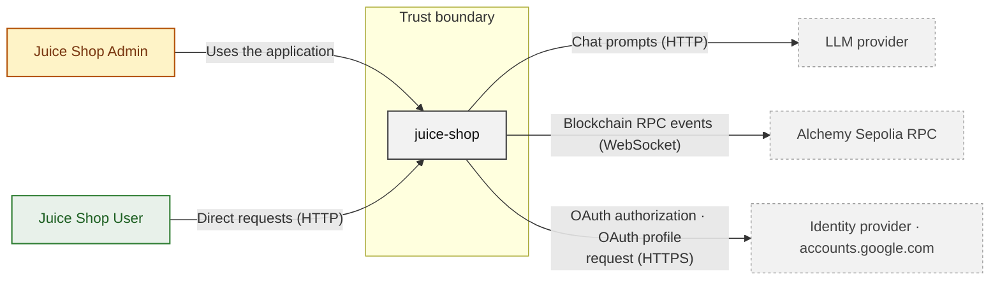
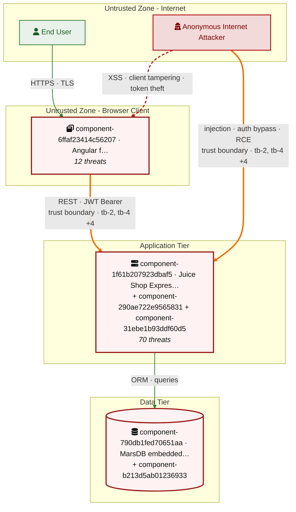

## 2. Architecture Diagrams

### 2.1 System Context

Who uses and attacks juice-shop, and which external systems it exchanges data with. Solid arrows name the data a flow carries; dashed red arrows are attack routes. Actors carry the names Figure 1 uses (C4 Level 1).



**Key takeaway:** juice-shop serves Juice Shop Admin and Juice Shop User and depends on LLM provider, Alchemy Sepolia RPC and Identity provider · accounts.google.com.

### 2.2 Container Architecture

How the system decomposes into deployable units. Each box is a separate runtime process or service container; arrows show synchronous request paths between them. Components with ≥3 Critical findings carry a red border, ≥2 High amber (C4 Level 2).

```mermaid
flowchart TB
    subgraph Client
        component_6ffaf23414c56207["Angular frontend"]
    end
    subgraph TBSERVER["Trust boundary · external → Juice Shop Express server (tb-2)<br/>external → Web3 / Wallet / NFT Surface (tb-4)<br/>+3 more"]
    subgraph Application
        component_1f61b207923dbaf5["Juice Shop Express server"]
        component_290ae722e9565831["Sequelize application data access"]
        component_6ffadbc3868c2a3b["Web3 / Wallet / NFT Surface"]
        component_8c3a32ee53769307["Real-time WebSocket Channel"]
        component_dff0840e0f4855be["Authentication & Session Surface"]
    end
    subgraph Data
        component_790db1fed70651aa[("MarsDB embedded store")]
        component_b213d5ab01236933[("SQLite embedded store")]
    end
    end
    component_290ae722e9565831 -->|SQLite (embedded) · Confidential| component_b213d5ab01236933
    component_1f61b207923dbaf5 -->|MarsDB (embedded) · Confidential| component_790db1fed70651aa
    component_6ffaf23414c56207 -->|HTTP · Internal| component_1f61b207923dbaf5
    component_6ffaf23414c56207 -->|HTTP · Internal| component_6ffadbc3868c2a3b
    component_6ffaf23414c56207 -->|HTTP · Internal| component_dff0840e0f4855be
    classDef critical fill:#f3dada,stroke:#b71c1c,color:#7f0000,stroke-width:3px
    classDef warning  fill:#fef3c7,stroke:#b45309,color:#78350f,stroke-width:2px
    class component_6ffaf23414c56207 warning
    class component_1f61b207923dbaf5 warning
    class component_dff0840e0f4855be warning
```

*Not shown (diagram capped at 8 containers): CI/CD Pipeline — every component is inventoried in [§2.3 Components](#23-components).*

*Trust boundaries not drawn above: Juice Shop Express server → MarsDB embedded store (tb-8), Sequelize application data access → SQLite embedded store (tb-6), Angular frontend → external (tb-9), Juice Shop Express server → external (tb-10), +1 more — every boundary is listed in [§1 Trust Boundaries](#trust-boundaries).*

**Key takeaway:** The system decomposes into 1 client, 6 application and 2 data unit(s); Juice Shop Express server carries the most Critical findings (2) and bounds the worst-case blast radius.

### 2.3 Components

Who reaches each component, and through which trust zone. Browser code runs on the user's device, so the client column is part of the untrusted zone, not a zone of its own — trust changes only where traffic enters the Application tier. Solid green arrows show legitimate data flow, dashed red arrows mark intrusion vectors. The component table directly below holds source paths and linked threats per `C-NN`; per-finding evidence is in [§8 Findings Register](#8-findings-register).



*Also folded into the tier nodes above, unnamed there for space: Web3 / Wallet / NFT Surface (`component-6ffadbc3868c2a3b`), Real-time WebSocket Channel (`component-8c3a32ee53769307`), Authentication & Session Surface (`component-dff0840e0f4855be`) — every component is in the table below.*

*Trust boundaries crossed by the `==>` edges above: external → Juice Shop Express server (tb-2), external → Web3 / Wallet / NFT Surface (tb-4), external → Authentication & Session Surface (tb-5, tb-7), external → CI/CD Pipeline (tb-3), +1 more — every boundary is listed in [§1 Trust Boundaries](#trust-boundaries).*

**Key takeaway:** Juice Shop Express server concentrates the most findings (44 of 82 across all components); the table below maps each component to its source paths and linked threats.

| Component ID | Name | Tier | Source paths | Threats |
|---|---|---|---|---|
| component-1f61b207923dbaf5 | Juice Shop Express server | Application | `lib/startup/registerWebsocketEvents.ts`, `routes/address.ts`, `routes/appConfiguration.ts`, `routes/appVersion.ts`, `routes/b2bOrder.ts`, `routes/basket.ts`, `routes/basketItems.ts`, `routes/captcha.ts`, `routes/changePassword.ts`, `routes/chat.ts`, `routes/continueCode.ts`, `routes/countryMapping.ts`, `routes/coupon.ts`, `routes/createProductReviews.ts`, `routes/currentUser.ts`, `routes/dataErasure.ts`, `routes/dataExport.ts`, `routes/delivery.ts`, `routes/deluxe.ts`, `routes/easterEgg.ts`, `routes/fileServer.ts`, `routes/fileUpload.ts`, `routes/imageCaptcha.ts`, `routes/keyServer.ts`, `routes/languages.ts`, `routes/likeProductReviews.ts`, `routes/logfileServer.ts`, `routes/memory.ts`, `routes/metrics.ts`, `routes/nftMint.ts`, `routes/order.ts`, `routes/orderHistory.ts`, `routes/payment.ts`, `routes/premiumReward.ts`, `routes/privacyPolicyProof.ts`, `routes/profileImageFileUpload.ts`, `routes/profileImageUrlUpload.ts`, `routes/quarantineServer.ts`, `routes/recycles.ts`, `routes/repeatNotification.ts`, `routes/restoreProgress.ts`, `routes/search.ts`, `routes/securityQuestion.ts`, `routes/showProductReviews.ts`, `routes/trackOrder.ts`, `routes/updateProductReviews.ts`, `routes/updateUserProfile.ts`, `routes/userProfile.ts`, `routes/verify.ts`, `routes/videoHandler.ts`, `routes/vulnCodeFixes.ts`, `routes/vulnCodeSnippet.ts`, `routes/wallet.ts`, `routes/web3Wallet.ts`, `server.ts` | 44 |
| component-290ae722e9565831 | Sequelize application data access | Application | `models/address.ts`, `models/basket.ts`, `models/basketitem.ts`, `models/captcha.ts`, `models/card.ts`, `models/challenge.ts`, `models/challengeDependency.ts`, `models/complaint.ts`, `models/delivery.ts`, `models/feedback.ts`, `models/hint.ts`, `models/imageCaptcha.ts`, `models/index.ts`, `models/memory.ts`, `models/privacyRequests.ts`, `models/product.ts`, `models/quantity.ts`, `models/recycle.ts`, `models/securityAnswer.ts`, `models/securityQuestion.ts`, `models/user.ts`, `models/wallet.ts` | 3 |
| component-31ebe1b93ddf60d5 | CI/CD Pipeline | Application | `.dockerignore`, `.github/workflows/ci.yml`, `.github/workflows/codeql-analysis.yml`, `.github/workflows/frontend-bundle-analysis.yml`, `.github/workflows/image_actions.yml`, `.github/workflows/lint-fixer.yml`, `.github/workflows/lock.yml`, `.github/workflows/pr-compliance.yml`, `.github/workflows/rebase.yml`, `.github/workflows/release.yml`, `.github/workflows/stale.yml`, `.github/workflows/update-challenges-ebook.yml`, `.github/workflows/update-challenges-www-legacy.yml`, `.github/workflows/update-challenges-www.yml`, `.github/workflows/update-news-www-legacy.yml`, `.github/workflows/update-news-www.yml`, `.github/workflows/zap_scan.yml`, `.gitlab-ci.yml`, `.npmrc`, `Dockerfile`, `docker-compose.test.yml`, `frontend/package.json`, `package.json`, `test/smoke/Dockerfile` | 8 |
| component-6ffadbc3868c2a3b | Web3 / Wallet / NFT Surface | Application | `routes/checkKeys.ts`, `routes/nftMint.ts`, `routes/redirect.ts`, `routes/web3Wallet.ts` | 2 |
| component-6ffaf23414c56207 | Angular frontend | Client | `frontend/src/app/Models/backup.model.ts`, `frontend/src/app/Models/challenge.model.ts`, `frontend/src/app/Models/deliveryMethod.model.ts`, `frontend/src/app/Models/hint.model.ts`, `frontend/src/app/Models/product.model.ts`, `frontend/src/app/Models/review.model.ts`, `frontend/src/app/Models/securityQuestion.model.ts`, `frontend/src/app/Services/address.service.ts`, `frontend/src/app/Services/administration.service.ts`, `frontend/src/app/Services/basket.service.ts`, `frontend/src/app/Services/captcha.service.ts`, `frontend/src/app/Services/challenge.service.ts`, `frontend/src/app/Services/chat.service.ts`, `frontend/src/app/Services/code-fixes.service.ts`, `frontend/src/app/Services/code-snippet.service.ts`, `frontend/src/app/Services/complaint.service.ts`, `frontend/src/app/Services/configuration.service.ts`, `frontend/src/app/Services/conversation-storage.service.ts`, `frontend/src/app/Services/country-mapping.service.ts`, `frontend/src/app/Services/ctf-system-wide-notification.service.ts`, `frontend/src/app/Services/data-subject.service.ts`, `frontend/src/app/Services/delivery.service.ts`, `frontend/src/app/Services/feedback.service.ts`, `frontend/src/app/Services/hint.service.ts`, `frontend/src/app/Services/image-captcha.service.ts`, `frontend/src/app/Services/keys.service.ts`, `frontend/src/app/Services/languages.service.ts`, `frontend/src/app/Services/local-backup.service.ts`, `frontend/src/app/Services/order-history.service.ts`, `frontend/src/app/Services/payment.service.ts`, `frontend/src/app/Services/photo-wall.service.ts`, `frontend/src/app/Services/product-review.service.ts`, `frontend/src/app/Services/product.service.ts`, `frontend/src/app/Services/quantity.service.ts`, `frontend/src/app/Services/recycle.service.ts`, `frontend/src/app/Services/request.interceptor.ts`, `frontend/src/app/Services/security-answer.service.ts`, `frontend/src/app/Services/security-question.service.ts`, `frontend/src/app/Services/snack-bar-helper.service.ts`, `frontend/src/app/Services/socket-io.service.ts`, `frontend/src/app/Services/track-order.service.ts`, `frontend/src/app/Services/two-factor-auth-service.ts`, `frontend/src/app/Services/user.service.ts`, `frontend/src/app/Services/vuln-lines.service.ts`, `frontend/src/app/Services/wallet.service.ts`, `frontend/src/app/Services/window-ref.service.ts`, `frontend/src/app/about/about.component.html`, `frontend/src/app/about/about.component.ts`, `frontend/src/app/accounting/accounting.component.html`, `frontend/src/app/accounting/accounting.component.ts`, `frontend/src/app/address-create/address-create.component.html`, `frontend/src/app/address-create/address-create.component.ts`, `frontend/src/app/address-select/address-select.component.html`, `frontend/src/app/address-select/address-select.component.ts`, `frontend/src/app/address/address.component.html`, `frontend/src/app/address/address.component.ts`, `frontend/src/app/administration/administration.component.html`, `frontend/src/app/administration/administration.component.ts`, `frontend/src/app/app.component.html`, `frontend/src/app/app.component.ts`, `frontend/src/app/app.guard.ts`, `frontend/src/app/app.routing.ts`, `frontend/src/app/basket/basket.component.html`, `frontend/src/app/basket/basket.component.ts`, `frontend/src/app/challenge-solved-notification/challenge-solved-notification.component.html`, `frontend/src/app/challenge-solved-notification/challenge-solved-notification.component.ts`, `frontend/src/app/challenge-status-badge/challenge-status-badge.component.html`, `frontend/src/app/challenge-status-badge/challenge-status-badge.component.ts`, `frontend/src/app/change-password/change-password.component.html`, `frontend/src/app/change-password/change-password.component.ts`, `frontend/src/app/chatbot/chat-conversation/chat-conversation.component.html`, `frontend/src/app/chatbot/chat-conversation/chat-conversation.component.ts`, `frontend/src/app/chatbot/chat-input-box/chat-input-box.component.html`, `frontend/src/app/chatbot/chat-input-box/chat-input-box.component.ts`, `frontend/src/app/chatbot/chat-welcome-page/chat-welcome-page.component.ts`, `frontend/src/app/chatbot/chat-welcome-screen/chat-welcome-screen.component.html`, `frontend/src/app/chatbot/chat-welcome-screen/chat-welcome-screen.component.ts`, `frontend/src/app/chatbot/chat.model.ts`, `frontend/src/app/chatbot/chatbot.component.html`, `frontend/src/app/chatbot/chatbot.component.ts`, `frontend/src/app/coding-challenge-page/coding-challenge-page.component.html`, `frontend/src/app/coding-challenge-page/coding-challenge-page.component.ts`, `frontend/src/app/coding-challenge-page/coding-challenge.types.ts`, `frontend/src/app/coding-challenge-page/components/coding-challenge-find-it/coding-challenge-find-it.component.html`, `frontend/src/app/coding-challenge-page/components/coding-challenge-find-it/coding-challenge-find-it.component.ts`, `frontend/src/app/coding-challenge-page/components/coding-challenge-find-it/format-selected-lines.ts`, `frontend/src/app/coding-challenge-page/components/coding-challenge-fix-it/coding-challenge-fix-it.component.html`, `frontend/src/app/coding-challenge-page/components/coding-challenge-fix-it/coding-challenge-fix-it.component.ts`, `frontend/src/app/coding-challenge-page/components/coding-challenge-section/coding-challenge-section.component.html`, `frontend/src/app/coding-challenge-page/components/coding-challenge-section/coding-challenge-section.component.ts`, `frontend/src/app/coding-challenge-page/helpers/handle-verdict.ts`, `frontend/src/app/complaint/complaint.component.html`, `frontend/src/app/complaint/complaint.component.ts`, `frontend/src/app/contact/contact.component.html`, `frontend/src/app/contact/contact.component.ts`, `frontend/src/app/ctf-system-wide-notification/ctf-system-wide-notification.component.html`, `frontend/src/app/ctf-system-wide-notification/ctf-system-wide-notification.component.ts`, `frontend/src/app/data-export/data-export.component.html`, `frontend/src/app/data-export/data-export.component.ts`, `frontend/src/app/delivery-method/delivery-method.component.html`, `frontend/src/app/delivery-method/delivery-method.component.ts`, `frontend/src/app/deluxe-user/deluxe-user.component.html`, `frontend/src/app/deluxe-user/deluxe-user.component.ts`, `frontend/src/app/error-page/error-page.component.html`, `frontend/src/app/error-page/error-page.component.ts`, `frontend/src/app/faucet/faucet.component.html`, `frontend/src/app/faucet/faucet.component.ts`, `frontend/src/app/faucet/faucet.module.ts`, `frontend/src/app/feedback-details/feedback-details.component.html`, `frontend/src/app/feedback-details/feedback-details.component.ts`, `frontend/src/app/forgot-password/forgot-password.component.html`, `frontend/src/app/forgot-password/forgot-password.component.ts`, `frontend/src/app/last-login-ip/last-login-ip.component.html`, `frontend/src/app/last-login-ip/last-login-ip.component.ts`, `frontend/src/app/login/login.component.html`, `frontend/src/app/login/login.component.ts`, `frontend/src/app/mat-search-bar/abstract-value-accessor.ts`, `frontend/src/app/mat-search-bar/mat-search-bar.component.html`, `frontend/src/app/mat-search-bar/mat-search-bar.component.ts`, `frontend/src/app/navbar/navbar.component.html`, `frontend/src/app/navbar/navbar.component.ts`, `frontend/src/app/nft-unlock/nft-unlock.component.html`, `frontend/src/app/nft-unlock/nft-unlock.component.ts`, `frontend/src/app/oauth/oauth.component.html`, `frontend/src/app/oauth/oauth.component.ts`, `frontend/src/app/order-completion/order-completion.component.html`, `frontend/src/app/order-completion/order-completion.component.ts`, `frontend/src/app/order-history/order-history.component.html`, `frontend/src/app/order-history/order-history.component.ts`, `frontend/src/app/order-summary/order-summary.component.html`, `frontend/src/app/order-summary/order-summary.component.ts`, `frontend/src/app/password-strength-info/password-strength-info.component.html`, `frontend/src/app/password-strength-info/password-strength-info.component.ts`, `frontend/src/app/password-strength/password-strength.component.html`, `frontend/src/app/password-strength/password-strength.component.ts`, `frontend/src/app/payment-method/payment-method.component.html`, `frontend/src/app/payment-method/payment-method.component.ts`, `frontend/src/app/payment/payment.component.html`, `frontend/src/app/payment/payment.component.ts`, `frontend/src/app/photo-wall/mime-type.validator.ts`, `frontend/src/app/photo-wall/photo-wall.component.html`, `frontend/src/app/photo-wall/photo-wall.component.ts`, `frontend/src/app/privacy-policy/privacy-policy.component.html`, `frontend/src/app/privacy-policy/privacy-policy.component.ts`, `frontend/src/app/privacy-security/privacy-security.component.html`, `frontend/src/app/privacy-security/privacy-security.component.ts`, `frontend/src/app/product-details/product-details.component.html`, `frontend/src/app/product-details/product-details.component.ts`, `frontend/src/app/product-review-edit/product-review-edit.component.html`, `frontend/src/app/product-review-edit/product-review-edit.component.ts`, `frontend/src/app/product/product.component.html`, `frontend/src/app/product/product.component.ts`, `frontend/src/app/purchase-basket/purchase-basket.component.html`, `frontend/src/app/purchase-basket/purchase-basket.component.ts`, `frontend/src/app/qr-code/qr-code.component.html`, `frontend/src/app/qr-code/qr-code.component.ts`, `frontend/src/app/recycle/recycle.component.html`, `frontend/src/app/recycle/recycle.component.ts`, `frontend/src/app/register/register.component.html`, `frontend/src/app/register/register.component.ts`, `frontend/src/app/roles.ts`, `frontend/src/app/saved-address/saved-address.component.html`, `frontend/src/app/saved-address/saved-address.component.ts`, `frontend/src/app/saved-payment-methods/saved-payment-methods.component.html`, `frontend/src/app/saved-payment-methods/saved-payment-methods.component.ts`, `frontend/src/app/score-board/components/challenge-card/challenge-card.component.html`, `frontend/src/app/score-board/components/challenge-card/challenge-card.component.ts`, `frontend/src/app/score-board/components/challenges-unavailable-warning/challenges-unavailable-warning.component.html`, `frontend/src/app/score-board/components/challenges-unavailable-warning/challenges-unavailable-warning.component.ts`, `frontend/src/app/score-board/components/coding-challenge-progress-score-card/coding-challenge-progress-score-card.component.html`, `frontend/src/app/score-board/components/coding-challenge-progress-score-card/coding-challenge-progress-score-card.component.ts`, `frontend/src/app/score-board/components/difficulty-overview-score-card/difficulty-overview-score-card.component.html`, `frontend/src/app/score-board/components/difficulty-overview-score-card/difficulty-overview-score-card.component.ts`, `frontend/src/app/score-board/components/difficulty-stars/difficulty-stars.component.html`, `frontend/src/app/score-board/components/difficulty-stars/difficulty-stars.component.ts`, `frontend/src/app/score-board/components/filter-settings/components/category-filter/category-filter.component.html`, `frontend/src/app/score-board/components/filter-settings/components/category-filter/category-filter.component.ts`, `frontend/src/app/score-board/components/filter-settings/components/score-board-additional-settings-dialog/score-board-additional-settings-dialog.component.html`, `frontend/src/app/score-board/components/filter-settings/components/score-board-additional-settings-dialog/score-board-additional-settings-dialog.component.ts`, `frontend/src/app/score-board/components/filter-settings/filter-settings.component.html`, `frontend/src/app/score-board/components/filter-settings/filter-settings.component.ts`, `frontend/src/app/score-board/components/filter-settings/pipes/difficulty-selection-summary.pipe.ts`, `frontend/src/app/score-board/components/hacking-challenge-progress-score-card/hacking-challenge-progress-score-card.component.html`, `frontend/src/app/score-board/components/hacking-challenge-progress-score-card/hacking-challenge-progress-score-card.component.ts`, `frontend/src/app/score-board/components/score-card/score-card.component.html`, `frontend/src/app/score-board/components/score-card/score-card.component.ts`, `frontend/src/app/score-board/components/tutorial-mode-warning/tutorial-mode-warning.component.html`, `frontend/src/app/score-board/components/tutorial-mode-warning/tutorial-mode-warning.component.ts`, `frontend/src/app/score-board/components/warning-card/warning-card.component.html`, `frontend/src/app/score-board/components/warning-card/warning-card.component.ts`, `frontend/src/app/score-board/filter-settings/FilterSetting.ts`, `frontend/src/app/score-board/filter-settings/query-params-converters.ts`, `frontend/src/app/score-board/helpers/challenge-filtering.ts`, `frontend/src/app/score-board/helpers/challenge-sorting.ts`, `frontend/src/app/score-board/score-board.component.html`, `frontend/src/app/score-board/score-board.component.ts`, `frontend/src/app/score-board/types/EnrichedChallenge.ts`, `frontend/src/app/search-result/search-result.component.html`, `frontend/src/app/search-result/search-result.component.ts`, `frontend/src/app/server-started-notification/server-started-notification.component.html`, `frontend/src/app/server-started-notification/server-started-notification.component.ts`, `frontend/src/app/shared/codemirror-extensions.ts`, `frontend/src/app/shared/codemirror-theme.ts`, `frontend/src/app/sidenav/sidenav.component.html`, `frontend/src/app/sidenav/sidenav.component.ts`, `frontend/src/app/token-sale/token-sale.component.html`, `frontend/src/app/token-sale/token-sale.component.ts`, `frontend/src/app/track-result/track-result.component.html`, `frontend/src/app/track-result/track-result.component.ts`, `frontend/src/app/two-factor-auth-enter/two-factor-auth-enter.component.html`, `frontend/src/app/two-factor-auth-enter/two-factor-auth-enter.component.ts`, `frontend/src/app/two-factor-auth/two-factor-auth.component.html`, `frontend/src/app/two-factor-auth/two-factor-auth.component.ts`, `frontend/src/app/user-details/user-details.component.html`, `frontend/src/app/user-details/user-details.component.ts`, `frontend/src/app/wallet-web3/wallet-web3.component.html`, `frontend/src/app/wallet-web3/wallet-web3.component.ts`, `frontend/src/app/wallet-web3/wallet-web3.module.ts`, `frontend/src/app/wallet/wallet.component.html`, `frontend/src/app/wallet/wallet.component.ts`, `frontend/src/app/web3-sandbox/web3-sandbox.component.html`, `frontend/src/app/web3-sandbox/web3-sandbox.component.ts`, `frontend/src/app/web3-sandbox/web3-sandbox.module.ts`, `frontend/src/app/welcome-banner/welcome-banner.component.html`, `frontend/src/app/welcome-banner/welcome-banner.component.ts`, `frontend/src/app/welcome/welcome.component.html`, `frontend/src/app/welcome/welcome.component.ts`, `frontend/src/assets/private/CopyShader.js`, `frontend/src/assets/private/EffectComposer.js`, `frontend/src/assets/private/MaskPass.js`, `frontend/src/assets/private/OrbitControls.js`, `frontend/src/assets/private/RenderPass.js`, `frontend/src/assets/private/ShaderPass.js`, `frontend/src/assets/private/dat.gui.min.js`, `frontend/src/assets/private/stats.min.js`, `frontend/src/assets/private/three.js`, `frontend/src/assets/private/threejs-demo.html`, `frontend/src/assets/public/ContractABIs.ts`, `frontend/src/confetti/index.ts`, `frontend/src/environments/environment.prod.ts`, `frontend/src/environments/environment.ts`, `frontend/src/hacking-instructor/challenges/adminSection.ts`, `frontend/src/hacking-instructor/challenges/bonusPayload.ts`, `frontend/src/hacking-instructor/challenges/codingChallenges.ts`, `frontend/src/hacking-instructor/challenges/domXss.ts`, `frontend/src/hacking-instructor/challenges/exposedCredentials.ts`, `frontend/src/hacking-instructor/challenges/forgedFeedback.ts`, `frontend/src/hacking-instructor/challenges/loginAdmin.ts`, `frontend/src/hacking-instructor/challenges/loginBender.ts`, `frontend/src/hacking-instructor/challenges/loginJim.ts`, `frontend/src/hacking-instructor/challenges/passwordStrength.ts`, `frontend/src/hacking-instructor/challenges/privacyPolicy.ts`, `frontend/src/hacking-instructor/challenges/reflectedXss.ts`, `frontend/src/hacking-instructor/challenges/scoreBoard.ts`, `frontend/src/hacking-instructor/challenges/viewBasket.ts`, `frontend/src/hacking-instructor/helpers/helpers.ts`, `frontend/src/hacking-instructor/index.ts`, `frontend/src/hacking-instructor/tutorialUnavailable.ts`, `frontend/src/index.html`, `frontend/src/main.ts`, `frontend/src/vitest.d.ts` | 12 |
| component-790db1fed70651aa | MarsDB embedded store | Data | `data/mongodb.ts` | 0 |
| component-8c3a32ee53769307 | Real-time WebSocket Channel | Application | `lib/challengeUtils.ts`, `lib/startup/registerWebsocketEvents.ts` | 3 |
| component-b213d5ab01236933 | SQLite embedded store | Data | `models/index.ts` | 0 |
| component-dff0840e0f4855be | Authentication & Session Surface | Application | `lib/insecurity.ts`, `lib/startup/registerWebsocketEvents.ts`, `routes/2fa.ts`, `routes/authenticatedUsers.ts`, `routes/login.ts`, `routes/resetPassword.ts`, `routes/saveLoginIp.ts` | 10 |

> **Legend:** `-->` synchronous request/response (REST, HTTPS, gRPC) · `-.->` asynchronous / event-driven (WebSocket, queue, pub-sub) · `==>` crosses an untrusted trust boundary (security-critical) · **red border** ≥ 3 Critical threats on the component · **amber border** ≥ 2 High threats
