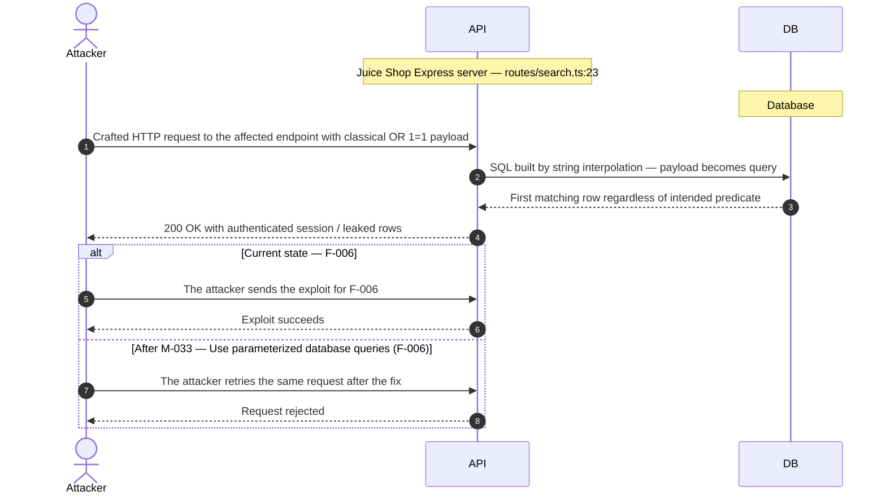
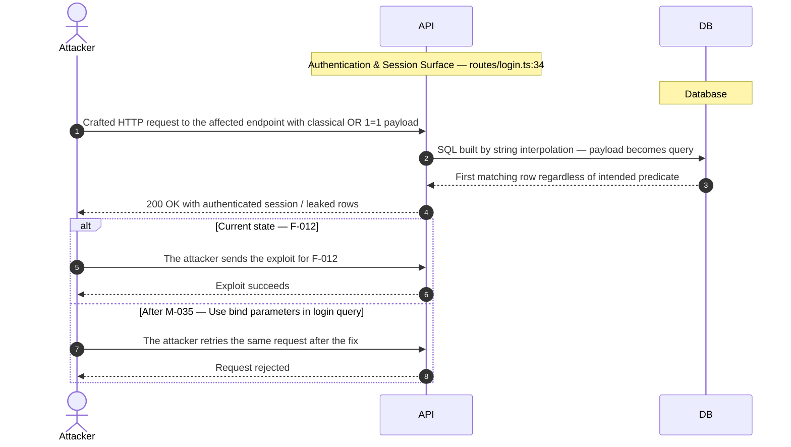
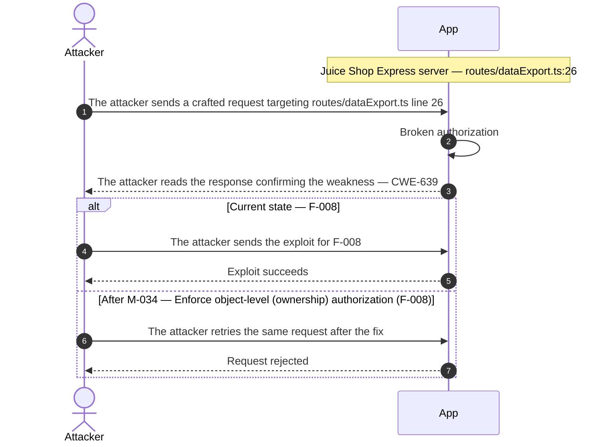
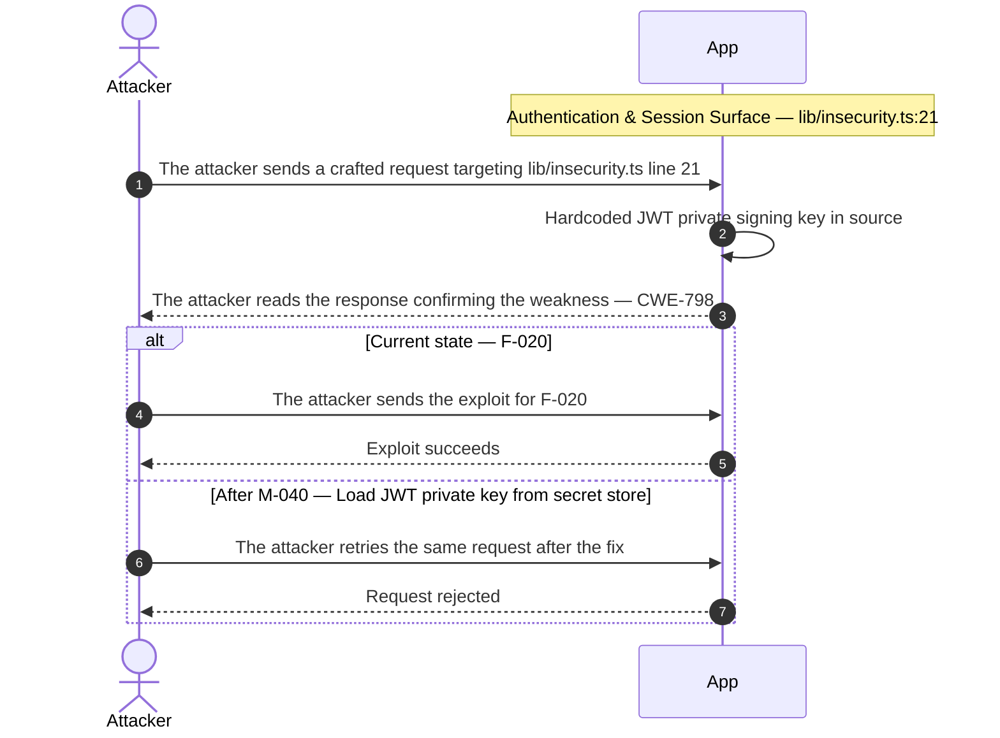
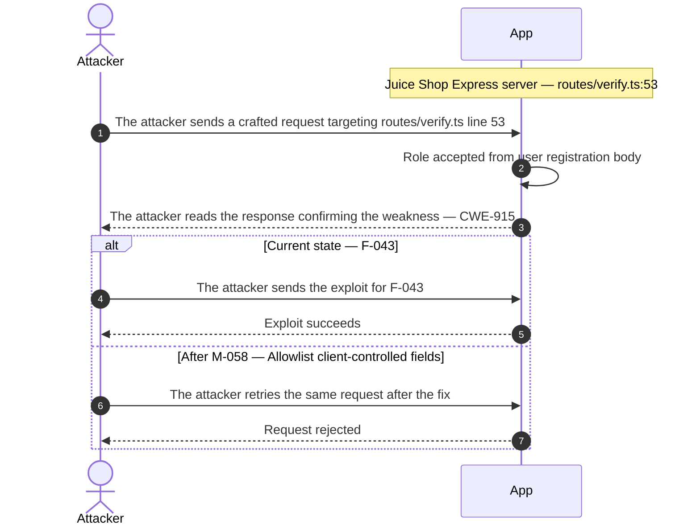

## 3. Attack Walkthroughs

This section walks through how the highest-risk findings are exploited — one short walkthrough per Critical, each with attack steps, a focused sequence diagram, and the primary mitigation. Which root cause each Critical traces back to is in [Critical Findings by Root Cause](#critical-findings-by-root-cause); full per-finding context (severity rationale, assets, detection signals) is in the [§8 Findings Register](#8-findings-register).

### 3.1 SQL injection in Search

**Source:** 🔴 [F-006](#f-006) — `routes/search.ts:23`

Severity **Critical** (CWE-89). STRIDE: Tampering. See [§8 F-006](#f-006) for the full register row.

**Attack Steps**

1. Find the request parameter that reaches the raw query at `routes/search.ts:23`.
2. Interpolating request-controlled text into a SQL statement lets an attacker alter the query — exfiltrating or modifying arbitrary rows, bypassing authentication, or escalating to full database control.

**Sequence Diagram**

**Key takeaway:** Until [M-033](#m-033) lands, F-006 is exploitable at `routes/search.ts:23` (Critical-severity, CWE-89).

**Defense in Depth**

- Primary mitigation: ● [M-033](#m-033) (Use parameterized database queries (F-006))

### 3.2 SQL injection in login email lookup

**Source:** 🔴 [F-012](#f-012) — `routes/login.ts:34`

Severity **Critical** (CWE-89). STRIDE: Tampering. See [§8 F-012](#f-012) for the full register row.

**Attack Steps**

1. POST `/rest/user/login` with email set to an injection payload that comments out the password clause.
2. The raw query returns the target user row and the server issues a valid JWT for that account.

**Sequence Diagram**

**Key takeaway:** Until [M-035](#m-035) lands, F-012 is exploitable at `routes/login.ts:34` (Critical-severity, CWE-89).

**Defense in Depth**

- Primary mitigation: ● [M-035](#m-035) (Use bind parameters in login query)

### 3.3 Broken authorization in Data Export

**Source:** 🔴 [F-008](#f-008) — `routes/dataExport.ts:26`

Severity **Critical** (CWE-639). STRIDE: Tampering. See [§8 F-008](#f-008) for the full register row.

**Attack Steps**

1. An attacker crafts a request that reaches the code at `routes/dataExport.ts:26`.
2. A signed-in attacker puts another user's ID into the owner field of the request (`req.body.UserId` and the like); the query trusts it instead of the session identity, so the attacker reads or changes every other user's records — horizontal privilege escalation across all accounts.

**Sequence Diagram**

**Key takeaway:** Until [M-034](#m-034) lands, F-008 is exploitable at `routes/dataExport.ts:26` (Critical-severity, CWE-639).

**Defense in Depth**

- Primary mitigation: ● [M-034](#m-034) (Enforce object-level (ownership) authorization (F-008))
- Defence in depth: ◑ [M-002](#m-002) (Manual review: verify Broken authorization attacker-controlled owner ID in resource query…)

### 3.4 Hardcoded JWT private signing key in source

**Source:** 🟠 [F-020](#f-020) — `lib/insecurity.ts:21`

Severity **High** (CWE-798). STRIDE: Spoofing. See [§8 F-020](#f-020) for the full register row.

**Attack Steps**

1. An attacker crafts a request that reaches the code at `lib/insecurity.ts:21`.
2. The `RS256` private key is embedded in `lib/insecurity.ts`.
3. Anyone with the source can sign a token with an arbitrary role claim, which `isAuthorized` and the role checks accept, and can also compute deluxe tokens derived from the same key.

**Sequence Diagram**

**Key takeaway:** Until [M-040](#m-040) lands, F-020 is exploitable at `lib/insecurity.ts:21` (High-severity, CWE-798).

**Defense in Depth**

- Primary mitigation: ◕ [M-040](#m-040) (Load JWT private key from secret store)

### 3.5 Role accepted from user registration body in Juice Shop Express server

**Source:** 🟠 [F-043](#f-043) — `routes/verify.ts:53`

Severity **High** (CWE-915). STRIDE: Elevation of Privilege. See [§8 F-043](#f-043) for the full register row.

**Attack Steps**

1. An attacker crafts a request that reaches the code at `routes/verify.ts:53`.
2. An unauthenticated caller POSTs `/api/Users` with role set to admin.
3. The middleware chain only inspects `req.body.role` and calls next, passing the body to the generated create endpoint, which may store the role.

**Sequence Diagram**

**Key takeaway:** Until [M-058](#m-058) lands, F-043 is exploitable at `routes/verify.ts:53` (High-severity, CWE-915).

**Defense in Depth**

- Primary mitigation: ◕ [M-058](#m-058) (Allowlist client-controlled fields)
- Defence in depth: ◑ [M-010](#m-010) (Manual review: verify Role accepted from user registration body)

<!-- generated:walkthrough_renderer -->
