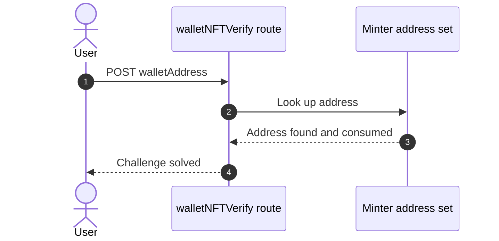
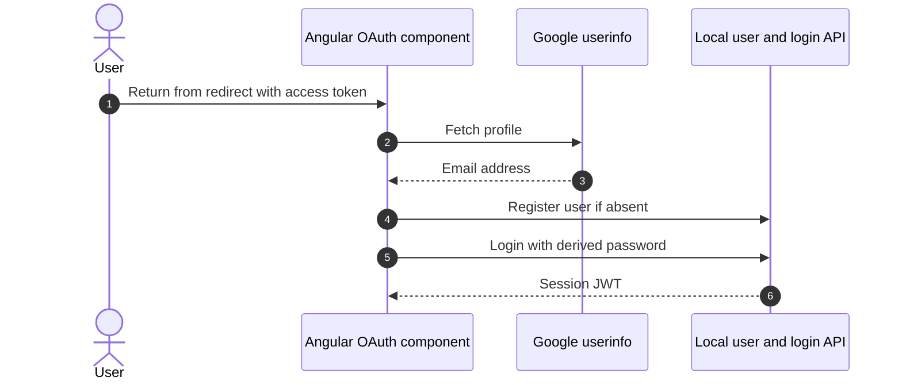
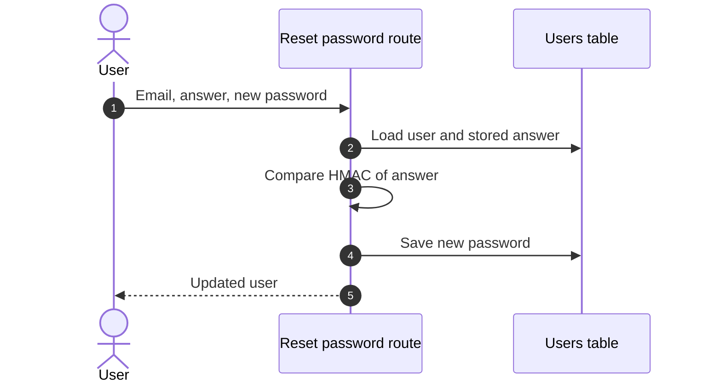
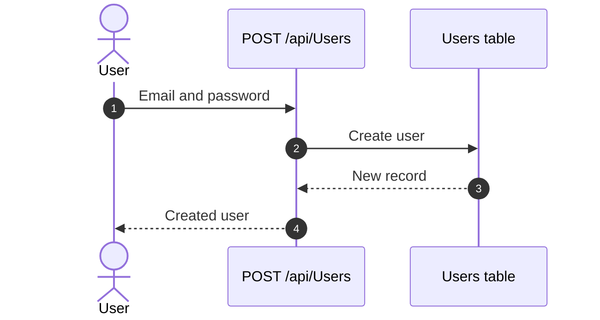
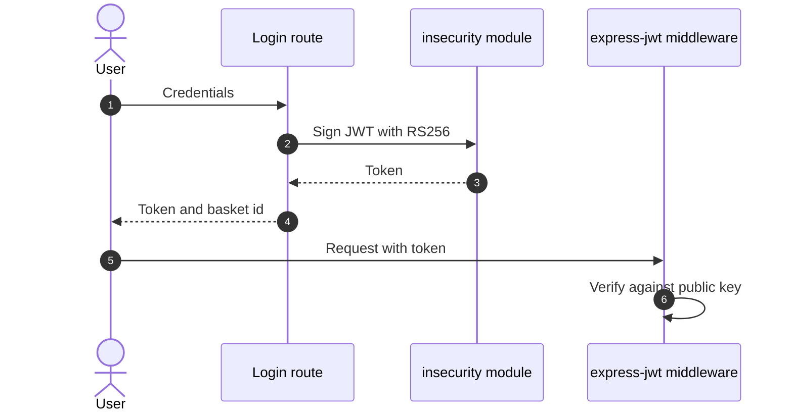
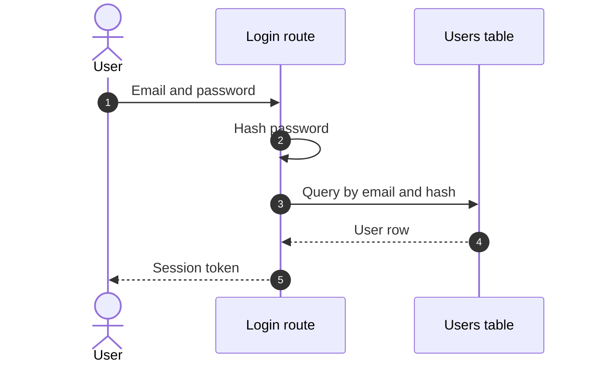

## 6. Security Architecture

This chapter is organized by security-control category. Findings are listed only where the affected control is described.

_Cataloged controls: 38 total — 3 adequate, 12 partial, 14 weak, 2 unsafe, 7 missing._

**How to read the verdicts.** Every control category (and every sub-control below it) carries exactly one status. The two red verdicts do **not** mean the same thing — this is the distinction that decides what you have to do about a finding:

| Status | Meaning | What it asks of you |
|---|---|---|
| 🟢 Adequate | Control is present and sound | Nothing — keep it |
| 🟡 Partial | Present, but with meaningful gaps | Close the gap |
| 🟠 Weak | Present, but has exploitable gaps | Strengthen it |
| 🔴 Unsafe | **Present and relied upon, but defeated / trivially bypassable** | **Fix the existing control** |
| 🔴 Missing | **Control was never built** | **Add the control** |
| — | Not applicable to this codebase | — |

So "🔴 Unsafe" on a control category does *not* mean the control is absent — it means the control exists but does not hold (e.g. an MD5 password hash, a raw-SQL query path, a hardcoded signing key). "🔴 Missing" is reserved for controls that were never built (e.g. no Content-Security-Policy header).

### 6.1 Security Control Overview

<!-- §6.1 MECHANICAL-FROZEN — DO NOT EDIT (overview table is pregenerator-owned) -->

| Control category | Verdict | Main reason |
|---|---|---|
| [6.2 Identity and Authentication Controls](#62-identity-and-authentication-controls) | 🔴 Unsafe | 9 findings; catalogued controls are present but defeated (e.g. Wallet ownership verification for NFT mint challenge, OAuth implicit flow login). |
| [6.3 Session and Token Controls](#63-session-and-token-controls) | 🟠 Weak | 2 findings; catalogued controls are weak (e.g. Cookie signing and request body parsing, Client-side token storage). |
| [6.4 Authorization Controls](#64-authorization-controls) | 🔴 Missing | 10 findings; required controls not in place (e.g. Route-level authorization middleware, Chatbot tool-level authorization and coupon policy). |
| [6.5 Query Construction and Data Access Controls](#65-query-construction-and-data-access-controls) | 🔴 Unsafe | 6 findings; catalogued controls are present but defeated (e.g. Embedded MarsDB data store access control, Login query construction). |
| [6.6 Input Boundary Validation Controls](#66-input-boundary-validation-controls) | 🔴 Missing | 6 findings; required controls not in place (e.g. Chatbot tool input validation and query construction, Validation of wallet address input). |
| [6.7 Output Encoding and Rendering Controls](#67-output-encoding-and-rendering-controls) | 🟠 Weak | 6 findings; catalogued controls are weak (e.g. Redirect allowlist). |
| [6.8 Browser and Cross-Origin Controls](#68-browser-and-cross-origin-controls) | 🟠 Weak | 1 finding; catalogued controls are weak (e.g. Socket.io CORS origin restriction). |
| [6.9 Cryptography Secrets and Data Protection](#69-cryptography-secrets-and-data-protection) | 🔴 Missing | 6 findings; required controls not in place (e.g. Embedded SQLite datastore protection, Blockchain RPC API key handling). |
| [6.10 File Parser and Outbound Request Controls](#610-file-parser-and-outbound-request-controls) | 🔴 Missing | 14 findings; required controls not in place (e.g. Profile image URL fetch (SSRF protection), Upload handling (size, mime type, filename sanitization)). |
| [6.11 Operations Runtime and Supply Chain Controls](#611-operations-runtime-and-supply-chain-controls) | 🔴 Missing | 8 findings; required controls not in place (e.g. Rate limiting, Access logging and metrics exposure). |
| [6.12 Real-time and Not Applicable Controls](#612-real-time-and-not-applicable-controls) | — | No controls or findings in this category. |

<!-- §6.1 MECHANICAL-FROZEN END -->

### 6.2 Identity and Authentication Controls

**Verdict:** 🔴 Unsafe — SQL injection in login, role injection at registration, and a guessable security-answer reset defeat identity controls that exist.

<!-- The line below is mechanically derived from the controls table — LLM must not re-author it. -->
**Controls covered:** [Wallet ownership verification for NFT mint challenge](#wallet-ownership-verification-for-nft-mint-challenge), [OAuth implicit flow login](#oauth-implicit-flow-login), [Credential handling in client](#credential-handling-in-client), [WebSocket connection authentication](#websocket-connection-authentication), [Password reset](#password-reset), [Multi-factor authentication step](#multi-factor-authentication-step), [User Registration](#user-registration).

**Implemented controls:** Wallet ownership verification for NFT mint challenge, OAuth implicit flow login, Credential handling in client, Password reset, Multi-factor authentication step.

**Assessment:** Identity rests on a raw-SQL password login, a client-side Google implicit flow that ends in the same local login, an optional TOTP step and a security-question reset. Each is defeated or weakened: SQL injection bypasses the credential check, the OAuth password is derived from the email, and reset needs only a guessable answer. Each successful flow above terminates in the server issuing a session token; the signing, validation, storage and lifecycle of that token are described in [§6.3 Session and Token Controls](#63-session-and-token-controls).

<!-- §6.2 AUTH-MECHANISMS-FROZEN — deterministic inventory, pregenerator-owned. DO NOT EDIT. -->
**Authentication mechanisms (at a glance).** Every authentication mechanism detected on the application, its effective status, where it is assessed, and its linked findings. Controls are catalogued by domain, so JWT/session handling is assessed under [§6.3 Session and Token Controls](#63-session-and-token-controls) and password hashing under [§6.9 Cryptography Secrets and Data Protection](#69-cryptography-secrets-and-data-protection).

| Mechanism | Status | Assessed in | Findings |
|---|---|---|---|
| User registration | 🔴 Unsafe | [§6.2](#62-identity-and-authentication-controls) | [F-039](#f-039) — Sensitive Routes Registered Without Authentication Middleware [F-041](#f-041) — Sensitive Routes Registered Without Authentication Middleware [F-043](#f-043) — Role accepted from user registration body — routes/verify.ts:53 [F-080](#f-080) — Stored notifications and flags sent — registerWebsocketEvents.ts:30 [F-086](#f-086) — Unhandled exception from non-string event — registerWebsocketEvents.ts:41 |
| Password login | 🔴 Unsafe | [§6.2](#62-identity-and-authentication-controls) | — |
| Password reset / change | 🟠 Weak | [§6.2](#62-identity-and-authentication-controls) | [F-019](#f-019) — Password reset accepts a security-question answer — routes/resetPassword.ts:10 [F-045](#f-045) — Password change allowed without current password — routes/changePassword.ts:39 [F-050](#f-050) — Unthrottled security-answer password reset — routes/resetPassword.ts:41 |
| Password storage (hashing) | 🟠 Weak | [§6.9](#69-cryptography-secrets-and-data-protection) | [F-035](#f-035) — Weak MD5 password hashing in User setter |
| JWT / bearer-token session | 🟡 Partial | [§6.3](#63-session-and-token-controls) | [F-014](#f-014) — Chat identity taken from unverified JWT — routes/chat.ts:45 [F-018](#f-018) — Insecure JWT Verification [F-020](#f-020) — Hardcoded JWT private signing key in source — lib/insecurity.ts:21 |
| Session-token storage | 🟠 Weak | [§6.3](#63-session-and-token-controls) | [F-110](#f-110) — Session token stored in web-accessible client storage — basket.service.ts:64 |
| Multi-factor authentication (TOTP / 2FA) | 🟡 Partial | [§6.2](#62-identity-and-authentication-controls) | — |
| OAuth / OIDC federated login | 🟠 Weak | [§6.2](#62-identity-and-authentication-controls) | [F-016](#f-016) — Predictable password derived from OAuth email — oauth.component.ts:30 [F-047](#f-047) — OAuth implicit flow without state, nonce or PKCE — login.component.ts:148 [F-079](#f-079) — OAuth access token in userinfo query string — user.service.ts:68 |

<!-- §6.2 AUTH-MECHANISMS-FROZEN END -->

**Findings in this category without a control:**

- [F-044](#f-044)
- [F-049](#f-049)
- [F-071](#f-071)

#### 6.2.1 Wallet ownership verification for NFT mint challenge

**Status:** 🟠 Weak — the server trusts a client-supplied wallet address with no proof of key control.

`walletNFTVerify` checks the `walletAddress` from the request body against an in-memory set of minter addresses filled from on-chain events. A matching entry is consumed on use.

The diagram shows the intended wallet claim path for the NFT mint challenge:

**Security assessment**

<!-- Model assessment (facts the narrative must not contradict): walletNFTVerify trusts a client-supplied walletAddress from the request body and checks it against an in-memory set of minters populated from on-chain events. No signature or proof of key control is required, so any caller who knows a minter address can claim it. Entries are consumed on use, which limits replay of the same address. -->
The check proves knowledge of an address, not control of its key:

- The address comes from the request body and no signature is required, so anyone who knows a minter address can claim it.
- Consuming entries on use limits replay of one address but not first-come claiming.
- The related open wallet endpoint also accepts arbitrary addresses ([F-085](#f-085)).

**Relevant findings**

- None linked to this control; see the other findings of this category.

#### 6.2.2 OAuth implicit flow login

**Status:** 🟠 Weak — the implicit flow has no state, nonce or PKCE, and the token travels in a query string.

The Angular `login.component.ts` starts Google login with `response_type=token`. `oauth.component.ts` reads the access token from the redirect, fetches the profile, and finishes through the local login endpoint.

The diagram shows how the frontend OAuth adapter enters local login:

**Security assessment**

<!-- Model assessment (facts the narrative must not contradict): Google login uses response_type=token (implicit flow) with no state or nonce parameter and no PKCE. The access token is passed in a URL query string to the userinfo endpoint. A redirect URI allow-list from server configuration (lines 80-87) is a partial mitigation. -->
This is an identity hint converted into a local password login, with three weaknesses:

- The local password is derived from the email, so anyone who knows the email can log in as that user ([F-016](#f-016)).
- The flow carries no state, nonce or PKCE parameter ([F-047](#f-047)).
- The access token is sent in the userinfo query string, where it can reach logs and history ([F-079](#f-079)).
- A server-configured redirect allow-list is a partial mitigation.

**Relevant findings**

- None linked to this control; see the other findings of this category.

#### 6.2.3 Credential handling in client

**Status:** 🟠 Weak — test credentials ship in client source and password changes travel in URLs.

`login.component.ts` handles the login form and `user.service.ts` calls the password-change and userinfo endpoints. Login validation only requires a non-empty password.

**Security assessment**

<!-- Model assessment (facts the narrative must not contradict): The client source contains hardcoded testing credentials. Password change sends the current and new passwords as GET query parameters, so they can appear in logs and history. Login validation only requires a non-empty password. -->
Credential handling in the Angular client leaks secrets in two ways:

- Hardcoded testing credentials are public properties of the login component ([F-048](#f-048)).
- Current and new passwords are sent as GET query parameters, so they can appear in logs and browser history ([F-078](#f-078)).

**Relevant findings**

- None linked to this control; see the other findings of this category.

#### 6.2.4 WebSocket connection authentication

**Status:** 🔴 Missing — any client can connect and receive stored notifications.

This control is not evidenced in the repository.

**Security assessment**

<!-- Model assessment (facts the narrative must not contradict): The connection handler accepts any client without a token, session or handshake check, and immediately emits stored challenge notifications to it. No io.use middleware is visible in the inspected file. -->
The Socket.IO connection handler performs no token, session or handshake check:

- Unauthenticated clients can open a channel ([F-049](#f-049)).
- On connect, the server emits stored challenge notifications, including flags, to the new socket ([F-080](#f-080)).
- No `io.use` middleware is visible in the inspected file.

**Relevant findings**

- None linked to this control; see the other findings of this category.

#### 6.2.5 Password reset

**Status:** 🟠 Weak — reset depends on a guessable security answer with no effective throttle.

`routes/resetPassword.ts` accepts an email, a security-question answer and a new password. The answer is compared as a keyed HMAC and the endpoint requires no session.

The diagram shows the intended reset path:

**Security assessment**

<!-- Model assessment (facts the narrative must not contradict): Reset relies only on a knowledge-based security answer, compared as a keyed HMAC. The endpoint is unauthenticated. No rate limiting or lockout was observed in the inspected files, so answers can be guessed repeatedly. -->
The reset path trusts a single knowledge factor:

- A security-question answer authorizes the reset ([F-019](#f-019)).
- No throttle or lockout protects guessing, and the rate limit on this route can be bypassed through a spoofable header ([F-050](#f-050)).
- The response returns the full user object ([F-081](#f-081)).
- Question lookup leaks which emails have an answer stored ([F-070](#f-070)).

**Relevant findings**

- None linked to this control; see the other findings of this category.

#### 6.2.6 Multi-factor authentication step

**Status:** 🟡 Partial — TOTP is requested when a secret is set, but the verification step was not assessed and the first step can be bypassed.

After the password check, login issues a temporary token that requires a TOTP code when the user has a `totpSecret`. The 2FA endpoints sit behind a rate limiter.

**Security assessment**

<!-- Model assessment (facts the narrative must not contradict): Login issues a temporary token requiring a TOTP second factor when a totpSecret is set. routes/2fa.ts was not inspected, so TOTP verification was not assessed. The SQL injection in the first step can bypass the credential check. -->
The possession factor is only as strong as the step before it:

- SQL injection in the first step can bypass the credential check and the path into TOTP ([F-012](#f-012)).
- `routes/2fa.ts` was not inspected, so code verification itself is unassessed.
- TOTP is opt-in per user.

**Relevant findings**

- None linked to this control; see the other findings of this category.

#### 6.2.7 User Registration

**Status:** 🔴 Unsafe — the role field is accepted from the registration body, giving privilege escalation at sign-up.

<!-- Model implementation note (facts for the intro): Present at POST /api/Users -->
Registration is served at `POST /api/Users` through the generated `finale-rest` resource. `routes/verify.ts` runs before it on the request.

The diagram shows the intended sign-up path:

**Security assessment**

Registration lets the caller shape the account:

- The role value from the body is not rejected, so a new user can choose an elevated role ([F-043](#f-043)).
- The route is registered without authentication middleware ([F-039](#f-039), [F-041](#f-041)).
- [F-080](#f-080) and [F-086](#f-086) are routed here by the catalog but concern the `Socket.IO` channel; see §6.12.

**Relevant findings**

- [F-039](#f-039)
- [F-041](#f-041)
- [F-043](#f-043)
- [F-080](#f-080)
- [F-086](#f-086)

### 6.3 Session and Token Controls

**Verdict:** 🟠 Weak — the signing key is public and tokens sit in script-readable storage.

<!-- The line below is mechanically derived from the controls table — LLM must not re-author it. -->
**Controls covered:** [Cookie signing and request body parsing](#cookie-signing-and-request-body-parsing), [Client-side token storage](#client-side-token-storage), [Session Token Issuance](#session-token-issuance).

**Implemented controls:** Cookie signing and request body parsing, Client-side token storage, Session Token Issuance (JWT Based).

**Assessment:** This application uses a single locally-signed JWT for every authenticated session, regardless of the login flow in §6.2 that established it. The sub-sections below trace cookie signing, browser storage and token issuance. The RS256 choice and the 6h expiry are sound, but the private key is committed, tokens are stored where scripts can read them, and there is no revocation.

**Findings in this category without a control:**

- [F-002](#f-002)
- [F-110](#f-110)

#### 6.3.1 Cookie signing and request body parsing

**Status:** 🟠 Weak — the cookie signing secret is a hardcoded static string.

`cookie-parser` signs cookies with a fixed secret in `server.ts`. Profile routes look up the cookie token in an in-memory token map, and request bodies of any content type are parsed as text then JSON.

**Security assessment**

<!-- Model assessment (facts the narrative must not contradict): cookie-parser uses a hardcoded static secret 'kekse' in source. Profile routes authenticate via an in-memory token map lookup using the cookie token. Request bodies of any content type are parsed as text and JSON.parse is applied without a try/catch, which can raise errors. -->
Cookie handling depends on a secret anyone with the source knows:

- The cookie-parser secret is hardcoded, so signed cookies can be forged ([F-046](#f-046)).
- `JSON.parse` runs on parsed bodies without a try/catch, which can raise unhandled errors.
- The token map is in-memory only.

**Relevant findings**

- None linked to this control; see the other findings of this category.

#### 6.3.2 Client-side token storage

**Status:** 🟠 Weak — the JWT is readable by any script that runs in the page.

The Angular client writes the JWT to `localStorage` and to a cookie set from JavaScript, with an 8 hour cookie expiry. A failed login clears the stored token.

**Security assessment**

<!-- Model assessment (facts the narrative must not contradict): The JWT is stored in localStorage and in a script-set cookie. The cookie is set from JavaScript, so it cannot be HttpOnly. Any XSS can read the token. The cookie expiry is 8 hours. Failed login clears the stored token. -->
Storage choices expose the token to cross-site scripting:

- The token sits in `localStorage` and a non-HttpOnly cookie, so any XSS reads it ([F-002](#f-002), [F-110](#f-110)).
- A script-set cookie cannot carry the HttpOnly flag.
- XSS sinks exist in the frontend, e.g. [F-001](#f-001) and [F-064](#f-064).

**Relevant findings**

- None linked to this control; see the other findings of this category.

#### 6.3.3 Session Token Issuance

**Status:** 🟡 Partial — RS256 and a 6h expiry are in place, but the signing key is public and tokens cannot be revoked.

<!-- Model implementation note (facts for the intro): lib/insecurity.ts:20-21,52-56,70-91,186-197 -->
`lib/insecurity.ts` signs a JWT on login with an RSA key and a 6h expiry. The `express-jwt` middleware verifies tokens against the public key, and issued tokens are tracked in an in-memory map.

The diagram shows issuance and the validation that follows:

**Security assessment**

<!-- Model assessment (facts the narrative must not contradict): Tokens are RS256-signed with a 6h expiry, and the express-jwt middleware verifies them against the public key. However, the private key is embedded in source, so anyone with the source can forge tokens. Tokens are also kept in an in-memory map with no revocation or logout invalidation. The unverified jws.decode in the role checks is gated by verify(). -->
Algorithm choice is sound but key custody and lifecycle are not:

- The private signing key is a source literal, so anyone with the repository can mint tokens ([F-020](#f-020)).
- Some verification paths accept tokens too loosely ([F-018](#f-018)), and the chat route trusts an unverified token ([F-014](#f-014)).
- A non-cryptographic RNG feeds a secret value ([F-031](#f-031)).
- Tokens have no logout invalidation or revocation.

**Relevant findings**

- None linked to this control; see the other findings of this category.

### 6.4 Authorization Controls

**Verdict:** 🔴 Missing — object-level and route-level authorization are absent on many routes.

<!-- The line below is mechanically derived from the controls table — LLM must not re-author it. -->
**Controls covered:** [Route-level authorization middleware](#route-level-authorization-middleware), [Chatbot tool-level authorization and coupon policy](#chatbot-tool-level-authorization-and-coupon-policy), [Authentication on web3 listener endpoints](#authentication-on-web3-listener-endpoints), [Request authentication attachment and client route gating](#request-authentication-attachment-and-client-route-gating), [Role checks](#role-checks).

**Implemented controls:** Route-level authorization middleware, Chatbot tool-level authorization and coupon policy, Request authentication attachment and client route gating, Role checks.

**Assessment:** Authorization relies on per-route `isAuthorized`, `denyAll` and `isAccounting` middleware plus role claims in the JWT. Coverage is inconsistent, object ownership is rarely checked, and the chatbot enforces coupon limits only through its prompt. Client route guards are not an enforcement point.

**Findings in this category without a control:**

- [F-003](#f-003)
- [F-004](#f-004)
- [F-008](#f-008)
- [F-024](#f-024)
- [F-038](#f-038)
- [F-039](#f-039)
- [F-041](#f-041)
- [F-042](#f-042)
- [F-043](#f-043)
- [F-091](#f-091)

#### 6.4.1 Route-level authorization middleware

**Status:** 🟡 Partial — middleware covers many routes but leaves several sensitive ones open.

`isAuthorized`, `denyAll` and `isAccounting` guard baskets, complaints, privacy requests, B2B, 2FA and several generated API resources.

**Security assessment**

<!-- Model assessment (facts the narrative must not contradict): isAuthorized/denyAll/isAccounting are applied to baskets, complaints, privacy requests, B2B, 2FA and several generated API resources. Coverage is inconsistent: PUT /api/Products/:id authorization is commented out, /api/Deliverys, /rest/order-history, /rest/deluxe-membership, /rest/memories, /rest/chat and /rest/products/:id/reviews PUT show no authorization middleware in the inspected slices. The /api/Quantitys/:id IpFilter uses a placeholder address. -->
Coverage gaps appear on routes that matter:

- Product update authorization is commented out ([F-004](#f-004)).
- Sensitive routes are registered without authentication middleware ([F-039](#f-039), [F-041](#f-041)).
- The memories listing is open and returns user data ([F-068](#f-068)).
- Any signed-in user can list all accounts ([F-091](#f-091)).
- The `/api/Quantitys/:id` IP filter uses a placeholder address.

**Relevant findings**

- None linked to this control; see the other findings of this category.

#### 6.4.2 Chatbot tool-level authorization and coupon policy

**Status:** 🟠 Weak — coupon limits live only in the system prompt, not in tool code.

`routes/chat.ts` lets the model call tools such as `generateCoupon`, `getOrderById`, `searchProducts` and `getProductReviews`. `getOrderById` checks authentication and ownership.

**Security assessment**

<!-- Model assessment (facts the narrative must not contradict): The coupon limit (max 10%) and eligibility conditions exist only in the system prompt. The generateCoupon tool accepts any number with no server-side cap, order validation or authentication, so model-directed action authorization depends on prompt compliance. getOrderById does check authentication and ownership (compared by vowel-masked email). The model-chosen searchProducts and getProductReviews tools have no per-user scoping. The /rest/chat route has no auth middleware, and the flow evidence says the token is decoded without signature verification. The system prompt also embeds a confidential discount instruction. -->
Model-directed actions depend on prompt compliance:

- `generateCoupon` accepts any number with no server-side cap, order check or authentication ([F-042](#f-042)).
- The chat route has no auth middleware and decodes the token without verifying it ([F-014](#f-014)).
- Search and review tools have no per-user scoping.
- The system prompt embeds a confidential discount instruction.
- Client messages reach the model unvalidated ([F-055](#f-055)).

**Relevant findings**

- None linked to this control; see the other findings of this category.

#### 6.4.3 Authentication on web3 listener endpoints

**Status:** 🔴 Missing — web3 listener handlers perform no caller authentication.

This control is not evidenced in the repository.

**Security assessment**

<!-- Model assessment (facts the narrative must not contradict): The handlers in the cited slices perform no authentication or authorization checks. Any caller can trigger creation of the shared WebSocket listeners. Handler-chain middleware outside these slices was not inspected beyond the flow metadata, which records no credential check. -->
The web3 handlers carry no credential check:

- Any caller can trigger creation of the shared WebSocket listeners.
- Middleware outside the cited slices was not inspected, but the flow metadata records no credential check.
- The related open wallet endpoint is described in [F-085](#f-085).

**Relevant findings**

- None linked to this control; see the other findings of this category.

#### 6.4.4 Request authentication attachment and client route gating

**Status:** 🟡 Partial — the client forwards IDs and tokens, and the server must carry authorization.

Angular services call basket, address and card endpoints with client-supplied IDs. An interceptor attaches the token and route guards gate pages in the browser.

**Security assessment**

<!-- Model assessment (facts the narrative must not contradict): Services call object-ID endpoints such as basket, address and card with client-supplied IDs. Authorization is left to the server. The interceptor and guards (request.interceptor.ts, app.guard.ts) were not inspected, so this rating covers only the services read. Client-side checks are not an enforcement boundary. -->
Authorization is left to the server, which does not do it consistently:

- Client-chosen IDs reach object endpoints without ownership checks ([F-003](#f-003), [F-024](#f-024), [F-038](#f-038)).
- Broken authorization is reported on further object routes ([F-008](#f-008)).
- `request.interceptor.ts` and `app.guard.ts` were not inspected, so this rating covers only the services read.
- Client checks are not an enforcement boundary.

**Relevant findings**

- None linked to this control; see the other findings of this category.

#### 6.4.5 Role checks

**Status:** 🟡 Partial — role claims are checked after signature verification, but the key is forgeable.

Role checks for accounting, deluxe and customer first verify the token signature, then read the role claim. The deluxe token is an HMAC keyed with the private key.

**Security assessment**

<!-- Model assessment (facts the narrative must not contradict): Role checks for accounting, deluxe and customer verify the token signature and then check the role claim. The deluxe token is an HMAC keyed with the private key. The forgeable-key issue limits their strength. -->
The role logic is sound, the key custody is not:

- A committed private key lets anyone sign a token carrying any role ([F-020](#f-020)).
- The deluxe HMAC shares that key.
- Registration also accepts the role from the request body ([F-043](#f-043)).
- The account listing has no role check ([F-091](#f-091)).

**Relevant findings**

- None linked to this control; see the other findings of this category.

### 6.5 Query Construction and Data Access Controls

**Verdict:** 🔴 Unsafe — raw SQL string building in login and search, and string-built NoSQL predicates in review and order routes.

<!-- The line below is mechanically derived from the controls table — LLM must not re-author it. -->
**Controls covered:** [Embedded MarsDB data store access control](#embedded-marsdb-data-store-access-control), [Login query construction](#login-query-construction).

**Implemented controls:** Login query construction.

**Assessment:** Sequelize backs most data access, but the login and search routes build raw SQL by interpolation and the MarsDB review and order routes build `$where` predicates from request values. The embedded stores add no access control of their own, so each route must sanitize input itself, and several do not.

**Findings in this category without a control:**

- [F-006](#f-006)
- [F-012](#f-012)
- [F-027](#f-027)
- [F-028](#f-028)
- [F-029](#f-029)
- [F-054](#f-054)

#### 6.5.1 Embedded MarsDB data store access control

**Status:** 🔴 Missing — the in-process store has no authentication, schema or access limits.

This control is not evidenced in the repository.

**Security assessment**

<!-- Model assessment (facts the narrative must not contradict): The reviews ('posts') and orders collections are created in-process with no authentication, schema validation, or access restriction at the data layer. The embedded engine has no login of its own, so the store depends entirely on callers for authorization and input sanitisation. Only this file was inspected; caller-side controls were not assessed here. -->
The MarsDB collections depend entirely on callers:

- Review and order predicates are built from request input ([F-027](#f-027), [F-028](#f-028), [F-029](#f-029)).
- Review like selectors take unvalidated request ids ([F-054](#f-054)).
- Only the store file was inspected, so caller-side controls are not assessed here.

**Relevant findings**

- None linked to this control; see the other findings of this category.

#### 6.5.2 Login query construction

**Status:** 🔴 Unsafe — the email is interpolated into raw SQL, which allows authentication bypass.

`routes/login.ts` hashes the submitted password, then passes a hand-built SQL string to `sequelize.query()`. The email is placed in the string as given.

The diagram shows the intended login lookup:

**Security assessment**

<!-- Model assessment (facts the narrative must not contradict): The login query is built by string interpolation of req.body.email into raw SQL. This allows SQL injection and authentication bypass. The password is hashed before interpolation, but the email is not escaped or parameterized. -->
The query structure is controlled by the caller:

- The unescaped email changes the WHERE clause and returns a user row, such as the admin, without a password ([F-012](#f-012)).
- The product search route repeats the pattern ([F-006](#f-006)).
- Hashing the password first does not protect the email term.

**Relevant findings**

- None linked to this control; see the other findings of this category.

### 6.6 Input Boundary Validation Controls

**Verdict:** 🔴 Missing — there is no shared validation layer, and wallet, upload and chat inputs are accepted unchecked.

<!-- The line below is mechanically derived from the controls table — LLM must not re-author it. -->
**Controls covered:** [Validation Approach](#validation-approach), [Chatbot tool input validation and query construction](#chatbot-tool-input-validation-and-query-construction), [Validation of wallet address input](#validation-of-wallet-address-input), [Guest basket input validation](#guest-basket-input-validation), [WebSocket message payload validation](#websocket-message-payload-validation).

**Implemented controls:** Chatbot tool input validation and query construction, Guest basket input validation, WebSocket message payload validation.

**Assessment:** Validation exists in pockets: Zod schemas on chatbot tools, item checks on the guest basket, and ad hoc checks in socket handlers. Wallet top-up, wallet address, upload and chat length have none, so unbounded values reach memory, disk and the model.

**Findings in this category without a control:**

- [F-021](#f-021)
- [F-036](#f-036)
- [F-082](#f-082)
- [F-083](#f-083)
- [F-084](#f-084)
- [F-085](#f-085)

#### 6.6.1 Validation Approach

**Status:** 🟠 Weak — validation is per-handler with no common schema layer.

Each handler validates on its own terms: Zod on chatbot tools, try/catch plus item checks on the guest basket, and `Array.isArray` guards in socket handlers.

**Security assessment**

Unvalidated values reach sensitive operations:

- Wallet top-up uses the body balance directly ([F-021](#f-021)).
- A review route runs a blocking busy-wait ([F-036](#f-036)).
- Remote downloads and chat input are unbounded ([F-082](#f-082), [F-083](#f-083)).
- Uploads are accepted ahead of authentication ([F-084](#f-084)).
- The wallet set grows without limit ([F-085](#f-085)).

**Relevant findings**

- None linked to this control; see the other findings of this category.

#### 6.6.2 Chatbot tool input validation and query construction

**Status:** 🟠 Weak — Zod types the tool arguments, but query building still has gaps.

The chatbot tools in `routes/chat.ts` declare Zod schemas for arguments. `searchProducts` uses a parameterized `Op.like` and `getProductReviews` coerces the id with `Number()`.

**Security assessment**

<!-- Model assessment (facts the narrative must not contradict): Zod schemas give type checks. getProductReviews coerces the id with Number() before building a $where string, which limits injection to numeric values (NaN is still concatenated). searchProducts uses Sequelize Op.like with a parameterized value, but wildcard characters in the query are not escaped. -->
Type checks do not cover everything:

- `getProductReviews` still concatenates the number into a `$where` string, and `NaN` passes through.
- Wildcard characters in the search term are not escaped.
- Free-text chat messages reach the model unvalidated ([F-055](#f-055)).

**Relevant findings**

- None linked to this control; see the other findings of this category.

#### 6.6.3 Validation of wallet address input

**Status:** 🔴 Missing — the wallet address is accepted with no type, format or size check.

This control is not evidenced in the repository.

**Security assessment**

<!-- Model assessment (facts the narrative must not contradict): req.body.walletAddress is added to an unbounded in-memory Set without any type, format or size validation. Unauthenticated callers can grow the set without limit, which is a memory-exhaustion risk, and can pre-register arbitrary addresses. -->
The wallet address path is open to abuse:

- `req.body.walletAddress` goes into an in-memory Set with no validation, so unauthenticated callers can grow it without limit ([F-085](#f-085)).
- The same callers can pre-register arbitrary addresses.

**Relevant findings**

- None linked to this control; see the other findings of this category.

#### 6.6.4 Guest basket input validation

**Status:** 🟢 Adequate — stored guest basket data is parsed safely and each item is checked.

The guest basket reads data from `sessionStorage`, parses it inside try/catch, and keeps only items with an integer ProductId and positive quantity.

**Security assessment**

<!-- Model assessment (facts the narrative must not contradict): Guest basket data from sessionStorage is parsed in try/catch and each item is validated (integer ProductId, positive quantity). Invalid items are dropped. This is local state only and the server must still validate. -->
The check holds for local state:

- Invalid items are dropped rather than sent on.
- It is client-side only, so the server must still validate basket contents.
- No finding is routed to this control.

**Relevant findings**

- None linked to this control; see the other findings of this category.

#### 6.6.5 WebSocket message payload validation

**Status:** 🟠 Weak — socket handlers take untyped data with ad hoc checks.

`registerWebsocketEvents.ts` registers handlers that receive `any` data. Some use optional chaining or `Array.isArray`, and the effects are limited to challenge state.

**Security assessment**

<!-- Model assessment (facts the narrative must not contradict): Handlers take untyped data (any) with no schema validation. Any client can remove notifications by sending a matching flag, and can trigger challenge-solving logic. Some handlers use optional chaining or Array.isArray checks, but these are ad hoc. The event effects are limited to application challenge state. -->
Payload handling is unstructured:

- A non-string event value reaches `str.includes` and raises an unhandled exception ([F-086](#f-086)).
- Any client can remove notifications by sending a matching flag, and the stored notifications carry flags ([F-080](#f-080)).
- No schema validation is applied.

**Relevant findings**

- None linked to this control; see the other findings of this category.

### 6.7 Output Encoding and Rendering Controls

**Verdict:** 🟠 Weak — the only cataloged control is a redirect allowlist with a substring check, and several rendering sinks bypass Angular escaping.

<!-- The line below is mechanically derived from the controls table — LLM must not re-author it. -->
**Controls covered:** [Redirect allowlist](#redirect-allowlist).

**Implemented controls:** Redirect allowlist.

**Assessment:** Angular escapes templates by default, but several components bypass it with trusted-HTML calls or raw writes: [F-001](#f-001), [F-005](#f-005), [F-063](#f-063) and [F-064](#f-064). Server-side setters store unsanitized values for later rendering ([F-056](#f-056), [F-065](#f-065)). The one cataloged control, the redirect allowlist, matches by substring.

**Findings in this category without a control:**

- [F-001](#f-001)
- [F-005](#f-005)
- [F-056](#f-056)
- [F-063](#f-063)
- [F-064](#f-064)
- [F-065](#f-065)

#### 6.7.1 Redirect allowlist

**Status:** 🟠 Weak — the allowlist matches substrings, so an attacker URL containing an allowed URL passes.

`lib/insecurity.ts` decides whether a redirect target is allowed by testing each allowed URL against the candidate with `url.includes`.

**Security assessment**

<!-- Model assessment (facts the narrative must not contradict): The allowlist check uses substring matching with url.includes, so an attacker URL containing an allowed URL passes. -->
The check is a substring test:

- A hostile URL that embeds an allowed URL is accepted ([F-051](#f-051)).
- The redirect handler that consumes the result was not read.

**Relevant findings**

- None linked to this control; see the other findings of this category.

### 6.8 Browser and Cross-Origin Controls

**Verdict:** 🟠 Weak — the only evidenced browser policy is a hard-coded Socket.IO CORS origin.

<!-- The line below is mechanically derived from the controls table — LLM must not re-author it. -->
**Controls covered:** [Socket.io CORS origin restriction](#socketio-cors-origin-restriction).

**Implemented controls:** Socket.io CORS origin restriction.

**Assessment:** The cataloged browser control is the `Socket.IO` CORS origin setting. No other header or CORS evidence was cataloged, so this chapter is thin. The single origin limits browser access, but CORS does not authenticate clients.

**Findings in this category without a control:**

- [F-047](#f-047)

#### 6.8.1 Socket.io CORS origin restriction

**Status:** 🟡 Partial — a single origin is pinned, but it is hard-coded and does not stop non-browser clients.

The `Socket.IO` server restricts CORS to one origin, `http://localhost:4200`, set in source.

**Security assessment**

<!-- Model assessment (facts the narrative must not contradict): Socket.io server restricts CORS to a single hard-coded origin (http://localhost:4200). This limits browser cross-origin access but is hard-coded, not environment-configurable, and CORS does not authenticate clients or block non-browser clients. -->
The restriction is narrow:

- The origin is hard-coded, not environment-configurable.
- Non-browser clients ignore CORS, so the unauthenticated channel stays open ([F-049](#f-049)).
- The OAuth flow lacks state and nonce ([F-047](#f-047)).

**Relevant findings**

- None linked to this control; see the other findings of this category.

### 6.9 Cryptography Secrets and Data Protection

**Verdict:** 🔴 Missing — the signing key, cookie secret and wallet mnemonic are in source, and data at rest and in transit lack protection.

<!-- The line below is mechanically derived from the controls table — LLM must not re-author it. -->
**Controls covered:** [Embedded SQLite datastore protection](#embedded-sqlite-datastore-protection), [Blockchain RPC API key handling](#blockchain-rpc-api-key-handling), [Transport protection of API calls](#transport-protection-of-api-calls), [Database storage encryption and access authentication](#database-storage-encryption-and-access-authentication), [Password Hashing and Credential Storage](#password-hashing-and-credential-storage).

**Implemented controls:** Embedded SQLite datastore protection, Blockchain RPC API key handling, Transport protection of API calls, Password hashing.

**Assessment:** Secrets and data protection fail in several places: the JWT private key and cookie secret are source literals ([F-020](#f-020), [F-046](#f-046)), a wallet mnemonic is hardcoded ([F-076](#f-076)), a non-cryptographic RNG feeds a token ([F-031](#f-031)), and order PDFs with customer email sit in a listed directory ([F-072](#f-072)). SQLite is unencrypted, and passwords use unsalted MD5.

**Findings in this category without a control:**

- [F-020](#f-020)
- [F-031](#f-031)
- [F-046](#f-046)
- [F-048](#f-048)
- [F-072](#f-072)
- [F-076](#f-076)

#### 6.9.1 Embedded SQLite datastore protection

**Status:** 🟠 Weak — the database is a plain file with ignored placeholder credentials.

Sequelize opens the file-based SQLite database at `data/juiceshop.sqlite` with placeholder `username` and `password` values that SQLite ignores.

**Security assessment**

<!-- Model assessment (facts the narrative must not contradict): Sequelize opens a file-based SQLite database at data/juiceshop.sqlite with placeholder credentials ('username'/'password') that SQLite ignores. No database-level authentication or encryption at rest is configured in this code. Protection depends on process and filesystem access controls, which were not inspected. -->
Protection depends on the host rather than the code:

- No database authentication or at-rest encryption is configured here.
- Payment card numbers are stored as plain integers ([F-075](#f-075)).
- File system permissions were not inspected.

**Relevant findings**

- None linked to this control; see the other findings of this category.

#### 6.9.2 Blockchain RPC API key handling

**Status:** 🟡 Partial — the key comes from the environment, but sits in the URL path.

The web3 code reads the Alchemy key from an environment variable and connects over `wss`.

**Security assessment**

<!-- Model assessment (facts the narrative must not contradict): The Alchemy API key is read from the environment rather than hardcoded, and the connection uses wss. However, the key is embedded in the URL path and falls back to an empty string when unset. Provider errors are logged with error.message, which could expose the URL. -->
The key handling has small gaps:

- The key is embedded in the URL path.
- It falls back to an empty string when unset.
- Provider errors are logged with `error.message`, which could expose the URL.
- A wallet mnemonic is separately hardcoded ([F-076](#f-076)).

**Relevant findings**

- None linked to this control; see the other findings of this category.

#### 6.9.3 Transport protection of API calls

**Status:** 🟠 Weak — API calls go to a configurable HTTP origin and TLS is left to deployment.

Angular services build API URLs from `environment.hostServer`, which is `http://localhost:3000` in the default environment file.

**Security assessment**

<!-- Model assessment (facts the narrative must not contradict): API calls use environment.hostServer, and the architecture flows list the protocol as HTTP. Sensitive data crosses this path: credentials, TOTP tokens, passwords, and a private key via submitKey. Enforcement of TLS is deployment-dependent and was not inspected. -->
Sensitive data crosses this path:

- A private key is posted to the configurable origin ([F-077](#f-077)).
- Passwords go out as GET query parameters ([F-078](#f-078)).
- The OAuth token goes out in a query string ([F-079](#f-079)).
- TLS enforcement is deployment-dependent and was not inspected.

**Relevant findings**

- None linked to this control; see the other findings of this category.

#### 6.9.4 Database storage encryption and access authentication

**Status:** 🔴 Missing — no database authentication or at-rest encryption exists.

This control is not evidenced in the repository.

**Security assessment**

<!-- Model assessment (facts the narrative must not contradict): The SQLite database is a plain file at data/juiceshop.sqlite. The Sequelize constructor uses placeholder credentials ('database', 'username', 'password'), which SQLite ignores, so there is no database-level authentication. The configuration shows no at-rest encryption. Protection depends on file system permissions and application-layer controls, which were not inspected here. -->
The database is unprotected below the application:

- The Sequelize constructor uses placeholder credentials that SQLite ignores.
- No at-rest encryption appears in the configuration.
- Plaintext card numbers follow from this ([F-075](#f-075)).
- File permissions and application-layer controls were not inspected.

**Relevant findings**

- None linked to this control; see the other findings of this category.

#### 6.9.5 Password Hashing and Credential Storage

**Status:** 🟠 Weak — passwords use unsalted MD5, and the answer HMAC key is hardcoded.

The `User` model setter hashes passwords with `security.hash` from `lib/insecurity.ts`. The security-answer HMAC uses a key hardcoded in the same module.

**Security assessment**

<!-- Model assessment (facts the narrative must not contradict): Passwords are hashed with unsalted MD5, which is fast and vulnerable to rainbow-table and brute-force attacks. The security-answer HMAC uses a hardcoded key at line 42. -->
The hashing is fast and unsalted:

- Unsalted MD5 has no work factor, so a database dump yields passwords through rainbow tables or brute force ([F-035](#f-035)).
- The HMAC key for security answers is a source literal.
- A non-cryptographic RNG feeds a secret value ([F-031](#f-031)).

**Relevant findings**

- None linked to this control; see the other findings of this category.

### 6.10 File Parser and Outbound Request Controls

**Verdict:** 🔴 Missing — outbound fetches, archive extraction and XML parsing have no hardening, and management surfaces are public.

<!-- The line below is mechanically derived from the controls table — LLM must not re-author it. -->
**Controls covered:** [Profile image URL fetch](#profile-image-url-fetch), [Upload handling](#upload-handling).

**Implemented controls:** Upload handling (size, mime type, filename sanitization).

**Assessment:** This category has the most findings. The server fetches user-supplied URLs ([F-034](#f-034)), extracts zip entries by unsanitized path ([F-023](#f-023)), parses XML with entity loading ([F-033](#f-033)), evaluates user text ([F-037](#f-037), [F-030](#f-030)) and serves key, log and PDF files publicly ([F-032](#f-032), [F-073](#f-073), [F-074](#f-074)). Upload handling is the one partial control.

**Findings in this category without a control:**

- [F-022](#f-022)
- [F-023](#f-023)
- [F-030](#f-030)
- [F-032](#f-032)
- [F-033](#f-033)
- [F-034](#f-034)
- [F-037](#f-037)
- [F-051](#f-051)
- [F-067](#f-067)
- [F-068](#f-068)
- [F-073](#f-073)
- [F-074](#f-074)
- [F-080](#f-080)
- [F-081](#f-081)

#### 6.10.1 Profile image URL fetch

**Status:** 🔴 Missing — the server fetches any requester-supplied URL.

This control is not evidenced in the repository.

**Security assessment**

<!-- Model assessment (facts the narrative must not contradict): The server fetches a requester-supplied URL with no scheme, host or private-range allowlist and no size limit. The response is written to disk under a user-id-based name with an extension that is allowlisted or defaults to jpg. Only a logged-in cookie session is required. On fetch failure the raw URL is stored as the profile image. No SSRF mitigation was found. -->
The profile image fetch has no SSRF defence:

- No scheme, host or private-range allowlist applies, and any logged-in session can reach internal addresses ([F-034](#f-034)).
- The download has no size limit ([F-082](#f-082)).
- On failure the raw URL is stored as the profile image.

**Relevant findings**

- None linked to this control; see the other findings of this category.

#### 6.10.2 Upload handling

**Status:** 🟡 Partial — a mime allowlist and filename sanitizing exist, but sizes and types are weakly checked.

The memory upload applies a mime allowlist, `sanitizeFilename` and a timestamp suffix. The memory-storage multer is capped at 200 KB, and `/file-upload` adds its own size and type checks.

**Security assessment**

<!-- Model assessment (facts the narrative must not contradict): The memory upload applies a mime allowlist (client-declared type), sanitizeFilename and a timestamp suffix. The memory-upload multer is configured without a fileSize limit, while the memory-storage multer is limited to 200 KB. /file-upload adds size and type checks. Mime types are taken from the client header, not content. -->
Upload controls are uneven:

- Zip entry paths are not constrained to the upload folder ([F-023](#f-023)).
- The memory-upload multer has no `fileSize` limit and runs ahead of authentication ([F-084](#f-084)).
- Mime types come from the client header, not content.
- XML parsing can disclose file content in errors ([F-033](#f-033)).
- The file type allowlist can be bypassed ([F-052](#f-052)).

**Relevant findings**

- None linked to this control; see the other findings of this category.

### 6.11 Operations Runtime and Supply Chain Controls

**Verdict:** 🔴 Missing — rate limiting covers few routes, the release pipeline is not locked down, and operational endpoints are public.

<!-- The line below is mechanically derived from the controls table — LLM must not re-author it. -->
**Controls covered:** [Rate limiting](#rate-limiting), [Access logging and metrics exposure](#access-logging-and-metrics-exposure), [Database query logging and transaction/retry handling](#database-query-logging-and-transactionretry-handling), [GitHub Actions pinned to commit SHAs](#github-actions-pinned-to-commit-shas), [Release pipeline dependency installation and build integrity](#release-pipeline-dependency-installation-and-build-integrity), [CI secret handling and workflow token usage](#ci-secret-handling-and-workflow-token-usage), [Scheduled dynamic security scanning](#scheduled-dynamic-security-scanning), [Build pipeline and dependency controls](#build-pipeline-and-dependency-controls).

**Implemented controls:** Rate limiting, Access logging and metrics exposure, Database query logging and transaction/retry handling, GitHub Actions pinned to commit SHAs, Release pipeline dependency installation and build integrity.

**Assessment:** Runtime and pipeline controls are patchy. Rate limits cover only reset and 2FA, logs and metrics are exposed ([F-071](#f-071), [F-073](#f-073), [F-074](#f-074)), and the container runs as root ([F-089](#f-089)). In CI, actions are SHA-pinned and a weekly ZAP scan runs, but images are unsigned ([F-057](#f-057)), a remote script is piped to shell ([F-058](#f-058)) and workflow permissions are unset ([F-090](#f-090)).

**Findings in this category without a control:**

- [F-057](#f-057)
- [F-058](#f-058)
- [F-061](#f-061)
- [F-089](#f-089)
- [F-090](#f-090)

#### 6.11.1 Rate limiting

**Status:** 🟠 Weak — limiters cover only reset and 2FA, and the reset limiter is spoofable.

`express-rate-limit` is applied to reset-password and the 2FA endpoints at 100 requests per 5 minutes. The reset key generator reads `X-Forwarded-For`.

**Security assessment**

<!-- Model assessment (facts the narrative must not contradict): Rate limits apply only to reset-password and the 2FA endpoints. The reset-password key generator trusts the X-Forwarded-For header (spoofable, so the limit can be bypassed). The limit is 100 per 5 minutes, and validate:false is set on the 2FA limiters. The login, chat (LLM cost) and upload endpoints show no limiter. -->
Most expensive or sensitive routes have no limiter:

- The spoofable header lets an attacker rotate the key and bypass the reset limit ([F-050](#f-050)).
- Login, chat and upload show no limiter, leaving LLM cost and disk use open ([F-083](#f-083), [F-084](#f-084)).
- The 2FA limiters set `validate:false`.

**Relevant findings**

- None linked to this control; see the other findings of this category.

#### 6.11.2 Access logging and metrics exposure

**Status:** 🟡 Partial — logs are written and rotated, but they and metrics are publicly readable.

`morgan` writes rotating access logs with two days of retention. `/support/logs` serves the directory and `/metrics` serves Prometheus output.

**Security assessment**

<!-- Model assessment (facts the narrative must not contradict): Rotating access logs (2 days retention) are written via morgan. However, /support/logs directory browsing with file serving and the unauthenticated /metrics endpoint expose operational data without authentication in the inspected code. Retention is short. -->
The logs exist but the exposure defeats them:

- Directory browsing of logs is unauthenticated ([F-073](#f-073)).
- Access log files download without authentication ([F-074](#f-074)).
- The metrics endpoint has no credential check ([F-071](#f-071)).
- Two-day retention is short.

**Relevant findings**

- None linked to this control; see the other findings of this category.

#### 6.11.3 Database query logging and transaction/retry handling

**Status:** 🟡 Partial — transactions and retries protect writes, but there is no data-access audit trail.

`models/index.ts` runs transactions in IMMEDIATE mode and retries `SQLITE_BUSY` errors up to 5 times.

**Security assessment**

<!-- Model assessment (facts the narrative must not contradict): Transactions use IMMEDIATE mode, and SQLITE_BUSY errors are retried up to 5 times, which supports write integrity under contention. Sequelize query logging is disabled (logging: false), so this layer gives no data-access audit trail. Only models/index.ts was inspected, so model-level validation and setters were not assessed. -->
Write integrity is covered, auditing is not:

- Sequelize query logging is off (`logging: false`), so there is no data-access audit trail.
- Only the index file was inspected, so model-level validation and setters are not assessed here.
- No finding is routed to this control.

**Relevant findings**

- None linked to this control; see the other findings of this category.

#### 6.11.4 GitHub Actions pinned to commit SHAs

**Status:** 🟢 Adequate — third-party actions in the inspected workflows are pinned to full commit SHAs.

<!-- Model implementation note (facts for the intro): .github/workflows/ci.yml, release.yml, zap_scan.yml uses: lines -->
`ci.yml`, `release.yml` and `zap_scan.yml` reference third-party actions by commit SHA with version comments.

**Security assessment**

<!-- Model assessment (facts the narrative must not contradict): Third-party actions in the inspected workflows (ci, release, zap_scan) are pinned to full commit SHAs with version comments, limiting tag-hijack supply-chain risk. One action (dawidd6/action-get-tag) is flagged as archived in a TODO but is still pinned and used in the release path. Other workflows were not inspected. -->
Pinning holds in the inspected files, with exceptions:

- The `dawidd6/action-get-tag` action is flagged archived in a TODO but still used in the release path.
- Other workflows still use a mutable main branch reference with a write token ([F-060](#f-060)).
- Workflows not inspected may differ.

**Relevant findings**

- None linked to this control; see the other findings of this category.

#### 6.11.5 Release pipeline dependency installation and build integrity

**Status:** 🟡 Partial — the lint job ignores scripts, but release installs are not locked.

<!-- Model implementation note (facts for the intro): release.yml package job; ci.yml lint job -->
The `release.yml` package job installs global CLI tools and project dependencies; the `ci.yml` lint job installs with `--ignore-scripts`. A CycloneDX SBOM tool is part of the build.

**Security assessment**

<!-- Model assessment (facts the narrative must not contradict): Release jobs install global CLI tools (grunt-cli unpinned, typescript and cyclonedx with semver ranges) and use npm install rather than npm ci, so release artifacts are not built from locked dependency versions. The lint job uses —ignore-scripts, which is a good practice, but test and release installs run lifecycle scripts. A CycloneDX SBOM tool is part of the build. -->
Release artifacts are not built from locked versions:

- `grunt-cli` is unpinned and `typescript` and CycloneDX use semver ranges.
- `npm install` replaces `npm ci`, so versions resolve at build time ([F-061](#f-061)).
- Test and release installs run lifecycle scripts ([F-059](#f-059)).

**Relevant findings**

- None linked to this control; see the other findings of this category.

#### 6.11.6 CI secret handling and workflow token usage

**Status:** 🟡 Partial — secrets come from GitHub secrets, but token scope and provenance are unset.

<!-- Model implementation note (facts for the intro): release.yml docker, create-release and notify-slack jobs -->
In `release.yml`, the docker, create-release and notify-slack jobs read registry and Slack credentials from GitHub secrets. Releases trigger on version tags and are created as drafts.

**Security assessment**

<!-- Model assessment (facts the narrative must not contradict): Registry and Slack credentials come from GitHub secrets, and the release is triggered only by version tags. No explicit top-level `permissions:` block was seen in the inspected files, so GITHUB_TOKEN scope depends on repository defaults. Releases are created as drafts, which adds a manual publication gate. Docker publishing has no visible provenance or signing step. -->
Credential sourcing is correct, scoping is not:

- No top-level `permissions:` block was seen, so `GITHUB_TOKEN` scope follows repository defaults ([F-090](#f-090)).
- Docker publishing has no visible signing or provenance step ([F-057](#f-057)).
- Draft releases add a manual publication gate.

**Relevant findings**

- None linked to this control; see the other findings of this category.

#### 6.11.7 Scheduled dynamic security scanning

**Status:** 🟢 Adequate — a weekly ZAP baseline scan gives ongoing dynamic coverage.

`zap_scan.yml` runs a weekly ZAP baseline scan against the preview instance using a rules file.

**Security assessment**

<!-- Model assessment (facts the narrative must not contradict): Weekly ZAP baseline scan against the preview instance with a rules file, giving ongoing DAST coverage. It targets a preview deployment only. -->
The scan is useful with limits:

- It targets a preview deployment only.
- A baseline scan is passive, so it does not substitute for the code-level fixes above.
- No finding is routed to this control.

**Relevant findings**

- None linked to this control; see the other findings of this category.

#### 6.11.8 Build pipeline and dependency controls

**Status:** 🔴 Missing — gaps in Lockfile hygiene, CI install integrity, Action pinning, Base image pinning, Install scripts

<!-- Model implementation note (facts for the intro): In place: Automated SCA scanning, Action pinning, Static analysis (SAST) -->
CI runs SCA scanning from `.gitlab-ci.yml` and CodeQL static analysis, and workflow actions are mostly pinned. Install integrity and image pinning are where the pipeline loses determinism.

- **Automated SCA scanning** — 🟢 Adequate. Automated SCA scanning present: .gitlab-ci.yml:2.
- **Automated dependency updates** — Not evidenced in the repository; it may run outside it (GitHub App, default setup, organization policy, agent).
- **Lockfile hygiene** — 🔴 Missing. Lockfile hygiene not detected in the repository (.gitignore:10, .npmrc:1).
- **CI install integrity** — 🔴 Missing. CI installs dependencies by resolving versions at install time: .github/workflows/ci.yml:36, .github/workflows/ci.yml:38, .github/workflows/ci.yml:51.
- **Action pinning** — 🟡 Partial. Some CI action or image references use a mutable tag or branch: .github/workflows/ci.yml:188, .github/workflows/codeql-analysis.yml:23, .github/workflows/codeql-analysis.yml:34. → [F-060](#f-060)
- **Base image pinning** — 🔴 Missing. Base images use no tag or a mutable tag: Dockerfile:1, Dockerfile:22, test/smoke/Dockerfile:1. → [F-062](#f-062)
- **Install scripts** — 🟠 Weak. A build step executes code fetched from an external URL: .github/workflows/ci.yml:358. → [F-059](#f-059)
- **Static analysis (SAST)** — 🟢 Adequate. Static analysis runs in CI: .github/workflows/codeql-analysis.yml:36, .gitlab-ci.yml:2.

**Security assessment**

Gaps: Lockfile hygiene (Missing), CI install integrity (Missing), Action pinning (Partial), Base image pinning (Missing), Install scripts (Weak). Not evidenced in the repository: Automated dependency updates.

**Relevant findings**

- [F-060](#f-060)
- [F-062](#f-062)
- [F-059](#f-059)

### 6.12 Real-time and Not Applicable Controls

**Verdict:** 🟠 Weak — the `Socket.IO` channel has no connection authentication or payload validation, and the LLM integration relies on prompt rules.

<!-- The line below is mechanically derived from the controls table — LLM must not re-author it. -->
**Controls covered:** [Real-Time Channel Security](#real-time-channel-security), [LLM Integration Security](#llm-integration-security).

**Implemented controls:** Socket.io CORS origin restriction, Zod schemas on chatbot tool arguments, and an ownership check in the order lookup tool.

**Assessment:** Recon found a `Socket.IO` channel and an LLM chatbot, so neither is out of scope. The channel accepts any client and emits stored notifications, and the chatbot enforces its coupon policy only through the prompt. Other domains were not detected in this assessment.

#### 6.12.1 Real-Time Channel Security

**Status:** 🔴 Missing — no connection authentication or message schema is evidenced.

`registerWebsocketEvents.ts` attaches `Socket.IO` handlers for challenge notifications. The server restricts CORS to one origin and emits cached notifications on connect.

**Security assessment**

The channel has no gate in front of it. Findings are listed in the matching §6.2 and §6.6 controls:

- Any client can connect and receive notifications ([F-049](#f-049)).
- Notifications sent on connect include flags ([F-080](#f-080)).
- Untyped payloads can raise unhandled exceptions ([F-086](#f-086)).

**Relevant findings**

- None.

#### 6.12.2 LLM Integration Security

**Status:** 🟠 Weak — tool access and discount limits rely on prompt compliance.

`routes/chat.ts` passes client messages to an LLM that can call tools for coupons, orders, products and reviews. Tool arguments are typed with Zod and order lookup checks ownership.

**Security assessment**

The model decides which actions run, and server code under-checks them:

- The coupon tool has no server-side cap ([F-042](#f-042)).
- Chat identity is read from an unverified token ([F-014](#f-014)).
- Messages reach the model unvalidated ([F-055](#f-055)).
- Input is unbounded and unlimited, so cost is open to abuse ([F-083](#f-083)).

**Relevant findings**

- None.

### 6.13 Defense-in-Depth Summary

<!-- §6.13 FORMAT — NEVER a table, at most 120 words, no file:line. Two short bullet lists: **What holds** (the individual positive controls that exist, strongest first, e.g. distroless runtime image, RS256 algorithm choice) and **Repair first** (the control-boundary repairs that would restore layered defense, each with its mitigation link [M-NNN](#m-nnn)). Do NOT emit a Markdown table — `| header |` lines under §6.13 are a contract violation. Do NOT make speculative perimeter-absence claims (`No WAF`, `No firewall`, `No DAM`) — only positive evidence from the recon scan. -->

**What holds**

- RS256 signing with a 6h expiry and public-key verification.
- GitHub Actions pinned to commit SHAs and a weekly ZAP baseline scan.
- Zod typing on chatbot tools and ownership checks on order lookup.
- Rate limits on reset and 2FA, and Angular template escaping by default.

**Repair first**

- Move the signing key and cookie secret out of source.
- Parameterize login, search and review queries.
- Add server-side ownership and role checks on object routes.
- Authenticate the `Socket.IO` channel and the open management endpoints.
